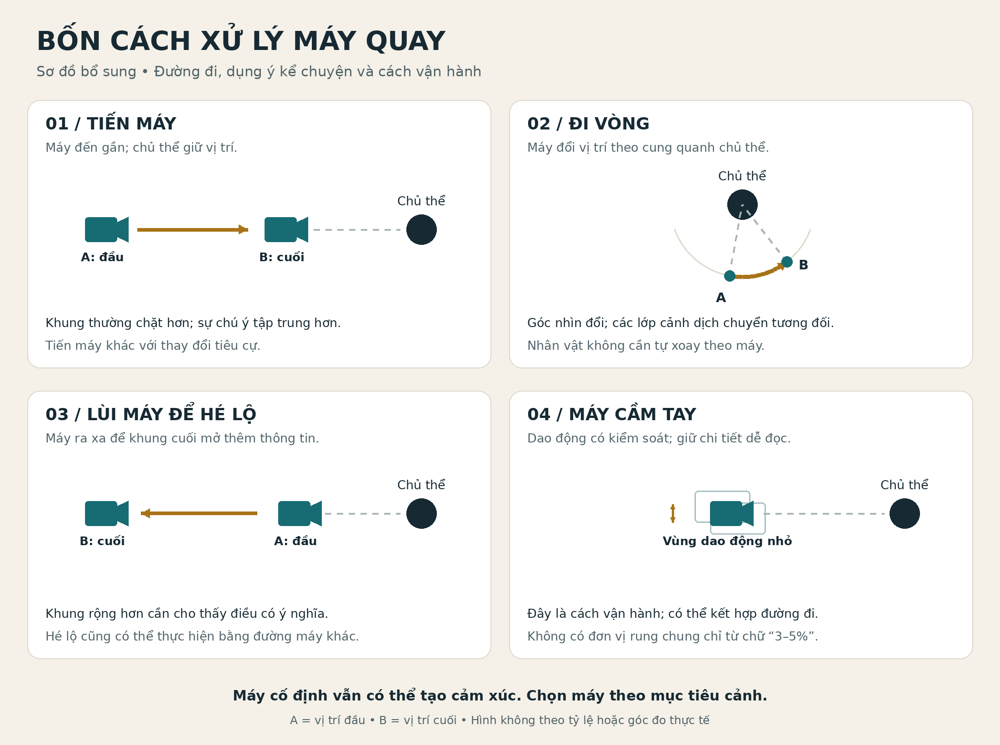

# Kiến thức điện ảnh ứng dụng vào video AI

Kho học tập tiếng Việt được biên soạn từ bộ ảnh trong thư mục Google Drive **Bí ẩn đạo diễn**. Mỗi bài giữ ảnh nguồn, bản đọc ảnh, phần phân tích và hướng dẫn thực hành để có thể kiểm tra lại kiến thức.

## Danh mục và thứ tự xử lý

**33 bài / 444 ảnh.** Đã gắn số 001–033 lên thư mục Drive. Bài 001 đã hoàn thành; còn 32 bài với 432 ảnh chưa đọc.

- [Danh sách đầy đủ 33 bài và 11 đợt xử lý](DANH-MUC-BAI-HOC.md).
- [Dữ liệu danh mục và trạng thái](DANH-MUC-BAI-HOC.json).
- Tiếp theo: **bài 002–004 / đợt D01**, tổng 35 ảnh. Đây là đề xuất phạm vi, chưa bắt đầu đọc.

## Bắt đầu học

| Bài | Nội dung | Trạng thái |
| --- | --- | --- |
| [001 — Bốn cấu trúc camera thiết yếu dành cho AI Director](bai-hoc/001-bon-cau-truc-camera/README.md) | Tiến máy, đi vòng quanh chủ thể, mở không gian, máy cầm tay | Đã đọc 12/12 ảnh và biên soạn |

**Đọc bài chính trước**, sau đó mở [bản đọc từng ảnh](bai-hoc/001-bon-cau-truc-camera/doc-anh.md) để đối chiếu và [bài thực hành](bai-hoc/001-bon-cau-truc-camera/thuc-hanh.md) để áp dụng.

## Cách sử dụng kho

- **Nội dung nguồn:** điều trực tiếp đọc được từ ảnh; có mã ảnh để tra lại.
- **Phân tích bổ sung:** giải thích, điều kiện áp dụng và nhận định do người biên soạn bổ sung; được ghi nhãn trong bài.
- **Đối chiếu bên ngoài:** chỉ dùng tài liệu chính thức, đặt liên kết ở phần liên quan.
- **Thực hành:** câu lệnh và bài tập tự biên soạn; chưa được chạy thử trên mô hình video trong đợt nhập này.

Các thuật ngữ tiếng Anh đều đi kèm nghĩa tiếng Việt. Câu lệnh tiếng Anh trích từ ảnh được giữ nguyên để đối chiếu, có bản dịch ngay cạnh.

## Nguồn và phạm vi

- [Thư mục gốc trên Google Drive](https://drive.google.com/drive/folders/1tR-tPhoveADKDuEDkiihlbzp7EoihFDE).
- Đợt đầu: **chỉ xử lý một bài được chỉ định**, không đồng nghĩa đã đọc các bài khác trong thư mục gốc.
- [Tiến độ và nguyên tắc nhập bài](TIEN-DO.md).
- [Dữ liệu nguồn, kích thước và mã kiểm tra tệp](bai-hoc/001-bon-cau-truc-camera/nguon.json).
- [Kiến thức chắt lọc có cấu trúc](bai-hoc/001-bon-cau-truc-camera/kien-thuc.json), dùng để tra cứu lại khi viết cảnh và câu lệnh.

Ngày biên soạn: **17/10/2026**, múi giờ Việt Nam. Dấu tên đọc được trên ảnh nguồn: **Vienhn**; đây là thông tin hiển thị trong ảnh, chưa phải xác minh tác giả hay nơi phát hành ban đầu. Ảnh nguồn được giữ nguyên dấu tên và nội dung.
