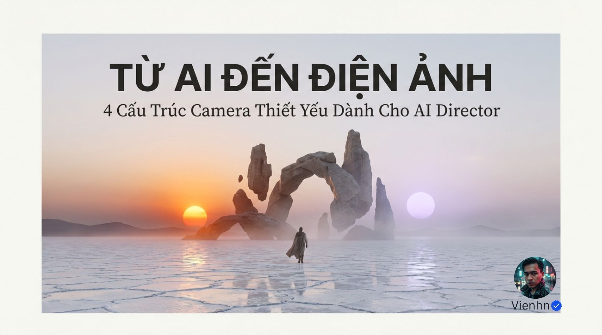
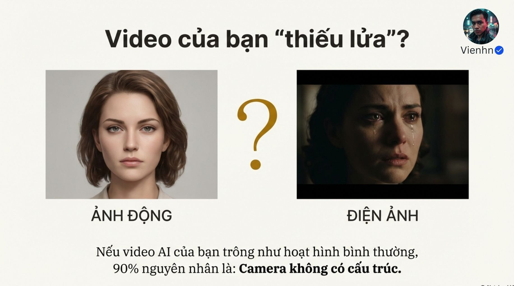
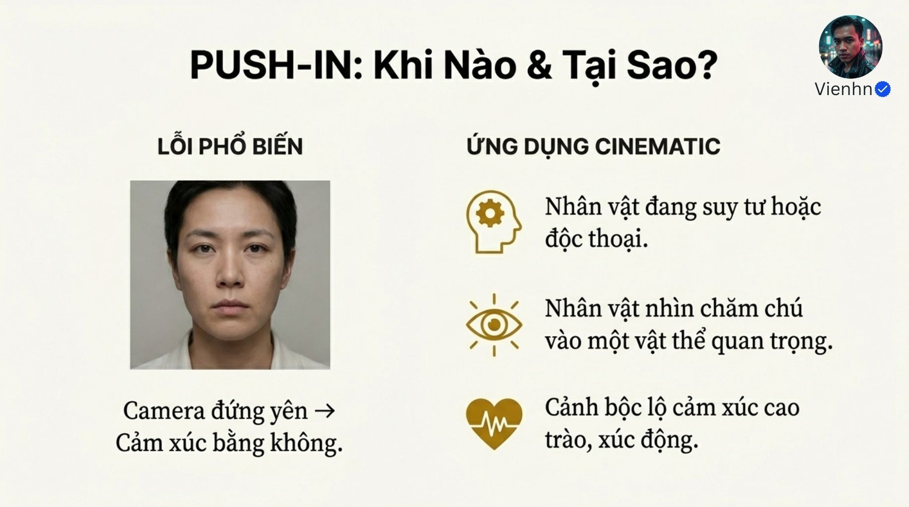
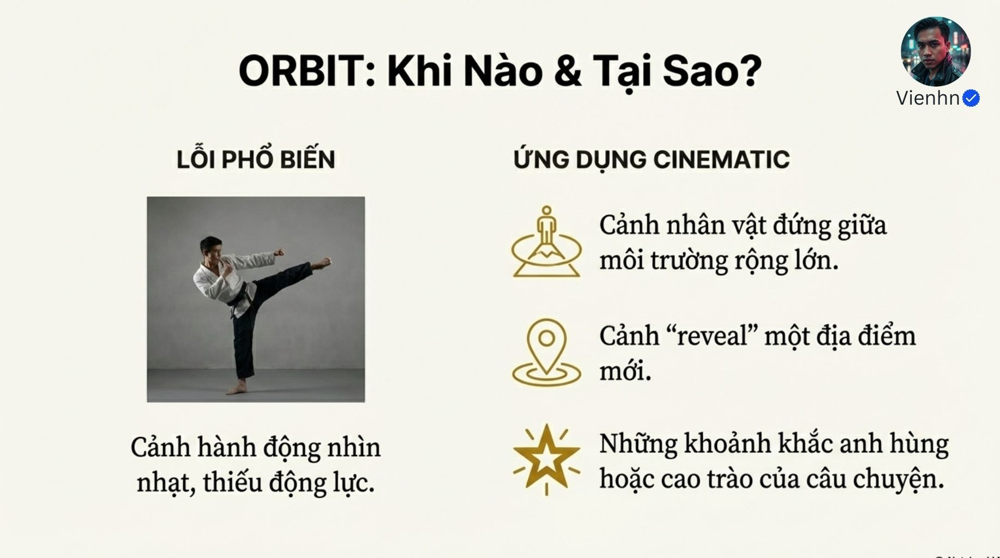
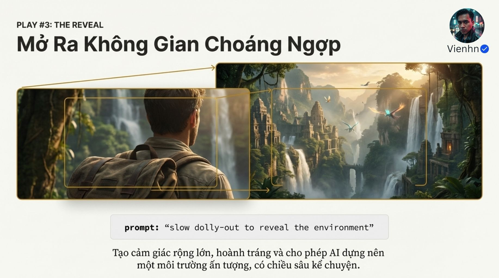
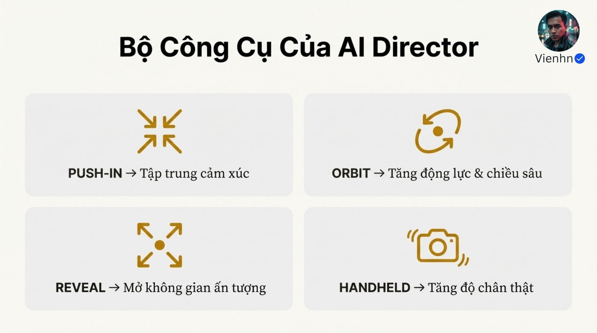

# Bản đọc và đối chiếu đủ 12 ảnh

Tài liệu này ghi lại chữ chính và nội dung minh họa nhìn thấy trong từng ảnh. Dòng giải nghĩa hoặc nhận xét bổ sung được tách riêng. Dấu xuống dòng, kiểu chữ và một số dấu ngoặc được chuẩn hóa để dễ đọc; không tự sửa ý nghĩa.

**Thứ tự:** bìa → 01 → 02 → … → 10 → `011.jpg`. Tên gốc cuối cùng có ba chữ số nhưng được xếp ở vị trí 11. Ảnh bìa không có số trong tên gốc. Toàn bộ ảnh được mở trực tiếp ở độ phân giải gốc 1834 × 1024.

[Về bài chính](README.md) · [Thực hành](thuc-hanh.md) · [Danh mục tệp, mã kiểm tra và liên kết Drive](nguon.json)

## B001-00 — Bìa

Tên gốc: `4 Cấu Trúc Camera Thiết Yếu Dành Cho AI Director.jpg` — tên hiển thị đã chuẩn hóa dấu Unicode cho dễ đọc; chuỗi tên gốc được giữ trong dữ liệu nguồn.

**Chữ đọc được:**

> TỪ AI ĐẾN ĐIỆN ẢNH
>
> 4 Cấu Trúc Camera Thiết Yếu Dành Cho AI Director

**Quan sát hình:** một nhân vật nhỏ giữa không gian sáng tạo giả tưởng, mặt đất phản chiếu, các khối đá và hai nguồn sáng dạng mặt trời. Dấu tên hiển thị: Vienhn.

**Vai trò bài học:** giới thiệu chủ đề. Hình bìa không phải bằng chứng về một chuyển động máy cụ thể.

## B001-01 — Vấn đề được bài học đặt ra

Tên gốc: `01.jpg`.

**Chữ đọc được:**

> Video của bạn “thiếu lửa”?
>
> ẢNH ĐỘNG — ĐIỆN ẢNH
>
> Nếu video AI của bạn trông như hoạt hình bình thường, 90% nguyên nhân là: Camera không có cấu trúc.

**Quan sát hình:** bên trái là chân dung sáng đều, biểu cảm tương đối trung tính; bên phải là khung gương mặt có nước mắt, ánh sáng tối và tương phản hơn.

**Nhận xét bổ sung:** hai hình còn khác nhau về ánh sáng, diễn xuất và cách đóng khung. Chỉ cặp ảnh tĩnh này không tách được tác động riêng của chuyển động máy. Con số 90% không đi kèm dữ liệu hoặc phương pháp đo trong bộ ảnh.

## B001-02 — Trách nhiệm của người đạo diễn

Tên gốc: `02.jpg`.

**Chữ đọc được:**

> AI không phải đạo diễn. BẠN LÀ ĐẠO DIỄN.
>
> Veo 3.1 hay bất kỳ AI nào cũng cần mệnh lệnh.
>
> Hãy trao cho nó ngôn ngữ của điện ảnh.

**Quan sát hình:** bàn tay phía trên một bề mặt kỹ thuật số phát sáng.

**Ý nghĩa nguồn:** người làm video cần chủ động truyền đạt lựa chọn điện ảnh.

**Nhận xét bổ sung:** giữ đây là định hướng sáng tạo của bài, không suy ra rằng một câu lệnh có thể bảo đảm mọi AI thực hiện chính xác ý đồ.

## B001-03 — Kỹ thuật 1: tiến máy

Tên gốc: `03.jpg`.

**Chữ đọc được:**

> PLAY #1: THE PUSH-IN
>
> Tập Trung Cảm Xúc

Câu lệnh gốc: `slow push-in toward the character`.

> Kéo khán giả vào nội tâm nhân vật, nhấn mạnh tâm trạng và khoảnh khắc quyết định.

**Giải nghĩa:** push-in là tiến máy về phía chủ thể; câu lệnh nghĩa là máy từ từ tiến về phía nhân vật.

**Quan sát hình:** cận mặt một phụ nữ; các mũi tên hội tụ về vùng mắt. Mũi tên minh họa sự chú ý, không phải toàn bộ đường máy được đo.

## B001-04 — Khi nào dùng tiến máy?

Tên gốc: `04.jpg`.

**Chữ đọc được:**

> PUSH-IN: Khi Nào & Tại Sao?
>
> LỖI PHỔ BIẾN
>
> Camera đứng yên → Cảm xúc bằng không.
>
> ỨNG DỤNG CINEMATIC
>
> Nhân vật đang suy tư hoặc độc thoại.
>
> Nhân vật nhìn chăm chú vào một vật thể quan trọng.
>
> Cảnh bộc lộ cảm xúc cao trào, xúc động.

**Giải nghĩa:** cinematic được dùng theo nghĩa mang cách thể hiện điện ảnh.

**Nhận xét bổ sung:** nhận định về máy đứng yên là tuyệt đối hóa; bài chính có chú giải N02. Một ảnh chân dung trung tính không đủ chứng minh mọi cảnh máy cố định đều thiếu cảm xúc.

## B001-05 — Kỹ thuật 2: đi máy vòng quanh chủ thể

Tên gốc: `05.jpg`.

**Chữ đọc được:**

> PLAY #2: THE ORBIT
>
> Kiến Tạo Chiều Sâu & Uy Lực

Câu lệnh gốc: `smooth 30-degree orbit around the character`.

> Tạo chiều sâu và hiệu ứng chuyển động mạnh mẽ, mang lại cảm giác sía ‘hero shot’ như phim Hollywood.

**Ghi chú độ rõ:** cụm **“cảm giác sía”** xuất hiện bất thường ngay trong ảnh gốc. Đã phóng vùng chữ để kiểm tra; giữ lại cách hiển thị đó, không tự đoán từ tác giả muốn viết. Ý chung xung quanh là hướng tới một cảnh tôn chủ thể; không dùng riêng cụm bất thường này làm kiến thức.

**Giải nghĩa:** orbit là đi máy quanh chủ thể theo cung; hero shot là cảnh tôn vai trò hoặc vẻ nổi bật của chủ thể. Câu lệnh yêu cầu một cung êm ba mươi độ.

**Quan sát hình:** một chiến binh trên mỏm đá, khung nhìn có vẻ thấp; đường vòng và mốc 30° minh họa hướng di chuyển. Hình không đo được độ cao, tiêu cự, tốc độ hay góc thật của một video.

## B001-06 — Khi nào dùng đi vòng?

Tên gốc: `06.jpg`.

**Chữ đọc được:**

> ORBIT: Khi Nào & Tại Sao?
>
> LỖI PHỔ BIẾN
>
> Cảnh hành động nhìn nhạt, thiếu động lực.
>
> ỨNG DỤNG CINEMATIC
>
> Cảnh nhân vật đứng giữa môi trường rộng lớn.
>
> Cảnh “reveal” một địa điểm mới.
>
> Những khoảnh khắc anh hùng hoặc cao trào của câu chuyện.

**Giải nghĩa:** reveal là hé lộ thông tin hoặc không gian.

**Quan sát hình:** bên trái là nhân vật đang đá chân; bên phải là danh sách ứng dụng kèm biểu tượng.

**Nhận xét bổ sung:** một ảnh hành động tĩnh không chứng minh chuyển động máy là nguyên nhân khiến cảnh hay hoặc nhạt. Các mục ứng dụng là gợi ý lựa chọn, không phải điều kiện bắt buộc.

## B001-07 — Kỹ thuật 3: hé lộ không gian

Tên gốc: `07.jpg`.

**Chữ đọc được:**

> PLAY #3: THE REVEAL
>
> Mở Ra Không Gian Choáng Ngợp

Câu lệnh gốc: `slow dolly-out to reveal the environment`.

> Tạo cảm giác rộng lớn, hoành tráng và cho phép AI dựng nên một môi trường ấn tượng, có chiều sâu kể chuyện.

**Giải nghĩa:** dolly-out là lùi máy; câu lệnh nghĩa là máy từ từ lùi để hé lộ môi trường.

**Quan sát hình:** một khung nhìn từ sau vai nhân vật ghép với một khung cảnh quan giả tưởng rộng hơn; có mũi tên và khung vàng chỉ sự mở rộng.

**Giới hạn chứng cứ:** đây là minh họa ghép, chưa phải video chứng minh một cú lùi liên tục. Không suy diễn tốc độ, chiều dài hành trình hoặc sự liền mạch từ hình này.

## B001-08 — Khi nào dùng hé lộ?

Tên gốc: `08.jpg`.

**Chữ đọc được:**

> REVEAL: Khi Nào & Tại Sao?
>
> LỖI PHỔ BIẾN
>
> Bối cảnh bị phẳng, không gây choáng ngợp.
>
> ỨNG DỤNG CINEMATIC
>
> Cảnh bắt đầu một video hoặc một chương mới.
>
> Dùng làm cảnh chuyển tiếp giữa các phân đoạn.
>
> Tạo ra những cảnh “wow” về không gian và bối cảnh.

**Quan sát hình:** nhân vật trước một lâu đài; không gian phía sau khá mềm nét trong ảnh ví dụ.

**Nhận xét bổ sung:** độ mềm nét và cách dàn cảnh cũng ảnh hưởng khả năng đọc không gian. Không dùng ảnh này để kết luận chỉ cần lùi máy là mọi bối cảnh sẽ có chiều sâu.

## B001-09 — Kỹ thuật 4: máy cầm tay

Tên gốc: `09.jpg`.

**Chữ đọc được:**

> PLAY #4: THE HANDHELD
>
> Gia Tăng Độ Chân Thực

Câu lệnh gốc: `subtle handheld shake 3–5%`.

> Tạo cảm giác như được quay bằng camera thật, giảm cảm giác ‘AI-generated’ và tăng độ chân thực cho cảnh quay.

**Giải nghĩa:** handheld là máy cầm tay; AI-generated nghĩa là do AI tạo ra. Câu lệnh yêu cầu dao động cầm tay nhẹ, kèm một mức phần trăm chưa được nguồn định nghĩa.

**Quan sát hình:** một người chạy trên đường mưa, bảng hiệu và các lớp nền có nhòe. Ảnh tĩnh không đủ phân biệt nhòe do vật chuyển động, máy chuyển động hoặc hiệu ứng tạo ảnh.

**Nhận xét bổ sung:** xem chú giải N05 trong bài chính trước khi dùng mức 3–5%.

## B001-10 — Khi nào dùng máy cầm tay?

Tên gốc: `10.jpg`.

**Chữ đọc được:**

> HANDHELD: Khi Nào & Tại Sao?
>
> LỖI PHỔ BIẾN
>
> Hình quá “sạch” và ổn định, trông giả tạo như CGI.
>
> ỨNG DỤNG CINEMATIC
>
> Cảnh hành động, rượt đuổi, hoặc chạy.
>
> Cảnh đối thoại căng thẳng, cận cảnh.
>
> Video theo phong cách tài liệu (documentary) hoặc sinh tồn (survival).

**Giải nghĩa:** CGI là hình ảnh bằng đồ họa máy tính; documentary là phim tài liệu; survival là sinh tồn.

**Quan sát hình:** một căn bếp sáng, sạch và tương đối ngăn nắp dùng làm ví dụ ở cột lỗi.

**Nhận xét bổ sung:** máy ổn định không tự khiến cảnh giả. Cầm tay cũng không tự khiến nội dung AI trở thành ghi hình tư liệu thật.

## B001-11 — Trang tổng kết

Tên gốc: `011.jpg`; bản lưu: `anh-goc/11.jpg`.

**Chữ đọc được:**

> Bộ Công Cụ Của AI Director
>
> PUSH-IN → Tập trung cảm xúc
>
> ORBIT → Tăng động lực & chiều sâu
>
> REVEAL → Mở không gian ấn tượng
>
> HANDHELD → Tăng độ chân thật

**Giải nghĩa:** người đạo diễn bằng AI có thể thử tiến máy, đi vòng, hé lộ và cầm tay theo mục tiêu cảnh.

**Nhận xét bổ sung:** dùng trang này như bảng gợi nhớ về ý đồ. Đọc kèm điều kiện áp dụng ở bài chính; không xem các mũi tên là lời hứa về hiệu quả tự động.

## Kiểm kê sau khi đọc

| Hạng mục | Kết quả |
| --- | --- |
| Ảnh tìm thấy / đã tải / đã mở | 12 / 12 / 12 |
| Ảnh không mở được | 0 |
| Câu lệnh gốc đã đọc | 4 / 4 |
| Vùng chữ đã phải xem lại | Dòng cuối ảnh 05; đã xem bản phóng vùng chữ |
| Chữ nguồn bất thường được giữ lại | “cảm giác sía” ở ảnh 05 |
| Nội dung chưa có chứng cứ | Tỷ lệ 90%, đơn vị rung 3–5%, hiệu quả chuyển động thực tế từ các ảnh tĩnh |
| Video nguồn | Không có tệp video trong thư mục bài đã liệt kê |

Các hình giữ nguyên nội dung và dấu tên nguồn. Đổi tên bản lưu chỉ nhằm tạo đường dẫn ổn định; [dữ liệu nguồn](nguon.json) lưu tên gốc, mã Drive, kích thước và mã kiểm tra.
