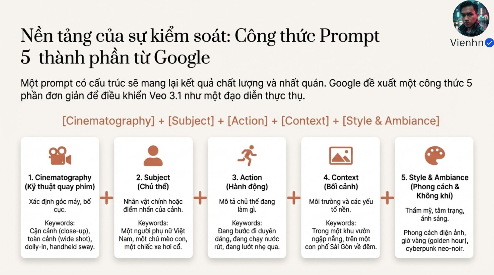
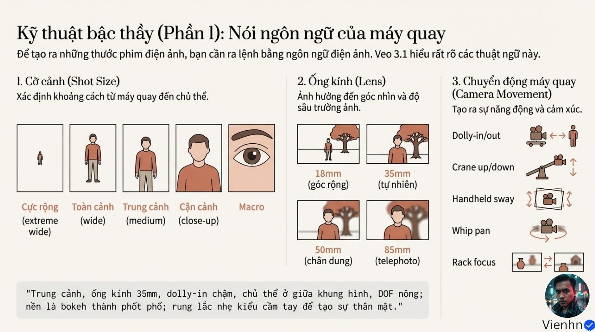
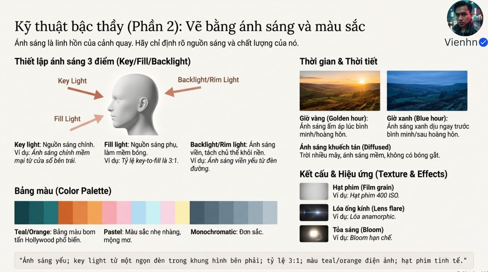

# Bài 002 — Câu lệnh có cấu trúc, ánh sáng và chủ động kể chuyện

Bài kết nối hai lớp: người làm phim chọn câu chuyện và góc nhìn văn hóa; câu lệnh phải biến lựa chọn đó thành chủ thể, hành động, bối cảnh, cách quay và không khí có thể quan sát.

**Nguồn:** ["Đạo Diễn" AI- Phương pháp Tạo Prompt Cấu trúc để Đạt tính Nhất quán Nhân vật và Ánh sáng trong Veo 3.1](https://drive.google.com/drive/folders/1rkAs-29TJoUIuhJpR2dfc7KjYPU6B4qg). Đã đọc **10/10 ảnh**. Ngày biên soạn: 17/10/2026.

[Đọc từng ảnh](doc-anh.md) · [Bài thực hành](thuc-hanh.md) · [Nguồn và mã kiểm tra](nguon.json) · [Danh mục toàn bộ](../../DANH-MUC-BAI-HOC.md)

**Quy ước:** phần “Nguồn” diễn đạt ý trong bộ ảnh. Phần “Phân tích và áp dụng” do người biên soạn bổ sung. Hiệu quả của câu lệnh chưa được kiểm nghiệm bằng lần tạo video trong đợt này.

## Những điều cần học

| Nội dung | Mã ảnh nguồn |
| --- | --- |
| Năm thành phần của một cảnh | B002-04 |
| Tách cỡ cảnh, ống kính và chuyển động | B002-05, B002-07 |
| Khóa hướng sáng trước hiệu ứng | B002-06 |
| Chuyển động có nguyên nhân và phản ứng | B002-07 |
| Giữ quyền chọn cách kể | B002-00, B002-01, B002-02, B002-08, B002-09 |

## 1. Năm thành phần của một cảnh

**Nguồn:** Nguồn dùng công thức kỹ thuật quay, chủ thể, hành động, bối cảnh, phong cách/không khí.

**Phân tích và áp dụng:** Viết mỗi phần như một quyết định có thể kiểm tra. Phong cách điện ảnh không thay được động từ thao tác. Nếu ảnh đã khóa gương mặt và quần áo, ưu tiên mô tả chuyển động cần thêm thay vì tự phát minh ngoại hình mới.

**Ví dụ cho cảnh nông thôn:** Cận tay cô gái kéo một nan tre qua dụng cụ; sân nhà tham chiếu; ánh sáng mềm từ trái; máy cố định. Các phần cùng phục vụ việc đọc thao tác.

**Kiểm tra kết quả:** Người xem chỉ ra được ai, làm gì, ở đâu, được nhìn từ đâu và ánh sáng thế nào.

## 2. Tách cỡ cảnh, ống kính và chuyển động

**Nguồn:** Nguồn liệt kê cỡ cảnh, các tiêu cự và cách di chuyển; đồng thời tách chuyển động người với chuyển động máy.

**Phân tích và áp dụng:** Cỡ cảnh là phần chủ thể chiếm trong khung. Tiêu cự mô tả cách ống kính bao quát; không phải một cỡ cảnh cố định. Đường máy mô tả vị trí điểm nhìn theo thời gian. Chuyển nét là thay mặt phẳng rõ, còn 24fps là số khung hình mỗi giây. Viết riêng để tránh câu lệnh tự mâu thuẫn.

**Ví dụ cho cảnh nông thôn:** Máy ngang mắt giữ cố định; cô gái tự đi ngang qua sân. Không gọi đây là máy bám theo chỉ vì chủ thể chuyển động.

**Kiểm tra kết quả:** Xem vật nền, cỡ người và vùng rõ; xác định cái gì thực sự di chuyển.

## 3. Khóa hướng sáng trước hiệu ứng

**Nguồn:** Sáng chính, bù và viền; thời điểm trong ngày, màu và chất lượng sáng.

**Phân tích và áp dụng:** Đặt nguồn sáng phù hợp bối cảnh trước khi thêm hạt phim hoặc lóe. Khi nối các cảnh, quan hệ mặt sáng–mặt tối và thời tiết cần liên tục. Một tỷ lệ 3:1 viết bằng chữ chưa chứng minh mô hình dựng đúng phép đo đó.

**Ví dụ cho cảnh nông thôn:** Ánh sáng trời khuếch tán từ cửa bên trái chiếu vào tay và bàn; vùng dưới hiên tối hơn nhẹ; giữ cùng hướng qua ba cảnh.

**Kiểm tra kết quả:** Mặt, tay và vật thể có cùng logic sáng; màu áo không đổi vì yêu cầu màu thiếu rõ ràng.

## 4. Chuyển động có nguyên nhân và phản ứng

**Nguồn:** Chuyển động chính/phụ, quan hệ máy–người và môi trường.

**Phân tích và áp dụng:** Mô tả hành động chính bằng chuỗi ngắn: tay nắm, dụng cụ đi theo hướng nào, vật biến đổi ra sao. Chuyển động phụ chỉ được thêm nếu không che thao tác. Chọn một hành động quan trọng thay vì dồn nhiều việc trong một đoạn ngắn.

**Ví dụ cho cảnh nông thôn:** Tay trái giữ nan; tay phải kéo dụng cụ dọc mép; phần mỏng tách ra; thân nan vẫn liên tục. Tóc chỉ lay nhẹ nếu có gió hợp lý.

**Kiểm tra kết quả:** Dụng cụ tiếp xúc đúng chỗ, không xuyên tay; vật liệu thay đổi theo lực nhìn thấy.

## 5. Giữ quyền chọn cách kể

**Nguồn:** Nguồn cảnh báo sự lặp cổ mẫu và nêu các ví dụ có chất liệu Việt.

**Phân tích và áp dụng:** Dùng AI đề xuất nhưng tự quyết định điều cảnh cần nói. Việc thêm một biểu tượng địa phương chưa đủ tạo bản sắc nếu quan hệ nhân vật, lối sống và thao tác đều chung chung. Các cách kể văn hóa có nhiều biến thể, không chia cố định thành hai khối đối lập.

**Ví dụ cho cảnh nông thôn:** Một người sửa chiếc rổ cho bà có thể kết bằng hành động trao lại chiếc rổ; không cần tự thêm tai nạn hay giải cứu để có cao trào.

**Kiểm tra kết quả:** Bỏ tên địa danh đi, cảnh có còn chi tiết sống cụ thể không? Các chi tiết văn hóa đã được kiểm tra chưa?

## Điểm cần hiểu có điều kiện

- Thông số 60 giây và đồng bộ khoảng 10ms trong ảnh không được coi là cam kết hiện tại. Nguồn model Google được đối chiếu ngày 17/10/2026; phân biệt sinh đoạn gốc với nối dài.
- Tên thư mục nói nhất quán nhưng bộ ảnh còn bàn nhiều về văn hóa; không lược bỏ phần này khi tổng kết.
- Ví dụ Reddit, Mesh.vn và dẫn lời Sydney trong ảnh chưa kèm bằng chứng đầu ra hoặc liên kết gốc đủ để xác minh toàn bộ.
- Không đồng nhất macro với đặc tả, chuyển nét với đường máy hoặc 24fps với tốc độ chủ thể.

## Cách đưa vào quy trình sản xuất

Chốt ý đồ văn hóa và hành động → chọn ảnh tham chiếu đã duyệt → viết năm thành phần → rà tính liên tục mặt/trang phục/hướng sáng → tạo thử từng cảnh khi có công cụ → chấm toàn chuyển động và ghi mốc lỗi. Bài này chưa có lần tạo thử.

## Tự kiểm tra kiến thức

- Có thể quay trung cảnh bằng nhiều tiêu cự không? Vì sao cần nêu thêm bố cục?
- Một cảnh gói lá cần chuyển động phụ nào và điều gì nên giữ cố định?
- Chi tiết nào giúp cảnh nông thôn có nội dung riêng thay vì chỉ đổi phong cảnh?

## Nguồn đối chiếu bổ sung

- [Google Cloud — công thức năm thành phần](https://cloud.google.com/blog/products/ai-machine-learning/ultimate-prompting-guide-for-veo-3-1/): Đối chiếu cấu trúc câu lệnh; không xem đó là bảo đảm kết quả.
- [Google — Veo 3.1 model](https://docs.cloud.google.com/gemini-enterprise-agent-platform/models/veo/3-1-generate?hl=en): Phân biệt thời lượng đoạn được model liệt kê với tuyên bố 60 giây trong ảnh.
- [UiB — AI Stories](https://www4.uib.no/en/research/research-projects/ai-stories): Xác nhận dự án nghiên cứu về cổ mẫu và tính đa dạng văn hóa, không khái quát kết quả cho mọi AI.

**Giới hạn:** đây là tài liệu học từ ảnh. Không dùng một hình minh họa để xác nhận chuyển động, thời lượng, độ chính xác thao tác hay khả năng hiện tại của một sản phẩm. Những phần chưa kiểm chứng được ghi rõ trong bản đọc ảnh.
