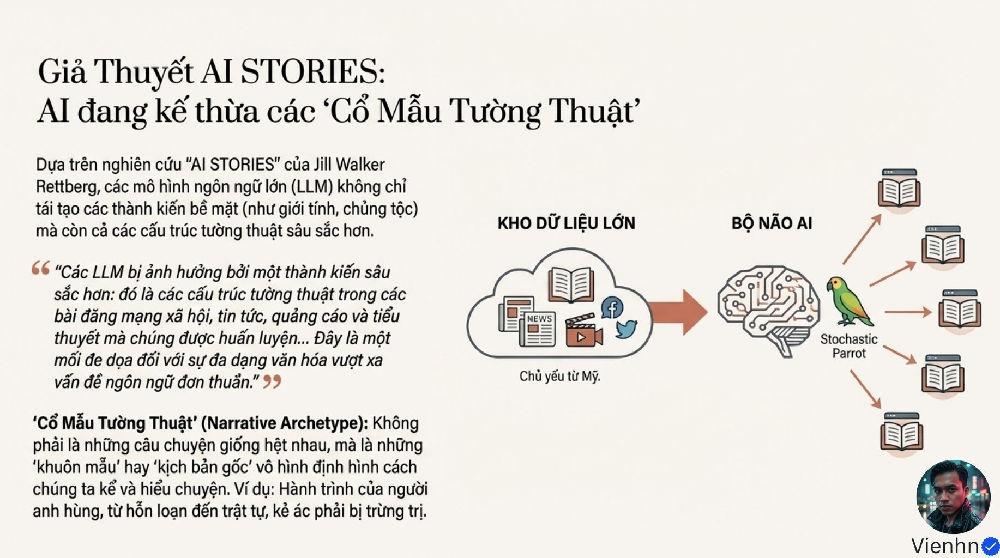
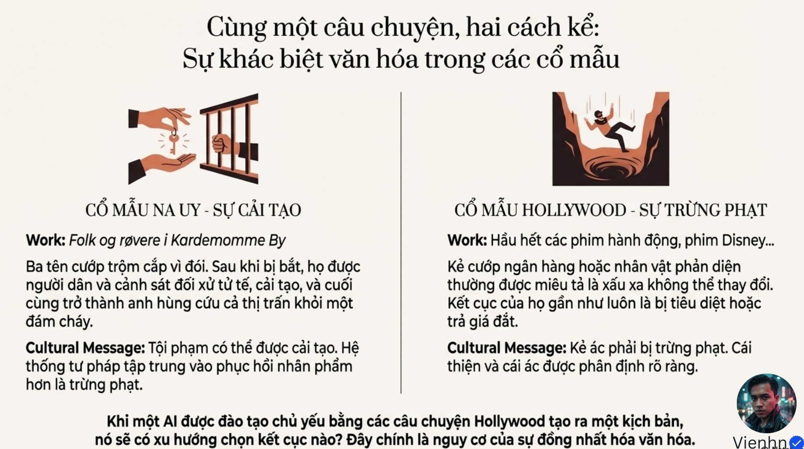
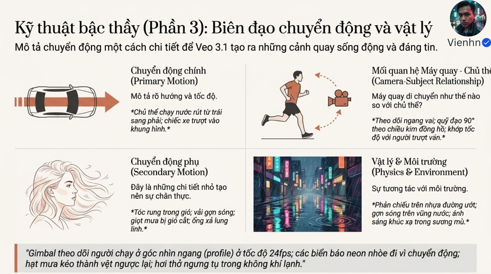
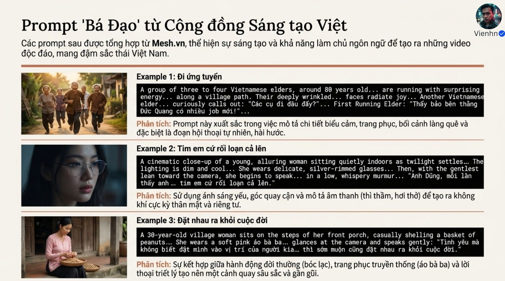
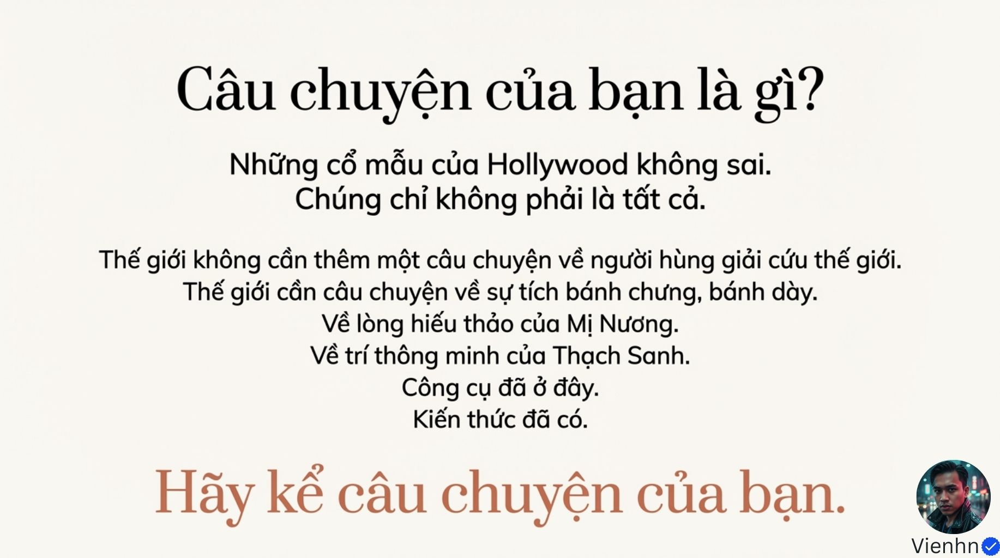

# B002 — Bản đọc toàn bộ 10 ảnh

Nguồn: ["Đạo Diễn" AI- Phương pháp Tạo Prompt Cấu trúc để Đạt tính Nhất quán Nhân vật và Ánh sáng trong Veo 3.1](https://drive.google.com/drive/folders/1rkAs-29TJoUIuhJpR2dfc7KjYPU6B4qg).

**Cách ghi:** nội dung chính được diễn đạt lại từ chữ và hình trong ảnh; không phải bản chép nguyên văn toàn bộ. Quan sát ảnh tĩnh được tách khỏi lời giải thích bổ sung. Ảnh gốc được giữ nguyên để đối chiếu.

[Bài chính](README.md) · [Thực hành](thuc-hanh.md) · [Dữ liệu nguồn](nguon.json)

## B002-00 — Dẫn nhập Sydney và thiên lệch kể chuyện

Tên gốc: `"Đạo Diễn" AI- Phương pháp Tạo Prompt Cấu trúc để Đạt tính Nhất quán Nhân vật và Ánh sáng trong Veo 3.1.jpg`.

**Nội dung chính đọc được:** Nguồn dẫn lời Sydney và gắn mốc tháng 1/2023, rồi đặt vấn đề AI học chuyện từ dữ liệu con người và nguy cơ mất tiếng nói văn hóa.

**Hình minh họa:** Chữ lớn trên nền sóng âm và mạng liên kết.

**Phân tích bổ sung:** Đây là trích dẫn được nguồn kể lại; mốc và xuất xứ chưa được xác nhận từ chính ảnh.

## B002-01 — Giả thuyết AI STORIES

Tên gốc: `01.jpg`.

**Nội dung chính đọc được:** Nguồn gắn tên Jill Walker Rettberg với giả thuyết mô hình kế thừa cổ mẫu tường thuật, không chỉ thiên lệch giới hoặc chủng tộc; nêu hành trình anh hùng và trật tự–hỗn loạn.

**Hình minh họa:** Sơ đồ kho dữ liệu, biểu tượng bộ não, vẹt và các cuốn sách.

**Phân tích bổ sung:** Dự án có thật theo UiB; không biến giả thuyết nghiên cứu thành kết luận đúng cho mọi mô hình.

## B002-02 — Cải tạo và trừng phạt

Tên gốc: `02.jpg`.

**Nội dung chính đọc được:** Nguồn đối chiếu chuyện Na Uy Folk og røvere i Kardemomme By, nơi người phạm lỗi được cải tạo, với kết cục trừng phạt trong ví dụ Hollywood.

**Hình minh họa:** Hai cột có chìa khóa, song sắt và người rơi xuống vực.

**Phân tích bổ sung:** Đây là ví dụ đối chiếu; không khái quát mọi phim hoặc mọi người thuộc hai nền văn hóa.

## B002-03 — Giới thiệu Veo 3.1

Tên gốc: `03.jpg`.

**Nội dung chính đọc được:** Ảnh nêu tháng 10/2025, 1080p, tới 60 giây có mở rộng, âm thanh đồng bộ khoảng 10ms, nhất quán và hai tỷ lệ khung; có ý kiến Reddit so với Sora 2.

**Hình minh họa:** Tay gói thực phẩm bằng lá cùng các biểu tượng thông số.

**Phân tích bổ sung:** Không dùng 60 giây như thời lượng một lần sinh chuẩn; tài liệu Google hiện nêu các độ dài 4/6/8 giây cho các phiên bản được liệt kê. Chưa có bằng chứng ở đây cho độ trễ 10ms hoặc hơn Sora.

## B002-04 — Công thức năm thành phần

Tên gốc: `04.jpg`.

**Nội dung chính đọc được:** Kỹ thuật quay + chủ thể + hành động + bối cảnh + phong cách/không khí. Ví dụ cỡ cảnh, người phụ nữ Việt, bước đi, phố đêm, giờ vàng.

**Hình minh họa:** Năm thẻ nối bằng dấu cộng.

**Phân tích bổ sung:** Công thức này có trong hướng dẫn Google; là khung diễn đạt chứ không bảo đảm đầu ra.

## B002-05 — Ngôn ngữ máy quay

Tên gốc: `05.jpg`.

**Nội dung chính đọc được:** Ảnh trình bày cỡ cảnh từ cực rộng tới cận, nhãn macro; ống kính 18/35/50/85mm; tiến/lùi, cần máy, cầm tay, lia nhanh và chuyển nét.

**Hình minh họa:** Các khung người, cây và sơ đồ máy.

**Phân tích bổ sung:** Cỡ cảnh không chỉ do khoảng cách; còn phụ thuộc tiêu cự và khung. Macro không đồng nghĩa mọi đặc tả. Chuyển nét không phải đường đi máy.

## B002-06 — Ánh sáng và màu

Tên gốc: `06.jpg`.

**Nội dung chính đọc được:** Nguồn giới thiệu sáng chính, sáng bù, viền; ví dụ tỷ lệ 3:1; bảng xanh ngọc/cam, pastel, đơn sắc; giờ vàng, giờ xanh, khuếch tán; hạt phim, lóe và tỏa sáng.

**Hình minh họa:** Đầu người với mũi tên và các bảng màu.

**Phân tích bổ sung:** Tỷ lệ và nhãn màu là ý đồ tham khảo; cần kiểm tra hướng sáng thực tế, không mặc định mọi cảnh cần đủ ba đèn.

## B002-07 — Biên đạo và vật lý

Tên gốc: `07.jpg`.

**Nội dung chính đọc được:** Tách chuyển động chính, chuyển động phụ, quan hệ máy–chủ thể và tương tác môi trường; ví dụ chạy trái–phải, tóc/vải, phản chiếu và gợn nước.

**Hình minh họa:** Xe, người chạy, tóc và phố ướt.

**Phân tích bổ sung:** 24fps là tốc độ khung hình, không phải tốc độ chạy của người. Phải tách hướng, nhịp chủ thể và đường máy.

## B002-08 — Ví dụ từ cộng đồng Việt

Tên gốc: `08.jpg`.

**Nội dung chính đọc được:** Nguồn ghi Mesh.vn và ba ví dụ: người cao tuổi chạy đi ứng tuyển; cô gái kính bạc nói nhỏ trong ánh sáng mát; người phụ nữ áo bà ba hồng bóc lạc ở hiên và nói về tình yêu.

**Hình minh họa:** Ba cặp ảnh và câu lệnh tiếng Anh có lời thoại Việt.

**Phân tích bổ sung:** Chỉ xác nhận các ví dụ hiện diện trong ảnh, chưa xác minh xuất xứ, video đầu ra hay kết luận chúng xuất sắc.

## B002-09 — Kể câu chuyện của mình

Tên gốc: `09.jpg`.

**Nội dung chính đọc được:** Trang kết khuyến khích kể chuyện riêng và văn hóa Việt; nhắc bánh chưng/bánh dày, Mị Nương, Thạch Sanh.

**Hình minh họa:** Trang chữ kết luận.

**Phân tích bổ sung:** Kiểm tra chi tiết truyện dân gian riêng trước khi dựng; không coi mô tả gắn nhân vật ở đây là dữ kiện văn hóa đã xác minh.

## Kiểm kê

Đã mở trực tiếp 10/10 ảnh. Các mã nguồn theo thứ tự ở trên khớp [danh mục tệp](nguon.json). Chưa sinh hoặc đánh giá video từ câu lệnh của bài này.
