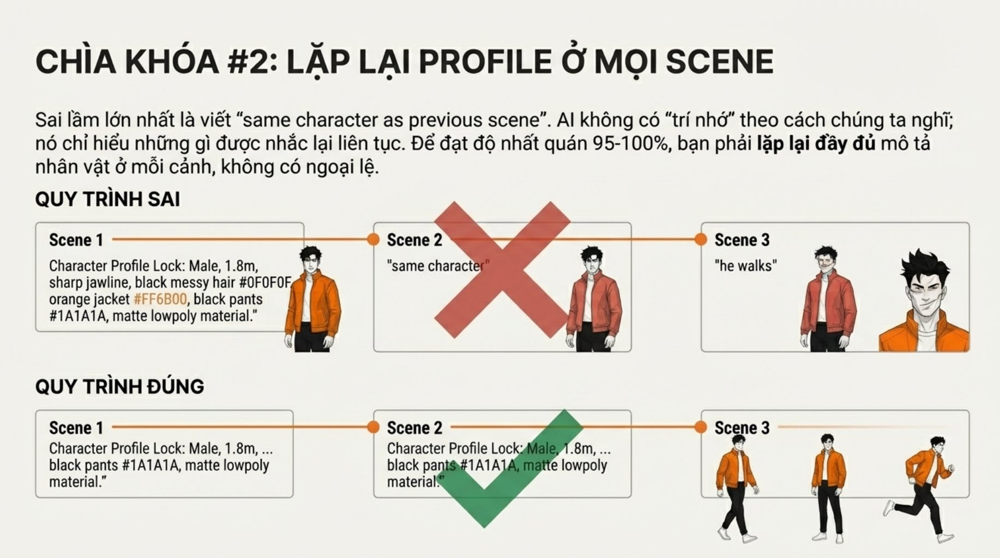
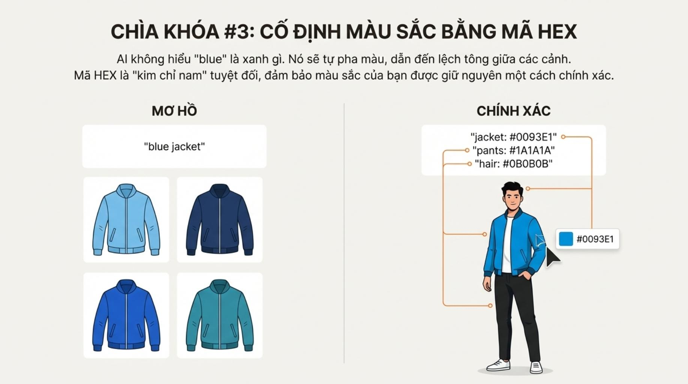
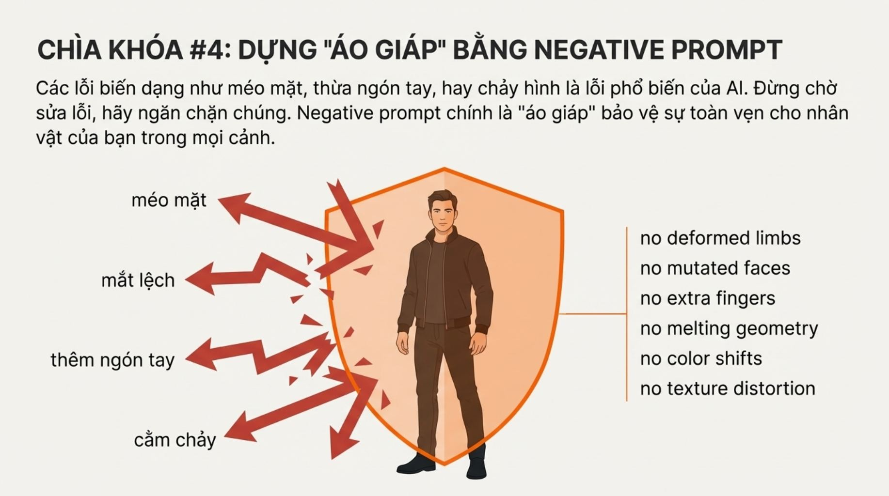

# Bài 003 — Giữ nhất quán thiết kế nhân vật qua năm lớp kiểm soát

Bộ ảnh đề xuất hồ sơ nhân vật, lặp mô tả, bảng màu, nội dung loại trừ và phong cách ổn định để giảm đổi người, đổi áo hoặc biến dạng. Bài học chuyển các mẹo này thành quy trình đối chiếu có thể kiểm tra; không coi chữ “khóa” là bảo đảm kết quả.

**Nguồn:** [3 "Ác Mộng" Của Creator AI Video Đều Bị Đánh Bại- 5 Kỹ Thuật Khóa Thiết Kế Nhân Vật Hoàn Hảo (Áp dụng cho Google Veo 3.1)](https://drive.google.com/drive/folders/1Xwl5Utm-Htki_HXiVIEVB1OBuWASKKf_). Đã đọc **10/10 ảnh**. Ngày biên soạn: 17/10/2026.

[Đọc từng ảnh](doc-anh.md) · [Bài thực hành](thuc-hanh.md) · [Nguồn và mã kiểm tra](nguon.json) · [Danh mục toàn bộ](../../DANH-MUC-BAI-HOC.md)

**Quy ước:** phần “Nguồn” diễn đạt ý trong bộ ảnh. Phần “Phân tích và áp dụng” do người biên soạn bổ sung. Hiệu quả của câu lệnh chưa được kiểm nghiệm bằng lần tạo video trong đợt này.

## Những điều cần học

| Nội dung | Mã ảnh nguồn |
| --- | --- |
| Lập hồ sơ bất biến trước khi viết cảnh | B003-01, B003-03 |
| Mỗi cảnh có đầu vào đủ rõ | B003-04 |
| Bảng màu là mục tiêu đối chiếu | B003-05 |
| Nội dung loại trừ và kiểm lỗi hình thể | B003-06 |
| Giữ hệ tạo hình và đo tính liên tục | B003-07, B003-08, B003-09 |

## 1. Lập hồ sơ bất biến trước khi viết cảnh

**Nguồn:** Nguồn đề xuất ghi hình thể, khuôn mặt, tóc, trang phục, chất liệu ngay từ cảnh đầu.

**Phân tích và áp dụng:** Tạo một khối mô tả ổn định và một khối hành động thay đổi. Chỉ chọn đặc điểm quan trọng, nhìn thấy được. Thêm ảnh chuẩn chính diện, góc ba phần tư và toàn thân nếu chế độ sử dụng hỗ trợ ảnh tham chiếu.

**Ví dụ cho cảnh nông thôn:** Lan, nữ 30 tuổi, tóc đen búi thấp, áo bà ba nâu vải thô, quần đen, không trang sức; ảnh chuẩn dưới ánh sáng trung tính.

**Kiểm tra kết quả:** So mặt, đường tóc, dáng người, cổ áo và vật liệu với ảnh chuẩn; không chỉ kiểm màu áo.

## 2. Mỗi cảnh có đầu vào đủ rõ

**Nguồn:** Lặp lại đầy đủ hồ sơ thay cho việc trông cậy vào câu cùng người như trước.

**Phân tích và áp dụng:** Với yêu cầu sinh độc lập, chép nguyên khối mô tả giúp tránh vô tình đổi đặc điểm. Nếu dùng ảnh đầu vào, ưu tiên giữ nội dung ảnh và mô tả chuyển động thay vì thêm chi tiết mâu thuẫn. Ghi phiên bản hồ sơ để truy lỗi.

**Ví dụ cho cảnh nông thôn:** Cảnh ở sân và cảnh trong bếp cùng dùng hồ sơ Lan v1; chỉ thay địa điểm, động tác và vị trí camera.

**Kiểm tra kết quả:** Đối chiếu các trường hồ sơ giữa hai prompt trước khi chạy; xem lại khung đầu, giữa, cuối sau khi chạy.

## 3. Bảng màu là mục tiêu đối chiếu

**Nguồn:** Nguồn dùng HEX để cụ thể hóa các tên màu mơ hồ.

**Phân tích và áp dụng:** Ghép tên màu dễ hiểu, ô màu tham chiếu và HEX. Phân biệt màu vật liệu gốc với màu quan sát dưới ánh sáng. Cảnh đèn vàng có thể làm áo nâu ấm hơn mà vẫn đúng tính liên tục.

**Ví dụ cho cảnh nông thôn:** Áo nâu đất mục tiêu #6B4938; giữ cùng loại vải. Cảnh sân sáng dịu và bếp ấm cần thay đổi ánh sáng có lý do.

**Kiểm tra kết quả:** Kiểm tương quan màu với da và đồ vật trung tính; không đòi từng pixel trùng HEX ở mọi vùng sáng tối.

## 4. Nội dung loại trừ và kiểm lỗi hình thể

**Nguồn:** Dùng negative prompt để giảm các lỗi hình thể, màu và chất liệu.

**Phân tích và áp dụng:** Khi có trường negative riêng, liệt kê lỗi cần tránh phù hợp cú máy: thừa ngón, mặt méo, đổi áo. Không mặc định một danh sách dài sẽ chữa mọi lỗi. Đồng thời mô tả tích cực động tác tay đơn giản, dễ đọc.

**Ví dụ cho cảnh nông thôn:** Lan nhấc một rổ rau bằng hai tay; trường loại trừ ghi thừa ngón, ngón dính, rổ biến dạng, thay trang phục.

**Kiểm tra kết quả:** Xem từng giai đoạn cầm–nhấc–đặt, kiểm ngón tay, tiếp xúc và hình dạng rổ; tạo lại nếu lỗi.

## 5. Giữ hệ tạo hình và đo tính liên tục

**Nguồn:** Chọn phong cách nhất quán và dùng checklist năm lớp.

**Phân tích và áp dụng:** Cố định tỷ lệ cơ thể, nét vẽ hoặc vật liệu, cách chiếu sáng và mức cách điệu. Ghi từng lỗi theo cảnh thay vì báo phần trăm không định nghĩa. Một video đẹp vẫn có thể sai danh tính.

**Ví dụ cho cảnh nông thôn:** Toàn phim dùng hiện thực tự nhiên, vải thô và ánh sáng mềm; không để một cảnh chuyển thành nhân vật đồ chơi.

**Kiểm tra kết quả:** Lập bảng từng cảnh với mặt, tóc, áo, hình thể, chất liệu và đạo cụ; đánh dấu đạt/chưa đạt và mốc giây.

## Điểm cần hiểu có điều kiện

- Các tỷ lệ 95–99% và 95–100% trong ảnh không kèm cách đo, tập mẫu hay kết quả thử; không được dùng làm bảo đảm.
- HEX trong câu lệnh không bảo đảm màu pixel chính xác; hình minh họa không chứng minh khóa màu.
- Hồ sơ văn bản không phải cơ chế khóa danh tính hoặc bộ nhớ xuyên mọi lần sinh. Ảnh tham chiếu có thể hỗ trợ tùy mô hình và chế độ.
- Nguồn viết no trong negative prompt. Hướng dẫn Google được đối chiếu khuyên trường loại trừ liệt kê yếu tố không mong muốn, tránh no/don't.
- Ảnh B003-08 đảo tên nhãn màu và khiên ở bước 3–4. Tài liệu dùng thứ tự theo nội dung.
- Nguồn không cung cấp video hoặc thông số thử đủ để kiểm tra 15 cảnh tiếp theo.

## Cách đưa vào quy trình sản xuất

Chốt hồ sơ và ảnh chuẩn → viết danh sách cảnh → giữ khối nhân vật cố định → thay một nhóm biến mỗi lần → sinh thử ngắn → kiểm tra toàn chuyển động và các điểm nối → ghi lỗi, sửa hoặc tạo lại. Lưu prompt, model, ảnh tham chiếu và bản kết quả được duyệt.

## Tự kiểm tra kiến thức

- Hồ sơ nhân vật khác mô tả hành động ở chỗ nào?
- Vì sao áo có thể đổi sắc độ dưới đèn vàng mà không phải đổi màu vật liệu?
- Cần dữ liệu gì trước khi khẳng định độ nhất quán 99%?

## Nguồn đối chiếu bổ sung

- [Google — hướng dẫn prompt video](https://docs.cloud.google.com/gemini-enterprise-agent-platform/models/video/video-gen-prompt-guide): Đối chiếu cách viết trường negative prompt.
- [Google — tạo video với Veo](https://ai.google.dev/gemini-api/docs/veo): Tham khảo đầu vào ảnh nhân vật; cần kiểm tra đúng chế độ đang dùng.

**Giới hạn:** đây là tài liệu học từ ảnh. Không dùng một hình minh họa để xác nhận chuyển động, thời lượng, độ chính xác thao tác hay khả năng hiện tại của một sản phẩm. Những phần chưa kiểm chứng được ghi rõ trong bản đọc ảnh.
