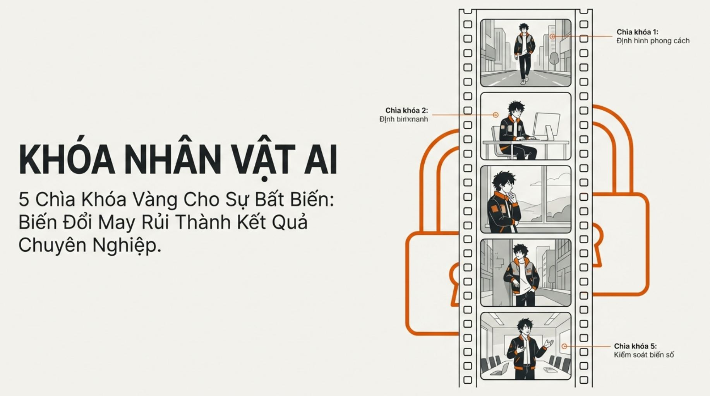
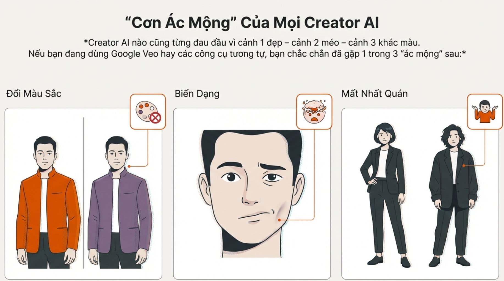
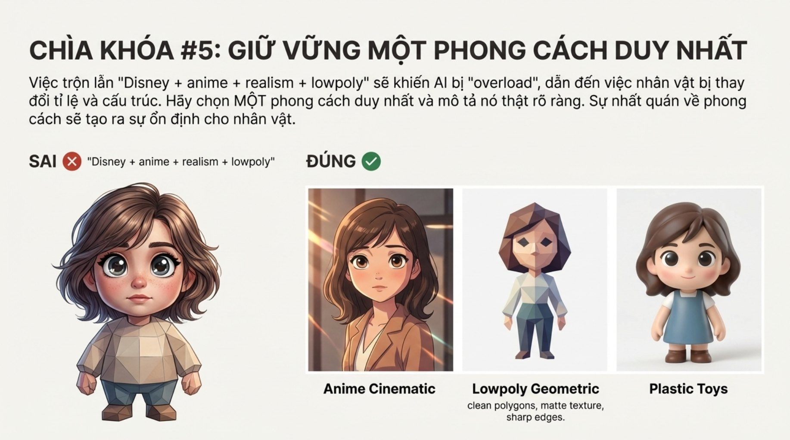
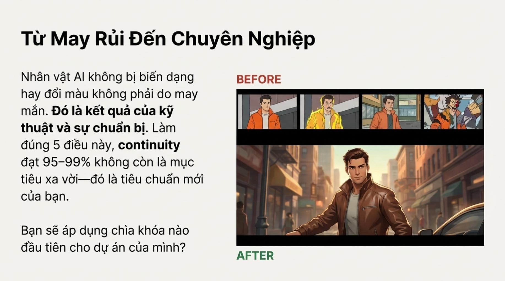

# B003 — Bản đọc toàn bộ 10 ảnh

Nguồn: [3 "Ác Mộng" Của Creator AI Video Đều Bị Đánh Bại- 5 Kỹ Thuật Khóa Thiết Kế Nhân Vật Hoàn Hảo (Áp dụng cho Google Veo 3.1)](https://drive.google.com/drive/folders/1Xwl5Utm-Htki_HXiVIEVB1OBuWASKKf_).

**Cách ghi:** nội dung chính được diễn đạt lại từ chữ và hình trong ảnh; không phải bản chép nguyên văn toàn bộ. Quan sát ảnh tĩnh được tách khỏi lời giải thích bổ sung. Ảnh gốc được giữ nguyên để đối chiếu.

[Bài chính](README.md) · [Thực hành](thuc-hanh.md) · [Dữ liệu nguồn](nguon.json)

## B003-00 — Khóa nhân vật AI

Tên gốc: `3 "Ác Mộng" Của Creator AI Video Đều Bị Đánh Bại- 5 Kỹ Thuật Khóa Thiết Kế Nhân Vật Hoàn Hảo (Áp dụng cho Google Veo 3.1).jpg`.

**Nội dung chính đọc được:** Giới thiệu năm chìa khóa nhằm giảm tính may rủi khi tạo nhiều cảnh.

**Hình minh họa:** Dải phim có nhân vật tóc đen áo cam trong nhiều bối cảnh, nền ổ khóa.

**Phân tích bổ sung:** Hình gợi ý tính liên tục, chưa chứng minh video giữ cùng nhân vật.

## B003-01 — Ba nhóm lỗi

Tên gốc: `01.jpg`.

**Nội dung chính đọc được:** Phân loại đổi màu sắc, biến dạng và mất nhất quán nhân vật.

**Hình minh họa:** Áo cam chuyển tím; khuôn mặt méo; hai người mặc vest có vóc dáng khác.

**Phân tích bổ sung:** Tách ba nhóm để biết cần sửa bảng màu, hình thể hay danh tính.

## B003-02 — Hệ thống năm lớp

Tên gốc: `02.jpg`.

**Nội dung chính đọc được:** Nguồn gọi quy trình là Playbook 5 Lớp Khóa và nêu mức nhất quán 95–99%.

**Hình minh họa:** Ổ khóa cùng biểu tượng thiết kế, huy hiệu, khiên và màu HEX.

**Phân tích bổ sung:** Không có mẫu thử, phép đo hoặc đối chứng cho tỷ lệ này.

## B003-03 — Hồ sơ nhân vật

Tên gốc: `03.jpg`.

**Nội dung chính đọc được:** So sánh mô tả một người mặc áo khoác với hồ sơ nam cao 1,8 m, hàm rõ, tóc đen rối #0F0F0F, áo cam #FF6B00, quần đen #1A1A1A, chất liệu lowpoly mờ.

**Hình minh họa:** Nhân vật nhạt, ít đặc điểm đối chiếu với hình áo cam nhiều chú thích.

**Phân tích bổ sung:** Chi tiết cố định giúp so sánh; chiều cao tuyệt đối khó suy ra nếu thiếu vật chuẩn.

## B003-04 — Lặp lại hồ sơ

Tên gốc: `04.jpg`.

**Nội dung chính đọc được:** Khuyên chép đầy đủ hồ sơ vào mỗi cảnh thay cho câu cùng nhân vật như cảnh trước; nguồn nêu 95–100%.

**Hình minh họa:** Hai chuỗi ba cảnh, một chuỗi bị gạch chéo, chuỗi kia giữ áo cam.

**Phân tích bổ sung:** Đầu vào độc lập cần đủ thông tin; ngữ cảnh và ảnh tham chiếu tùy công cụ. Lặp chữ không tạo bộ nhớ danh tính.

## B003-05 — Bảng màu HEX

Tên gốc: `05.jpg`.

**Nội dung chính đọc được:** Nguồn cho rằng mã HEX giữ màu chính xác; ví dụ áo #0093E1, quần #1A1A1A, tóc #0B0B0B.

**Hình minh họa:** Nhiều áo xanh khác sắc độ đối chiếu một nhân vật và ô màu.

**Phân tích bổ sung:** HEX là quy ước màu mục tiêu; ánh sáng, vật liệu và mô hình vẫn ảnh hưởng kết quả.

## B003-06 — Nội dung loại trừ

Tên gốc: `06.jpg`.

**Nội dung chính đọc được:** Đề xuất ngăn méo chi, mặt biến dạng, thừa ngón, hình thể chảy, đổi màu và méo chất liệu bằng negative prompt.

**Hình minh họa:** Nhân vật sau khiên, mũi tên lỗi bị bật ra.

**Phân tích bổ sung:** Nguồn dùng nhiều câu có no; hướng dẫn Google cho trường negative riêng khuyên liệt kê yếu tố không muốn thấy.

## B003-07 — Phong cách thống nhất

Tên gốc: `07.jpg`.

**Nội dung chính đọc được:** Khuyên chọn một hệ tạo hình thay vì ghép nhiều phong cách thiếu định hướng; ví dụ anime điện ảnh, lowpoly hình học, đồ chơi nhựa.

**Hình minh họa:** Một nhân vật lai nhiều chất liệu đối chiếu ba hình theo ba phong cách.

**Phân tích bổ sung:** Phối phong cách có chủ đích vẫn là lựa chọn nghệ thuật; cần mô tả phần nào theo hệ nào.

## B003-08 — Tóm tắt năm lớp

Tên gốc: `08.jpg`.

**Nội dung chính đọc được:** Gom hồ sơ, lặp lại, HEX, loại trừ và phong cách thành một checklist.

**Hình minh họa:** Sơ đồ năm nhánh; nhãn bước 3 và 4 bị đảo so với lời mô tả.

**Phân tích bổ sung:** Đọc theo nội dung: bước 3 là bảng màu, bước 4 là negative prompt.

## B003-09 — Kết thúc và lời hứa

Tên gốc: `09.jpg`.

**Nội dung chính đọc được:** Nguồn nhấn mạnh chuẩn bị kỹ thuật và lặp lại cam kết continuity 95–99%.

**Hình minh họa:** Dải hình trước có màu áo và hình thể thay đổi; hình sau là một chân dung đẹp.

**Phân tích bổ sung:** Một ảnh sau không thể xác nhận độ liên tục của cả đoạn video.

## Kiểm kê

Đã mở trực tiếp 10/10 ảnh. Các mã nguồn theo thứ tự ở trên khớp [danh mục tệp](nguon.json). Chưa sinh hoặc đánh giá video từ câu lệnh của bài này.
