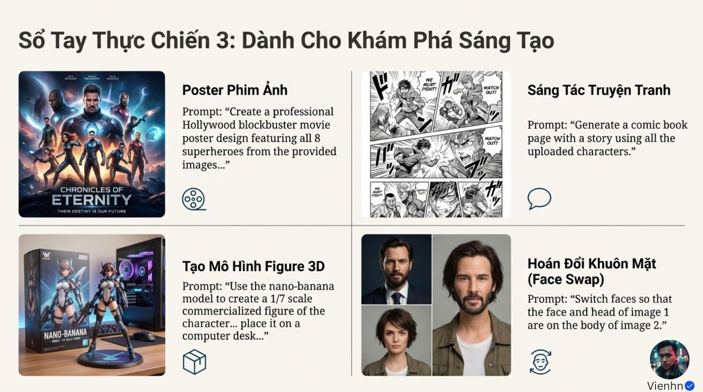
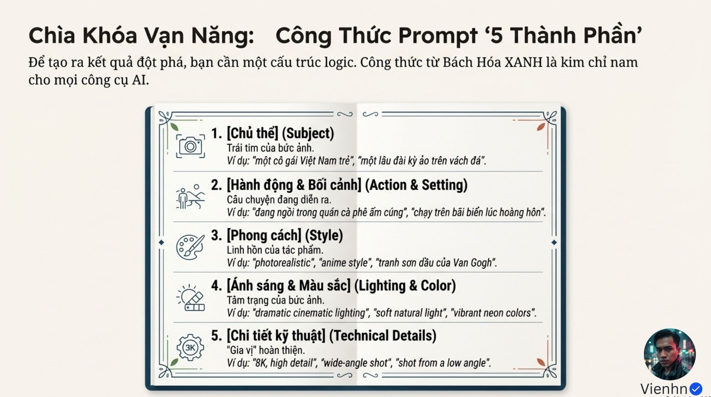
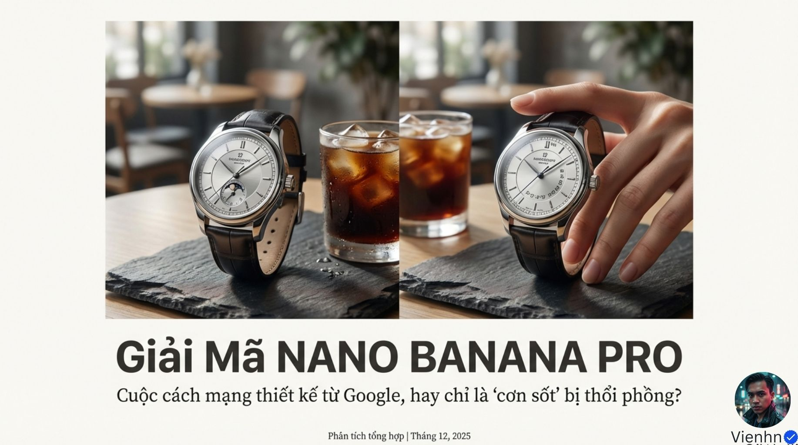
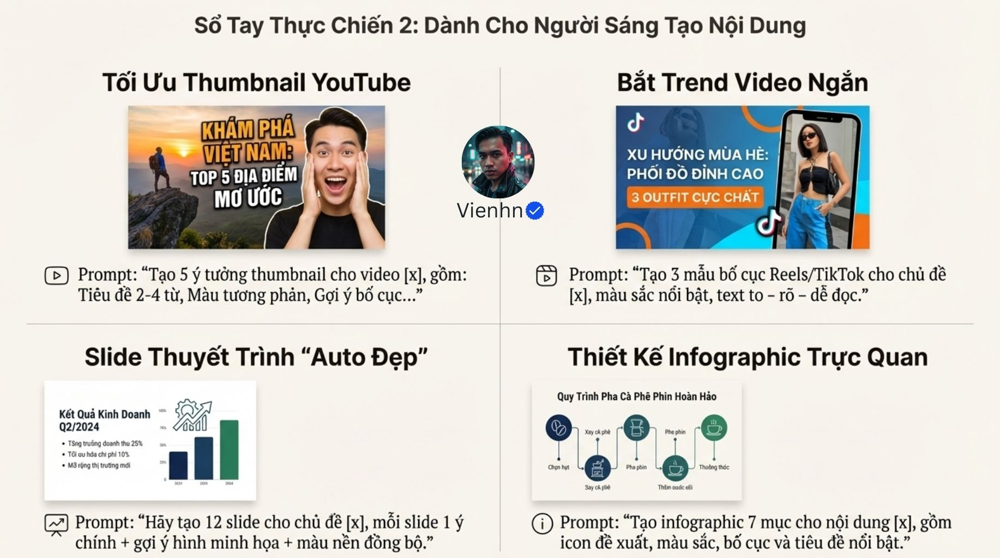
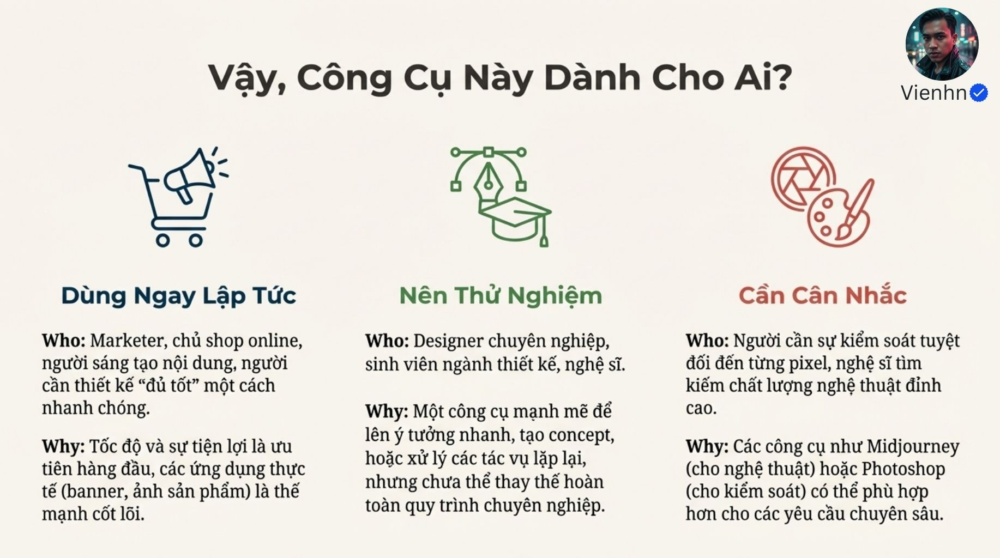

# Bài 004 — Nano Banana Pro trong khâu chuẩn bị hình ảnh

Bộ 15 ảnh giới thiệu khả năng tạo và sửa ảnh, cấu trúc prompt và nhiều ứng dụng thiết kế. Với việc làm phim, giá trị dễ chuyển giao là tạo hình ý tưởng, ảnh tham chiếu, storyboard và vật liệu quảng bá; cần duyệt kỹ danh tính, chữ, dữ liệu và chi tiết sản phẩm.

**Nguồn:** [4 Vũ Khí Tối Thượng khiến Nano Banana Pro mạnh đến MỨC ĐÁNG NGỜ - Bạn đã thử chưa?](https://drive.google.com/drive/folders/1whjdmVdATgovKxaEXnA9gWsU-TIdnTRJ). Đã đọc **15/15 ảnh**. Ngày biên soạn: 17/10/2026.

[Đọc từng ảnh](doc-anh.md) · [Bài thực hành](thuc-hanh.md) · [Nguồn và mã kiểm tra](nguon.json) · [Danh mục toàn bộ](../../DANH-MUC-BAI-HOC.md)

**Quy ước:** phần “Nguồn” diễn đạt ý trong bộ ảnh. Phần “Phân tích và áp dụng” do người biên soạn bổ sung. Hiệu quả của câu lệnh chưa được kiểm nghiệm bằng lần tạo video trong đợt này.

## Những điều cần học

| Nội dung | Mã ảnh nguồn |
| --- | --- |
| Chọn đầu ra phục vụ tiền kỳ | B004-00, B004-03, B004-07 |
| Viết yêu cầu theo năm nhóm | B004-04, B004-14 |
| Sửa một yếu tố và bảo vệ phần còn lại | B004-00, B004-05, B004-14 |
| Duyệt chữ và dữ liệu độc lập | B004-03, B004-06 |
| Đánh giá công cụ bằng tác vụ | B004-02, B004-08, B004-10, B004-11, B004-12, B004-13 |

## 1. Chọn đầu ra phục vụ tiền kỳ

**Nguồn:** Nguồn giới thiệu tạo, chỉnh và kết hợp nhiều ảnh, các ví dụ poster, truyện và figure.

**Phân tích và áp dụng:** Bắt đầu bằng yêu cầu sản xuất cụ thể: một ảnh bối cảnh, thiết kế trang phục hay một khung storyboard. Ảnh tĩnh cần có bố cục đủ rõ để sau đó viết hành động và đường máy. Không suy ra khả năng video hay tệp 3D từ ảnh demo.

**Ví dụ cho cảnh nông thôn:** Tạo một ảnh hiên nhà miền Tây sau mưa để duyệt màu, vị trí cửa và rổ rau trước khi sinh clip.

**Kiểm tra kết quả:** Khung có không gian cho hành động; cửa, đồ vật và tỷ lệ nhân vật hợp lý.

## 2. Viết yêu cầu theo năm nhóm

**Nguồn:** Chủ thể + hành động/bối cảnh + phong cách + ánh sáng/màu + chi tiết kỹ thuật.

**Phân tích và áp dụng:** Dùng cấu trúc này như checklist. Chọn một trọng tâm thị giác, hướng nguồn sáng và vị trí máy rõ ràng. Yêu cầu độ phân giải ở thiết lập được hỗ trợ; không nhồi từ chất lượng thay cho mô tả hình.

**Ví dụ cho cảnh nông thôn:** Lan ở bên phải khung, hiên nhà gỗ bên trái; buổi sáng âm u, ánh sáng mềm, màu nâu và xanh lá trầm; hiện thực tự nhiên, khung ngang.

**Kiểm tra kết quả:** Người xem xác định được chủ thể và hướng sáng ngay; chi tiết kỹ thuật không mâu thuẫn ý đồ.

## 3. Sửa một yếu tố và bảo vệ phần còn lại

**Nguồn:** Nguồn có mẫu chỉ thay yếu tố cụ thể, giữ phần còn lại; tạo nhiều biến thể sản phẩm và nhận diện.

**Phân tích và áp dụng:** Ghi ảnh chuẩn và vùng cần sửa, rồi so toàn bộ ảnh đầu ra với đầu vào. Câu giữ nguyên không đảm bảo các vùng khác thực sự bất biến. Các biến thể phục vụ so sánh chỉ nên đổi một nhóm quyết định.

**Ví dụ cho cảnh nông thôn:** Giữ bếp, mặt và tư thế Lan, chỉ đổi áo sang nâu đất; sau đó mới thử ánh sáng bếp.

**Kiểm tra kết quả:** Kiểm mặt, tay, cửa, đường bàn và chữ ngoài vùng sửa; loại bản làm thay đổi ngoài ý muốn.

## 4. Duyệt chữ và dữ liệu độc lập

**Nguồn:** Nguồn đề cao chữ tiếng Việt và Search cho infographic.

**Phân tích và áp dụng:** So từng ký tự, dấu và con số với bản nội dung đã chốt. Với sơ đồ chính xác, chuẩn bị dữ liệu và vẽ bằng công cụ xác định thay vì tin một ảnh đẹp. Search hỗ trợ thông tin nhưng không thay bước kiểm chứng.

**Ví dụ cho cảnh nông thôn:** Poster phim ngắn có tên Bữa Cơm Chiều; duyệt dấu ữ, ơ, ề và tên đoàn trước khi dùng.

**Kiểm tra kết quả:** Đọc ở kích thước xuất thật; mọi số liệu có nguồn và thời điểm, không lấy đồ thị minh họa làm dữ liệu.

## 5. Đánh giá công cụ bằng tác vụ

**Nguồn:** Nguồn cân nhắc ưu nhược điểm, người dùng và quy trình bắt đầu.

**Phân tích và áp dụng:** Google công bố Nano Banana Pro là Gemini 3 Pro Image; hỗ trợ 1K/2K/4K và nhiều ảnh theo bề mặt sử dụng. Ghi model, tài khoản, số lần thử, thời gian sửa và số bản dùng được. Không chọn công cụ từ một bình luận hoặc lời hứa thay toàn bộ phần mềm.

**Ví dụ cho cảnh nông thôn:** Thử một bối cảnh, một ảnh nhân vật và một chỉnh sửa trang phục, đánh giá mức phù hợp với phim dự định.

**Kiểm tra kết quả:** Có đầu vào, đầu ra và tiêu chí duyệt lưu cùng nhau; xem hạn mức hiện trong tài khoản trước khi lập ngân sách.

## Điểm cần hiểu có điều kiện

- Nano Banana Pro được Google sử dụng chính thức để gọi Gemini 3 Pro Image; câu chỉ là tên cộng đồng ở B004-02 cần chỉnh.
- 4K không đồng nghĩa mọi tỉ lệ đều 4096×4096; kích thước phụ thuộc tỉ lệ và nơi sử dụng. Từ 8K trong prompt không nâng giới hạn xuất.
- Google có công bố tối đa 14 ảnh và hỗ trợ duy trì nét giống của tối đa năm người; đây không phải bảo đảm mọi ảnh đều chính xác.
- Không xác nhận chữ tiếng Việt hoàn hảo hoặc Search bảo đảm đúng dữ liệu. Google cũng nêu giới hạn với chữ, mặt nhỏ và chi tiết.
- Miễn phí hai ảnh/ngày và vị trí nút trong ảnh thuộc bối cảnh nguồn tháng 12/2025, không được coi là điều kiện hiện tại.
- Các con số lỗi 50%, tiếp cận 99% và so sánh Canva/Photoshop/Midjourney trong nguồn chưa có thử nghiệm đủ đối chiếu.

## Cách đưa vào quy trình sản xuất

Chốt mục đích ảnh → gom tham chiếu → viết yêu cầu có thứ tự ưu tiên → tạo vài biến thể → kiểm bố cục, danh tính, chữ và dữ liệu → sửa có mục tiêu → chốt ảnh chuẩn để chuyển sang video. Lưu bản gốc và bản được duyệt.

## Tự kiểm tra kiến thức

- Ảnh figure khác tài sản 3D ở điểm gì?
- Cần kiểm phần nào khi yêu cầu chỉ sửa một vùng?
- Vì sao ảnh có chữ đẹp vẫn cần đối chiếu nội dung?

## Nguồn đối chiếu bổ sung

- [Google — công bố Nano Banana Pro](https://blog.google/innovation-and-ai/products/nano-banana-pro/): Đối chiếu tên, nhiều ảnh và độ phân giải.
- [Google DeepMind — Nano Banana Pro](https://deepmind.google/models/gemini-image/pro/): Đối chiếu giới hạn chữ, mặt nhỏ và chi tiết.

**Giới hạn:** đây là tài liệu học từ ảnh. Không dùng một hình minh họa để xác nhận chuyển động, thời lượng, độ chính xác thao tác hay khả năng hiện tại của một sản phẩm. Những phần chưa kiểm chứng được ghi rõ trong bản đọc ảnh.
