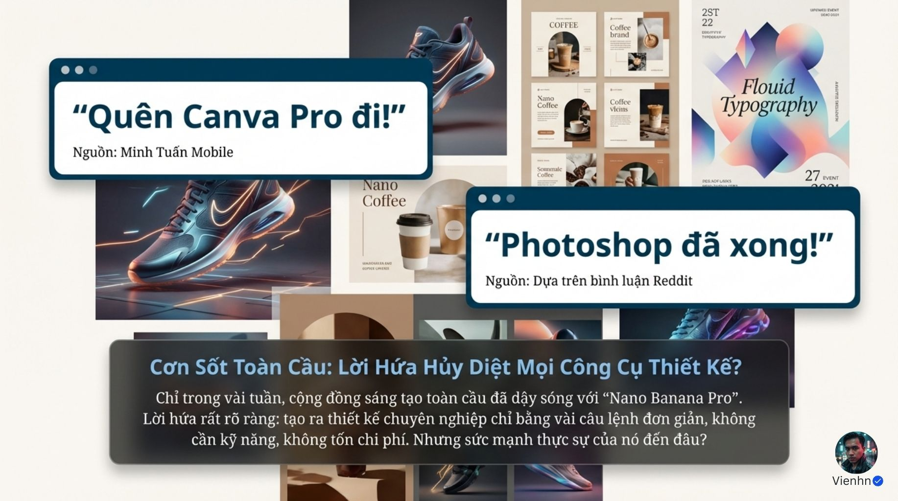
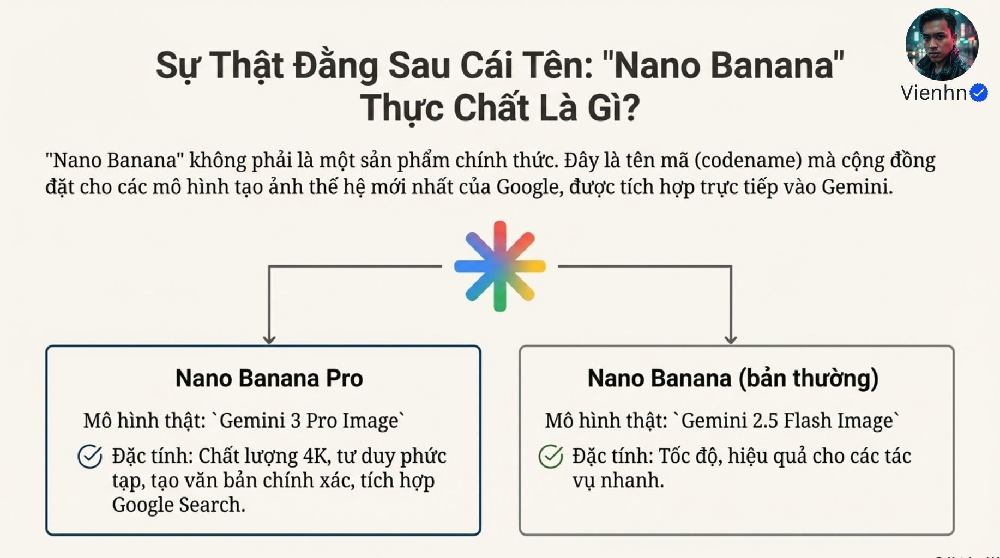
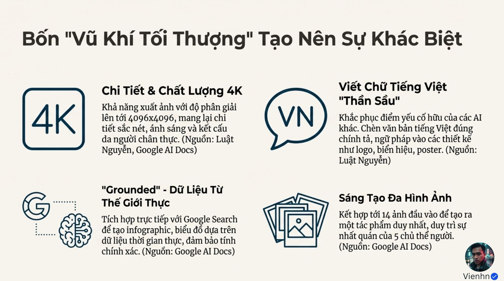
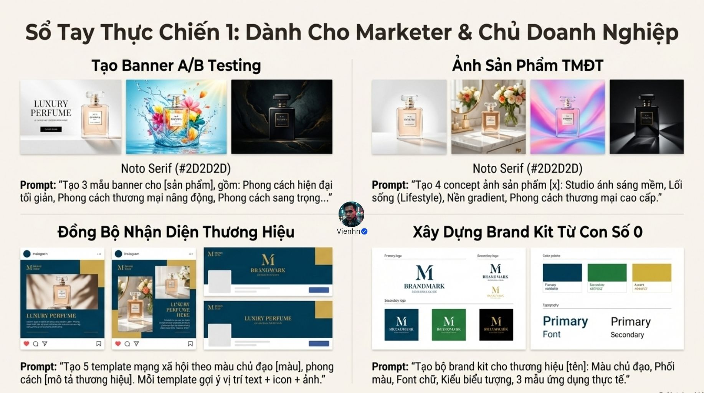
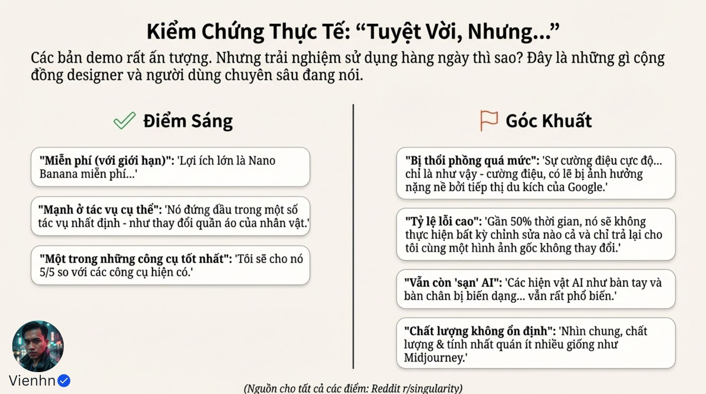
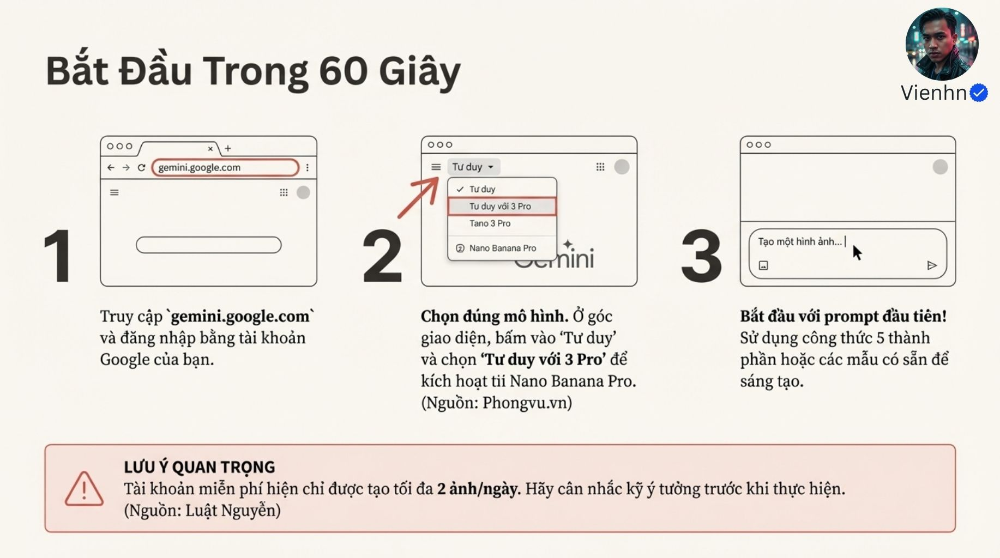
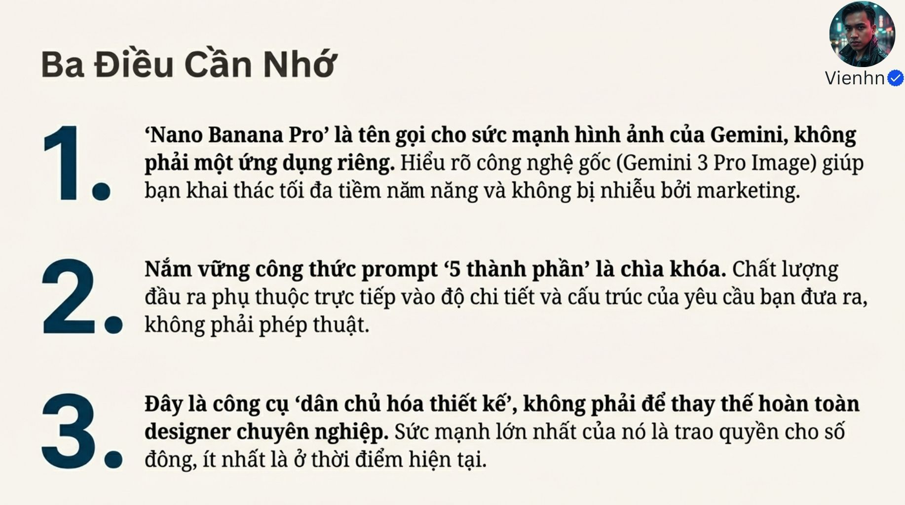
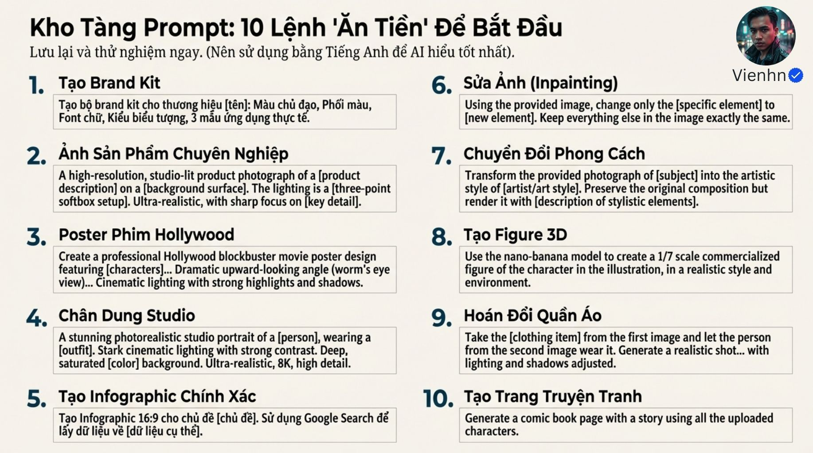

# B004 — Bản đọc toàn bộ 15 ảnh

Nguồn: [4 Vũ Khí Tối Thượng khiến Nano Banana Pro mạnh đến MỨC ĐÁNG NGỜ - Bạn đã thử chưa?](https://drive.google.com/drive/folders/1whjdmVdATgovKxaEXnA9gWsU-TIdnTRJ).

**Cách ghi:** nội dung chính được diễn đạt lại từ chữ và hình trong ảnh; không phải bản chép nguyên văn toàn bộ. Quan sát ảnh tĩnh được tách khỏi lời giải thích bổ sung. Ảnh gốc được giữ nguyên để đối chiếu.

[Bài chính](README.md) · [Thực hành](thuc-hanh.md) · [Dữ liệu nguồn](nguon.json)

## B004-00 — Giải mã công cụ

Tên gốc: `4 Vũ Khí Tối Thượng khiến Nano Banana Pro mạnh đến MỨC ĐÁNG NGỜ - Bạn đã thử chưa?.jpg`.

**Nội dung chính đọc được:** Bài tổng hợp tháng 12/2025 đặt câu hỏi về năng lực thực tế của Nano Banana Pro.

**Hình minh họa:** Hai ảnh đồng hồ trong quán, một ảnh có bàn tay; có dấu Vienhn.

**Phân tích bổ sung:** Hình chỉnh sửa có thay đổi chi tiết mặt đồng hồ; phải kiểm phần cần giữ.

## B004-01 — Lời quảng bá

Tên gốc: `01.jpg`.

**Nội dung chính đọc được:** Dẫn các nhận xét cho rằng công cụ có thể thay Canva hoặc Photoshop và tạo thiết kế đơn giản.

**Hình minh họa:** Ghép giày, bao bì cà phê, poster chữ và hai khung trích dẫn.

**Phân tích bổ sung:** Đây là bình luận tiếp thị, không phải thử nghiệm so sánh.

## B004-02 — Tên gọi và mô hình

Tên gốc: `02.jpg`.

**Nội dung chính đọc được:** Gắn Pro với Gemini 3 Pro Image, bản thường với Gemini 2.5 Flash Image; gọi Nano Banana là tên không chính thức.

**Hình minh họa:** Sơ đồ hai nhánh dưới biểu tượng Gemini.

**Phân tích bổ sung:** Google đã dùng tên Nano Banana Pro trong công bố chính thức; sửa nhận định chỉ là tên cộng đồng.

## B004-03 — Bốn khả năng

Tên gốc: `03.jpg`.

**Nội dung chính đọc được:** Nêu 4K đến 4096×4096, chữ tiếng Việt, dữ liệu từ Search và kết hợp tối đa 14 ảnh, 5 người.

**Hình minh họa:** Bốn biểu tượng độ nét, tiếng Việt, tìm kiếm, chồng ảnh.

**Phân tích bổ sung:** Khả năng phụ thuộc sản phẩm; Search và chữ tốt hơn không bảo đảm không sai.

## B004-04 — Năm thành phần prompt

Tên gốc: `04.jpg`.

**Nội dung chính đọc được:** Chủ thể; hành động và bối cảnh; phong cách; ánh sáng và màu; chi tiết kỹ thuật.

**Hình minh họa:** Trang sổ chia năm mục có ví dụ.

**Phân tích bổ sung:** Viết 8K không thay thế lựa chọn độ phân giải thực tế.

## B004-05 — Thiết kế tiếp thị

Tên gốc: `05.jpg`.

**Nội dung chính đọc được:** Mẫu tạo ba banner, bốn ảnh sản phẩm, bộ template mạng xã hội và bộ nhận diện.

**Hình minh họa:** Chai nước hoa trong các nền, mẫu brand kit và bài đăng.

**Phân tích bổ sung:** Dùng cùng sản phẩm tham chiếu, kiểm logo và hình dáng ở từng biến thể.

## B004-06 — Nội dung số

Tên gốc: `06.jpg`.

**Nội dung chính đọc được:** Gợi ý thumbnail, bố cục video ngắn, 12 slide và infographic bảy mục.

**Hình minh họa:** Bốn ví dụ thumbnail du lịch, thời trang, slide biểu đồ, quy trình cà phê.

**Phân tích bổ sung:** Ảnh slide hoặc bố cục video không phải tệp thuyết trình sửa được hay video chuyển động.

## B004-07 — Khám phá sáng tạo

Tên gốc: `08.jpg`.

**Nội dung chính đọc được:** Gợi ý poster nhiều siêu anh hùng, trang truyện từ ảnh nhân vật, ảnh figure tỷ lệ 1/7 và ghép mặt.

**Hình minh họa:** Poster, truyện tranh, tượng trên bàn và ảnh ghép mặt.

**Phân tích bổ sung:** Ảnh figure không tạo mô hình 3D có lưới; cần phân biệt đầu ra hình ảnh với tài sản 3D.

## B004-08 — Phản hồi cộng đồng

Tên gốc: `09.jpg`.

**Nội dung chính đọc được:** Gom ý kiến khen miễn phí giới hạn, sửa đồ tốt; chê phóng đại, lỗi gần 50%, bàn tay và chất lượng thiếu ổn định.

**Hình minh họa:** Hai cột điểm sáng và góc khuất, ghi nguồn Reddit r/singularity.

**Phân tích bổ sung:** Thiếu đường dẫn, ngày, mẫu và phiên bản; 50% là lời kể, không phải tỷ lệ lỗi kiểm chứng.

## B004-09 — Mở rộng tiếp cận

Tên gốc: `010.jpg`.

**Nội dung chính đọc được:** Nguồn cho rằng AI giúp nhiều người tiếp cận năng lực thiết kế, dùng con số 99% dân số.

**Hình minh họa:** Nhiều bàn tay và công cụ quanh hình sáng ở giữa.

**Phân tích bổ sung:** 99% mang tính tu từ, không có thống kê kèm theo.

## B004-10 — Chọn theo nhu cầu

Tên gốc: `011.jpg`.

**Nội dung chính đọc được:** Phân nhóm người cần thiết kế nhanh, người chuyên nghiệp nên thử và người cần kiểm soát từng pixel.

**Hình minh họa:** Ba biểu tượng mua sắm, học tập, nghệ thuật.

**Phân tích bổ sung:** Khuyến nghị trong nguồn là bối cảnh 2025; lựa chọn cần thử đúng tác vụ.

## B004-11 — Bắt đầu sử dụng

Tên gốc: `012.jpg`.

**Nội dung chính đọc được:** Hướng dẫn vào Gemini, chọn chế độ Tư duy với 3 Pro, viết prompt; nêu miễn phí hai ảnh/ngày.

**Hình minh họa:** Ba màn hình vẽ lại và khung cảnh báo quota.

**Phân tích bổ sung:** Không dùng màn hình minh họa làm hướng dẫn giao diện hiện tại; quota phụ thuộc tài khoản và thời điểm.

## B004-12 — Ba điều cần nhớ

Tên gốc: `013.jpg`.

**Nội dung chính đọc được:** Hiểu mô hình gốc; dùng prompt có cấu trúc; coi AI là hỗ trợ tiếp cận thiết kế.

**Hình minh họa:** Ba ý đánh số lớn.

**Phân tích bổ sung:** Cấu trúc prompt chỉ là một yếu tố, cùng ảnh đầu vào và khâu duyệt.

## B004-13 — Thích ứng

Tên gốc: `014.jpg`.

**Nội dung chính đọc được:** Khuyên học và thích nghi khi giới hạn công cụ thay đổi.

**Hình minh họa:** Chữ lớn cạnh mặt kính tòa nhà.

**Phân tích bổ sung:** Đây là thông điệp định hướng, không dự báo kỹ thuật đã kiểm chứng.

## B004-14 — Mười mẫu yêu cầu

Tên gốc: `015.jpg`.

**Nội dung chính đọc được:** Brand kit, ảnh sản phẩm, poster, chân dung, infographic, sửa vùng, đổi phong cách, figure, thay áo và trang truyện.

**Hình minh họa:** Hai cột mười mẫu câu có biến điền.

**Phân tích bổ sung:** Các mẫu là điểm khởi đầu; luôn nói rõ yếu tố giữ lại, thay đổi và cách kiểm.

## Kiểm kê

Đã mở trực tiếp 15/15 ảnh. Các mã nguồn theo thứ tự ở trên khớp [danh mục tệp](nguon.json). Chưa sinh hoặc đánh giá video từ câu lệnh của bài này.
