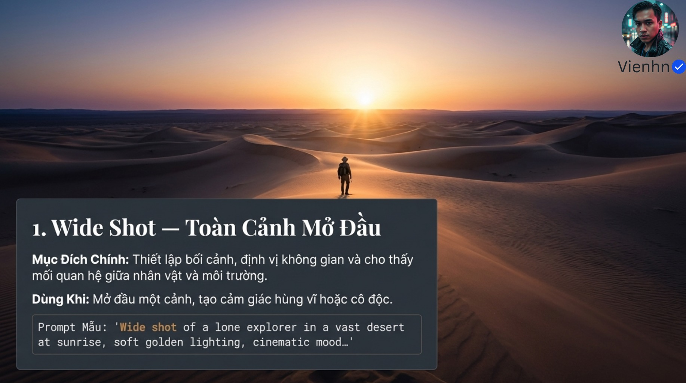
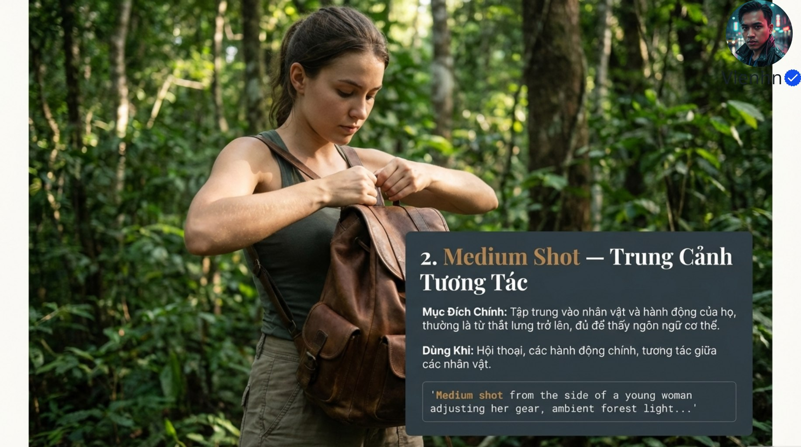
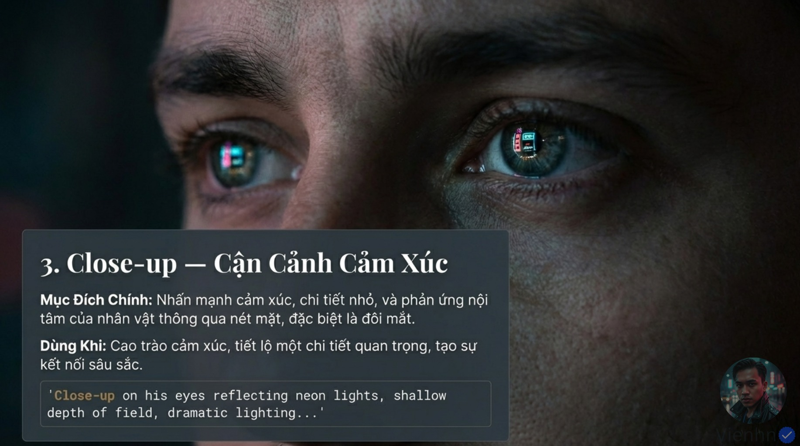
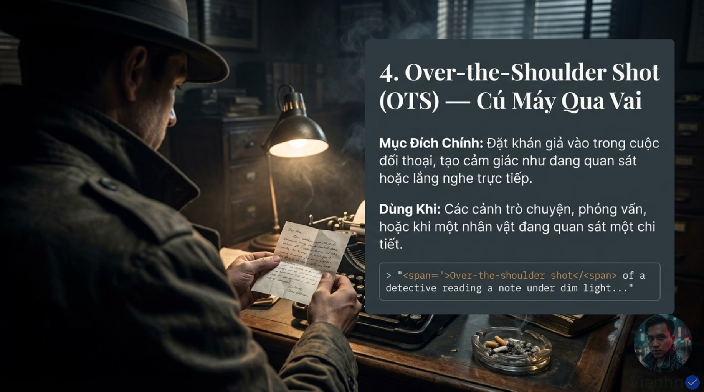
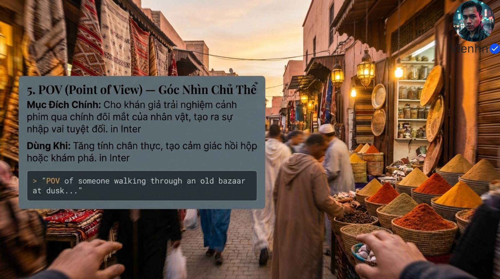
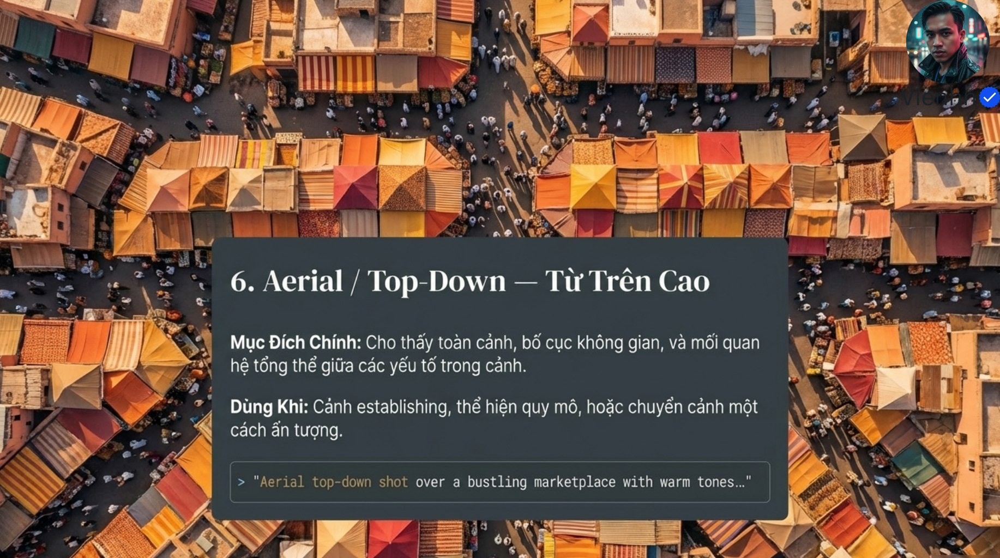
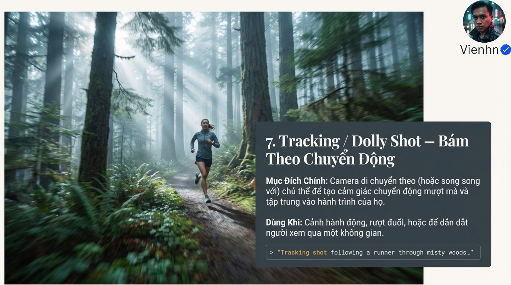

# Bài 005 — Bảy lựa chọn cỡ cảnh, góc nhìn và chuyển động

Đọc 13 ảnh về toàn cảnh, trung cảnh, cận cảnh, qua vai, POV, trên cao và máy bám. Trọng tâm là chọn thông tin khán giả cần thấy rồi mô tả vị trí, khung hình và chuyển động đủ cụ thể.

**Nguồn:** [7 Cú Máy Kinh Điển - Từ Tốt Đến Đậm Chất Điện Ảnh Với Prompt Veo3.1](https://drive.google.com/drive/folders/1qDJzlfauIo-m6RDrBqJcpPr6Am94IHcC). Đã đọc **13/13 ảnh**. Ngày biên soạn: 17/10/2026.

[Đọc từng ảnh](doc-anh.md) · [Bài thực hành](thuc-hanh.md) · [Nguồn và mã kiểm tra](nguon.json) · [Danh mục toàn bộ](../../DANH-MUC-BAI-HOC.md)

**Quy ước:** phần “Nguồn” diễn đạt ý trong bộ ảnh. Phần “Phân tích và áp dụng” do người biên soạn bổ sung. Hiệu quả của câu lệnh chưa được kiểm nghiệm bằng lần tạo video trong đợt này.

## Những điều cần học

| Nội dung | Mã ảnh nguồn |
| --- | --- |
| Toàn cảnh: xác lập quan hệ người–nơi | B005-04 |
| Trung cảnh: đọc hành động | B005-05 |
| Cận và đặc tả: chọn chi tiết quan trọng | B005-06 |
| Qua vai: xây quan hệ quan sát | B005-07 |
| POV: cho người xem nhìn cùng nhân vật | B005-08 |
| Trên cao: đọc bố cục không gian | B005-09 |
| Tracking: đồng hành với chuyển động | B005-10 |

## 1. Toàn cảnh: xác lập quan hệ người–nơi

**Nguồn:** Dùng khung rộng để định vị bối cảnh.

**Phân tích và áp dụng:** Nêu quy mô chủ thể trong khung, khoảng cách và yếu tố định hướng. Chỉ thêm đường máy nếu phục vụ việc khám phá không gian.

**Ví dụ cho cảnh nông thôn:** Toàn cảnh sân nhà, Lan nhỏ bên cổng, bàn cơm dưới mái hiên.

**Kiểm tra kết quả:** Thấy rõ cổng–hiên–bàn và hướng Lan sẽ đi.

## 2. Trung cảnh: đọc hành động

**Nguồn:** Dùng trung cảnh cho tương tác và động tác thân trên.

**Phân tích và áp dụng:** Giữ bàn tay và đồ vật trong khung; cho một hành động đơn giản diễn tiến rõ.

**Ví dụ cho cảnh nông thôn:** Lan đặt rổ rau lên bàn, lấy từ eo trở lên, máy đứng yên.

**Kiểm tra kết quả:** Tay tiếp xúc đúng rổ, động tác không bị cắt hoặc lặp.

## 3. Cận và đặc tả: chọn chi tiết quan trọng

**Nguồn:** Tập trung mắt, nét mặt và phản ứng.

**Phân tích và áp dụng:** Ghi cận toàn mặt hay đặc tả mắt; diễn tả thay đổi nhỏ nhìn thấy được thay cho nhãn cảm xúc chung chung.

**Ví dụ cho cảnh nông thôn:** Cận mặt Lan nhìn chiếc bát cũ, mắt dừng lại rồi khẽ mỉm cười.

**Kiểm tra kết quả:** Giữ danh tính và nét mắt tự nhiên; không tự đổi sang đặc tả nếu cần thấy toàn mặt.

## 4. Qua vai: xây quan hệ quan sát

**Nguồn:** Máy nhìn qua vai một người tới đối tượng phía trước.

**Phân tích và áp dụng:** Ghi vai nào ở bên nào khung, chủ thể nào nét và ai đang nhìn ai. Giữ hướng nhìn hợp lý khi cắt sang góc đối.

**Ví dụ cho cảnh nông thôn:** Qua vai phải của mẹ ở trái tiền cảnh, Lan bên phải hậu cảnh đang đặt rổ.

**Kiểm tra kết quả:** Vai không che động tác; hướng nhìn và vị trí hai người nhất quán.

## 5. POV: cho người xem nhìn cùng nhân vật

**Nguồn:** Dùng góc nhìn nhân vật để khám phá hoặc tăng hồi hộp.

**Phân tích và áp dụng:** Nêu rõ chủ thể sở hữu điểm nhìn, độ cao máy và chuyển động. Bàn tay có thể xuất hiện nhưng không bắt buộc.

**Ví dụ cho cảnh nông thôn:** POV Lan nhìn xuống bàn cơm khi bước tới hiên; máy cao ngang mắt, rung bước chân nhẹ.

**Kiểm tra kết quả:** Khung có thể xuất phát từ vị trí Lan; không vô tình lộ toàn thân cô ở trước máy.

## 6. Trên cao: đọc bố cục không gian

**Nguồn:** Thấy quan hệ tổng thể từ trên cao.

**Phân tích và áp dụng:** Tách vị trí máy trên không với hướng nhìn thẳng xuống. Nếu cần thấy mặt đứng căn nhà, chọn góc xiên thay vì top-down.

**Ví dụ cho cảnh nông thôn:** Nhìn thẳng xuống sân với các nia rau, đường từ cổng vào bếp.

**Kiểm tra kết quả:** Bố cục địa lý ổn định; mái nhà không xuyên qua người hoặc đồ vật.

## 7. Tracking: đồng hành với chuyển động

**Nguồn:** Máy bám hoặc song song để theo hành trình.

**Phân tích và áp dụng:** Ghi máy ở trước, sau hay bên cạnh; khoảng cách, tốc độ và cỡ cảnh cần giữ. Dolly-in là máy tiến tới, khác zoom thay tiêu cự.

**Ví dụ cho cảnh nông thôn:** Máy đi song song bên phải Lan khi cô mang rổ từ cổng vào hiên, giữ trung cảnh rộng.

**Kiểm tra kết quả:** Nhân vật và máy dịch chuyển hợp lý, nền có thị sai, cỡ cảnh không tự nhảy.

## Điểm cần hiểu có điều kiện

- Bảy mục không cùng một cấp phân loại: wide/medium/close là cỡ cảnh; OTS/POV là quan hệ góc nhìn; aerial/top-down là vị trí và hướng máy; tracking là chuyển động.
- Ảnh so sánh B005-03 đổi người, trang phục, ánh sáng và khung hình cùng lúc; không thể gọi là thử một biến.
- Khung mắt ở B005-06 phù hợp đặc tả cực cận. Cận cảnh không nhất thiết phải cắt chỉ còn mắt.
- Nguồn có mảnh mã span và chữ in Inter thừa; các phần này không phải thuật ngữ hoặc câu lệnh cần dùng.
- Aerial không bắt buộc nhìn thẳng xuống; tracking không đồng nghĩa mọi kiểu dolly.
- Không có video thử để khẳng định Veo luôn thực hiện đúng hoặc đẹp lên ngay lập tức.

## Cách đưa vào quy trình sản xuất

Viết mục đích từng shot → chọn cỡ cảnh → chọn điểm nhìn → quyết định máy đứng hay đi → mô tả hành động và ánh sáng → thử từng shot → dựng nối để kiểm quan hệ không gian. Giữ cùng nhân vật và đạo cụ theo bài 003.

## Tự kiểm tra kiến thức

- Có thể kết hợp medium shot, OTS và tracking trong một shot không?
- Aerial khác top-down như thế nào?
- Vì sao so sánh hai ảnh ở B005-03 chưa chứng minh được tác động của một thay đổi?

## Nguồn đối chiếu bổ sung

- [Google — hướng dẫn ngôn ngữ hình ảnh](https://docs.cloud.google.com/gemini-enterprise-agent-platform/models/video/video-gen-prompt-guide): Đối chiếu cỡ cảnh, góc máy, chuyển động và hiệu ứng quang học.

**Giới hạn:** đây là tài liệu học từ ảnh. Không dùng một hình minh họa để xác nhận chuyển động, thời lượng, độ chính xác thao tác hay khả năng hiện tại của một sản phẩm. Những phần chưa kiểm chứng được ghi rõ trong bản đọc ảnh.
