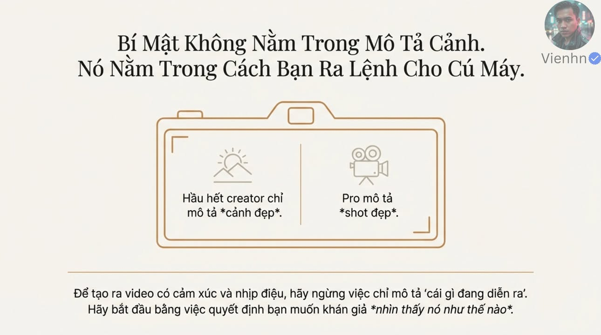
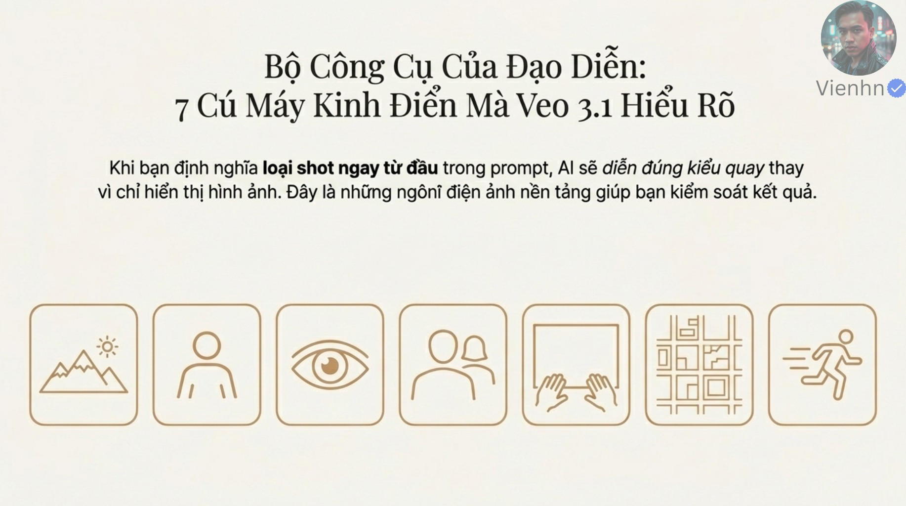
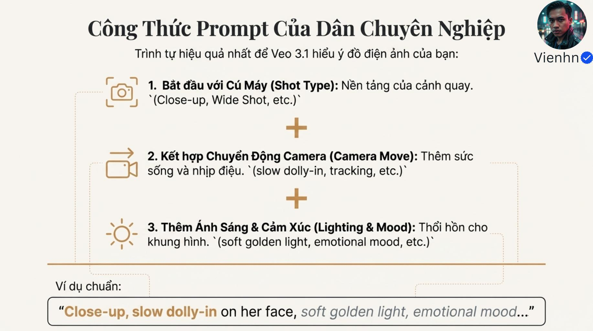
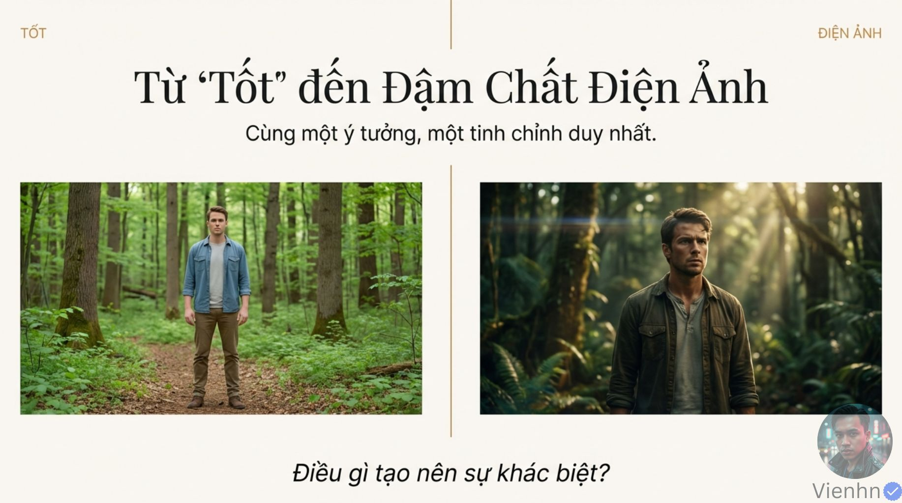
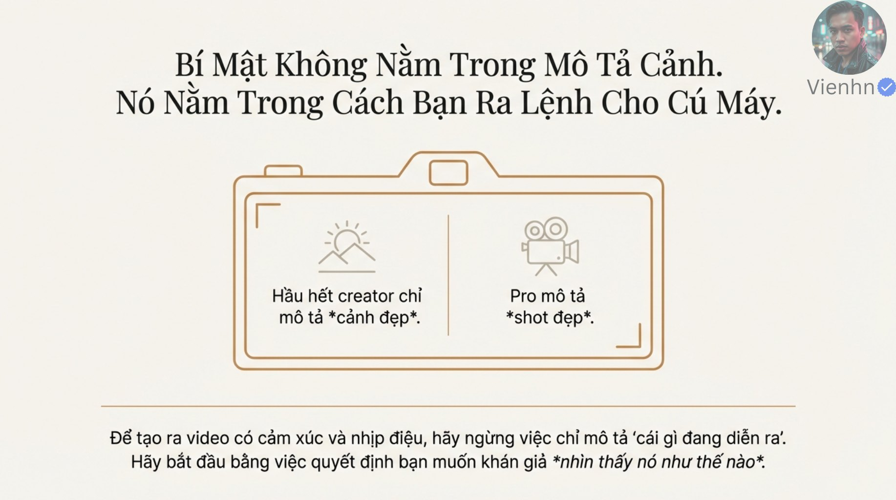

# B005 — Bản đọc toàn bộ 13 ảnh

Nguồn: [7 Cú Máy Kinh Điển - Từ Tốt Đến Đậm Chất Điện Ảnh Với Prompt Veo3.1](https://drive.google.com/drive/folders/1qDJzlfauIo-m6RDrBqJcpPr6Am94IHcC).

**Cách ghi:** nội dung chính được diễn đạt lại từ chữ và hình trong ảnh; không phải bản chép nguyên văn toàn bộ. Quan sát ảnh tĩnh được tách khỏi lời giải thích bổ sung. Ảnh gốc được giữ nguyên để đối chiếu.

[Bài chính](README.md) · [Thực hành](thuc-hanh.md) · [Dữ liệu nguồn](nguon.json)

## B005-00 — Ý đồ quan sát

Tên gốc: `7 Cú Máy Kinh Điển - Từ Tốt Đến Đậm Chất Điện Ảnh Với Prompt Veo3.1.jpg`.

**Nội dung chính đọc được:** Nguồn đề nghị quyết định khán giả nhìn sự việc như thế nào, bổ sung cách quay vào mô tả cảnh.

**Hình minh họa:** Biểu tượng cảnh đẹp và máy quay trong một khung máy ảnh.

**Phân tích bổ sung:** Nội dung và cách quay cùng cần thiết; không cần bỏ mô tả hành động.

## B005-01 — Bảy lựa chọn

Tên gốc: `01.jpg`.

**Nội dung chính đọc được:** Giới thiệu bảy loại shot và khuyên xác định ngay đầu prompt.

**Hình minh họa:** Bảy ô biểu tượng: phong cảnh, người, mắt, qua vai, chủ quan, trên cao, chuyển động.

**Phân tích bổ sung:** Danh sách trộn cỡ cảnh, góc nhìn và chuyển động; chúng có thể kết hợp.

## B005-02 — Công thức

Tên gốc: `02.jpg`.

**Nội dung chính đọc được:** Loại shot + chuyển động camera + ánh sáng/cảm xúc; ví dụ cận mặt, máy tiến chậm, ánh vàng mềm.

**Hình minh họa:** Ba dòng nối bằng dấu cộng.

**Phân tích bổ sung:** Cần thêm chủ thể, hành động và bối cảnh; không có thứ tự duy nhất bảo đảm hiệu quả.

## B005-03 — So sánh trong rừng

Tên gốc: `03.jpg`.

**Nội dung chính đọc được:** Nguồn nói một tinh chỉnh đưa cùng ý tưởng từ tốt lên điện ảnh.

**Hình minh họa:** Trái toàn thân áo xanh sáng; phải người khác áo tối, khung gần và tia nắng.

**Phân tích bổ sung:** Có nhiều biến thay đổi đồng thời, không chứng minh hiệu quả riêng một chỉnh sửa.

## B005-04 — Toàn cảnh

Tên gốc: `04.jpg`.

**Nội dung chính đọc được:** Wide shot đặt người trong môi trường, dùng mở cảnh hoặc gợi cô độc/hùng vĩ; mẫu người thám hiểm trong sa mạc bình minh.

**Hình minh họa:** Một người nhỏ giữa đồi cát và đường chân trời.

**Phân tích bổ sung:** Cỡ cảnh rộng có thể dùng giữa hoặc cuối cảnh; chức năng mở đầu không bắt buộc.

## B005-05 — Trung cảnh

Tên gốc: `05.jpg`.

**Nội dung chính đọc được:** Medium shot thường lấy từ eo trở lên, đủ thấy động tác và ngôn ngữ cơ thể; mẫu cô gái chỉnh đồ trong rừng.

**Hình minh họa:** Người phụ nữ đang mở túi.

**Phân tích bổ sung:** Chọn khung sao cho động tác quan trọng không bị cắt.

## B005-06 — Cận cảnh

Tên gốc: `06.jpg`.

**Nội dung chính đọc được:** Close-up tập trung biểu cảm và chi tiết, mẫu đôi mắt phản chiếu neon.

**Hình minh họa:** Ảnh cắt rất sát vùng mắt.

**Phân tích bổ sung:** Ảnh minh họa thực chất gần đặc tả cực cận hơn cận toàn mặt.

## B005-07 — Qua vai

Tên gốc: `07.jpg`.

**Nội dung chính đọc được:** OTS đặt vai người quan sát ở tiền cảnh; mẫu thám tử đọc giấy dưới đèn.

**Hình minh họa:** Vai và mũ tiền cảnh, tay cầm giấy trước bàn máy chữ.

**Phân tích bổ sung:** Có dấu mã span thừa trong prompt nguồn; loại khi thực hành.

## B005-08 — Góc nhìn chủ thể

Tên gốc: `08.jpg`.

**Nội dung chính đọc được:** POV cho thấy điều nhân vật nhìn thấy; mẫu bước qua chợ lúc chạng vạng.

**Hình minh họa:** Hai bàn tay ở đáy ảnh và chợ gia vị phía trước.

**Phân tích bổ sung:** Có chữ in Inter thừa; POV không bảo đảm cảm giác nhập vai tuyệt đối.

## B005-09 — Trên cao

Tên gốc: `09.jpg`.

**Nội dung chính đọc được:** Aerial/top-down giúp thấy bố cục không gian và quy mô; mẫu chợ nhìn từ trên xuống, tông ấm.

**Hình minh họa:** Các mái che và lối đi tạo ô hình học.

**Phân tích bổ sung:** Aerial là vị trí trên không, top-down là hướng nhìn gần thẳng xuống; không đồng nghĩa.

## B005-10 — Máy bám theo

Tên gốc: `10.jpg`.

**Nội dung chính đọc được:** Tracking/dolly camera đi cùng hoặc song song chủ thể; mẫu người chạy trong rừng sương.

**Hình minh họa:** Người chạy ở giữa, nền cây có nhòe.

**Phân tích bổ sung:** Tracking nói chức năng bám, dolly nói cách di chuyển; cần ghi quan hệ cụ thể.

## B005-11 — Kết luận

Tên gốc: `011.jpg`.

**Nội dung chính đọc được:** Khuyên tư duy đạo diễn và dùng loại shot cụ thể để hướng dẫn Veo.

**Hình minh họa:** Người thợ già làm gỗ bên cửa sổ.

**Phân tích bổ sung:** Câu điện ảnh hơn ngay lập tức là lời khích lệ, cần kiểm bằng kết quả.

## B005-12 — Lặp thông điệp đầu

Tên gốc: `012.jpg`.

**Nội dung chính đọc được:** Nhắc lại quyết định cách khán giả nhìn thấy hành động.

**Hình minh họa:** Bố cục cùng nội dung ảnh đầu, khung kích thước lớn hơn.

**Phân tích bổ sung:** Giữ cả tệp trong kiểm kê dù nội dung gần trùng.

## Kiểm kê

Đã mở trực tiếp 13/13 ảnh. Các mã nguồn theo thứ tự ở trên khớp [danh mục tệp](nguon.json). Chưa sinh hoặc đánh giá video từ câu lệnh của bài này.
