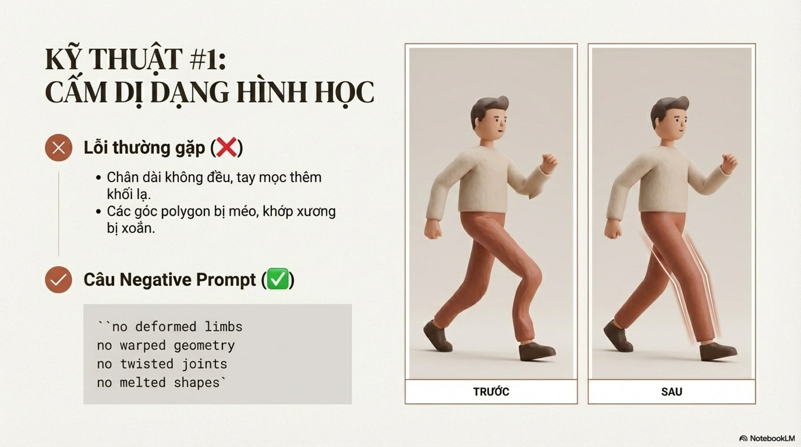
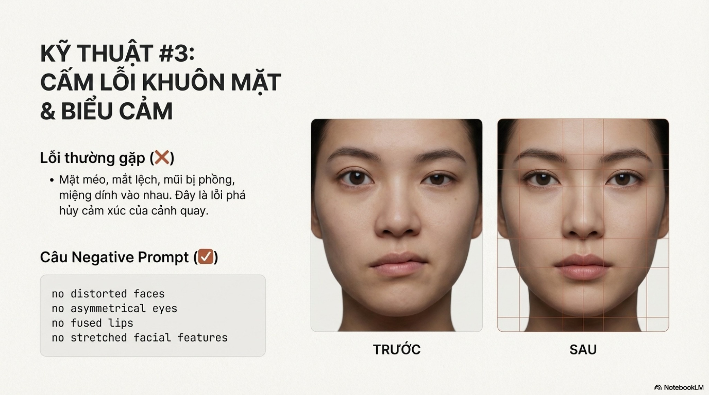
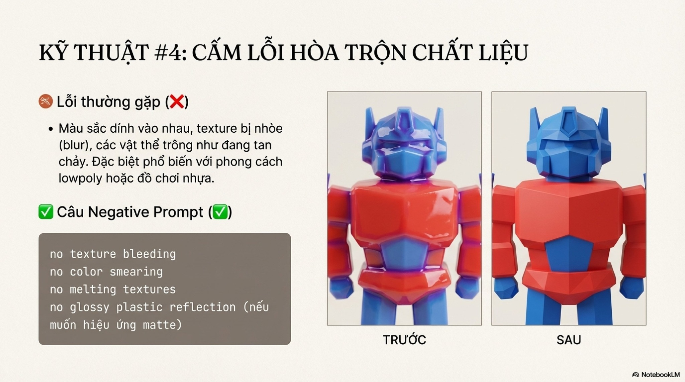
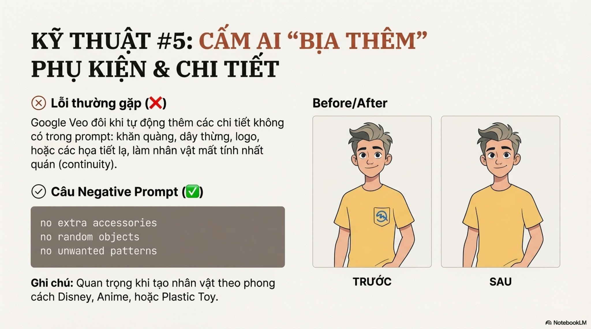
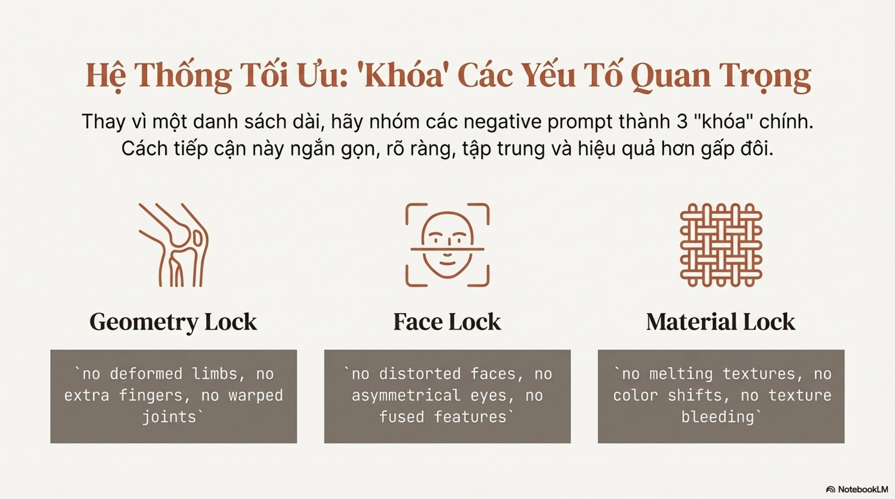

# Bài 006 — Giảm lỗi hình thể, màu và phụ kiện bằng yêu cầu có mục tiêu

Đã đọc 15 ảnh về nội dung loại trừ. Bài tách sáu nhóm lỗi nhìn thấy được, cách gom thành checklist và cách thử có đối chiếu. Không coi negative prompt là lệnh cấm tuyệt đối hoặc cú pháp dùng chung cho mọi mô hình.

**Nguồn:** [7 Kỹ Thuật Negative Prompt- Làm Thế Nào Để Cấm AI Đổi Màu Sắc và Bịa Thêm Phụ Kiện Giữa Các Cảnh? (Nhất quán)](https://drive.google.com/drive/folders/1wpVlWl2bK5HLQTZatRITBCh5eF3YeYWd). Đã đọc **15/15 ảnh**. Ngày biên soạn: 17/10/2026.

[Đọc từng ảnh](doc-anh.md) · [Bài thực hành](thuc-hanh.md) · [Nguồn và mã kiểm tra](nguon.json) · [Danh mục toàn bộ](../../DANH-MUC-BAI-HOC.md)

**Quy ước:** phần “Nguồn” diễn đạt ý trong bộ ảnh. Phần “Phân tích và áp dụng” do người biên soạn bổ sung. Hiệu quả của câu lệnh chưa được kiểm nghiệm bằng lần tạo video trong đợt này.

## Những điều cần học

| Nội dung | Mã ảnh nguồn |
| --- | --- |
| Kiểm hình thể và số chi | B006-03, B006-04 |
| Giữ khuôn mặt có thể nhận ra | B006-05 |
| Phân biệt hình học, màu và vật liệu | B006-06, B006-08 |
| Quản lý phụ kiện bằng thiết kế rõ | B006-07 |
| Viết đúng theo mô hình, kiểm bằng nhiều kết quả | B006-02, B006-09, B006-10, B006-11, B006-12, B006-13 |

## 1. Kiểm hình thể và số chi

**Nguồn:** Hai kỹ thuật đầu xử lý hình học méo và chi thừa.

**Phân tích và áp dụng:** Mô tả động tác và các điểm tiếp xúc trước; khi công cụ có trường negative thì chọn lỗi liên quan. Tránh động tác quá nhiều bàn tay che nhau khi chưa cần.

**Ví dụ cho cảnh nông thôn:** Lan nhấc rổ bằng hai tay, bàn tay đặt rõ ở hai quai.

**Kiểm tra kết quả:** Đếm chi theo chuỗi chuyển động; kiểm khớp, tiếp xúc và việc ngón biến mất.

## 2. Giữ khuôn mặt có thể nhận ra

**Nguồn:** Loại trừ mặt méo, mắt lỗi, môi dính và mặt kéo giãn.

**Phân tích và áp dụng:** So với ảnh chuẩn của đúng nhân vật. Cần giữ nét riêng và biểu cảm tự nhiên; việc buộc đối xứng tuyệt đối có thể làm đổi mặt.

**Ví dụ cho cảnh nông thôn:** Lan quay đầu nhẹ sang mẹ, môi thư giãn, ánh nhìn dừng rõ.

**Kiểm tra kết quả:** So mặt khi chính diện và nghiêng; phân biệt phối cảnh với biến dạng.

## 3. Phân biệt hình học, màu và vật liệu

**Nguồn:** Giảm bề mặt chảy, màu lem và thay vật liệu giữa cảnh.

**Phân tích và áp dụng:** Một áo vải mờ không nên tự thành nhựa bóng. Cố định vật liệu và bảng màu; cho phép sắc độ thay đổi có lý do theo ánh sáng. HEX chỉ là đích tham chiếu.

**Ví dụ cho cảnh nông thôn:** Áo bà ba nâu vải thô giữ nếp và độ mờ khi Lan từ hiên bước vào bếp.

**Kiểm tra kết quả:** Xem bề mặt có trượt theo người, biến thành chất khác hay nhấp nháy giữa khung.

## 4. Quản lý phụ kiện bằng thiết kế rõ

**Nguồn:** Ngăn logo, khăn và vật thể không được yêu cầu xuất hiện.

**Phân tích và áp dụng:** Lập danh sách có mặt: một rổ tre, một bàn gỗ, áo trơn. Nếu cần loại trừ, gọi đúng nhóm ngoài thiết kế; đừng cấm mọi đồ vật trong cảnh.

**Ví dụ cho cảnh nông thôn:** Lan mặc áo trơn, có rổ rau; thiết kế không có khăn cổ hay huy hiệu.

**Kiểm tra kết quả:** Số và hình dạng phụ kiện không đổi khi người quay hoặc đi qua vật che.

## 5. Viết đúng theo mô hình, kiểm bằng nhiều kết quả

**Nguồn:** Nguồn gom lỗi thành ba khối và khuyên chọn trong nhiều bản.

**Phân tích và áp dụng:** Google hướng dẫn trường negative nên liệt kê yếu tố không mong muốn, tránh no/don't. Runway Gen-4 khuyên mô tả tích cực và tránh negative prompt. Kiểm tài liệu của chế độ đang dùng trước khi áp dụng; không coi chữ Lock là cơ chế kỹ thuật.

**Ví dụ cho cảnh nông thôn:** Veo có trường loại trừ: thừa ngón, mặt biến dạng, đổi trang phục. Với quy trình theo hướng dẫn Runway: mô tả tay tự nhiên, áo nâu ổn định và hành động rõ.

**Kiểm tra kết quả:** Lưu cùng đầu vào và số bản thử; đánh giá toàn đoạn, ghi lỗi theo mốc giây, so trước/sau với cùng tiêu chí.

## Điểm cần hiểu có điều kiện

- Tên thư mục ghi bảy kỹ thuật nhưng các ảnh chỉ đánh số #1–#6; phần gom ba nhóm là chiến lược tổ chức bổ sung, không tự tạo kỹ thuật thứ bảy từ nguồn.
- Các lời hứa ổn định 95–100%, hiệu quả gấp đôi và loại bỏ lỗi chưa có dữ liệu thử hỗ trợ.
- Negative prompt không tự khóa hình học, mặt hoặc vật liệu; Geometry/Face/Material Lock là nhãn do bài đặt.
- Cú pháp nhiều no không phù hợp mọi công cụ. Google khuyên trường loại trừ liệt kê lỗi; Runway Gen-4 khuyên tránh negative và dùng mô tả tích cực.
- Hình sau ở B006-03 vẫn có hình thể bất thường; các cặp ảnh trước/sau không phải bằng chứng thực nghiệm.
- Bốn biến thể là gợi ý nguồn. Số lần thử nên theo mức độ khó, chi phí và tiêu chí duyệt.
- Tên phông JetBrains Mono và nhãn không rõ ở B006-01 là lỗi trình bày nguồn; không đưa vào prompt thực hành.

## Cách đưa vào quy trình sản xuất

Xem bản thử → gọi đúng loại lỗi và mốc giây → sửa mô tả tích cực hoặc trường loại trừ theo công cụ → giữ các yếu tố khác để so → xem toàn đoạn mới → duyệt hoặc tạo lại. Ghép checklist này với hồ sơ nhân vật bài 003.

## Tự kiểm tra kiến thức

- Tại sao không nên chép cùng danh sách no vào Veo và Runway?
- Mặt không đối xứng có luôn là lỗi không?
- Ảnh sau đẹp hơn có chứng minh negative prompt gây ra cải thiện không?

## Nguồn đối chiếu bổ sung

- [Google — negative prompts](https://docs.cloud.google.com/gemini-enterprise-agent-platform/models/video/video-gen-prompt-guide): Cách dùng trường nội dung loại trừ.
- [Runway — Gen-4 Video Prompting Guide](https://help.runwayml.com/hc/en-us/articles/39789879462419-Gen-4-Video-Prompting-Guide): Đối chiếu khuyến nghị diễn đạt tích cực.

**Giới hạn:** đây là tài liệu học từ ảnh. Không dùng một hình minh họa để xác nhận chuyển động, thời lượng, độ chính xác thao tác hay khả năng hiện tại của một sản phẩm. Những phần chưa kiểm chứng được ghi rõ trong bản đọc ảnh.
