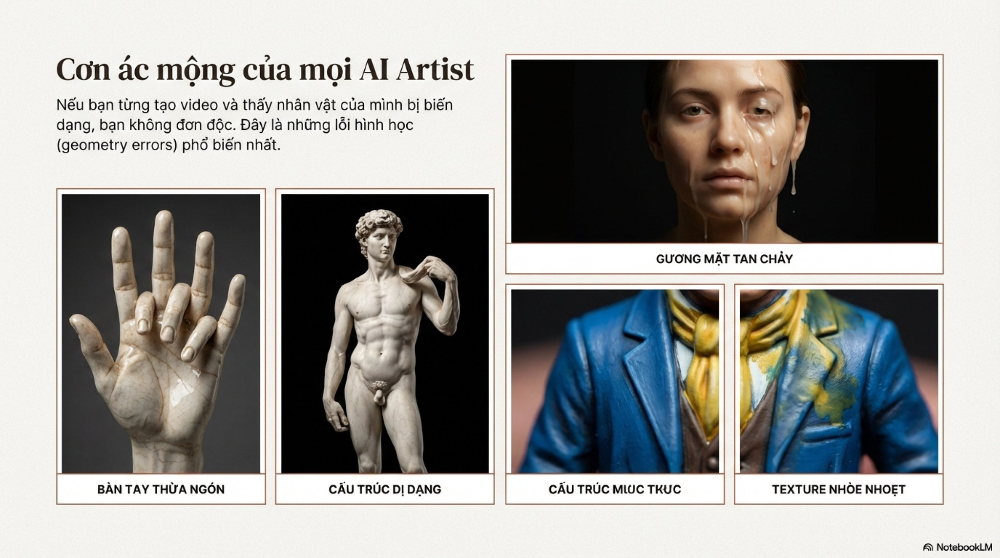
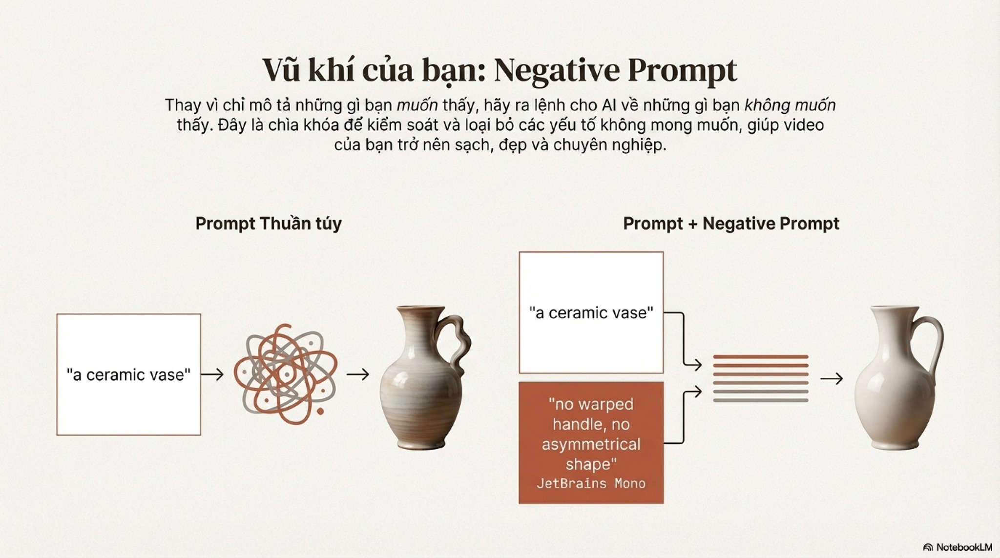
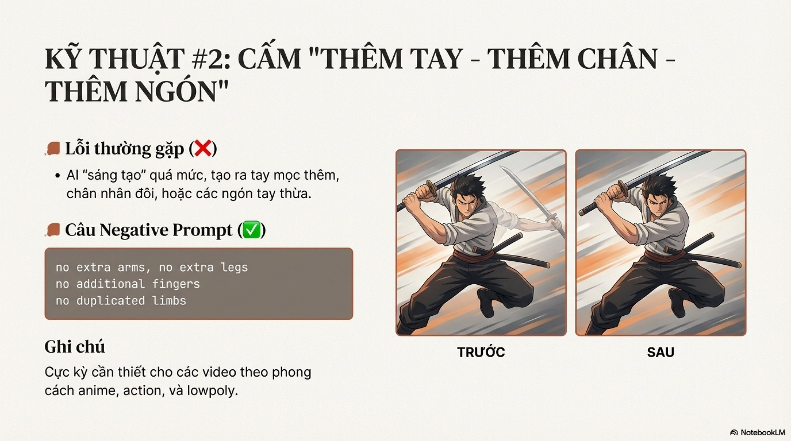
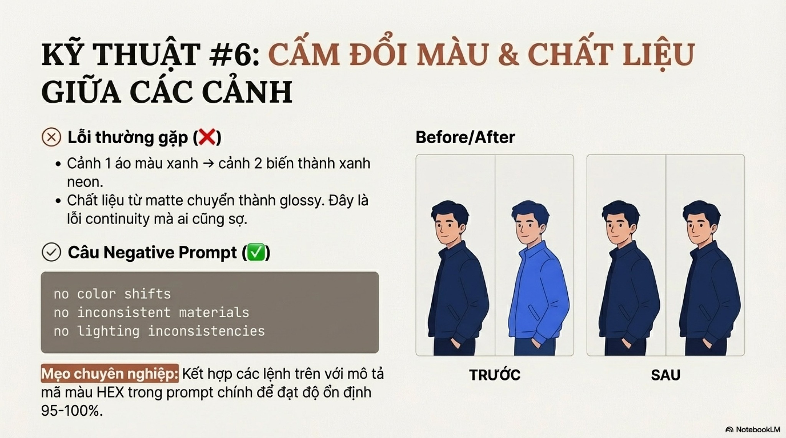
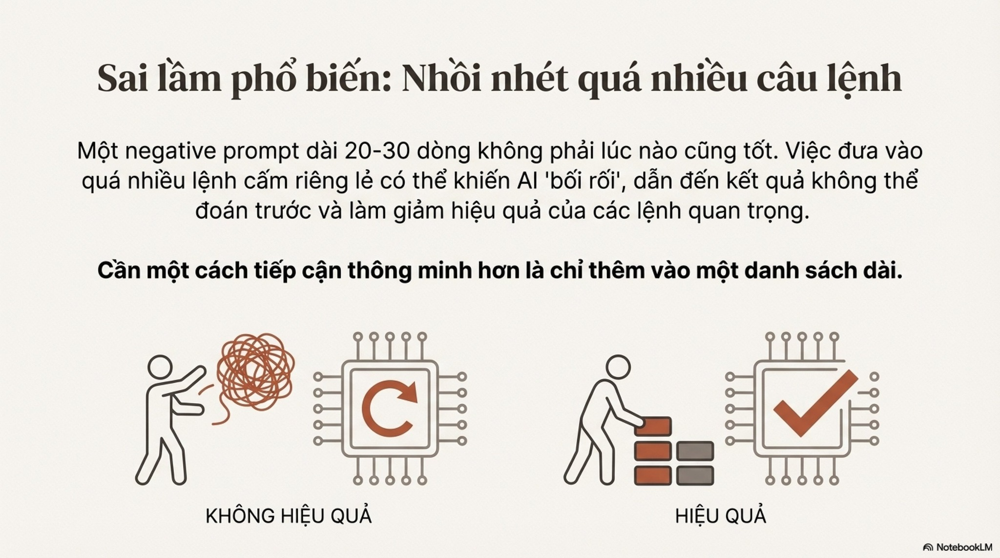
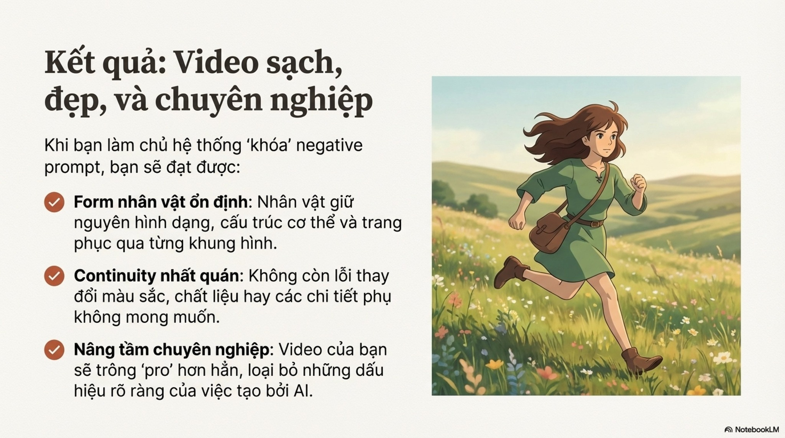
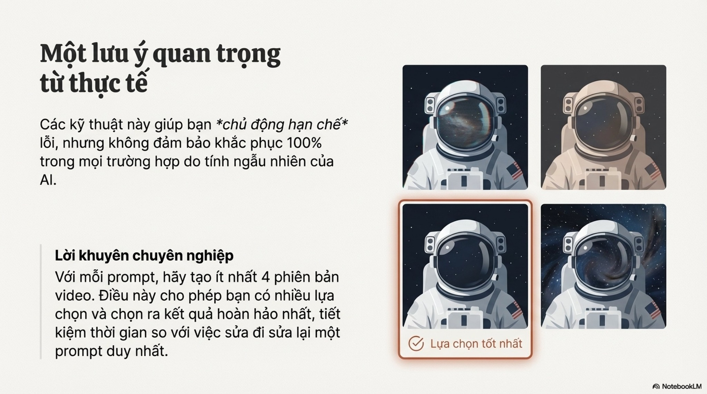
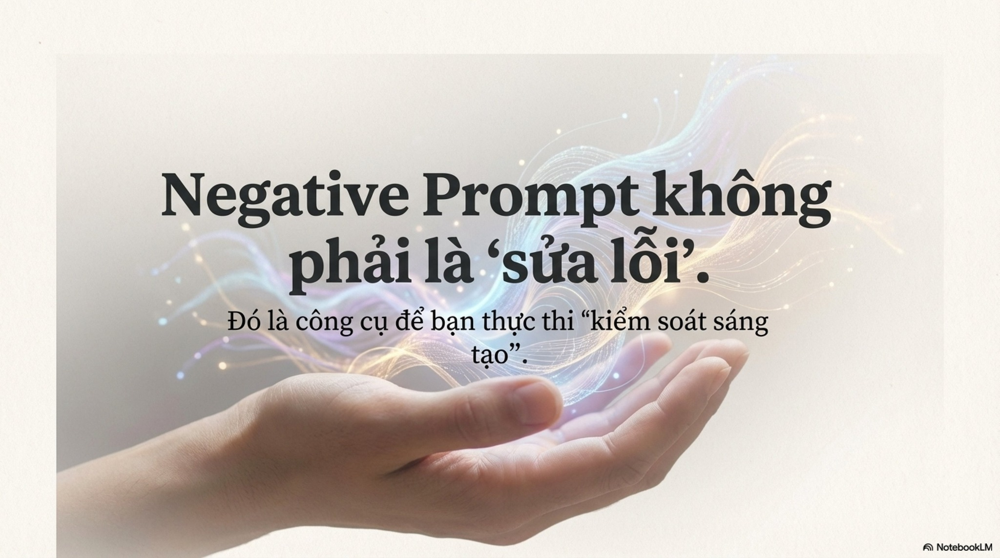
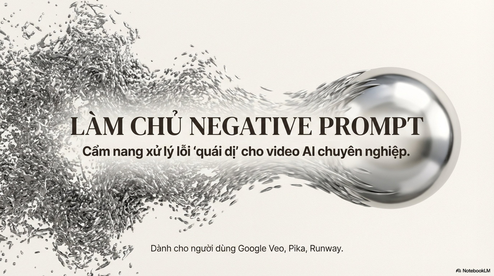

# B006 — Bản đọc toàn bộ 15 ảnh

Nguồn: [7 Kỹ Thuật Negative Prompt- Làm Thế Nào Để Cấm AI Đổi Màu Sắc và Bịa Thêm Phụ Kiện Giữa Các Cảnh? (Nhất quán)](https://drive.google.com/drive/folders/1wpVlWl2bK5HLQTZatRITBCh5eF3YeYWd).

**Cách ghi:** nội dung chính được diễn đạt lại từ chữ và hình trong ảnh; không phải bản chép nguyên văn toàn bộ. Quan sát ảnh tĩnh được tách khỏi lời giải thích bổ sung. Ảnh gốc được giữ nguyên để đối chiếu.

[Bài chính](README.md) · [Thực hành](thuc-hanh.md) · [Dữ liệu nguồn](nguon.json)

## B006-00 — Làm chủ negative prompt

Tên gốc: `7 Kỹ Thuật Negative Prompt- Làm Thế Nào Để Cấm AI Đổi Màu Sắc và Bịa Thêm Phụ Kiện Giữa Các Cảnh? (Nhất quán).jpg`.

**Nội dung chính đọc được:** Giới thiệu cẩm nang giảm lỗi cho người dùng Veo, Pika và Runway.

**Hình minh họa:** Khối kim loại tròn tan thành các mảnh; dấu NotebookLM.

**Phân tích bổ sung:** Cần kiểm hướng dẫn từng mô hình, không dùng cùng cú pháp cho mọi công cụ.

## B006-01 — Các lỗi hình thể

Tên gốc: `01.jpg`.

**Nội dung chính đọc được:** Nêu thừa ngón, cấu trúc dị dạng, mặt tan và chất liệu nhòe.

**Hình minh họa:** Bàn tay nhiều ngón, tượng người, mặt chảy và hai ảnh áo.

**Phân tích bổ sung:** Một số nhãn như cấu trúc mục tục không rõ nghĩa; không dùng làm thuật ngữ.

## B006-02 — Nội dung loại trừ

Tên gốc: `02.jpg`.

**Nội dung chính đọc được:** So sánh chỉ yêu cầu bình gốm với yêu cầu thêm tránh quai méo, hình lệch.

**Hình minh họa:** Sơ đồ một bình quai gợn và một bình quai đều hơn.

**Phân tích bổ sung:** Chữ JetBrains Mono lọt vào ví dụ là tên phông, không phải phần prompt.

## B006-03 — 1. Hình học

Tên gốc: `03.jpg`.

**Nội dung chính đọc được:** Tránh chi biến dạng, hình học méo, khớp xoắn và hình tan chảy.

**Hình minh họa:** Hai nhân vật đi bộ trước/sau, hình sau vẫn có chân kéo dài.

**Phân tích bổ sung:** Ảnh sau không chứng minh đã khắc phục lỗi; cần kiểm chuyển động.

## B006-04 — 2. Thừa chi

Tên gốc: `04.jpg`.

**Nội dung chính đọc được:** Tránh tay, chân, ngón thêm hoặc chi nhân đôi, nguồn nhấn mạnh anime/hành động/lowpoly.

**Hình minh họa:** Nhân vật cầm kiếm trước có tay dư, sau bớt tay.

**Phân tích bổ sung:** Tách chi thừa khỏi nhòe chuyển động hoặc các vị trí theo thời gian.

## B006-05 — 3. Mặt và biểu cảm

Tên gốc: `05.jpg`.

**Nội dung chính đọc được:** Tránh mặt méo, mắt lệch bất thường, môi dính và chi tiết mặt kéo giãn.

**Hình minh họa:** Hai chân dung, hình sau thêm lưới đối chiếu.

**Phân tích bổ sung:** Không đòi mặt đối xứng hoàn hảo; bất đối xứng tự nhiên thuộc danh tính.

## B006-06 — 4. Chất liệu hòa trộn

Tên gốc: `06.jpg`.

**Nội dung chính đọc được:** Tránh texture tràn, màu lem, bề mặt tan; tránh bóng nhựa nếu muốn mờ.

**Hình minh họa:** Robot đỏ xanh bóng méo so với robot lowpoly mờ.

**Phân tích bổ sung:** Bóng hay mờ là ý đồ chất liệu; không cấm bóng nếu đang mô tả kim loại hoặc nhựa bóng.

## B006-07 — 5. Phụ kiện tự thêm

Tên gốc: `07.jpg`.

**Nội dung chính đọc được:** Tránh phụ kiện, đồ ngẫu nhiên và họa tiết ngoài thiết kế.

**Hình minh họa:** Áo vàng có biểu tượng đối chiếu áo trơn.

**Phân tích bổ sung:** Cần danh sách vật được phép có, tránh từ rộng làm mất đạo cụ quan trọng.

## B006-08 — 6. Đổi màu/chất liệu

Tên gốc: `08.jpg`.

**Nội dung chính đọc được:** Tránh màu và vật liệu thay đổi giữa cảnh; khuyên dùng HEX, nêu ổn định 95–100%.

**Hình minh họa:** Hai áo xanh lệch màu đối chiếu hai áo xanh giống nhau.

**Phân tích bổ sung:** Tỷ lệ thiếu phép đo; ánh sáng có thể thay màu quan sát hợp lý.

## B006-09 — Tránh danh sách quá dài

Tên gốc: `09.jpg`.

**Nội dung chính đọc được:** Nguồn khuyên đừng nhồi 20–30 dòng riêng lẻ, ưu tiên yêu cầu rõ.

**Hình minh họa:** Búi chỉ rối và các khối xếp gọn cạnh biểu tượng chip.

**Phân tích bổ sung:** Không có ngưỡng số dòng phổ quát; độ liên quan và mâu thuẫn quan trọng hơn.

## B006-10 — Gom ba nhóm kiểm soát

Tên gốc: `010.jpg`.

**Nội dung chính đọc được:** Đề xuất Geometry Lock, Face Lock, Material Lock và nói hiệu quả gấp đôi.

**Hình minh họa:** Ba cột hình thể, mặt và vật liệu.

**Phân tích bổ sung:** Đây là nhãn tổ chức nội dung, không phải tham số khóa chính thức; gấp đôi chưa có dữ liệu.

## B006-11 — Kết quả mong muốn

Tên gốc: `011.jpg`.

**Nội dung chính đọc được:** Nêu hình thể ổn định, continuity và chất lượng chuyên nghiệp.

**Hình minh họa:** Cô gái hoạt hình chạy qua đồng hoa.

**Phân tích bổ sung:** Ảnh tĩnh không xác nhận ổn định xuyên khung hình.

## B006-12 — Giới hạn và chọn biến thể

Tên gốc: `012.jpg`.

**Nội dung chính đọc được:** Thừa nhận không bảo đảm 100%; gợi ý tạo ít nhất bốn bản rồi chọn.

**Hình minh họa:** Bốn phi hành gia với một bản được đánh dấu.

**Phân tích bổ sung:** Bốn là gợi ý của nguồn, không phải số bắt buộc hoặc tối ưu với mọi ngân sách.

## B006-13 — Kiểm soát sáng tạo

Tên gốc: `013.jpg`.

**Nội dung chính đọc được:** Nhấn mạnh loại trừ là một phần định hướng sáng tạo.

**Hình minh họa:** Bàn tay đỡ dải sáng.

**Phân tích bổ sung:** Nội dung loại trừ bổ trợ mô tả mong muốn và khâu duyệt.

## B006-14 — Ảnh bìa lặp

Tên gốc: `014.jpg`.

**Nội dung chính đọc được:** Lặp lại tên cẩm nang và phạm vi công cụ.

**Hình minh họa:** Khối kim loại cùng ảnh mở đầu.

**Phân tích bổ sung:** Tệp được đọc và giữ nguyên dù nội dung trùng.

## Kiểm kê

Đã mở trực tiếp 15/15 ảnh. Các mã nguồn theo thứ tự ở trên khớp [danh mục tệp](nguon.json). Chưa sinh hoặc đánh giá video từ câu lệnh của bài này.
