# B007 — Bản đọc toàn bộ 12 ảnh

Nguồn: [10 công cụ tạo Video AI tốt nhất - bạn cần biết để không bị bỏ lại phía sau](https://drive.google.com/drive/folders/1kQEIkAS6cgAaOJyujBFBgl13v8fIA1xH).

**Cách ghi:** nội dung chính được diễn đạt lại từ chữ và hình trong ảnh; không phải bản chép nguyên văn toàn bộ. Quan sát ảnh tĩnh được tách khỏi lời giải thích bổ sung. Ảnh gốc được giữ nguyên để đối chiếu.

[Bài chính](README.md) · [Thực hành](thuc-hanh.md) · [Dữ liệu nguồn](nguon.json)

## B007-00 — Hiệu quả marketing được nêu

Tên gốc: `10 công cụ tạo Video AI tốt nhất - bạn cần biết để không bị bỏ lại phía sau.jpg`.

**Nội dung chính đọc được:** Nguồn nêu video tăng tương tác 80% và chuyển đổi 60% so với ảnh.

**Hình minh họa:** Hai con số lớn và nền đồ thị đi lên.

**Phân tích bổ sung:** Không có nghiên cứu, tập mẫu hay định nghĩa chỉ số; ghi là tuyên bố chưa kiểm chứng.

## B007-01 — Ảnh thành video

Tên gốc: `01.jpg`.

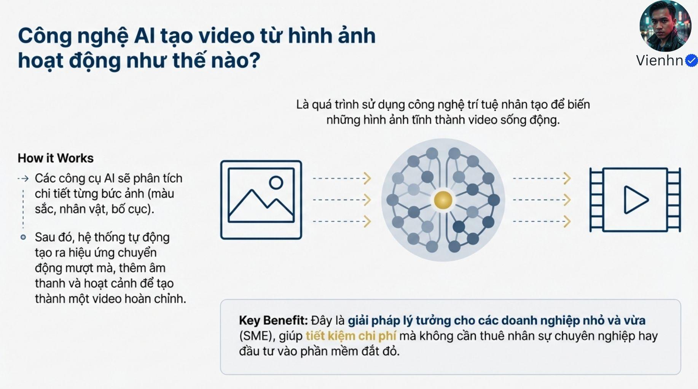

**Nội dung chính đọc được:** Mô tả phân tích màu, nhân vật, bố cục rồi tạo chuyển động, âm thanh; hướng tới doanh nghiệp nhỏ.

**Hình minh họa:** Sơ đồ ảnh → mạng trí tuệ → video.

**Phân tích bổ sung:** Không phải mọi công cụ đều sinh âm thanh hay tự tạo video hoàn chỉnh.

## B007-02 — Ví dụ TripAdvisor

Tên gốc: `02.jpg`.

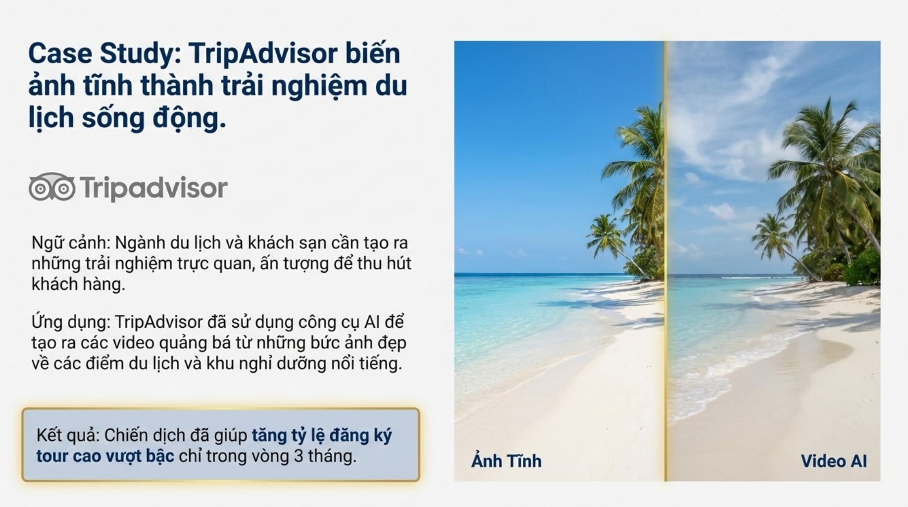

**Nội dung chính đọc được:** Nguồn kể TripAdvisor dùng ảnh điểm đến làm video và tăng đăng ký tour trong ba tháng.

**Hình minh họa:** Bãi biển chia đôi nhãn ảnh tĩnh/video AI.

**Phân tích bổ sung:** Không có tên chiến dịch, thời gian, liên kết hoặc dữ liệu; chỉ là ví dụ được nguồn gán tên.

## B007-03 — Ví dụ LangMaster

Tên gốc: `03.jpg`.

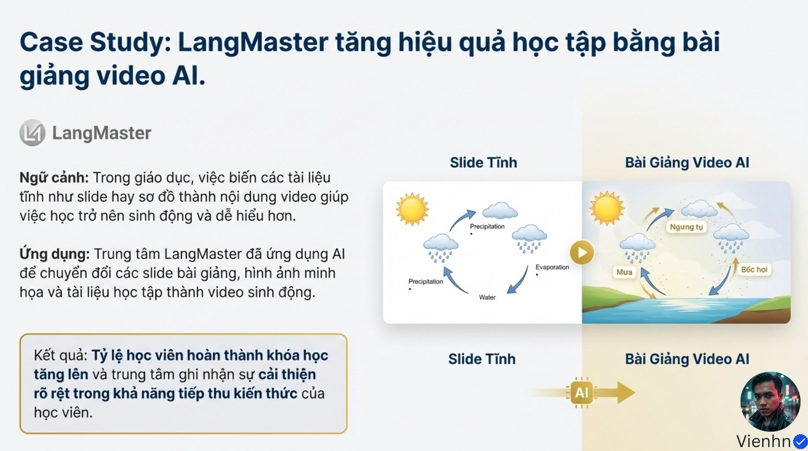

**Nội dung chính đọc được:** Nguồn kể chuyển slide thành video, tăng hoàn thành khóa và tiếp thu.

**Hình minh họa:** Sơ đồ vòng tuần hoàn nước trước/sau.

**Phân tích bổ sung:** Không có báo cáo đối chứng; hình còn có nhãn và vị trí thuật ngữ cần kiểm lại.

## B007-04 — Mười tên công cụ

Tên gốc: `04.jpg`.

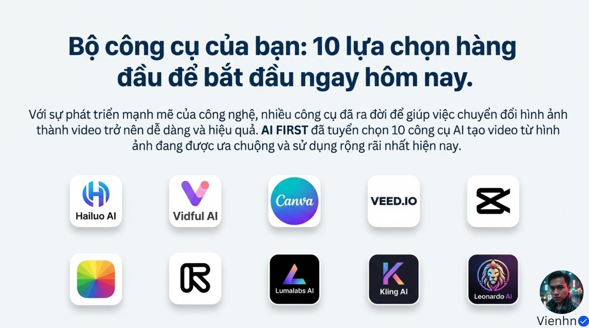

**Nội dung chính đọc được:** Danh sách hình biểu trưng Hailuo, Vidful, Canva, VEED, CapCut, Fotor, Runway, Luma, Kling, Leonardo; ghi AI FIRST tuyển chọn.

**Hình minh họa:** Lưới mười logo, một số vẽ cách điệu.

**Phân tích bổ sung:** Không có thang điểm, phiên bản hoặc thử nghiệm để gọi là mười công cụ tốt nhất.

## B007-05 — Nhóm dễ tiếp cận

Tên gốc: `05.jpg`.

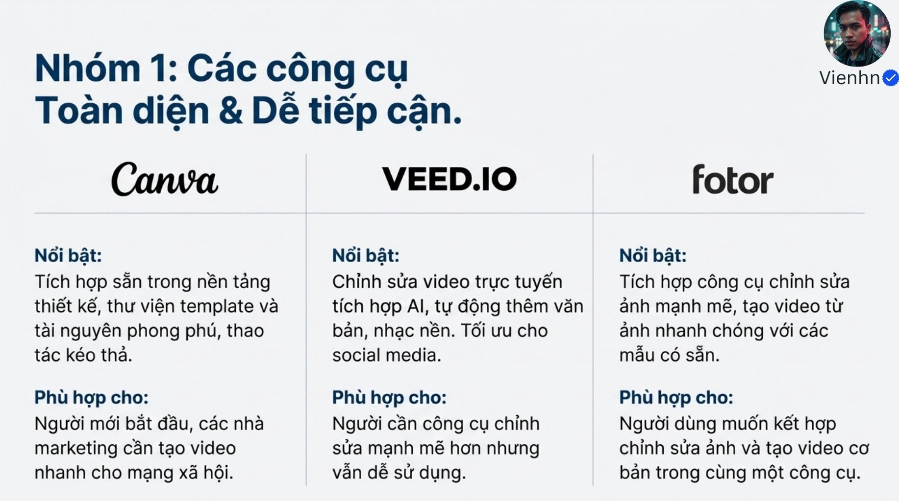

**Nội dung chính đọc được:** Nguồn giới thiệu Canva cho kéo thả/template, VEED cho biên tập online, Fotor cho kết hợp sửa ảnh và video.

**Hình minh họa:** Ba cột tên và mô tả.

**Phân tích bổ sung:** Phân loại theo công việc có ích; tính năng/gói hiện tại phải kiểm riêng.

## B007-06 — Nhóm mạng xã hội

Tên gốc: `06.jpg`.

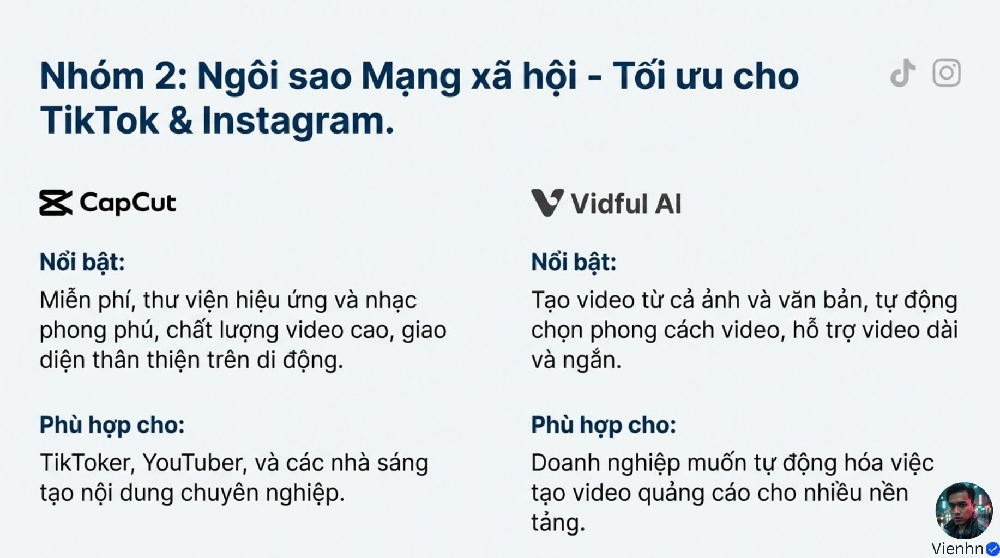

**Nội dung chính đọc được:** Nguồn giới thiệu CapCut cho hiệu ứng/nhạc trên di động, Vidful cho tự động tạo từ ảnh/chữ.

**Hình minh họa:** Hai cột CapCut và Vidful.

**Phân tích bổ sung:** Câu miễn phí không nói rõ phần nào; không mặc định toàn bộ tính năng và tài nguyên đều miễn phí.

## B007-07 — Nhóm chuyên sâu

Tên gốc: `07.jpg`.

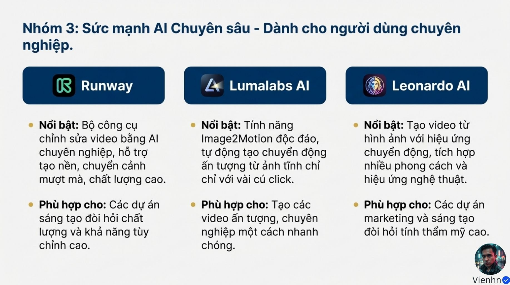

**Nội dung chính đọc được:** Nguồn nêu Runway, Luma, Leonardo; gắn Image2Motion với Luma và mô tả khả năng tùy chỉnh.

**Hình minh họa:** Ba cột logo và gạch đầu dòng.

**Phân tích bổ sung:** Tên Image2Motion trong ảnh sau lại gắn Leonardo; cần sửa phân biệt tên sản phẩm và thuật ngữ chung.

## B007-08 — Chọn hai ví dụ hướng dẫn

Tên gốc: `08.jpg`.

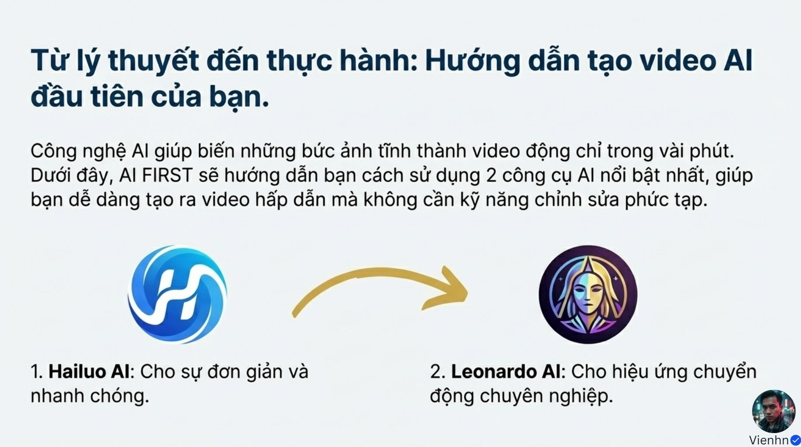

**Nội dung chính đọc được:** Nguồn chọn Hailuo cho nhanh đơn giản, Leonardo cho chuyển động.

**Hình minh họa:** Hai logo nối bằng mũi tên.

**Phân tích bổ sung:** Lựa chọn của tác giả không phải thứ hạng đã được đo.

## B007-09 — Các bước Hailuo

Tên gốc: `09.jpg`.

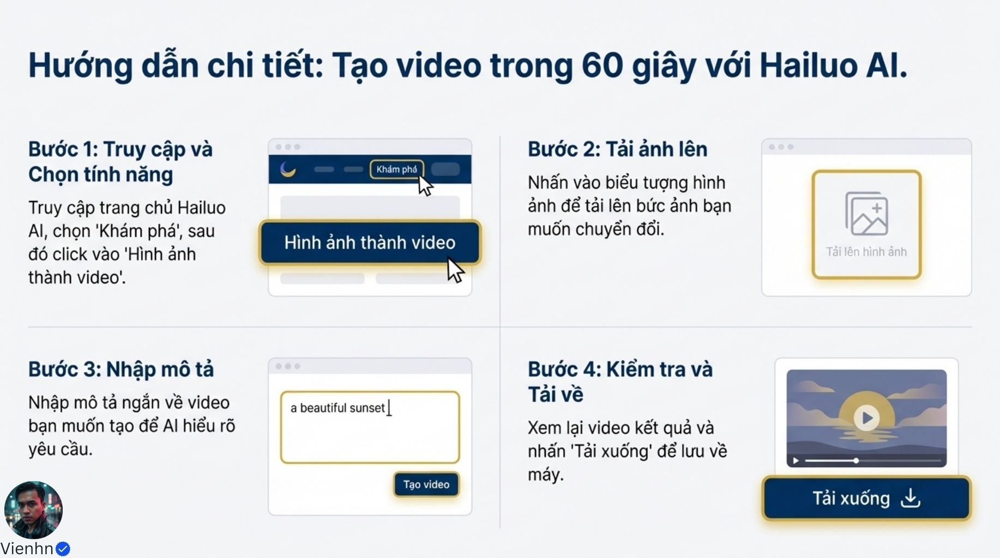

**Nội dung chính đọc được:** Chọn ảnh thành video, tải ảnh, nhập mô tả, kiểm tra rồi tải về; tiêu đề nói trong 60 giây.

**Hình minh họa:** Bốn ô giao diện minh họa và cảnh hoàng hôn.

**Phân tích bổ sung:** Đây là lưu đồ khái quát; không bảo đảm thời gian xử lý hoặc nhãn nút hiện tại.

## B007-10 — Các bước Leonardo

Tên gốc: `010.jpg`.

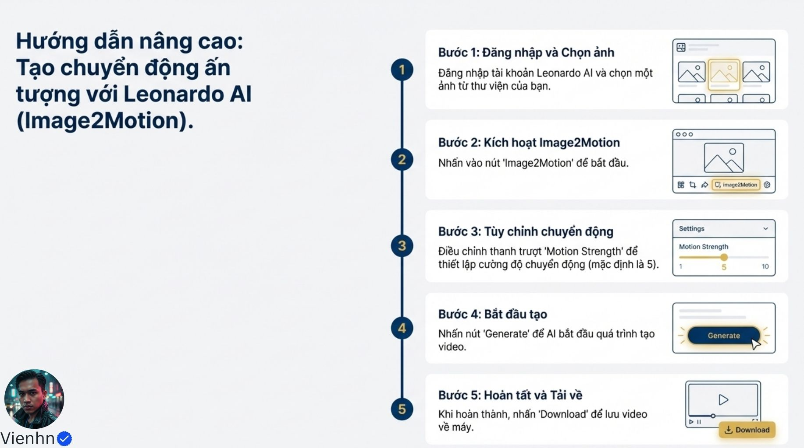

**Nội dung chính đọc được:** Chọn ảnh, Image2Motion, chỉnh Motion Strength mặc định 5, Generate rồi Download.

**Hình minh họa:** Năm bước, thanh trượt 1–10.

**Phân tích bổ sung:** Hướng dẫn có thể thuộc phiên bản cũ; tài liệu hiện hành có quy trình Generate Video/Create Video và nhiều mô hình.

## B007-11 — Kết luận về lợi ích

Tên gốc: `011.jpg`.

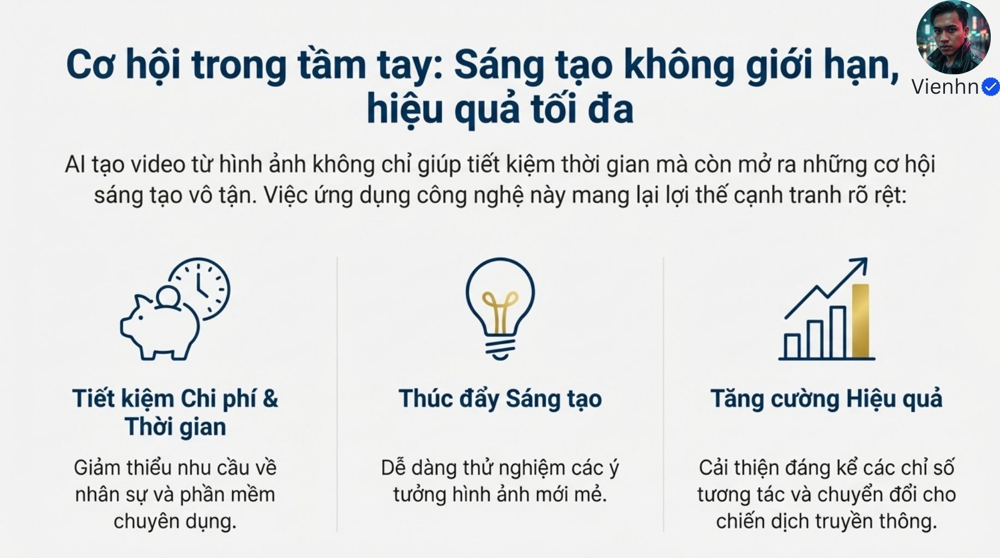

**Nội dung chính đọc được:** Nhấn mạnh tiết kiệm thời gian/chi phí, thêm khả năng thử ý tưởng và cải thiện hiệu quả.

**Hình minh họa:** Ba biểu tượng tiền/thời gian, bóng đèn và tăng trưởng.

**Phân tích bổ sung:** Cần đo cả số lần sinh lỗi và công sửa, không chỉ thời gian nhấn tạo.

## Kiểm kê

Đã mở trực tiếp 12/12 ảnh. Các mã nguồn theo thứ tự ở trên khớp [danh mục tệp](nguon.json). Chưa sinh hoặc đánh giá video từ câu lệnh của bài này.
