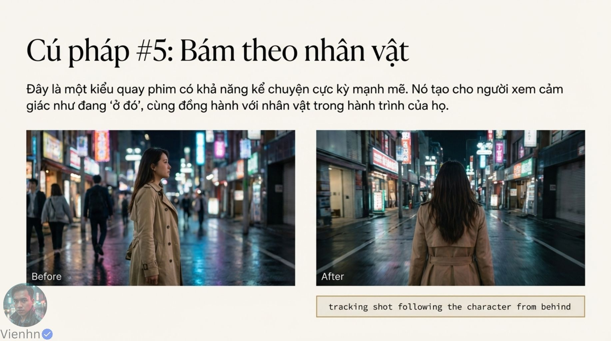
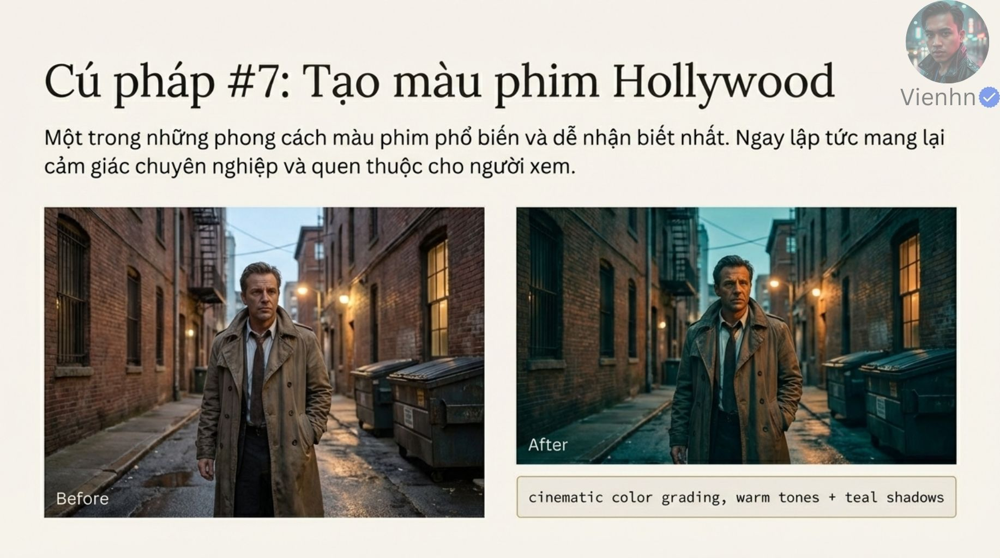

# Bài 008 — Mười cụm mô tả ánh sáng, đường máy và hoàn thiện

Đã đọc 18 ảnh gồm ba nhóm kiến thức: ánh sáng/khí quyển, máy/bố cục và hoàn thiện. Tài liệu giải nghĩa đủ mười cụm, chỉ ra điều quan sát được và cách chọn theo nhu cầu cảnh thay vì ghép tất cả vào một câu.

**Nguồn:** [10 Cú Pháp Prompt Google Veo Giúp Video Điện Ảnh Hơn](https://drive.google.com/drive/folders/1ctNomNol-Wsm_4FDwgpcRlnaAa7iPspU). Đã đọc **18/18 ảnh**. Ngày biên soạn: 17/10/2026.

[Đọc từng ảnh](doc-anh.md) · [Bài thực hành](thuc-hanh.md) · [Nguồn và mã kiểm tra](nguon.json) · [Danh mục toàn bộ](../../DANH-MUC-BAI-HOC.md)

**Quy ước:** phần “Nguồn” diễn đạt ý trong bộ ảnh. Phần “Phân tích và áp dụng” do người biên soạn bổ sung. Hiệu quả của câu lệnh chưa được kiểm nghiệm bằng lần tạo video trong đợt này.

## Những điều cần học

| Nội dung | Mã ảnh nguồn |
| --- | --- |
| Bảng tra đủ mười cụm | B008-04, B008-05, B008-06, B008-08, B008-09, B008-10, B008-12, B008-13, B008-14, B008-15, B008-17 |
| Thiết kế ánh sáng có nguồn và hướng | B008-03, B008-04, B008-05, B008-06 |
| Chuyển động máy và vùng nét dẫn chú ý | B008-07, B008-08, B008-09, B008-10 |
| Màu, tốc độ và âm thanh hoàn thiện ý đồ | B008-11, B008-12, B008-13, B008-14, B008-15 |

## 1. Bảng tra đủ mười cụm

**Nguồn:** Bộ ảnh gọi đây là mười cú pháp để nâng chất lượng hình ảnh.

**Phân tích và áp dụng:** Đây là các cụm mô tả bằng ngôn ngữ tự nhiên. Có thể viết bằng lời rõ hơn để phục vụ shot. Không có bằng chứng chúng là lệnh khóa hoặc luôn được thực hiện chính xác.

| Cụm trong nguồn | Nghĩa | Cách kiểm |
| --- | --- | --- |
| golden hour lighting | Ánh sáng giờ vàng | Nắng thấp có hướng; giữ chi tiết mặt. |
| soft rim light behind the subject | Viền sáng mềm từ phía sau | Tóc/vai có viền theo đúng phía nguồn sáng. |
| soft fog + volumetric light beams | Sương nhẹ và chùm sáng trong không khí | Tia đi từ nguồn hợp lý, không che mất hành động. |
| wide shot, slow dolly-in | Toàn cảnh, máy tiến chậm | Máy thực sự tiến tới; nền đổi tương quan phối cảnh. |
| tracking shot following the character from behind | Máy bám theo phía sau | Khoảng cách và hướng đi ổn định. |
| shallow depth of field, creamy bokeh | Vùng nét nông, nền mờ mịn | Chi tiết kể chuyện còn ở vùng nét. |
| cinematic color grading, warm tones + teal shadows | Chỉnh màu với tông ấm và bóng xanh ngả lục | Màu da và tính liên tục vẫn hợp ý đồ. |
| slow motion 30% | Chuyển động chậm, mục tiêu tốc độ 30% | Kiểm thời gian; cần chính xác thì chỉnh tốc độ ở khâu dựng. |
| soft ambient wind + natural ambience | Gió nền nhẹ và tiếng môi trường tự nhiên | Nguồn tiếng, mức âm và thời điểm hợp cảnh. |
| Negative: no flicker, no jitter, no distortion | Loại trừ nhấp nháy, giật và biến dạng | Chuyển sang cú pháp được công cụ hỗ trợ; xem toàn clip. |

**Ví dụ cho cảnh nông thôn:** Cảnh cơm chiều chỉ cần ánh nắng thấp, trung cảnh máy đứng và tiếng chén bát; không nhất thiết thêm sương, tracking hay bóng xanh.

**Kiểm tra kết quả:** Mỗi cụm thêm vào phải tạo một đặc điểm có thể quan sát hoặc nghe được.

## 2. Thiết kế ánh sáng có nguồn và hướng

**Nguồn:** Giờ vàng, viền sáng và sương/tia giúp tạo không khí và tách lớp.

**Phân tích và áp dụng:** Nêu vị trí cửa, mặt trời hoặc đèn; xác định mặt sáng, mặt tối và nền. Haze/sương vừa đủ làm rõ tia nhưng có thể làm giảm tương phản nếu quá dày. Giữ hướng sáng xuyên shot.

**Ví dụ cho cảnh nông thôn:** Mặt trời thấp phía sân trái tạo viền tóc Lan, ánh hắt từ tường sáng giữ chi tiết mặt; không thêm tia sáng từ bức tường kín.

**Kiểm tra kết quả:** Bóng và viền sáng cùng chỉ về nguồn hợp lý; mặt đọc được, không bị cháy viền.

## 3. Chuyển động máy và vùng nét dẫn chú ý

**Nguồn:** Máy tiến, máy bám và nền mờ tập trung người xem vào chủ thể.

**Phân tích và áp dụng:** Ghi điểm đầu/cuối, phía máy và khoảng cách cần giữ. Độ sâu trường ảnh nông chỉ có ích khi không che thông tin quan trọng. Phân biệt nền mờ do mất nét với nhòe chuyển động hoặc hiệu ứng kéo hướng tâm.

**Ví dụ cho cảnh nông thôn:** Máy bám sau Lan vào hiên; khi cô dừng, dùng cận mặt riêng để thấy phản ứng, thay vì vừa bám vừa tiến vừa đổi nét phức tạp.

**Kiểm tra kết quả:** Không nhảy cỡ cảnh; mắt hoặc đạo cụ mục tiêu luôn nét đúng lúc; nền không chảy.

## 4. Màu, tốc độ và âm thanh hoàn thiện ý đồ

**Nguồn:** Nguồn đề xuất màu ấm/bóng xanh, slow motion, âm thanh nền và loại trừ lỗi.

**Phân tích và áp dụng:** Chọn bảng màu theo tâm trạng. Slow motion thay nhịp thời gian, khác người tự di chuyển chậm. Nếu cần tốc độ đúng 30% so với thời gian thực, đo và xử lý trong dựng. Âm thanh môi trường cần vị trí, cường độ và nhịp; phần loại trừ tham khảo bài 006.

**Ví dụ cho cảnh nông thôn:** Giữ màu da tự nhiên trong bữa cơm; tiếng gió ngoài sân thấp hơn tiếng rổ chạm bàn, không dùng slow motion cho mọi động tác.

**Kiểm tra kết quả:** Xem liền với shot trước/sau; màu và nhịp hỗ trợ câu chuyện, âm không lấn hành động.

## Điểm cần hiểu có điều kiện

- Câu chỉ do ngôn ngữ mà video kém bỏ qua giới hạn công cụ, đầu vào và khâu chọn/dựng.
- Các cặp ảnh thay đổi nhiều yếu tố; không đủ kết luận thêm một cụm gây cải thiện trong mọi video.
- Rim light không tự tách chủ thể hoàn toàn; bokeh và sương cũng không luôn tăng chất lượng.
- Ảnh tĩnh không chứng minh dolly, tracking, slow motion, âm thanh hoặc giảm flicker/jitter.
- slow motion 30% là mô tả mục tiêu, không phải tham số bảo đảm tỉ lệ thời gian.
- Màu ấm/bóng xanh là một kiểu tạo hình, không đồng nghĩa điện ảnh hoặc Hollywood.
- Đối với Veo có trường negative, hướng dẫn Google khuyên liệt kê yếu tố không mong muốn thay vì nhiều câu no.

## Cách đưa vào quy trình sản xuất

Chọn thông tin và cảm xúc shot → thiết kế ánh sáng → chọn một đường máy hoặc máy đứng → quyết định vùng nét → hoàn thiện màu, nhịp, âm thanh → thử và kiểm toàn clip. Mỗi lần sửa ưu tiên một nhóm để biết điều gì thay đổi.

## Tự kiểm tra kiến thức

- Ảnh gần hơn có đủ chứng minh máy dolly-in không?
- Khi nào nền mờ làm mất thông tin cần thiết?
- Tốc độ 30% và 30 fps khác nhau ở đâu?

## Nguồn đối chiếu bổ sung

- [Google — Video generation prompt guide](https://docs.cloud.google.com/gemini-enterprise-agent-platform/models/video/video-gen-prompt-guide): Đối chiếu cách mô tả ánh sáng, vùng nét, thời gian, âm và nội dung loại trừ.

**Giới hạn:** đây là tài liệu học từ ảnh. Không dùng một hình minh họa để xác nhận chuyển động, thời lượng, độ chính xác thao tác hay khả năng hiện tại của một sản phẩm. Những phần chưa kiểm chứng được ghi rõ trong bản đọc ảnh.
