# B009 — Bản đọc toàn bộ 18 ảnh

Nguồn: [10 Cú Pháp Prompt Nâng Cấp Video AI Từ "Phèn" Tới Điện Ảnh](https://drive.google.com/drive/folders/1yc3Pan6xsBwx6nQMa2etxyMkUVJOL99P).

**Cách ghi:** nội dung chính được diễn đạt lại từ chữ và hình trong ảnh; không phải bản chép nguyên văn toàn bộ. Quan sát ảnh tĩnh được tách khỏi lời giải thích bổ sung. Ảnh gốc được giữ nguyên để đối chiếu.

[Bài chính](README.md) · [Thực hành](thuc-hanh.md) · [Dữ liệu nguồn](nguon.json)

## B009-00 — Bí mật của bậc thầy

Tên gốc: `10 Cú Pháp Prompt Nâng Cấp Video AI Từ "Phèn" Tới Điện Ảnh.jpg`.

**Nội dung chính đọc được:** Giới thiệu mười cụm prompt tạo hình điện ảnh, gắn tên VEO3.1 AI Video Prompting Masterclass.

**Hình minh họa:** Người thợ già nặn bình gốm, ánh cửa sổ từ trái.

**Phân tích bổ sung:** Dấu tên mô hình không xác nhận nguồn là tài liệu chính thức của hãng.

## B009-01 — Thiếu chiều sâu

Tên gốc: `01.jpg`.

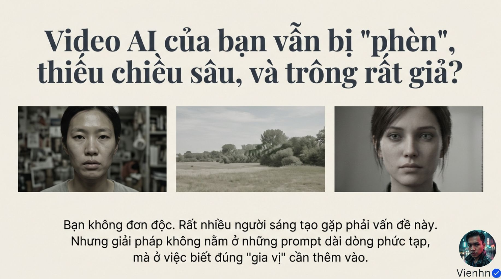

**Nội dung chính đọc được:** Nêu hình phẳng và giả; cho rằng cần thêm đúng gia vị thay vì prompt phức tạp.

**Hình minh họa:** Hai chân dung và một phong cảnh ít tương phản.

**Phân tích bổ sung:** Lời khuyên có ích khi hiểu mục tiêu, không có công thức thay mọi quyết định đạo diễn.

## B009-02 — Bốn học phần

Tên gốc: `02.jpg`.

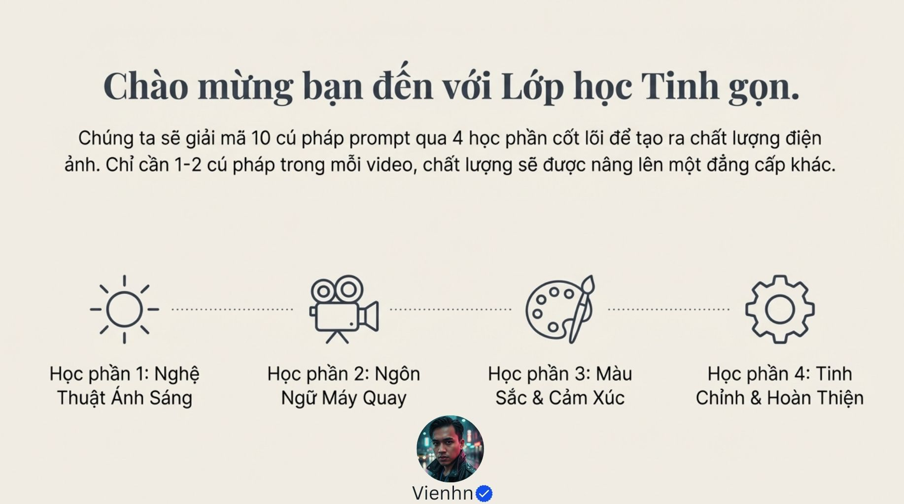

**Nội dung chính đọc được:** Chia thành ánh sáng, máy quay, màu/cảm xúc, tinh chỉnh/hoàn thiện; nói một hai cú pháp đủ nâng chất lượng.

**Hình minh họa:** Bốn biểu tượng theo hàng ngang.

**Phân tích bổ sung:** Cách chia khác B008 nhưng phần lớn nội dung lặp lại.

## B009-03 — Nghệ thuật ánh sáng

Tên gốc: `03.jpg`.

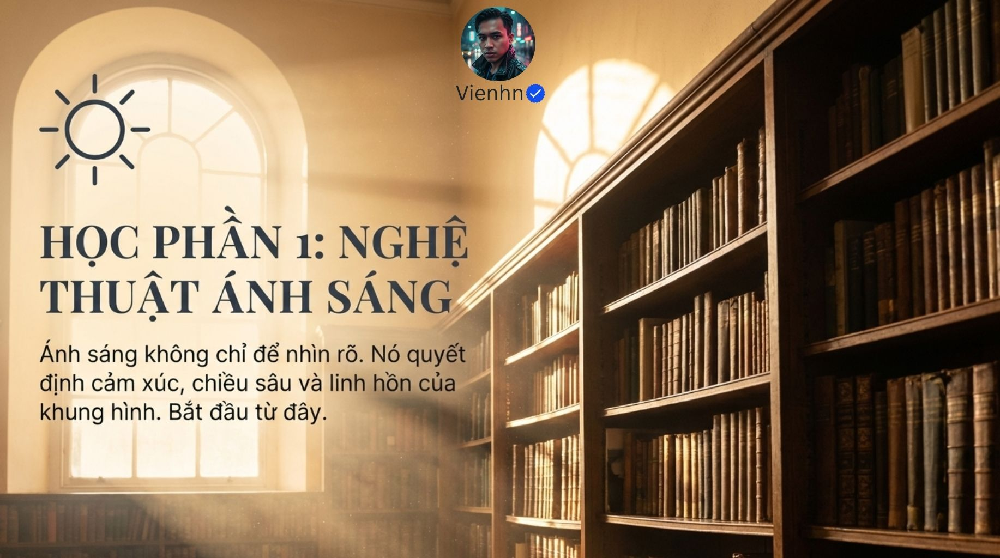

**Nội dung chính đọc được:** Ánh sáng phục vụ cảm xúc và chiều sâu.

**Hình minh họa:** Cửa sổ cao chiếu tia vào thư viện nhiều lớp kệ sách.

**Phân tích bổ sung:** Màu, hướng sáng, vật liệu và bố cục cùng tham gia tạo chiều sâu.

## B009-04 — Giờ vàng

Tên gốc: `04.jpg`.

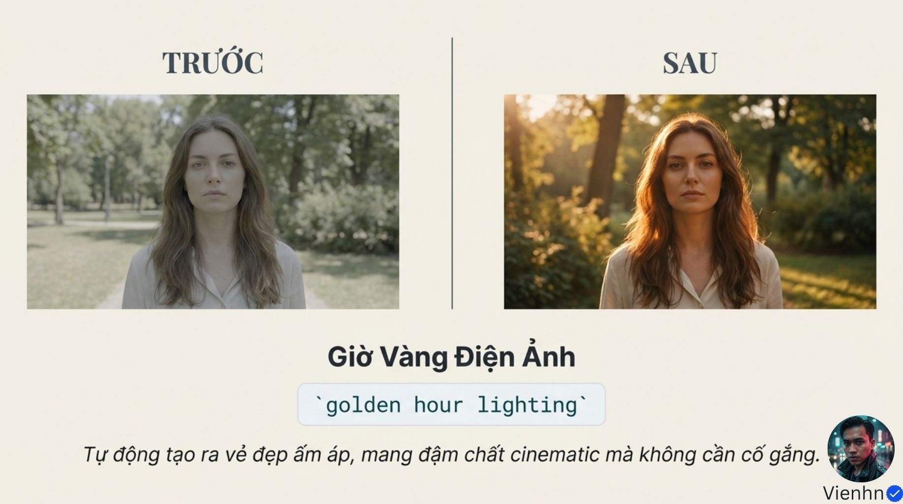

**Nội dung chính đọc được:** golden hour lighting: ánh sáng ấm khi mặt trời thấp.

**Hình minh họa:** Chân dung nữ từ nhạt sang nắng vàng có viền tóc.

**Phân tích bổ sung:** Không chỉ là tăng màu vàng hoặc độ bão hòa.

## B009-05 — Viền sáng

Tên gốc: `05.jpg`.

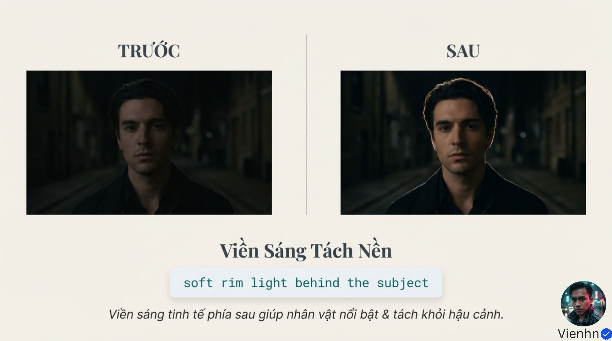

**Nội dung chính đọc được:** soft rim light behind the subject: viền mềm phía sau tách nền.

**Hình minh họa:** Chân dung nam tóc tối, bản sau có viền tóc.

**Phân tích bổ sung:** Cần nguồn sáng phía sau có lý do và kiểm mức sáng.

## B009-06 — Sương và tia

Tên gốc: `06.jpg`.

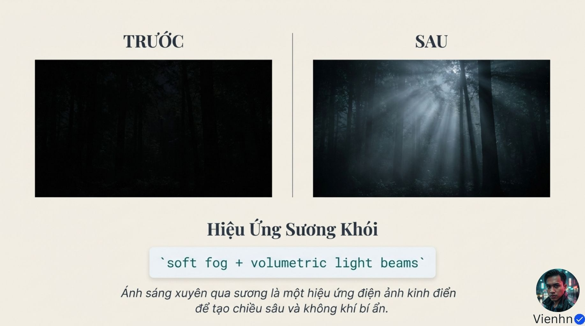

**Nội dung chính đọc được:** soft fog + volumetric light beams: sương nhẹ và các chùm sáng.

**Hình minh họa:** Rừng tối so với rừng có tia xuyên cây.

**Phân tích bổ sung:** Mật độ sương và hướng tia nên khớp không gian.

## B009-07 — Ngôn ngữ máy quay

Tên gốc: `07.jpg`.

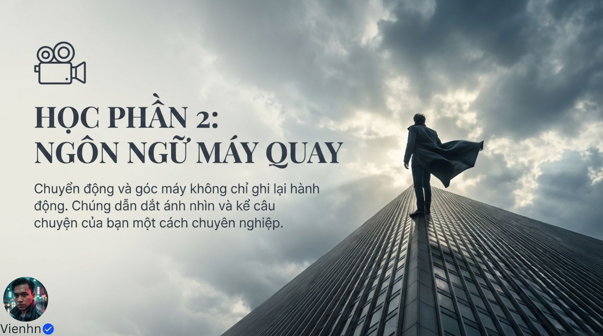

**Nội dung chính đọc được:** Chuyển động và góc máy dẫn nhìn và kể chuyện.

**Hình minh họa:** Người áo khoác trên hình tòa nhà theo góc thấp mạnh.

**Phân tích bổ sung:** Ảnh minh họa cách điệu không chứng minh đường máy hoặc vật lý.

## B009-08 — Máy tiến

Tên gốc: `08.jpg`.

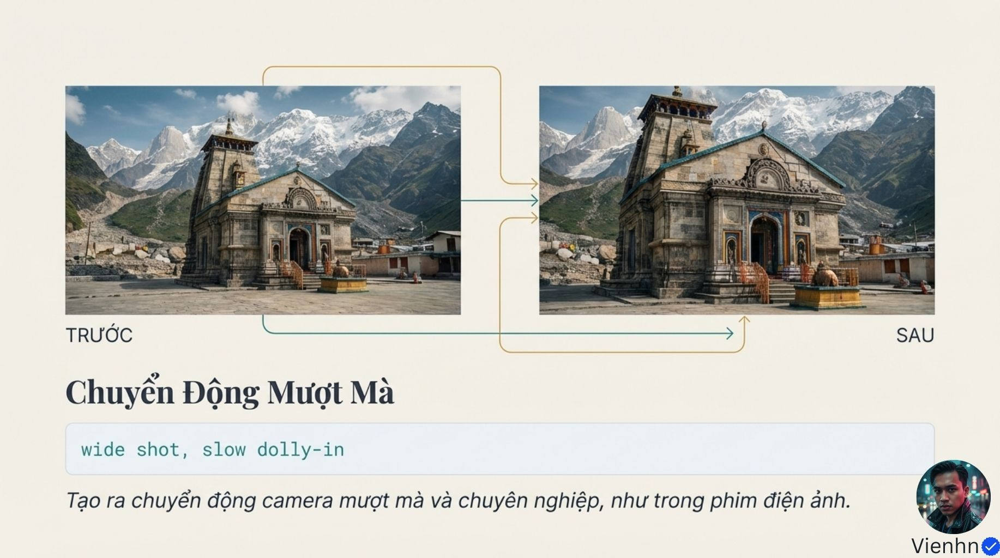

**Nội dung chính đọc được:** wide shot, slow dolly-in: từ khung rộng máy tiến chậm.

**Hình minh họa:** Hai ảnh công trình đá trước núi, mũi tên chỉ từ nhỏ sang lớn.

**Phân tích bổ sung:** Cần video để phân biệt tiến máy, zoom hoặc cắt gần.

## B009-09 — Nền mờ

Tên gốc: `09.jpg`.

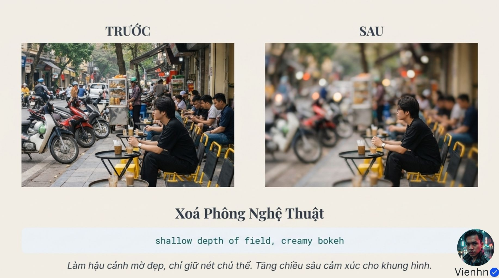

**Nội dung chính đọc được:** shallow depth of field, creamy bokeh: vùng nét nông và bokeh mịn.

**Hình minh họa:** Người ngồi quán vỉa hè, hình sau môi trường mờ mạnh.

**Phân tích bổ sung:** Nếu bối cảnh xã hội quan trọng thì mờ quá mức làm mất nghĩa.

## B009-10 — Máy theo dấu

Tên gốc: `010.jpg`.

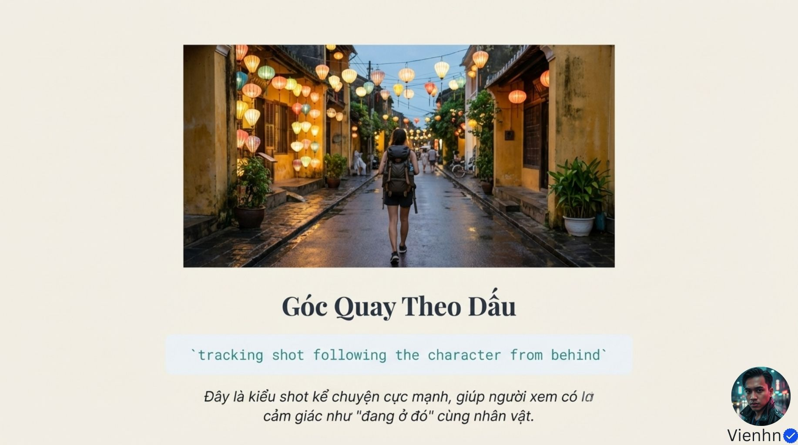

**Nội dung chính đọc được:** tracking shot following the character from behind: máy bám sau nhân vật.

**Hình minh họa:** Người đeo ba lô đi trên phố đèn lồng.

**Phân tích bổ sung:** Nhân vật nhìn từ sau nhưng ảnh tĩnh không cho biết máy có di chuyển.

## B009-11 — Màu và cảm xúc

Tên gốc: `011.jpg`.

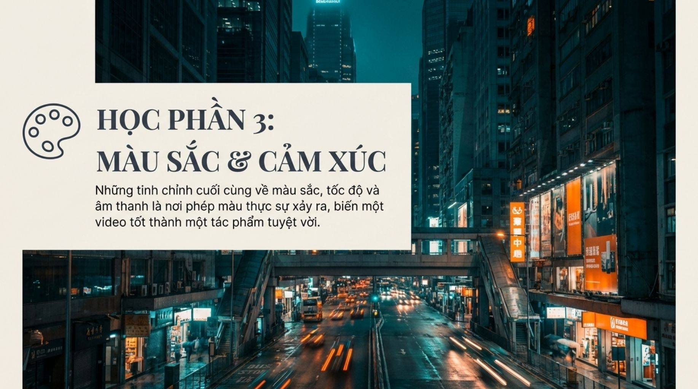

**Nội dung chính đọc được:** Nguồn gom màu, tốc độ và âm thanh như bước hoàn thiện.

**Hình minh họa:** Phố đêm xanh ngả lục, biển hiệu cam, vệt xe.

**Phân tích bổ sung:** Chọn chúng theo chức năng cảnh, không luôn là tinh chỉnh cuối cùng.

## B009-12 — Màu ấm/bóng xanh

Tên gốc: `012.jpg`.

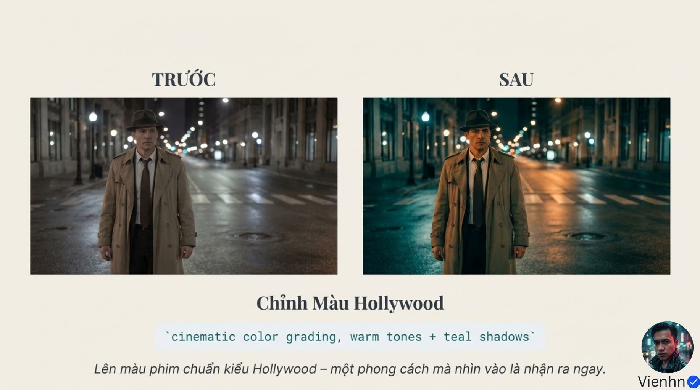

**Nội dung chính đọc được:** cinematic color grading, warm tones + teal shadows: chỉnh màu với sáng ấm và tối xanh.

**Hình minh họa:** Người đội mũ áo khoác trong phố đêm, bản sau cam/xanh rõ.

**Phân tích bổ sung:** Không có một chuẩn Hollywood duy nhất; màu da cần được duyệt.

## B009-13 — Slow motion

Tên gốc: `013.jpg`.

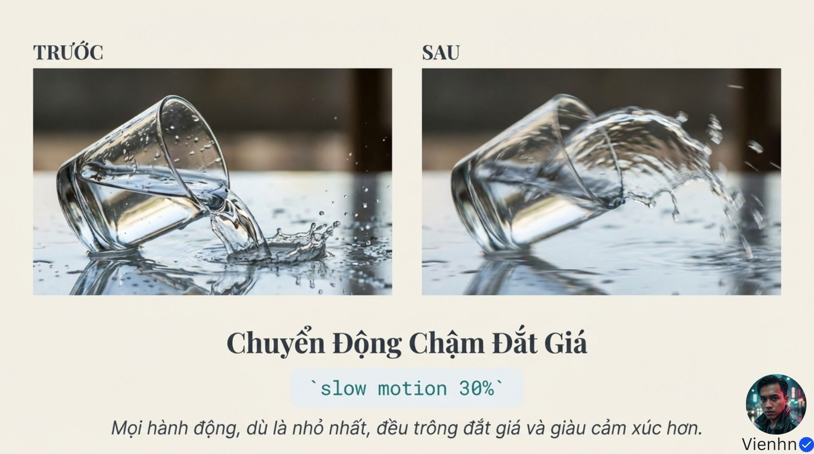

**Nội dung chính đọc được:** slow motion 30%: làm chậm hành động để nhấn trọng lượng cảm xúc.

**Hình minh họa:** Ly nghiêng và dòng nước, hình sau có vệt nhòe.

**Phân tích bổ sung:** Không thể đọc tốc độ 30% từ ảnh hoặc vệt nhòe.

## B009-14 — Âm thanh tự nhiên

Tên gốc: `014.jpg`.

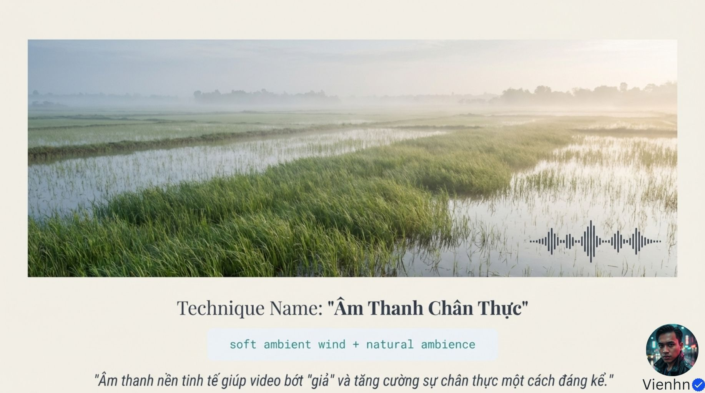

**Nội dung chính đọc được:** soft ambient wind + natural ambience: tiếng gió và môi trường nền nhẹ.

**Hình minh họa:** Đồng ngập nước có cỏ và biểu tượng sóng âm.

**Phân tích bổ sung:** Ảnh không chứa bằng chứng âm thanh; cần nghe clip thực tế.

## B009-15 — Nội dung loại trừ

Tên gốc: `015.jpg`.

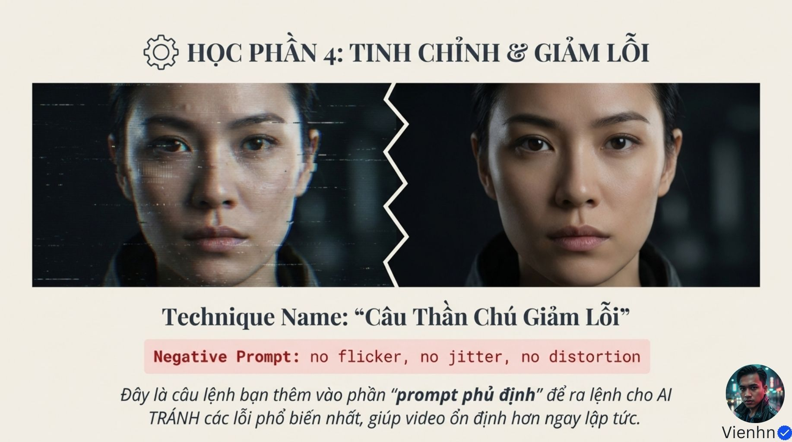

**Nội dung chính đọc được:** Nguồn dùng no flicker, no jitter, no distortion cho trường phủ định.

**Hình minh họa:** Chân dung có nhiễu đối chiếu chân dung sạch.

**Phân tích bổ sung:** Phải dùng cú pháp được model hỗ trợ; ảnh tĩnh không thể chứng minh hết nhấp nháy theo thời gian.

## B009-16 — Phối hợp

Tên gốc: `016.jpg`.

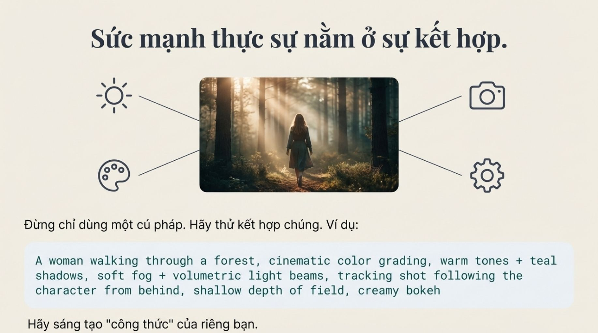

**Nội dung chính đọc được:** Mẫu người đi rừng kết hợp màu ấm/tối xanh, sương/tia, bám từ sau và nền mờ.

**Hình minh họa:** Người đi giữa các lớp cây có nắng và sương.

**Phân tích bổ sung:** Điểm bổ sung thực hành so với B008; cần ưu tiên để các cụm không che mục tiêu hành động.

## B009-17 — Kết bài

Tên gốc: `017.jpg`.

**Nội dung chính đọc được:** Nhấn mạnh áp dụng kiến thức để cải thiện video.

**Hình minh họa:** Bé gái nhìn đèn lồng, bokeh tiền/hậu cảnh.

**Phân tích bổ sung:** Thông điệp khích lệ không phải kết quả đo chất lượng.

## Kiểm kê

Đã mở trực tiếp 18/18 ảnh. Các mã nguồn theo thứ tự ở trên khớp [danh mục tệp](nguon.json). Chưa sinh hoặc đánh giá video từ câu lệnh của bài này.
