# B010 — Bản đọc toàn bộ 14 ảnh

Nguồn: [Bí Kíp Làm Chủ Ngôn Ngữ Điện Ảnh Cùng Veo3.1](https://drive.google.com/drive/folders/1VBQ0HiAWGWtDEMz2kQc5CwVu9gJroWHd).

**Cách ghi:** nội dung chính được diễn đạt lại từ chữ và hình trong ảnh; không phải bản chép nguyên văn toàn bộ. Quan sát ảnh tĩnh được tách khỏi lời giải thích bổ sung. Ảnh gốc được giữ nguyên để đối chiếu.

[Bài chính](README.md) · [Thực hành](thuc-hanh.md) · [Dữ liệu nguồn](nguon.json)

## B010-00 — Làm chủ ngôn ngữ hình ảnh

Tên gốc: `Bí Kíp Làm Chủ Ngôn Ngữ Điện Ảnh Cùng Veo3.1.jpg`.

**Nội dung chính đọc được:** Giới thiệu ba nhóm cỡ cảnh, góc máy và chuyển động với Veo 3.1.

**Hình minh họa:** Nền vòng sáng và tiêu đề lớn.

**Phân tích bổ sung:** Tên mô hình không thay thế kiểm tra khả năng thực thi.

## B010-01 — Prompt có chủ đích

Tên gốc: `01.jpg`.

**Nội dung chính đọc được:** Cho rằng ngôn ngữ camera giúp tăng chất điện ảnh.

**Hình minh họa:** Trái người làm máy tính trong phòng sáng; phải người khác viết dưới đèn tối.

**Phân tích bổ sung:** Khác người, hành động, bối cảnh và ánh sáng; không phải đối chứng một biến camera.

## B010-02 — Ba yếu tố

Tên gốc: `02.jpg`.

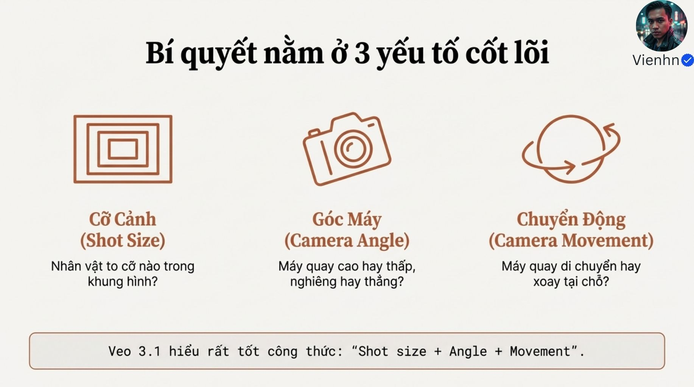

**Nội dung chính đọc được:** Shot size: người chiếm khung bao nhiêu; angle: cao/thấp/nghiêng; movement: máy xoay hoặc di chuyển.

**Hình minh họa:** Ba biểu tượng khung hình, máy, vòng chuyển động.

**Phân tích bổ sung:** Đây là checklist hình ảnh, cần thêm hành động và bối cảnh.

## B010-03 — Cỡ cảnh và khoảng cách

Tên gốc: `03.jpg`.

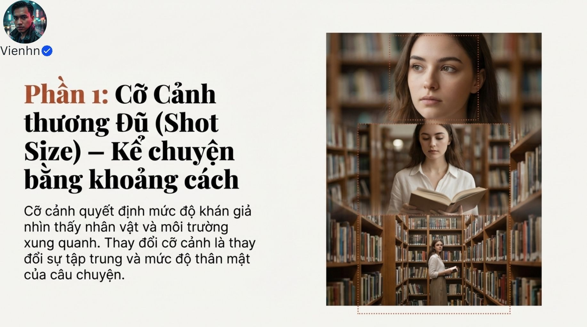

**Nội dung chính đọc được:** Cỡ cảnh kiểm soát lượng thông tin môi trường và sự tập trung vào người.

**Hình minh họa:** Một người đọc sách ở ba khung từ gần tới rộng.

**Phân tích bổ sung:** Cỡ cảnh không đồng nhất tiêu cự hoặc khoảng cách vật lý.

## B010-04 — Bốn cỡ cơ bản

Tên gốc: `04.jpg`.

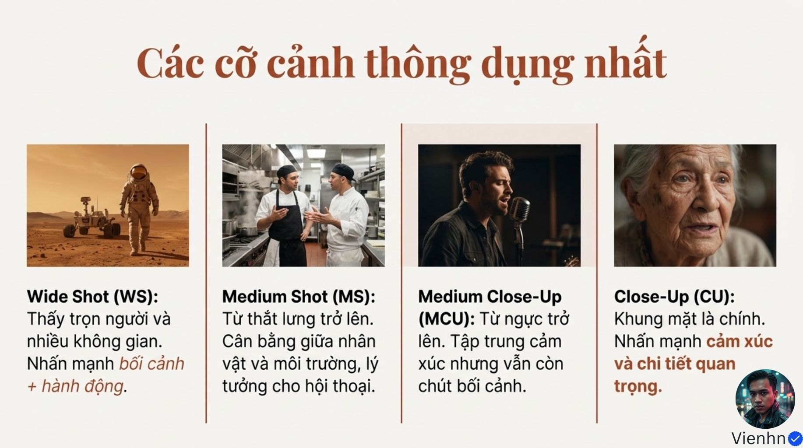

**Nội dung chính đọc được:** WS thấy trọn người và không gian; MS khoảng eo lên; MCU khoảng ngực lên; CU tập trung mặt.

**Hình minh họa:** Phi hành gia, hai đầu bếp, ca sĩ, bà lão.

**Phân tích bổ sung:** Các ranh giới là quy ước tương đối; nên ghi phần cơ thể và đồ vật cần thấy.

## B010-05 — Hai cực của cỡ cảnh

Tên gốc: `05.jpg`.

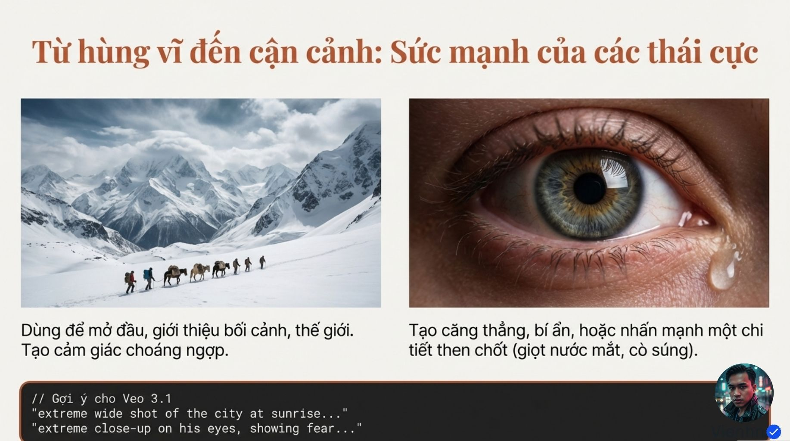

**Nội dung chính đọc được:** EWS giới thiệu thế giới và quy mô; ECU nhấn chi tiết như mắt/nước mắt; mẫu đô thị bình minh và mắt sợ.

**Hình minh họa:** Đoàn người nhỏ giữa núi tuyết đối chiếu một mắt rất lớn.

**Phân tích bổ sung:** Cảm xúc phụ thuộc ngữ cảnh; không phải cứ cực rộng là hùng vĩ hay cực cận là sợ.

## B010-06 — Vị trí và góc

Tên gốc: `06.jpg`.

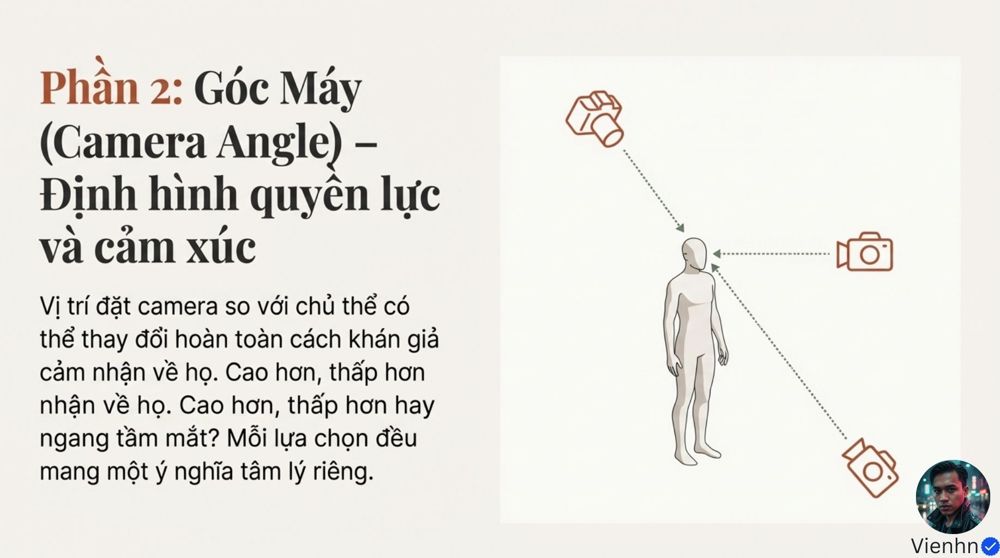

**Nội dung chính đọc được:** Góc cao, ngang và thấp thay đổi cách nhìn nhận người.

**Hình minh họa:** Sơ đồ máy trên cao, ngang mắt và thấp hướng về người.

**Phân tích bổ sung:** Tách độ cao đặt máy khỏi hướng chĩa máy; thấp nhưng hướng ngang chưa chắc là nhìn hất lên.

## B010-07 — Ba góc cơ bản

Tên gốc: `07.jpg`.

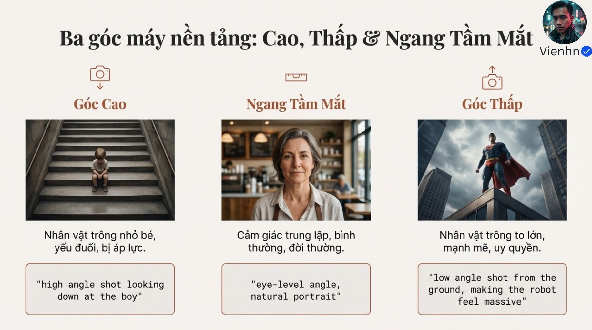

**Nội dung chính đọc được:** Nguồn gắn cao với yếu thế, ngang mắt với đời thường, thấp với sức mạnh.

**Hình minh họa:** Trẻ trên cầu thang, chân dung quán, siêu anh hùng.

**Phân tích bổ sung:** Đây là gợi ý biểu đạt, không phải ý nghĩa tâm lý cố định.

## B010-08 — Góc nghiêng và điểm đặt đặc biệt

Tên gốc: `08.jpg`.

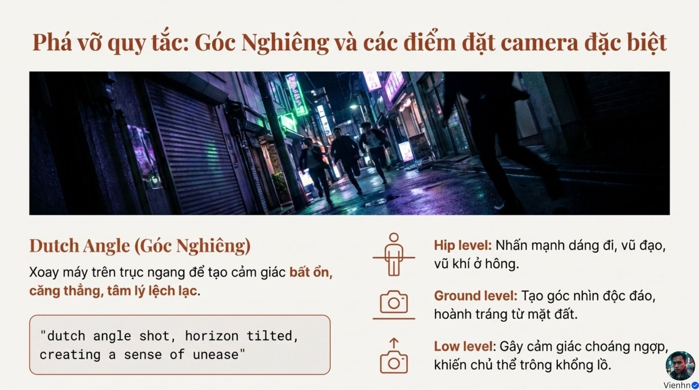

**Nội dung chính đọc được:** Dutch angle tạo chân trời nghiêng; thêm hip level, ground level, low level. Nguồn mô tả xoay trên trục ngang.

**Hình minh họa:** Phố neon nghiêng và biểu tượng độ cao máy.

**Phân tích bổ sung:** Diễn đạt dễ nhầm trục: góc nghiêng là lăn khung quanh hướng nhìn của ống kính; khác tilt ngẩng/cúi.

## B010-09 — Xoay và tịnh tiến

Tên gốc: `09.jpg`.

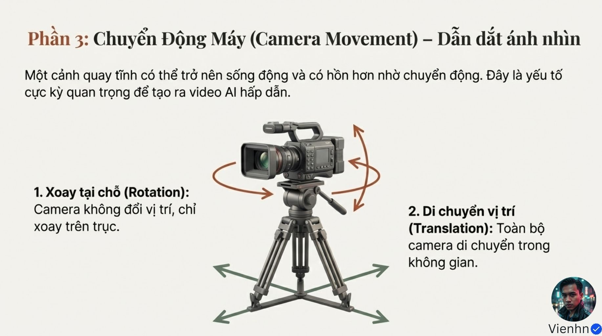

**Nội dung chính đọc được:** Rotation: máy ở tại vị trí, đổi hướng; translation: cả máy đổi vị trí.

**Hình minh họa:** Máy chân ba với mũi tên xoay và mũi tên di chuyển.

**Phân tích bổ sung:** Shot tĩnh cũng có giá trị; không buộc camera luôn chuyển động.

## B010-10 — Bốn chuyển động

Tên gốc: `010.jpg`.

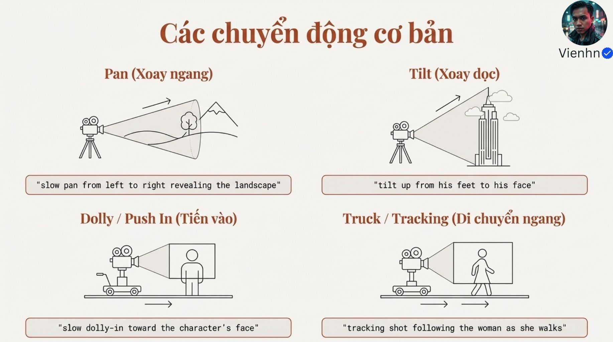

**Nội dung chính đọc được:** Pan xoay trái/phải; tilt ngẩng/cúi; dolly/push-in tiến tới; truck/tracking di chuyển ngang theo người.

**Hình minh họa:** Bốn sơ đồ và ví dụ phong cảnh, chân tới mặt, tiến tới mặt, đi theo phụ nữ.

**Phân tích bổ sung:** Tracking không chỉ ngang; truck là tịnh tiến ngang. Sơ đồ pan nhìn bên có thể gây nhầm với tilt.

## B010-11 — Phối hợp ba nhóm

Tên gốc: `011.jpg`.

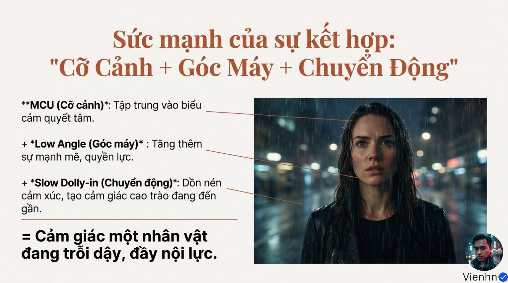

**Nội dung chính đọc được:** MCU + low angle + slow dolly-in nhằm gợi nhân vật quyết tâm trỗi dậy.

**Hình minh họa:** Người phụ nữ ướt dưới mưa, các đường chú thích.

**Phân tích bổ sung:** MCU là cận vừa, không đồng nghĩa mọi cận cảnh. Cần ghi hành vi nhìn thấy được.

## B010-12 — Bảng cảm xúc

Tên gốc: `012.jpg`.

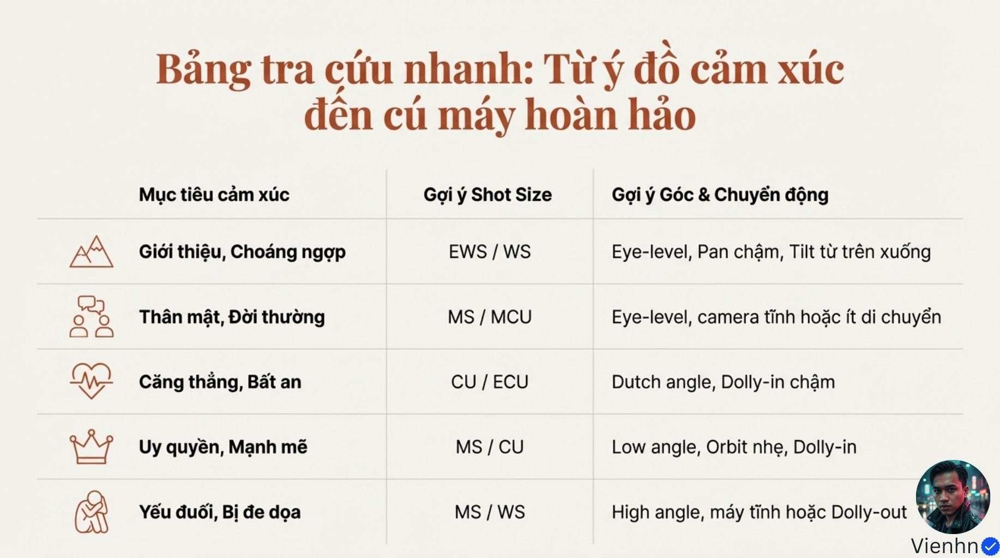

**Nội dung chính đọc được:** Gợi ý cỡ/góc/chuyển động cho giới thiệu, đời thường, bất an, uy quyền, yếu thế; có orbit nhẹ và dolly-out.

**Hình minh họa:** Bảng năm dòng cảm xúc.

**Phân tích bổ sung:** Orbit là máy đi vòng quanh chủ thể; bảng là gợi ý, không phải công thức tâm lý phổ quát.

## B010-13 — Kết thúc

Tên gốc: `013.jpg`.

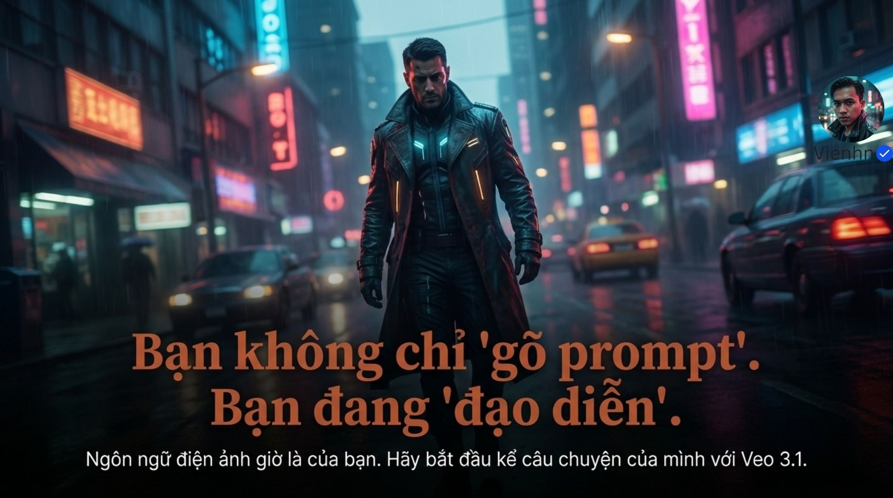

**Nội dung chính đọc được:** Khuyên dùng ngôn ngữ điện ảnh để kể câu chuyện.

**Hình minh họa:** Người mặc áo khoác trên phố neon mưa.

**Phân tích bổ sung:** Chốt ý đồ rồi kiểm kết quả; không chỉ chọn thuật ngữ có vẻ chuyên nghiệp.

## Kiểm kê

Đã mở trực tiếp 14/14 ảnh. Các mã nguồn theo thứ tự ở trên khớp [danh mục tệp](nguon.json). Chưa sinh hoặc đánh giá video từ câu lệnh của bài này.
