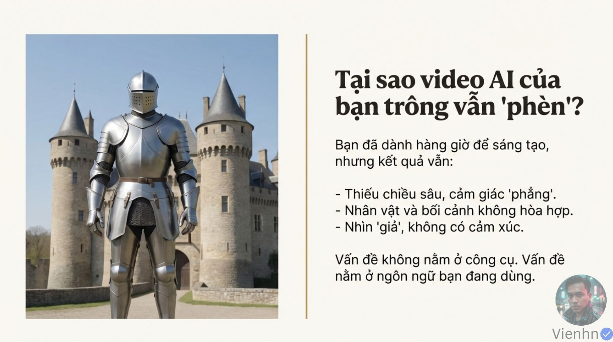
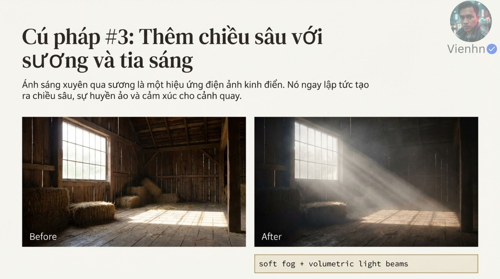
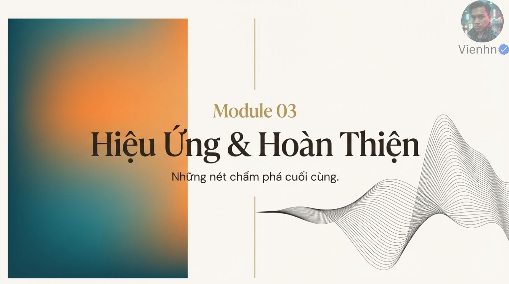
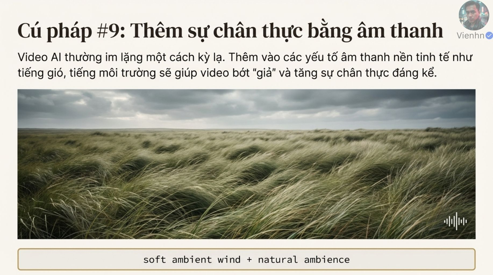
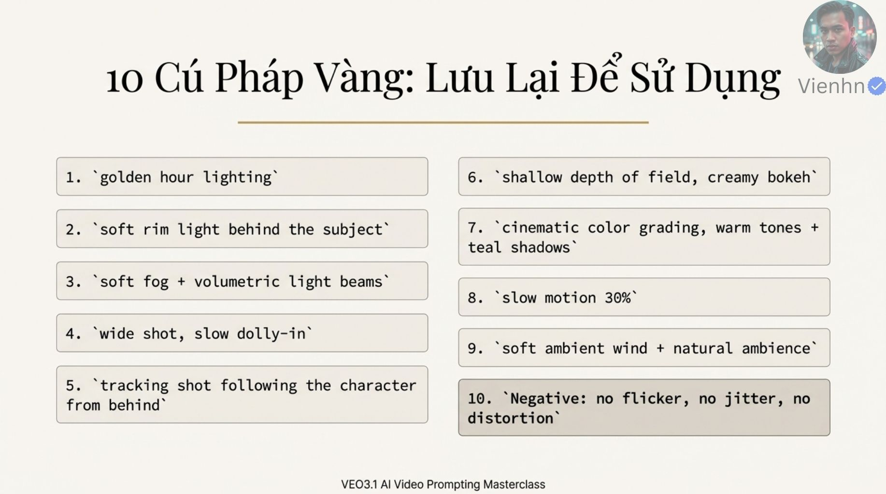

# B011 — Bản đọc toàn bộ 18 ảnh

Nguồn: [Bí Mật Cinematic Với Prompt Veo3.1- Dùng Golden Hour, Bokeh và Slow Motion Để Tạo Ra Video AI Chuẩn Hollywood](https://drive.google.com/drive/folders/1BwpHpUkcMaVEYLEZKiPSXNTDTq2S7I15).

**Cách ghi:** nội dung chính được diễn đạt lại từ chữ và hình trong ảnh; không phải bản chép nguyên văn toàn bộ. Quan sát ảnh tĩnh được tách khỏi lời giải thích bổ sung. Ảnh gốc được giữ nguyên để đối chiếu.

[Bài chính](README.md) · [Thực hành](thuc-hanh.md) · [Dữ liệu nguồn](nguon.json)

## B011-00 — Mở bài mười cụm prompt

Tên gốc: `Bí Mật Cinematic Với Prompt Veo3.1- Dùng Golden Hour, Bokeh và Slow Motion Để Tạo Ra Video AI Chuẩn Hollywood.jpg`.

**Nội dung chính đọc được:** Giới thiệu mười cú pháp hướng tới hình ảnh điện ảnh, gắn tên Veo 3.1.

**Hình minh họa:** Phi hành gia ở tiền cảnh phải, thung lũng và mặt trời phía sau.

**Phân tích bổ sung:** Dấu tên mô hình trong ảnh không xác nhận đây là tài liệu chính thức của Google.

## B011-01 — Vấn đề hình ảnh phẳng

Tên gốc: `01.jpg`.

**Nội dung chính đọc được:** Nguồn nêu thiếu chiều sâu, người/nền không hòa hợp, hình giả và thiếu cảm xúc; quy nguyên nhân cho ngôn ngữ.

**Hình minh họa:** Hiệp sĩ trước lâu đài dưới trời sáng.

**Phân tích bổ sung:** Còn có giới hạn mô hình, ảnh đầu vào và quá trình chọn bản; không chỉ do cách viết.

## B011-02 — Bổ sung từ vựng

Tên gốc: `02.jpg`.

**Nội dung chính đọc được:** Đề nghị thêm một hoặc hai cụm, bắt đầu bằng ánh sáng và khí quyển.

**Hình minh họa:** Một hiệp sĩ đơn giản qua biểu tượng chìa khóa thành khung ấm.

**Phân tích bổ sung:** Cụm từ là mô tả mong muốn, không phải cú pháp lập trình có kết quả bảo đảm.

## B011-03 — Mô-đun ánh sáng

Tên gốc: `03.jpg`.

**Nội dung chính đọc được:** Mở phần ánh sáng và khí quyển.

**Hình minh họa:** Rừng có tia sáng xuyên sương giữa các lớp cây.

**Phân tích bổ sung:** Dùng hướng sáng và các lớp không gian để giải thích chiều sâu.

## B011-04 — 1. Giờ vàng

Tên gốc: `04.jpg`.

**Nội dung chính đọc được:** golden hour lighting: ánh sáng ấm khi mặt trời thấp, nguồn minh họa người phụ nữ trên đồng.

**Hình minh họa:** Trái nắng gắt, phải ngược nắng vàng.

**Phân tích bổ sung:** Cần xác định hướng mặt trời và mức sáng trên mặt, tránh chỉ phủ màu vàng.

## B011-05 — 2. Viền sáng

Tên gốc: `05.jpg`.

**Nội dung chính đọc được:** soft rim light behind the subject: viền sáng mềm phía sau người để tách nền.

**Hình minh họa:** Chân dung nam áo tối, hình sau có viền tóc và vai.

**Phân tích bổ sung:** Viền sáng hỗ trợ tách lớp, không tự tách hoàn toàn nếu màu/độ sáng gần nhau.

## B011-06 — 3. Sương và tia

Tên gốc: `06.jpg`.

**Nội dung chính đọc được:** soft fog + volumetric light beams: sương nhẹ và chùm sáng thấy trong không khí.

**Hình minh họa:** Nhà kho có cửa sổ, hình sau thêm bụi/sương và tia xiên.

**Phân tích bổ sung:** Hướng chùm sáng phải khớp cửa; sương dày có thể làm mất chi tiết.

## B011-07 — Mô-đun máy và bố cục

Tên gốc: `07.jpg`.

**Nội dung chính đọc được:** Mở phần máy quay và bố cục.

**Hình minh họa:** Máy trên ray và sơ đồ đường đi cong quanh người.

**Phân tích bổ sung:** Đây là nhóm quyết định điểm nhìn và chuyển động, không phải chỉ hiệu ứng.

## B011-08 — 4. Máy tiến chậm

Tên gốc: `08.jpg`.

**Nội dung chính đọc được:** wide shot, slow dolly-in: bắt đầu toàn cảnh rồi máy tiến từ từ.

**Hình minh họa:** Cặp đôi dã ngoại, hình sau gần hơn và nền nhòe hướng tâm.

**Phân tích bổ sung:** Ảnh gần hơn không chứng minh dolly thật; phải xem thị sai và đường máy trong clip.

## B011-09 — 5. Bám từ sau

Tên gốc: `09.jpg`.

**Nội dung chính đọc được:** tracking shot following the character from behind: máy đi theo sau nhân vật.

**Hình minh họa:** Một phụ nữ trong phố neon; hình sau nhìn lưng.

**Phân tích bổ sung:** Cần quy định khoảng cách và hướng đi, kiểm nhân vật không tự xoay mặt.

## B011-10 — 6. Độ sâu trường ảnh nông

Tên gốc: `010.jpg`.

**Nội dung chính đọc được:** shallow depth of field, creamy bokeh: vùng nét nông, hậu cảnh mờ mịn.

**Hình minh họa:** Người thợ già, hình sau nền nhòe mạnh và tư thế thay đổi.

**Phân tích bổ sung:** Mờ nền chọn lọc không tương đương mọi thứ trừ người đều được xóa; phải giữ chi tiết cần kể.

## B011-11 — Mô-đun hoàn thiện

Tên gốc: `011.jpg`.

**Nội dung chính đọc được:** Mở phần hiệu ứng và hoàn thiện.

**Hình minh họa:** Mảng màu cam/xanh và đường sóng trang trí.

**Phân tích bổ sung:** Cần chốt cấu trúc shot trước khi thêm phong cách màu.

## B011-12 — 7. Màu ấm và bóng xanh

Tên gốc: `012.jpg`.

**Nội dung chính đọc được:** cinematic color grading, warm tones + teal shadows: tông ấm và vùng tối xanh ngả lục.

**Hình minh họa:** Người mặc áo khoác trong ngõ, hình sau xanh đậm hơn.

**Phân tích bổ sung:** Đây là một lựa chọn bảng màu, không đại diện cho tất cả phim Hollywood.

## B011-13 — 8. Chuyển động chậm

Tên gốc: `013.jpg`.

**Nội dung chính đọc được:** slow motion 30%: nguồn muốn làm hành động chậm và đáng chú ý hơn.

**Hình minh họa:** Hai ảnh ly nghiêng và nước bắn, khác bố cục lẫn ánh sáng.

**Phân tích bổ sung:** Ảnh tĩnh không cho biết tốc độ. 30% là mục tiêu cần đo hoặc thực hiện ở khâu dựng.

## B011-14 — 9. Âm thanh môi trường

Tên gốc: `014.jpg`.

**Nội dung chính đọc được:** soft ambient wind + natural ambience: gió nền nhẹ và môi trường tự nhiên.

**Hình minh họa:** Đồng cỏ gió với biểu tượng sóng âm.

**Phân tích bổ sung:** Không thể nghe âm thanh từ biểu tượng; cần chế độ sinh âm hoặc bổ sung hậu kỳ.

## B011-15 — 10. Giảm lỗi

Tên gốc: `015.jpg`.

**Nội dung chính đọc được:** Negative: no flicker, no jitter, no distortion: nhắm nhấp nháy, rung giật, biến dạng.

**Hình minh họa:** Hai chân dung dưới kính lúp.

**Phân tích bổ sung:** Thực hành theo trường negative của mô hình; không coi danh sách là thần chú.

## B011-16 — Kết luận

Tên gốc: `016.jpg`.

**Nội dung chính đọc được:** Gom ánh sáng/khí quyển, máy/bố cục, hiệu ứng/hoàn thiện và khuyên áp dụng có hiểu biết.

**Hình minh họa:** Người trên thuyền nhìn mặt biển lúc nắng thấp.

**Phân tích bổ sung:** Chọn cách quay theo câu chuyện, không nhất thiết dùng đủ mười mục.

## B011-17 — Bảng nhắc mười cụm

Tên gốc: `017.jpg`.

**Nội dung chính đọc được:** Liệt kê lại đủ mười cụm đã giới thiệu.

**Hình minh họa:** Hai cột hộp chữ.

**Phân tích bổ sung:** Giữ bảng nguồn để tra, thêm nghĩa và tiêu chí kiểm trong bài học.

## Kiểm kê

Đã mở trực tiếp 18/18 ảnh. Các mã nguồn theo thứ tự ở trên khớp [danh mục tệp](nguon.json). Chưa sinh hoặc đánh giá video từ câu lệnh của bài này.
