# B012 — Bản đọc toàn bộ 16 ảnh

Nguồn: [Bí Mật Cinematic- Chỉ Cần Đổi "CẤU TRÚC CAMERA" Video Veo 3.1 Lên Đời Ngay Lập Tức!](https://drive.google.com/drive/folders/1rvOf5T7xt7gMc0_KdAm9lX6abW39n2j1).

**Cách ghi:** nội dung chính được diễn đạt lại từ chữ và hình trong ảnh; không phải bản chép nguyên văn toàn bộ. Quan sát ảnh tĩnh được tách khỏi lời giải thích bổ sung. Ảnh gốc được giữ nguyên để đối chiếu.

[Bài chính](README.md) · [Thực hành](thuc-hanh.md) · [Dữ liệu nguồn](nguon.json)

## B012-00 — Bản thiết kế prompt

Tên gốc: `Bí Mật Cinematic- Chỉ Cần Đổi "CẤU TRÚC CAMERA" Video Veo 3.1 Lên Đời Ngay Lập Tức!.jpg`.

**Nội dung chính đọc được:** Giới thiệu cấu trúc camera để tăng tính điện ảnh cho video Veo 3.1.

**Hình minh họa:** Chữ tiêu đề trên nền sáng có vệt chuyển động.

**Phân tích bổ sung:** Lời hứa tăng chất lượng là định hướng của tác giả, chưa có kết quả thử đi kèm.

## B012-01 — Prompt chung chung

Tên gốc: `01.jpg`.

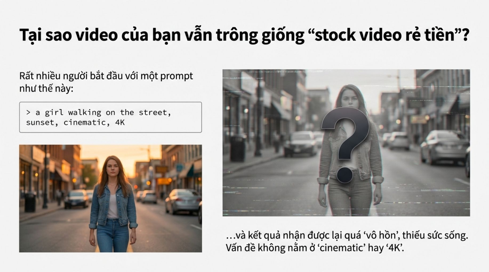

**Nội dung chính đọc được:** Ví dụ cô gái đi phố lúc hoàng hôn với nhãn cinematic, 4K được dùng để nêu vấn đề thiếu chủ ý camera.

**Hình minh họa:** Ảnh cô gái đi phố và dấu hỏi lớn.

**Phân tích bổ sung:** Ảnh không chứng minh prompt cũ luôn kém; 4K trong câu không thay thế thiết lập xuất.

## B012-02 — Điều khiển chủ thể và camera

Tên gốc: `02.jpg`.

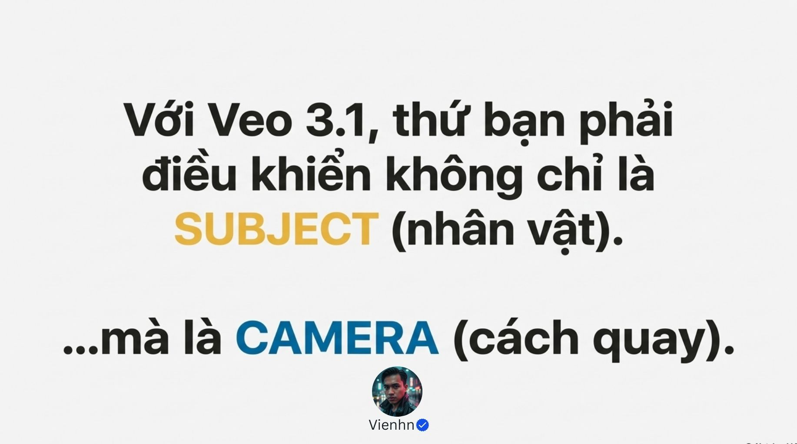

**Nội dung chính đọc được:** Tác giả yêu cầu mô tả cả hành động chủ thể lẫn hoạt động camera.

**Hình minh họa:** Trang nhấn mạnh hai đối tượng cần điều khiển.

**Phân tích bổ sung:** Tách hai chuyển động giúp tránh hiểu nhân vật quay vòng khi ý định là máy quay vòng.

## B012-03 — Mô tả camera đang làm gì

Tên gốc: `03.jpg`.

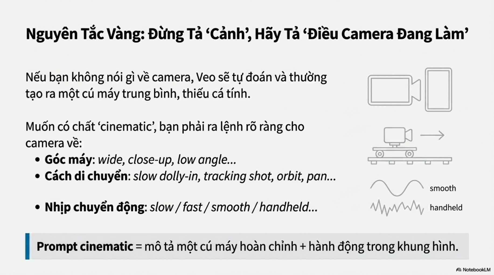

**Nội dung chính đọc được:** Liệt kê cỡ/góc máy, chuyển động và nhịp hoặc độ rung; tránh chỉ tả cảnh.

**Hình minh họa:** Sơ đồ đường ray và nét chuyển động mượt/rung.

**Phân tích bổ sung:** Wide, close-up là cỡ cảnh; low angle là góc. Handheld là cách vận hành, không tự quyết định tốc độ.

## B012-04 — Công thức năm phần

Tên gốc: `04.jpg`.

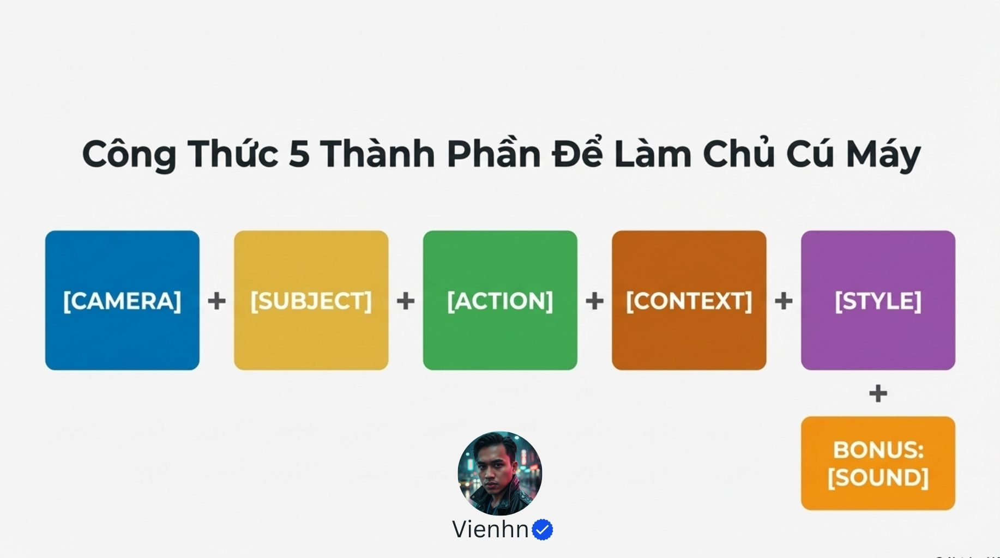

**Nội dung chính đọc được:** CAMERA + SUBJECT + ACTION + CONTEXT + STYLE; bổ sung SOUND.

**Hình minh họa:** Công thức từng khối.

**Phân tích bổ sung:** Đây là mẫu kiểm tra thông tin, không phải cú pháp lập trình bắt buộc.

## B012-05 — Từ vựng camera

Tên gốc: `05.jpg`.

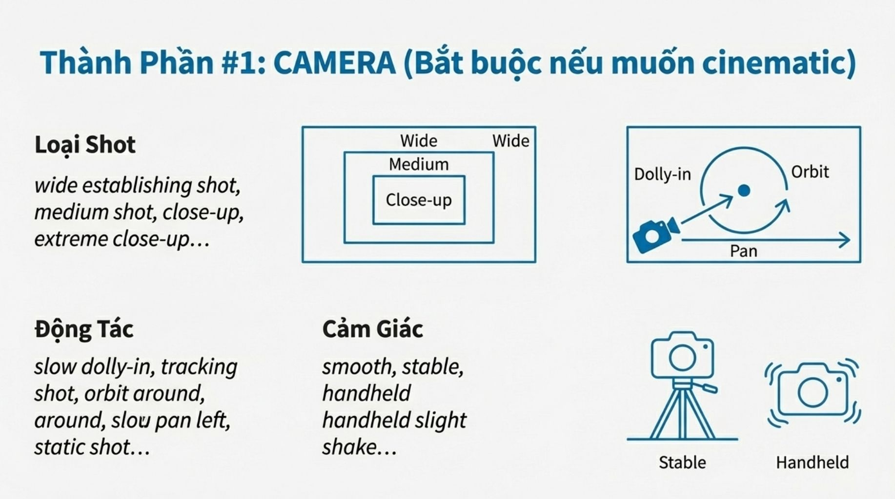

**Nội dung chính đọc được:** Cỡ cảnh từ rộng tới cực cận; máy tiến gần, bám theo, quay vòng, lia và đứng yên; cảm giác ổn định hoặc cầm tay.

**Hình minh họa:** Các hình camera, đường chuyển động và nhãn tiếng Anh.

**Phân tích bổ sung:** Lia pan là xoay tại vị trí; dịch ngang thân máy cần mô tả khác, tránh học nhầm sơ đồ.

## B012-06 — Chủ thể, hành động, bối cảnh, phong cách

Tên gốc: `06.jpg`.

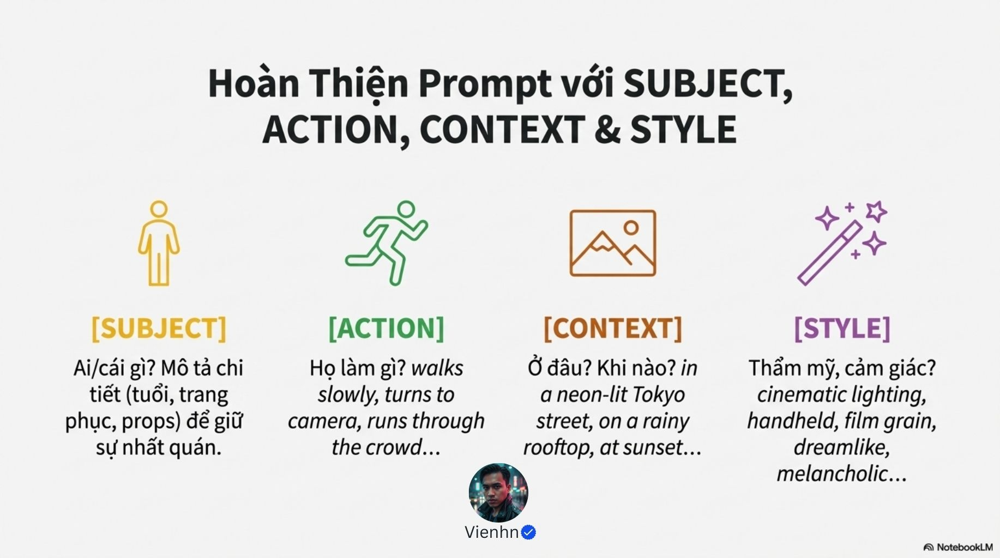

**Nội dung chính đọc được:** Nêu nhân vật cụ thể, hành động nhìn thấy, nơi chốn/thời tiết và ánh sáng hoặc sắc thái mong muốn.

**Hình minh họa:** Các nhóm ví dụ mô tả.

**Phân tích bổ sung:** Ghi đặc điểm nhận diện cố định nhưng giữ hành động ngắn, có đầu và cuối.

## B012-07 — Âm thanh

Tên gốc: `07.jpg`.

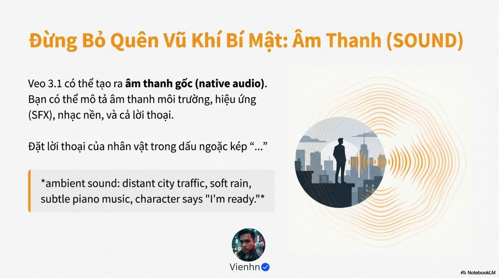

**Nội dung chính đọc được:** Nguồn gợi ý tiếng môi trường, hiệu ứng, nhạc và lời thoại trong dấu ngoặc kép.

**Hình minh họa:** Người trong cảnh thành phố và biểu tượng sóng âm.

**Phân tích bổ sung:** Chỉ có thể kiểm tra đồng bộ khi nghe video; khả năng tùy công cụ và chế độ.

## B012-08 — Bốn cấu trúc

Tên gốc: `08.jpg`.

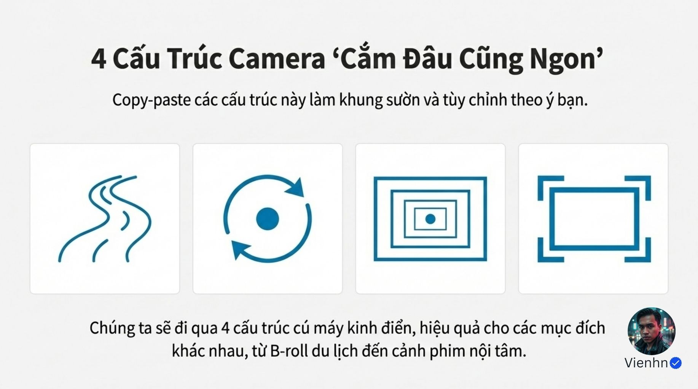

**Nội dung chính đọc được:** Giới thiệu bốn mẫu dùng cho cảnh bổ trợ, giới thiệu chủ thể và cảm xúc.

**Hình minh họa:** Bốn biểu tượng đường đi, quỹ đạo, khung thu gần và khung tĩnh.

**Phân tích bổ sung:** Chọn theo thông tin cần kể, không áp cả bốn vào một clip.

## B012-09 — Cảnh bổ trợ B-roll

Tên gốc: `09.jpg`.

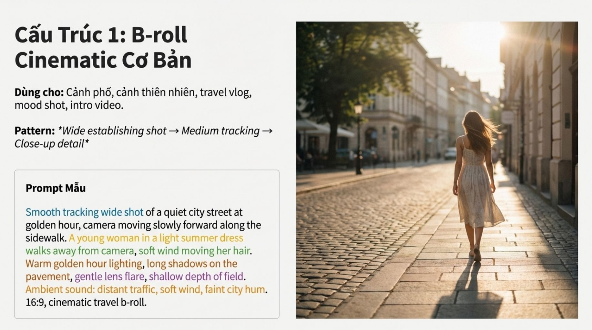

**Nội dung chính đọc được:** Mẫu rộng giới thiệu → trung cảnh bám theo → cận chi tiết. Prompt minh họa riêng là máy tiến chậm theo cô gái đi phố nắng chiều, có gió và tiếng phố.

**Hình minh họa:** Cô gái đi xa trên phố lát đá, bóng dài.

**Phân tích bổ sung:** Chuỗi ba cỡ cảnh cần shot list và dựng; prompt minh họa không mô tả đủ cả ba shot.

## B012-10 — Orbit reveal

Tên gốc: `010.jpg`.

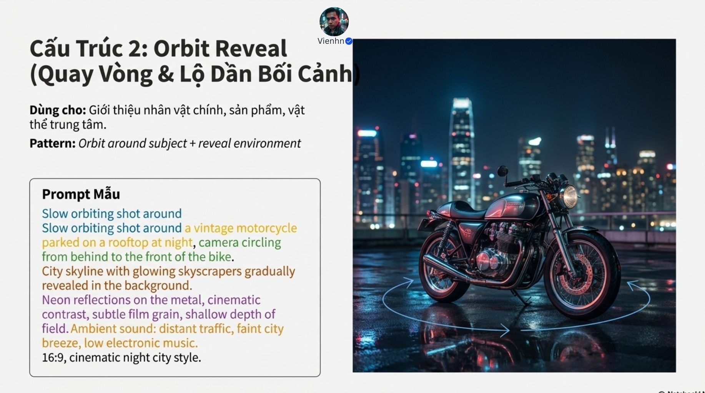

**Nội dung chính đọc được:** Camera vòng từ phía sau ra trước xe máy cổ trên mái nhà đêm, dần lộ đường chân trời, phản xạ neon và âm thành phố.

**Hình minh họa:** Xe máy với mũi tên quỹ đạo bao quanh.

**Phân tích bổ sung:** Quy định cung quay và điểm dừng; không mặc định quay tròn 360 độ. Prompt có dòng lặp, không cần sao lại.

## B012-11 — Tiến gần cảm xúc

Tên gốc: `011.jpg`.

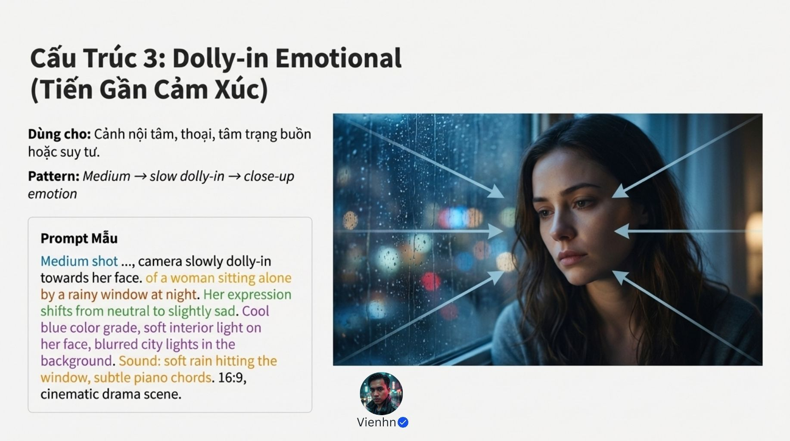

**Nội dung chính đọc được:** Từ trung cảnh tiến chậm vào cận mặt người phụ nữ ngồi cạnh cửa sổ mưa đêm; biểu cảm chuyển sang buồn nhẹ, âm mưa và piano.

**Hình minh họa:** Gương mặt bên cửa mưa với mũi tên hội tụ.

**Phân tích bổ sung:** Dolly-in là dịch máy tới gần; tránh nhầm với zoom. Cảm xúc nên có biểu hiện nhỏ quan sát được.

## B012-12 — Khung tĩnh, chuyển động trong cảnh

Tên gốc: `012.jpg`.

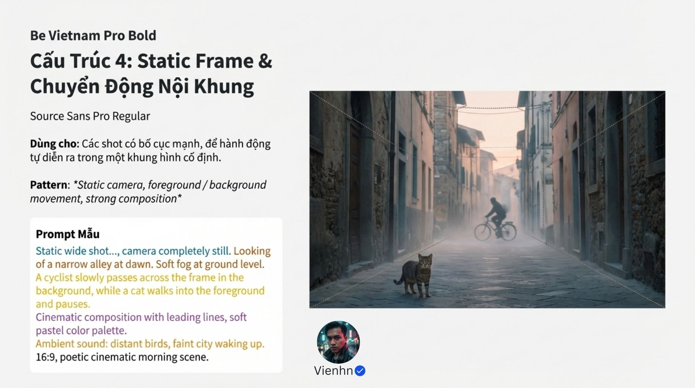

**Nội dung chính đọc được:** Máy đứng yên toàn cảnh ngõ sương sớm; người đạp xe đi ngang hậu cảnh, mèo vào tiền cảnh rồi dừng.

**Hình minh họa:** Ngõ có đường dẫn, mèo phía trước và xe đạp phía sau; còn chữ tên font.

**Phân tích bổ sung:** Chữ Be Vietnam Pro/Source Sans Pro là dấu dàn trang. Máy tĩnh vẫn có nhiều lớp chuyển động kể chuyện.

## B012-13 — So sánh prompt

Tên gốc: `013.jpg`.

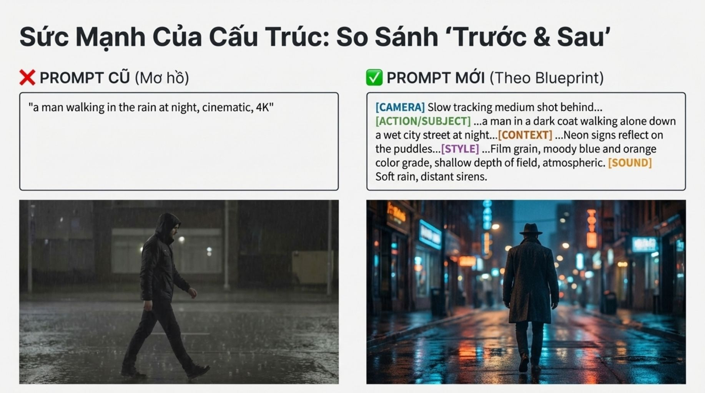

**Nội dung chính đọc được:** So ví dụ người đi mưa chung chung với mô tả camera bám sau, áo tối, phố ướt, màu xanh/cam, âm mưa và còi xa.

**Hình minh họa:** Hai cảnh mưa khác bố cục, ánh sáng và trang phục.

**Phân tích bổ sung:** Nhiều biến thay đổi cùng lúc nên đây là minh họa, không cô lập được tác động của cấu trúc.

## B012-14 — Bảy mục trước khi tạo

Tên gốc: `014.jpg`.

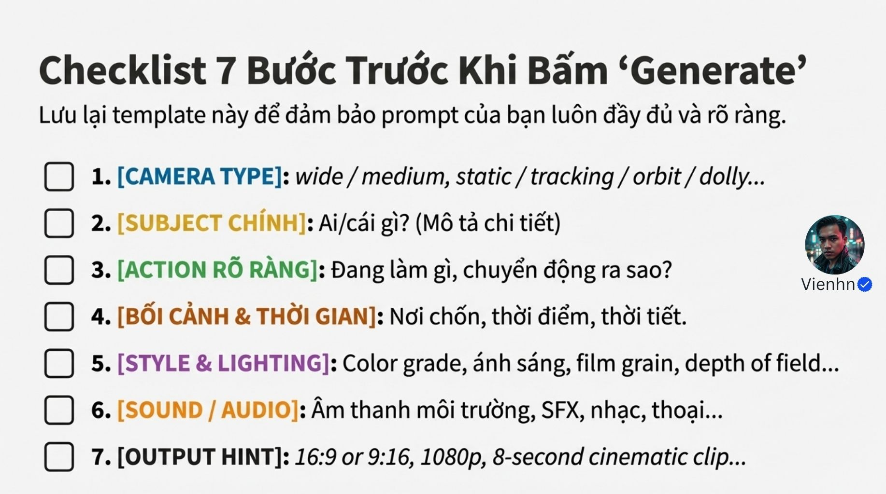

**Nội dung chính đọc được:** Kiểm tra camera, chủ thể, hành động, bối cảnh/thời gian, phong cách/ánh sáng, âm thanh và đầu ra.

**Hình minh họa:** Danh sách bảy ô đánh dấu.

**Phân tích bổ sung:** Tỷ lệ, độ phân giải và thời lượng nên chọn trong thiết lập được hỗ trợ; ghi trong prompt không bảo đảm đầu ra.

## B012-15 — Câu hỏi kết

Tên gốc: `015.jpg`.

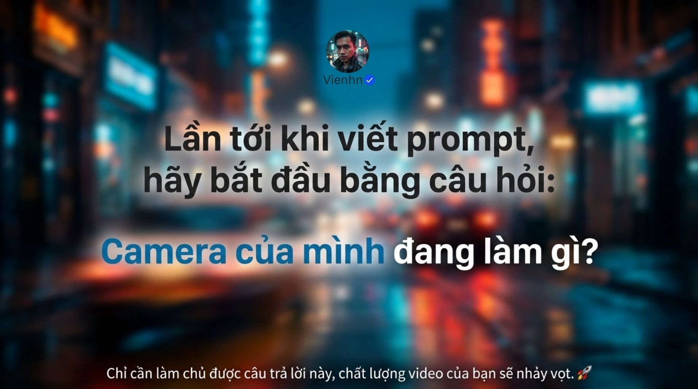

**Nội dung chính đọc được:** Bắt đầu bằng câu hỏi camera đang làm gì.

**Hình minh họa:** Nền phố neon mờ và câu hỏi lớn.

**Phân tích bổ sung:** Bổ sung: vì sao camera làm vậy, và người xem cần thấy thông tin nào.

## Kiểm kê

Đã mở trực tiếp 16/16 ảnh. Các mã nguồn theo thứ tự ở trên khớp [danh mục tệp](nguon.json). Chưa sinh hoặc đánh giá video từ câu lệnh của bài này.
