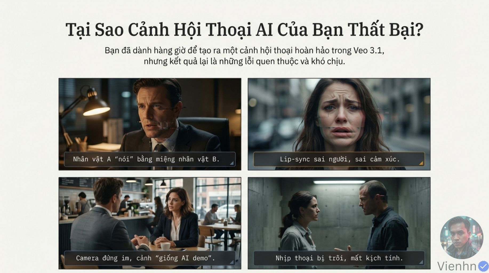
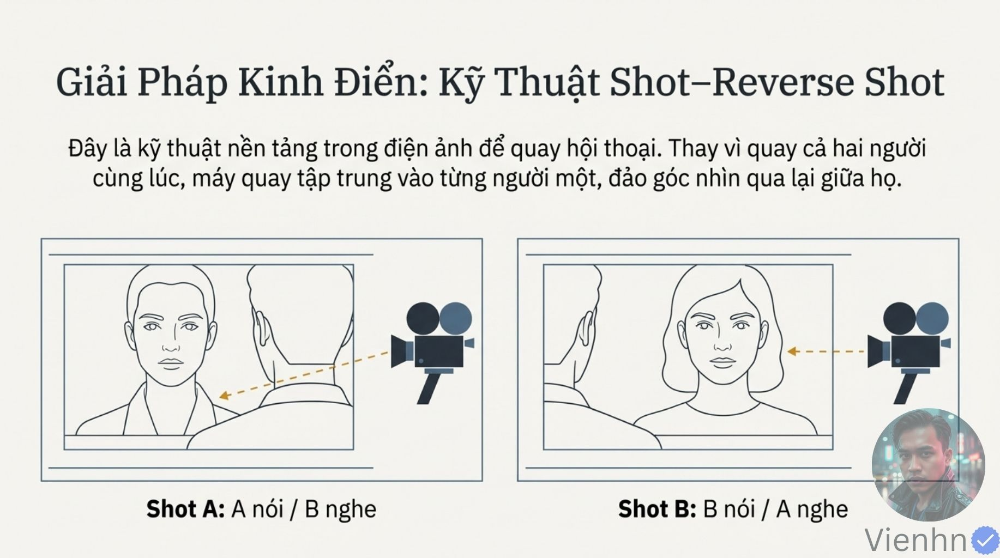
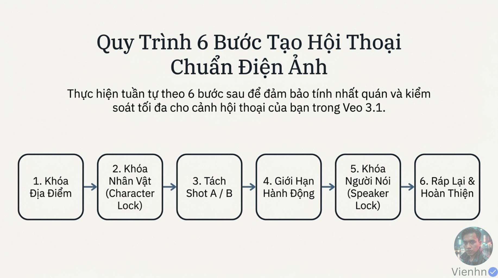
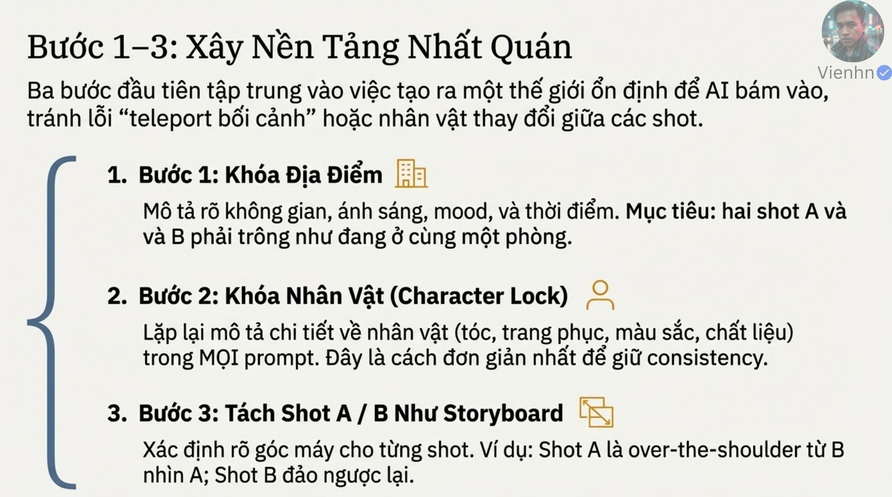
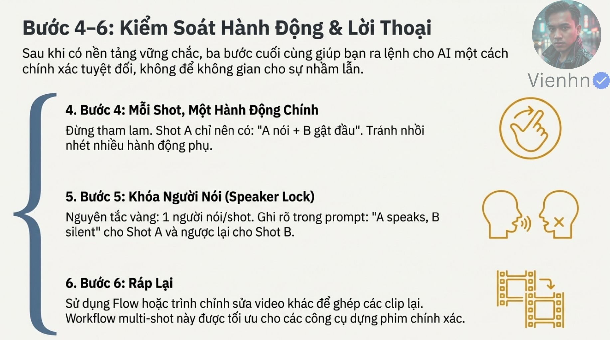
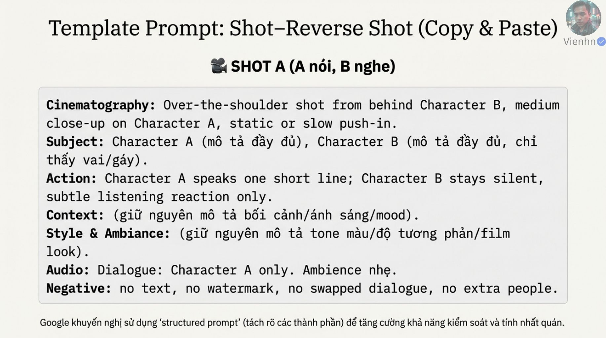
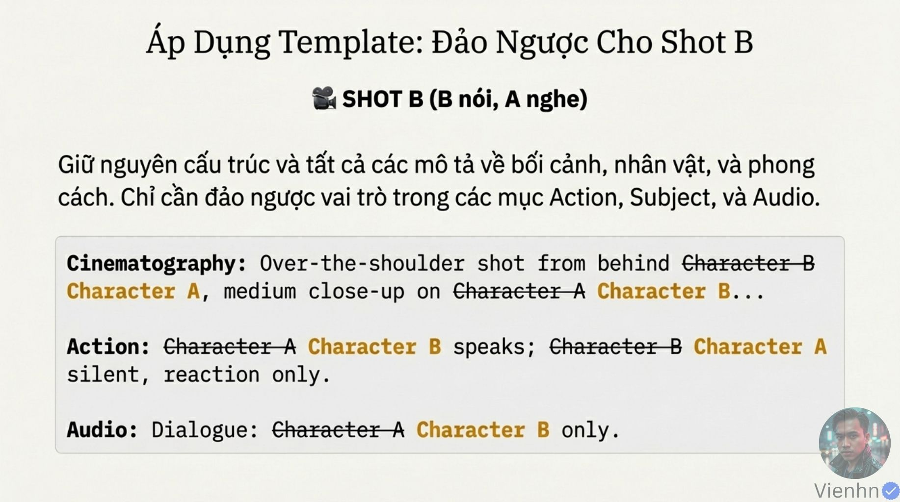
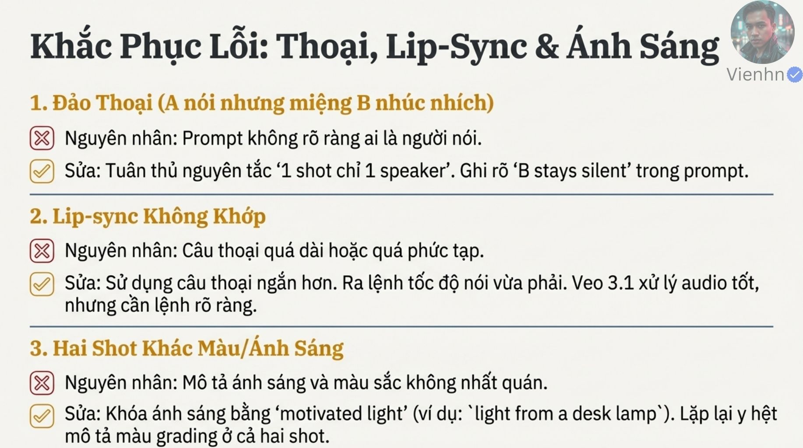
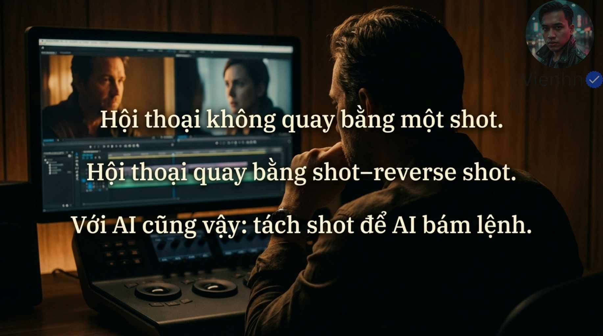

# B013 — Bản đọc toàn bộ 16 ảnh

Nguồn: [Bí Mật Prompt Veo3.1 - Tách Shot Để AI Bám Lệnh (Hội Thoại Không Quay Bằng Một Shot)](https://drive.google.com/drive/folders/1DcfzftcYU9njo4dJcM3AXgUjWpFPsqMA).

**Cách ghi:** nội dung chính được diễn đạt lại từ chữ và hình trong ảnh; không phải bản chép nguyên văn toàn bộ. Quan sát ảnh tĩnh được tách khỏi lời giải thích bổ sung. Ảnh gốc được giữ nguyên để đối chiếu.

[Bài chính](README.md) · [Thực hành](thuc-hanh.md) · [Dữ liệu nguồn](nguon.json)

## B013-00 — Các lỗi hội thoại

Tên gốc: `Bí Mật Prompt Veo3.1 - Tách Shot Để AI Bám Lệnh (Hội Thoại Không Quay Bằng Một Shot).jpg`.

**Nội dung chính đọc được:** Nguồn nêu nhầm người nói, khẩu hình sai, cảnh thiếu nhịp và camera đứng yên.

**Hình minh họa:** Bốn khung hội thoại với chú thích lỗi.

**Phân tích bổ sung:** Máy đứng yên tự nó không phải lỗi; khẩu hình phải kiểm tra bằng video có âm.

## B013-01 — Tách yêu cầu phức tạp

Tên gốc: `01.jpg`.

**Nội dung chính đọc được:** Nguồn quy lỗi cho cách nhồi cả hội thoại vào một prompt, đề xuất nhiều shot ngắn.

**Hình minh họa:** Một khối rối đối chiếu ba đoạn gọn.

**Phân tích bổ sung:** Chia nhỏ giảm số yêu cầu trong mỗi lần tạo nhưng lỗi còn đến từ mô hình và thiết lập.

## B013-02 — Tư duy đạo diễn

Tên gốc: `02.jpg`.

**Nội dung chính đọc được:** Chủ động chia cảnh theo góc nhìn, cảm xúc và nhịp thay vì chỉ nhập lệnh.

**Hình minh họa:** Bàn phím hướng tới ghế đạo diễn và storyboard.

**Phân tích bổ sung:** Câu 'không ai quay hội thoại bằng một cú máy' trong nguồn là sai khi nói tuyệt đối.

## B013-03 — Shot–reverse shot

Tên gốc: `03.jpg`.

**Nội dung chính đọc được:** Luân phiên góc A nói/B nghe và B nói/A nghe.

**Hình minh họa:** Hai khung nhìn qua vai đối đáp.

**Phân tích bổ sung:** Đây là cách dựng góc đối đáp, không phải bắt máy xoay đúng 180 độ.

## B013-04 — Ba lợi ích

Tên gốc: `04.jpg`.

**Nội dung chính đọc được:** Nguồn kỳ vọng rõ người nói, hình có chủ ý và sửa riêng shot lỗi.

**Hình minh họa:** Ba biểu tượng giọng nói, camera, mảnh ghép.

**Phân tích bổ sung:** Lợi ích chỉnh riêng shot rõ về quy trình; mức giảm lỗi cần thử mới biết.

## B013-05 — Khi cân nhắc tách

Tên gốc: `05.jpg`.

**Nội dung chính đọc được:** Hai người nói qua lại, cần phản ứng người nghe, đạo cụ/cử chỉ nhỏ hoặc khoảng im lặng.

**Hình minh họa:** Bốn dòng đánh dấu.

**Phân tích bổ sung:** Có thể dùng cận phản ứng hoặc cận đạo cụ; không phải mọi cảnh đều cần cắt liên tục.

## B013-06 — Sáu bước

Tên gốc: `06.jpg`.

**Nội dung chính đọc được:** Khóa địa điểm, khóa nhân vật, tách A/B, giới hạn hành động, xác định người nói, ráp lại.

**Hình minh họa:** Sáu ô quy trình.

**Phân tích bổ sung:** Khóa là duy trì mô tả/tham chiếu, không phải cam kết tính năng khóa cứng.

## B013-07 — Nền tảng nhất quán

Tên gốc: `07.jpg`.

**Nội dung chính đọc được:** Lặp không gian/ánh sáng/thời điểm và mô tả tóc, trang phục; xác định góc qua vai cho từng shot.

**Hình minh họa:** Ba mục địa điểm, nhân vật và storyboard.

**Phân tích bổ sung:** Bổ sung trục nhìn, vị trí đạo cụ, hướng sáng; mô tả lặp không bảo đảm giữ mặt.

## B013-08 — Một trọng tâm, một người nói

Tên gốc: `08.jpg`.

**Nội dung chính đọc được:** Mỗi shot một hành động chính, ghi rõ người nói và người im lặng; ghép bằng Flow hoặc trình dựng.

**Hình minh họa:** Biểu tượng hành động, thoại và ghép phim.

**Phân tích bổ sung:** Tạo riêng không tự giữ giọng; cần nghe giọng giữa shot và chỉnh dựng.

## B013-09 — Mẫu shot A

Tên gốc: `09.jpg`.

**Nội dung chính đọc được:** Qua vai B nhìn A, trung cận, máy tĩnh hoặc tiến nhẹ; A một câu ngắn, B nghe; giữ bối cảnh/phong cách và âm.

**Hình minh họa:** Khối mẫu chia Cinematography, Subject, Action, Context, Style, Audio, Negative.

**Phân tích bổ sung:** Khi dùng chọn tĩnh hoặc tiến nhẹ, không để lựa chọn mơ hồ. Mục negative của nguồn dùng no nhiều lần, cần theo giao diện thực tế.

## B013-10 — Mẫu shot B

Tên gốc: `10.jpg`.

**Nội dung chính đọc được:** Đổi góc qua vai A nhìn B, B nói, A nghe; giữ nhận diện, địa điểm và phong cách.

**Hình minh họa:** Tên A/B gạch bỏ rồi thay bằng màu vàng.

**Phân tích bổ sung:** Phải sửa cả góc camera như minh họa, không chỉ đổi người ở Action/Audio.

## B013-11 — Bản lặp mẫu B

Tên gốc: `011.jpg`.

**Nội dung chính đọc được:** Nội dung đảo vai shot B lặp lại.

**Hình minh họa:** Cùng khối chữ và đánh dấu như ảnh trước.

**Phân tích bổ sung:** Đã so SHA-256: ảnh này trùng tệp B013-10; giữ đủ hai nguồn trong kiểm kê.

## B013-12 — Giới thiệu xử lý lỗi

Tên gốc: `012.jpg`.

**Nội dung chính đọc được:** Chuyển sang năm lỗi thường gặp và cách sửa.

**Hình minh họa:** Năm số lớn 1–5.

**Phân tích bổ sung:** Trang mở đầu, không có chi tiết sửa mới.

## B013-13 — Thoại, khẩu hình, ánh sáng

Tên gốc: `013.jpg`.

**Nội dung chính đọc được:** Nguồn đề xuất một người nói, câu ngắn/tốc độ vừa và lặp ánh sáng có nguồn hợp lý như đèn bàn.

**Hình minh họa:** Ba nhóm nguyên nhân/cách sửa.

**Phân tích bổ sung:** Đây là giả thuyết chẩn đoán, không phải nguyên nhân duy nhất. Hướng sáng giữ theo căn phòng, có thể đổi bên khung khi đảo góc.

## B013-14 — Camera và người thừa

Tên gốc: `014.jpg`.

**Nội dung chính đọc được:** Đưa chỉ dẫn máy lên đầu, dùng một chuyển động rõ; nguồn đề xuất câu phủ định để hạn chế người thừa.

**Hình minh họa:** Hai nhóm lỗi và ví dụ tiếng Anh.

**Phân tích bổ sung:** Viết số nhân vật và căn phòng rõ; negative riêng liệt kê thành phần không muốn theo tài liệu giao diện. Không có lệnh bảo đảm tuyệt đối.

## B013-15 — Kết luận

Tên gốc: `015.jpg`.

**Nội dung chính đọc được:** Nguồn nhấn tách shot và shot–reverse shot để AI bám chỉ dẫn.

**Hình minh họa:** Người dựng nhìn hai khung đối đáp trên màn hình.

**Phân tích bổ sung:** Coi đây là một phương án tổ chức cảnh có ích, không phải luật duy nhất của hội thoại.

## Kiểm kê

Đã mở trực tiếp 16/16 ảnh. Các mã nguồn theo thứ tự ở trên khớp [danh mục tệp](nguon.json). Chưa sinh hoặc đánh giá video từ câu lệnh của bài này.
