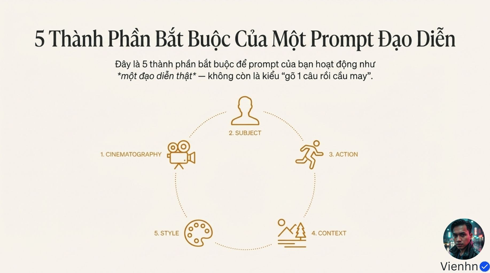
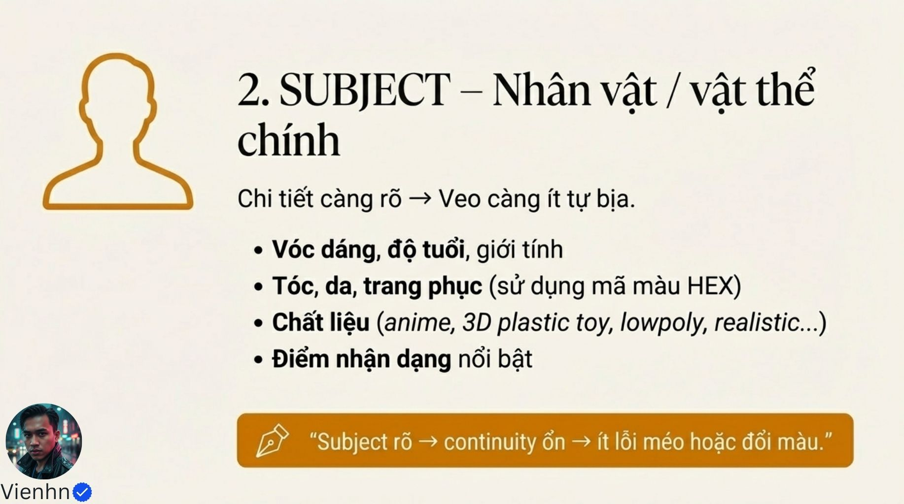
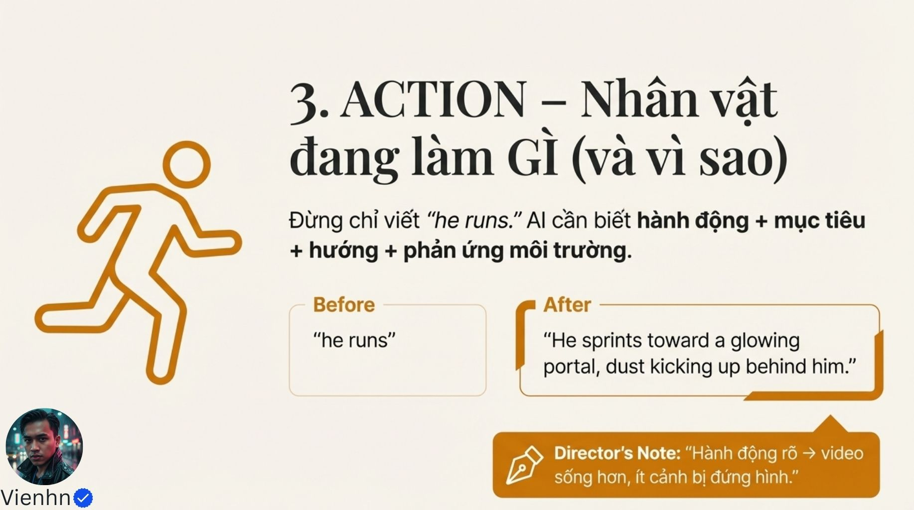
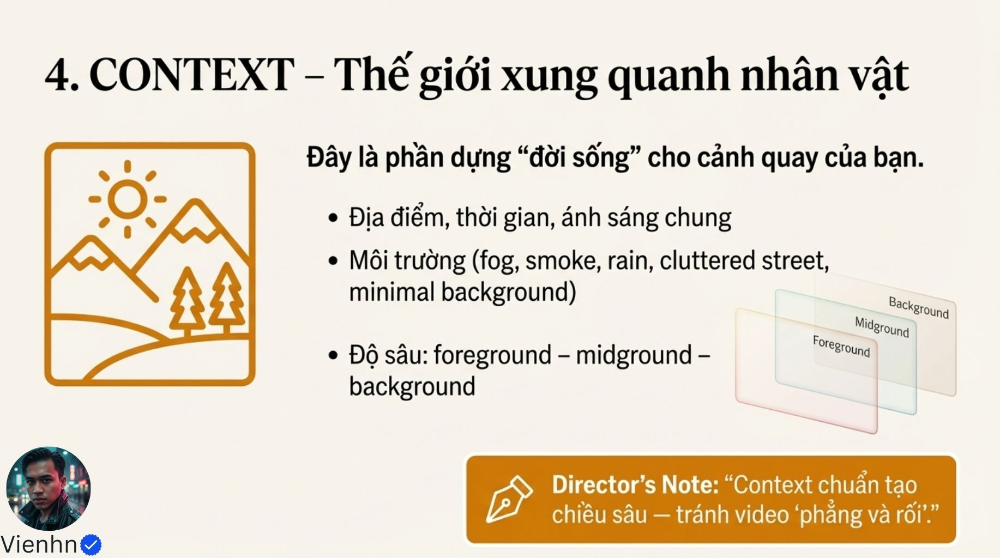
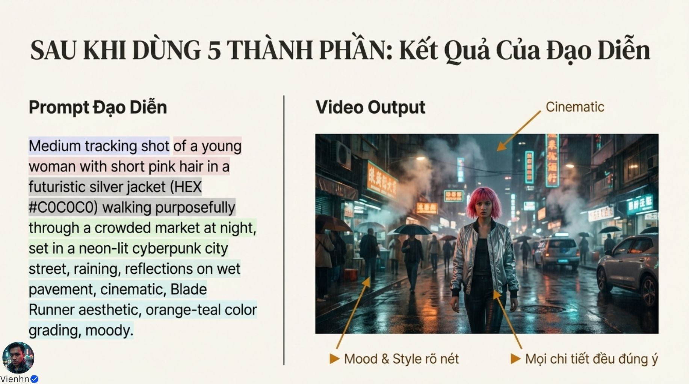

# Bài 014 — Chỉ đạo cảnh quay bằng yêu cầu rõ

Bộ 12 ảnh ôn công thức năm phần: camera, chủ thể, hành động, bối cảnh và phong cách. Bài biên soạn chuyển các nhãn thành chỉ dẫn quan sát được và tách những con số quảng bá khỏi kiến thức đã kiểm chứng.

**Nguồn:** [Bí Mật Veo 3.1- Google Thiết Kế Để Nghe Lời Đạo Diễn (80% Creator Đang Dùng Sai Cách)](https://drive.google.com/drive/folders/1wjF1f3YIGiAe_fHaXCA4ug6RX6WiISGV). Đã đọc **12/12 ảnh**. Ngày biên soạn: 17/10/2026.

[Đọc từng ảnh](doc-anh.md) · [Bài thực hành](thuc-hanh.md) · [Nguồn và mã kiểm tra](nguon.json) · [Danh mục toàn bộ](../../DANH-MUC-BAI-HOC.md)

**Quy ước:** phần “Nguồn” diễn đạt ý trong bộ ảnh. Phần “Phân tích và áp dụng” do người biên soạn bổ sung. Hiệu quả của câu lệnh chưa được kiểm nghiệm bằng lần tạo video trong đợt này.

## Những điều cần học

| Nội dung | Mã ảnh nguồn |
| --- | --- |
| Dùng năm phần như bảng kiểm | B014-01, B014-02, B014-08, B014-11 |
| Định nghĩa camera và chủ thể riêng | B014-03, B014-04 |
| Hành động có hướng và hệ quả | B014-05 |
| Bối cảnh và phong cách phục vụ việc nhìn rõ | B014-06, B014-07 |
| Đánh giá chất lượng bằng tiêu chí | B014-00, B014-03, B014-09, B014-10 |

## 1. Dùng năm phần như bảng kiểm

**Nguồn:** Nguồn khuyên tổ chức prompt theo cinematography → subject → action → context → style.

**Phân tích và áp dụng:** Cinematography là cách ghi hình, subject là chủ thể, action là hành động, context là bối cảnh, style là phong cách. Viết từng dòng để phát hiện thiếu thông tin hoặc mâu thuẫn, rồi gộp thành đoạn tự nhiên nếu thích. Bổ sung âm thanh khi cần. Khung này hỗ trợ thiết kế; không chứng minh AI xử lý theo thứ tự cố định.

**Ví dụ cho cảnh nông thôn:** Camera trung cảnh cố định; chủ thể người áo nâu; hành động đặt bó rau; bối cảnh bàn hiên buổi sáng; phong cách tự nhiên với sáng mềm.

**Kiểm tra kết quả:** Mỗi yêu cầu có nội dung cụ thể; không cần thêm từ khóa chỉ để lấp ô.

## 2. Định nghĩa camera và chủ thể riêng

**Nguồn:** Nguồn liệt kê cỡ/góc, chuyển động, bố cục và mô tả nhận diện nhân vật.

**Phân tích và áp dụng:** Chọn cỡ cảnh theo phần hành động cần thấy; góc theo điểm nhìn; một trạng thái máy rõ. Tách vật liệu (vải thô, tre, kim loại) khỏi phong cách (hoạt hình, ảnh thực). Giữ các dấu nhận diện chính trong mọi shot; ảnh tham chiếu nếu hỗ trợ vẫn cần đối chiếu kết quả.

**Ví dụ cho cảnh nông thôn:** Trung cận nhìn hơi chếch xuống để thấy tay người áo vải nâu đang đan giỏ tre. Máy tĩnh, mép giỏ nằm gọn trong khung.

**Kiểm tra kết quả:** Không cắt mất tay/dụng cụ; nhận diện và chất liệu không đổi tùy tiện.

## 3. Hành động có hướng và hệ quả

**Nguồn:** Nguồn bổ sung mục tiêu, hướng và phản ứng môi trường thay cho động từ chung chung.

**Phân tích và áp dụng:** Mẫu áp dụng: trạng thái đầu → động tác chính → điểm tiếp xúc → kết quả nhìn thấy. Chỉ mô tả hệ quả hợp vật liệu và môi trường. Mục tiêu tâm lý hỗ trợ câu chuyện nhưng cần dấu hiệu hình thể cụ thể để kiểm tra.

**Ví dụ cho cảnh nông thôn:** Người nghiêng ca về phía chậu; nước chảy từ miệng ca xuống đất trong chậu; mặt đất sẫm màu tại nơi nước chạm, rồi người dựng ca lại.

**Kiểm tra kết quả:** Đúng trình tự và hướng; có điểm tiếp xúc; vật không tự đổi vị trí hoặc xuất hiện sẵn.

## 4. Bối cảnh và phong cách phục vụ việc nhìn rõ

**Nguồn:** Nguồn dùng ba lớp không gian cùng ánh sáng/màu/phong cách để tạo chiều sâu và sắc thái.

**Phân tích và áp dụng:** Tiền cảnh, trung cảnh, hậu cảnh là các lớp bố cục; vùng nét là thuộc tính khác. Chọn hướng sáng và màu chủ đạo nhất quán. Mood là sắc thái cảm xúc: có thể biểu hiện bằng nhịp, cử chỉ, âm và tương phản, không chỉ từ 'cinematic'.

**Ví dụ cho cảnh nông thôn:** Mép giỏ ở tiền cảnh, tay đan ở trung cảnh, vườn ở hậu cảnh dịu hơn. Sáng hắt từ hiên giúp đọc sợi nan, không làm cháy trắng điểm tiếp xúc.

**Kiểm tra kết quả:** Người xem thấy việc chính ngay; lớp nền không che động tác; phong cách không đổi giữa shot.

## 5. Đánh giá chất lượng bằng tiêu chí

**Nguồn:** Nguồn có con số 80%, lời hứa gấp ba và so sánh hình trước/sau.

**Phân tích và áp dụng:** Không dùng các con số này làm kết quả học. Chấm riêng: tuân thủ hành động, camera, nhận diện, vật lý, ánh sáng và âm. Khi thử cấu trúc prompt, giữ nội dung và thiết lập tương tự; nếu thay nội dung, ghi rõ để tránh quy kết sai.

**Ví dụ cho cảnh nông thôn:** Một video đặt rau đúng giỏ nhưng lệch màu áo cần sửa nhận diện, không nhất thiết thêm chuyển động camera.

**Kiểm tra kết quả:** Nhật ký ghi lỗi cụ thể và mốc giây; biết yếu tố nào cần sửa.

## Điểm cần hiểu có điều kiện

- 80% và 'gấp 3 lần' không có dữ liệu chứng minh trong bộ ảnh.
- Không suy từ việc camera viết trước ra cơ chế nội bộ 'AI đọc camera đầu tiên'.
- Năm thành phần là cách lập kế hoạch, không phải điều kiện bắt buộc cho mọi prompt. Google cũng lưu ý không cần dùng mọi thành phần trong mọi câu lệnh.
- HEX không bảo đảm khóa màu hoặc giữ nhân vật; cần kiểm tra dưới ánh sáng cảnh.
- Hình trước/sau không đủ chứng minh chuyển động hoặc tính nhất quán toàn video.

## Cách đưa vào quy trình sản xuất

Nêu mục đích shot → ghi năm phần cần thiết → rà mâu thuẫn, thêm âm thanh → tạo và xem toàn clip → chấm từng tiêu chí → sửa đúng nhóm lỗi. Có thể đọc lại B012 để chọn cấu trúc và B013 để xử lý đối thoại.

## Tự kiểm tra kiến thức

- Phong cách lowpoly khác chất liệu tre như thế nào?
- Vì sao mã HEX không đồng nghĩa bảo đảm màu không đổi?
- Bạn sẽ sửa nhóm nào nếu hành động đúng nhưng camera sai?

## Nguồn đối chiếu bổ sung

- [Google Cloud: khung prompt Veo 3.1](https://cloud.google.com/blog/products/ai-machine-learning/ultimate-prompting-guide-for-veo-3-1/): Đối chiếu khung năm thành phần; không dùng bài này làm bằng chứng cho con số quảng bá trong ảnh.
- [Google: hướng dẫn thành phần prompt](https://docs.cloud.google.com/gemini-enterprise-agent-platform/models/video/video-gen-prompt-guide): Tài liệu nêu không cần dùng mọi thành phần trong mọi prompt.

**Giới hạn:** đây là tài liệu học từ ảnh. Không dùng một hình minh họa để xác nhận chuyển động, thời lượng, độ chính xác thao tác hay khả năng hiện tại của một sản phẩm. Những phần chưa kiểm chứng được ghi rõ trong bản đọc ảnh.
