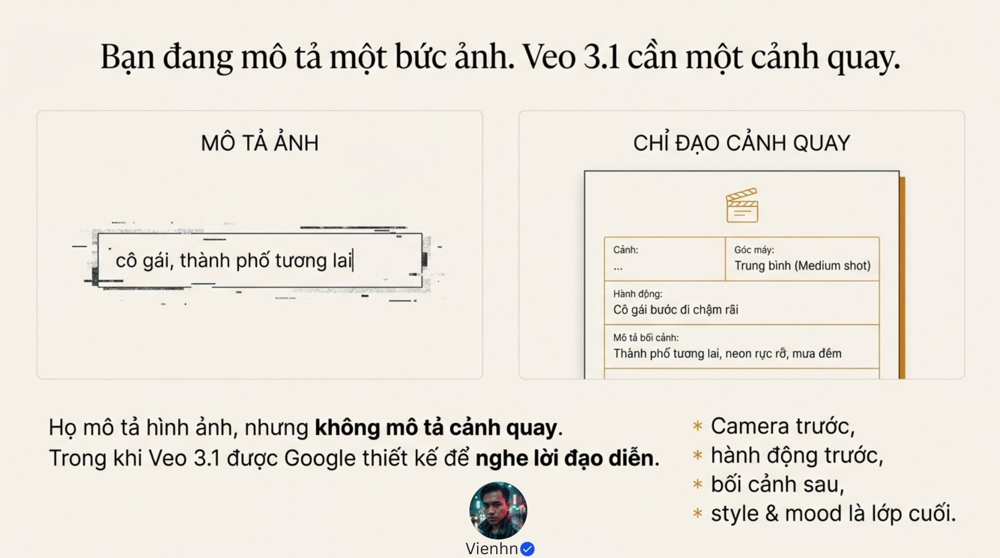
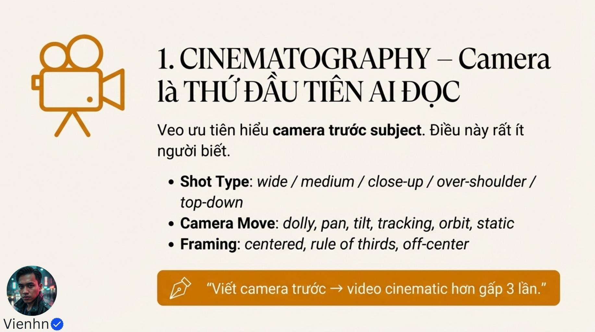
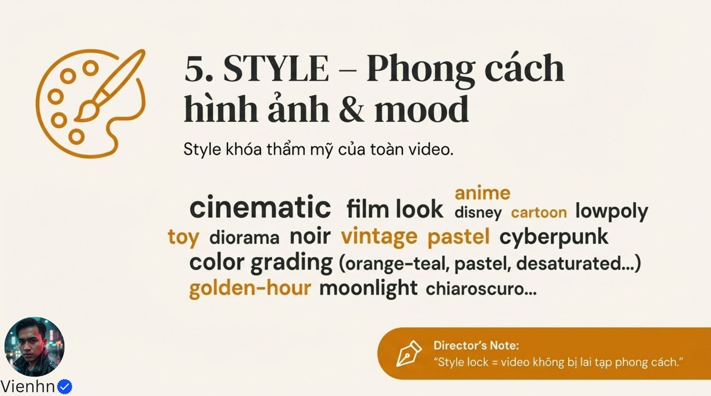
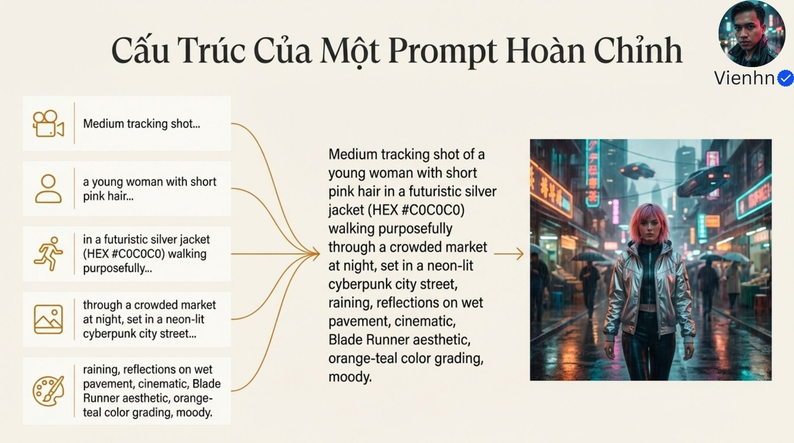
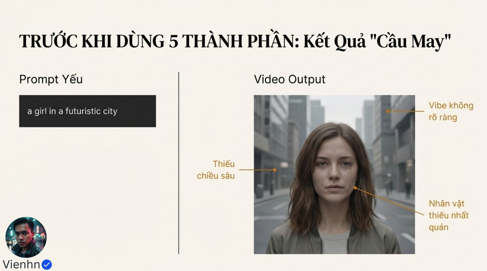
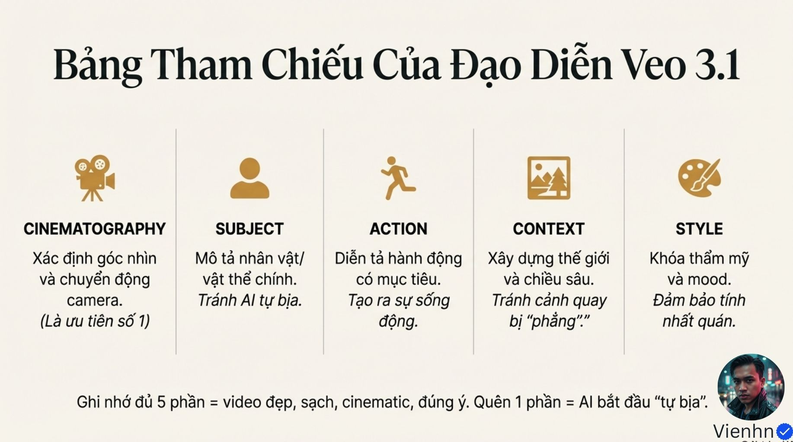

# B014 — Bản đọc toàn bộ 12 ảnh

Nguồn: [Bí Mật Veo 3.1- Google Thiết Kế Để Nghe Lời Đạo Diễn (80% Creator Đang Dùng Sai Cách)](https://drive.google.com/drive/folders/1wjF1f3YIGiAe_fHaXCA4ug6RX6WiISGV).

**Cách ghi:** nội dung chính được diễn đạt lại từ chữ và hình trong ảnh; không phải bản chép nguyên văn toàn bộ. Quan sát ảnh tĩnh được tách khỏi lời giải thích bổ sung. Ảnh gốc được giữ nguyên để đối chiếu.

[Bài chính](README.md) · [Thực hành](thuc-hanh.md) · [Dữ liệu nguồn](nguon.json)

## B014-00 — Mở bài 80%

Tên gốc: `Bí Mật Veo 3.1- Google Thiết Kế Để Nghe Lời Đạo Diễn (80% Creator Đang Dùng Sai Cách).jpg`.

**Nội dung chính đọc được:** Nguồn nói 80% người sáng tạo dùng Veo 3.1 sai và thiếu một yếu tố sẽ hỏng sắc thái.

**Hình minh họa:** Nhân vật nữ trong bối cảnh khoa học viễn tưởng.

**Phân tích bổ sung:** Không có khảo sát hay cách đo cho 80%; xem là câu thu hút.

## B014-01 — Từ ảnh tới cảnh quay

Tên gốc: `01.jpg`.

**Nội dung chính đọc được:** Đối chiếu vài danh từ về cô gái/thành phố với mô tả cỡ cảnh, hành động đi chậm và phố neon mưa đêm.

**Hình minh họa:** Hai ô mô tả ảnh và bảng chỉ đạo cảnh.

**Phân tích bổ sung:** Video cần diễn biến theo thời gian, nhưng không phải shot nào cũng cần camera chuyển động.

## B014-02 — Năm thành phần

Tên gốc: `02.jpg`.

**Nội dung chính đọc được:** Nguồn gọi cinematography, subject, action, context, style là năm phần bắt buộc.

**Hình minh họa:** Vòng năm biểu tượng.

**Phân tích bổ sung:** Là khung tổ chức hữu ích; không có bằng chứng thiếu một nhãn khiến mọi prompt thất bại.

## B014-03 — Camera đầu tiên

Tên gốc: `03.jpg`.

**Nội dung chính đọc được:** Liệt kê cỡ/góc, dolly/pan/tilt/tracking/orbit/static và bố cục; khẳng định AI ưu tiên camera, hiệu quả gấp ba.

**Hình minh họa:** Camera màu vàng và danh sách từ vựng.

**Phân tích bổ sung:** Thứ tự mẫu không chứng minh thứ tự xử lý nội bộ; không có thang đo cho gấp ba.

## B014-04 — Mô tả chủ thể

Tên gốc: `04.jpg`.

**Nội dung chính đọc được:** Vóc dáng/tuổi, tóc/da/trang phục, mã HEX, phong cách chất liệu và dấu nhận diện.

**Hình minh họa:** Biểu tượng người và bốn nhóm đặc điểm.

**Phân tích bổ sung:** Mã màu là tham chiếu mong muốn, không khóa màu điểm ảnh dưới mọi ánh sáng; anime/lowpoly là phong cách chứ không phải chất liệu vật lý.

## B014-05 — Hành động có đích

Tên gốc: `05.jpg`.

**Nội dung chính đọc được:** Mô tả hành động, mục tiêu, hướng và phản ứng môi trường; ví dụ chạy tới cổng phát sáng, bụi bốc sau chân.

**Hình minh họa:** Ví dụ ngắn trước/sau và biểu tượng chạy.

**Phân tích bổ sung:** Biến động cơ thành dấu hiệu nhìn thấy; bụi chỉ hợp bề mặt phù hợp.

## B014-06 — Thế giới quanh nhân vật

Tên gốc: `06.jpg`.

**Nội dung chính đọc được:** Địa điểm, thời gian, sáng chung, sương/khói/mưa và lớp tiền–trung–hậu cảnh.

**Hình minh họa:** Ba lớp không gian chồng nhau.

**Phân tích bổ sung:** Độ sâu bố cục khác độ sâu trường ảnh; không cần mọi lớp đều chuyển động.

## B014-07 — Phong cách và sắc thái

Tên gốc: `07.jpg`.

**Nội dung chính đọc được:** Từ khóa cinematic, phim, hoạt hình, noir, cổ điển, pastel, cyberpunk; màu và ánh sáng.

**Hình minh họa:** Đám từ khóa phong cách.

**Phân tích bổ sung:** Chọn nhất quán; không ghép các phong cách đối nghịch khi không có chủ ý.

## B014-08 — Ghép năm phần

Tên gốc: `08.jpg`.

**Nội dung chính đọc được:** Trung cảnh theo cô gái tóc hồng áo bạc HEX #C0C0C0 đi qua chợ đông đêm mưa, phố neon, màu cam/xanh lơ, không khí trầm.

**Hình minh họa:** Năm khối hợp thành prompt và ảnh phố.

**Phân tích bổ sung:** Ảnh minh họa không xác nhận chuyển động bám theo; mã màu không bảo đảm chính xác.

## B014-09 — Trước khi cấu trúc

Tên gốc: `09.jpg`.

**Nội dung chính đọc được:** Prompt chỉ có cô gái ở thành phố tương lai; nguồn đánh giá thiếu chiều sâu, nhất quán và sắc thái.

**Hình minh họa:** Chân dung trong phố xám có mũi tên chú giải.

**Phân tích bổ sung:** Một ảnh không cho phép đánh giá tính nhất quán theo thời gian.

## B014-10 — Sau khi cấu trúc

Tên gốc: `010.jpg`.

**Nội dung chính đọc được:** Nguồn dùng prompt nhiều chi tiết tóc/áo/chợ/mưa/ánh sáng để minh họa hình có phong cách rõ.

**Hình minh họa:** Prompt tô màu và ảnh phố đêm.

**Phân tích bổ sung:** Đã thay nhiều biến cùng lúc; chưa thể quy mọi cải thiện cho thứ tự năm phần.

## B014-11 — Bảng ôn tập

Tên gốc: `011.jpg`.

**Nội dung chính đọc được:** Tóm tắt camera, chủ thể, hành động, bối cảnh, phong cách và khuyên nhớ đủ.

**Hình minh họa:** Năm cột biểu tượng và ý chính.

**Phân tích bổ sung:** Dùng làm bảng rà soát theo nhu cầu, không phải bảo đảm đầu ra đúng ý.

## Kiểm kê

Đã mở trực tiếp 12/12 ảnh. Các mã nguồn theo thứ tự ở trên khớp [danh mục tệp](nguon.json). Chưa sinh hoặc đánh giá video từ câu lệnh của bài này.
