# B015 — Bản đọc toàn bộ 12 ảnh

Nguồn: [Bí Mật Veo 3.1- Tại Sao AI Không "Vẽ" Video Mà Chỉ "Dự Đoán Chuyển Động"? (Làm Chủ Logic Vật Lý)](https://drive.google.com/drive/folders/15eT4W3GaEGptuMmpU0ArNPc0Bt89hIdv).

**Cách ghi:** nội dung chính được diễn đạt lại từ chữ và hình trong ảnh; không phải bản chép nguyên văn toàn bộ. Quan sát ảnh tĩnh được tách khỏi lời giải thích bổ sung. Ảnh gốc được giữ nguyên để đối chiếu.

[Bài chính](README.md) · [Thực hành](thuc-hanh.md) · [Dữ liệu nguồn](nguon.json)

## B015-00 — Cẩm nang đạo diễn AI

Tên gốc: `Bí Mật Veo 3.1- Tại Sao AI Không "Vẽ" Video Mà Chỉ "Dự Đoán Chuyển Động"? (Làm Chủ Logic Vật Lý).jpg`.

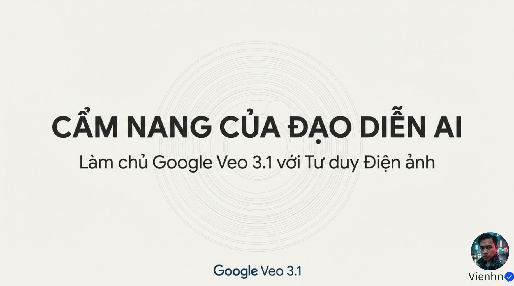

**Nội dung chính đọc được:** Giới thiệu làm chủ Veo 3.1 bằng tư duy điện ảnh.

**Hình minh họa:** Tiêu đề và đường tròn dạng thấu kính.

**Phân tích bổ sung:** Đây là tài liệu phương pháp, không phải tài liệu kiến trúc mô hình.

## B015-01 — Chủ động ý đồ

Tên gốc: `01.jpg`.

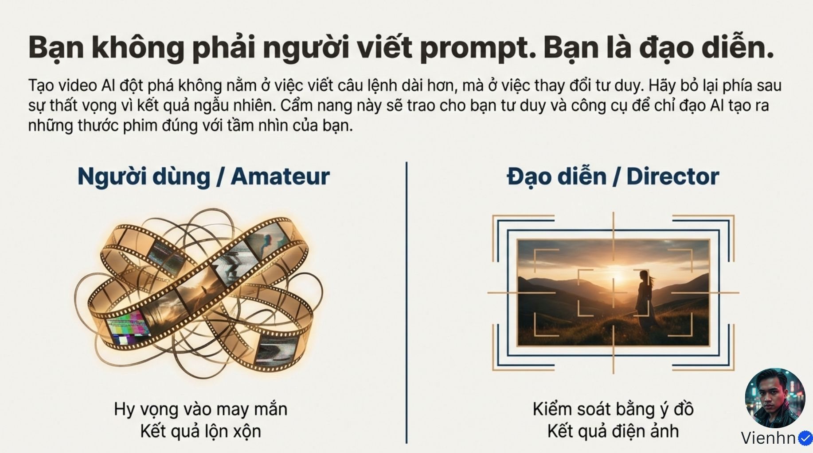

**Nội dung chính đọc được:** Nguồn khuyên tập trung ý đồ đạo diễn thay vì kéo dài prompt.

**Hình minh họa:** Dải phim rối và một khung hình có chỉ dấu bố cục.

**Phân tích bổ sung:** Ý đồ cần chuyển thành mục tiêu và tiêu chí; vẫn phải chấp nhận thử và sửa.

## B015-02 — Bối cảnh video AI

Tên gốc: `02.jpg`.

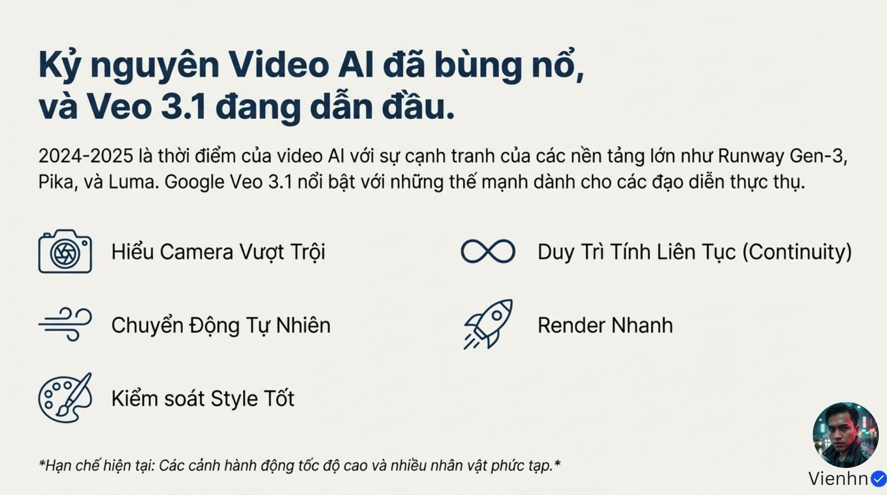

**Nội dung chính đọc được:** Nguồn nhắc Runway Gen-3, Pika, Luma giai đoạn 2024–2025; đánh giá Veo nổi bật về máy, chuyển động, phong cách, liên tục và tốc độ, đồng thời nêu cảnh nhanh/nhiều người là hạn chế.

**Hình minh họa:** Năm biểu tượng năng lực và dòng giới hạn.

**Phân tích bổ sung:** Đây là nhận định của nguồn theo thời điểm, không phải bảng xếp hạng hiện tại hay số liệu benchmark.

## B015-03 — Dự đoán chuyển động

Tên gốc: `03.jpg`.

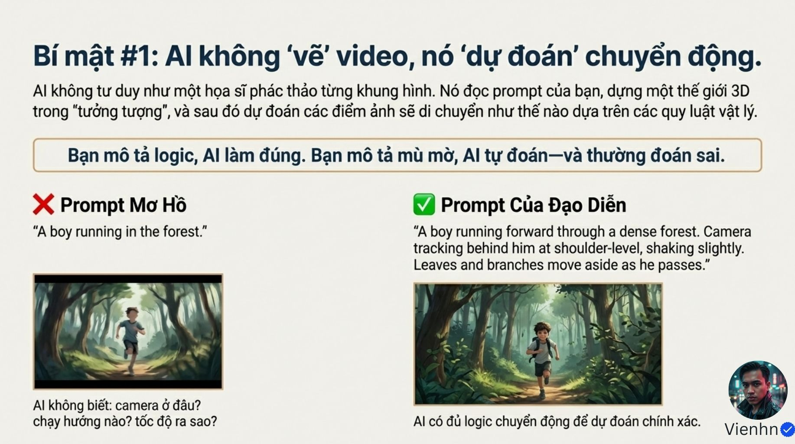

**Nội dung chính đọc được:** Nguồn giải thích bằng hình dung AI dựng thế giới 3D rồi dự đoán điểm ảnh; đề xuất ghi hướng chạy, camera sau vai, lá/cành bị tác động.

**Hình minh họa:** Hai ảnh người chạy trong rừng và prompt đối chiếu.

**Phân tích bổ sung:** Không xác nhận kiến trúc 'dựng 3D' từ ẩn dụ. Hình nhân vật hướng về người xem không chứng minh camera bám từ sau như câu lệnh.

## B015-04 — Ba ràng buộc

Tên gốc: `04.jpg`.

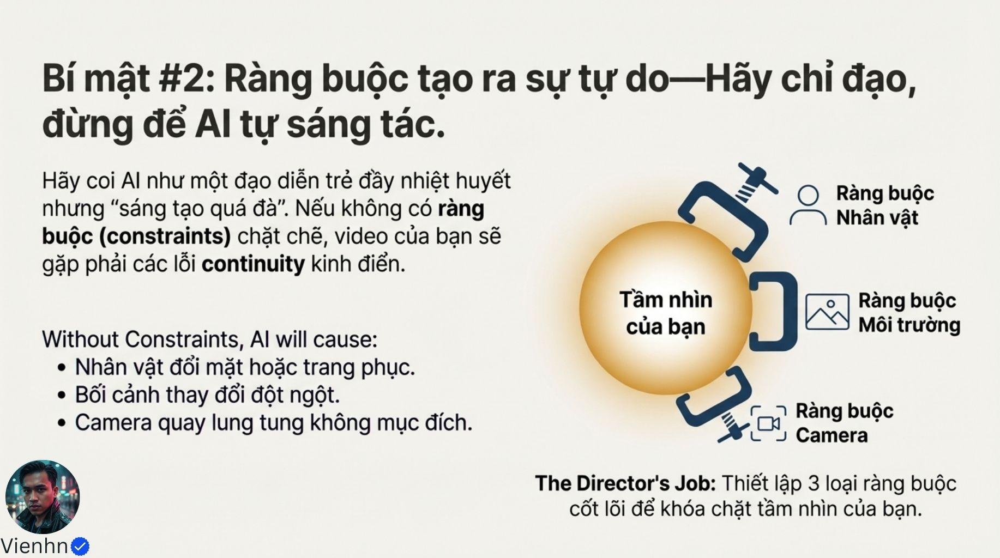

**Nội dung chính đọc được:** Nhân vật, môi trường, camera cần ổn định để giảm đổi mặt/áo, nhảy bối cảnh và chuyển động máy tùy tiện.

**Hình minh họa:** Ba kẹp quanh quả cầu ý đồ.

**Phân tích bổ sung:** Ràng buộc làm rõ đích nhưng không khóa cứng kết quả; chọn thông tin thiết yếu.

## B015-05 — Danh sách ràng buộc

Tên gốc: `05.jpg`.

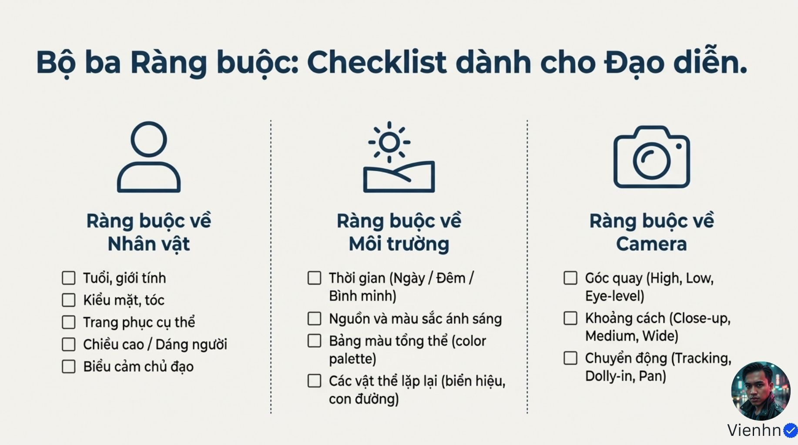

**Nội dung chính đọc được:** Nhận diện/áo/biểu cảm; thời điểm/nguồn sáng/màu/đồ vật lặp; góc/cỡ/chuyển động máy.

**Hình minh họa:** Ba cột kiểm tra.

**Phân tích bổ sung:** Tính liên tục cần so qua thời gian và giữa các shot; không chỉ lặp chữ.

## B015-06 — Dịch từ trừu tượng

Tên gốc: `06.jpg`.

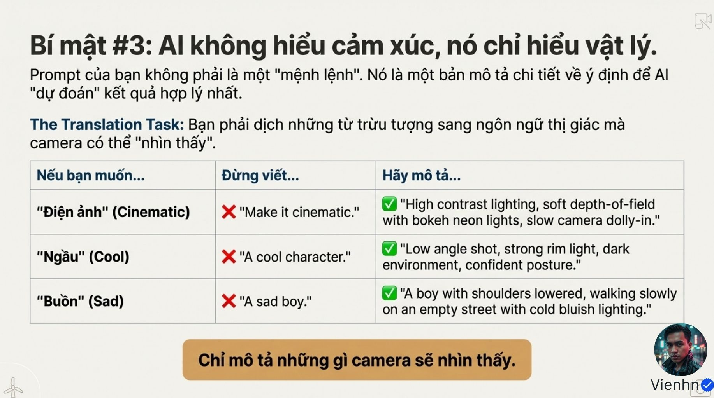

**Nội dung chính đọc được:** Nguồn khuyên thay 'điện ảnh', 'ngầu', 'buồn' bằng sáng, bố cục, tư thế, nhịp và nét; khẳng định AI chỉ hiểu vật lý.

**Hình minh họa:** Bảng ba mục từ trừu tượng sang mô tả nhìn thấy.

**Phân tích bổ sung:** Không dùng 'chỉ hiểu vật lý' như mô tả khoa học. Buồn không bắt buộc ánh sáng xanh; điện ảnh không đồng nghĩa bokeh hay tương phản cao.

## B015-07 — Cấu trúc năm phần

Tên gốc: `07.jpg`.

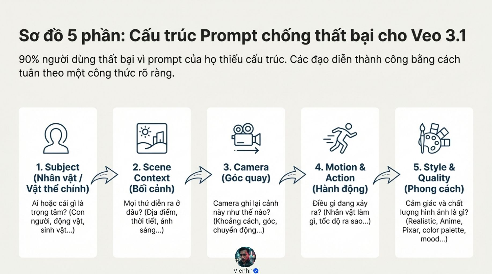

**Nội dung chính đọc được:** Chủ thể → bối cảnh → camera → chuyển động/hành động → phong cách/chất lượng; nguồn nói 90% thất bại vì thiếu cấu trúc.

**Hình minh họa:** Năm thẻ nối mũi tên.

**Phân tích bổ sung:** 90% không có dữ liệu. Thứ tự khác B014 cho thấy đây là các mẫu tổ chức, không phải luật đọc nội bộ.

## B015-08 — Ví dụ thám tử

Tên gốc: `08.jpg`.

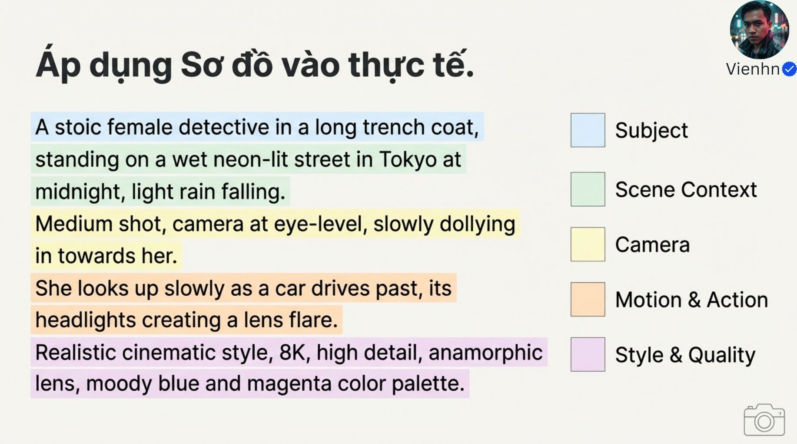

**Nội dung chính đọc được:** Nữ thám tử áo khoác dài trong phố Tokyo mưa đêm; trung cảnh ngang mắt tiến gần; ngẩng nhìn khi xe đi qua, đèn gây lóe; màu xanh/tím, nhãn 8K và anamorphic.

**Hình minh họa:** Prompt tô màu năm nhóm.

**Phân tích bổ sung:** 8K trong câu không xác nhận độ phân giải. Lóe kính cần nguồn sáng và góc phù hợp, không tự có ở mọi xe đi qua.

## B015-09 — Từ vựng camera

Tên gốc: `09.jpg`.

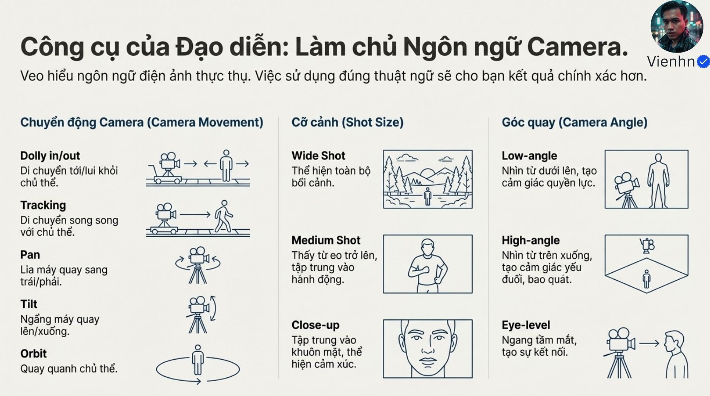

**Nội dung chính đọc được:** Dolly tới/lùi, tracking, pan, tilt, orbit; rộng/trung/cận; góc thấp/cao/ngang mắt.

**Hình minh họa:** Ba cột sơ đồ.

**Phân tích bổ sung:** Tracking không chỉ song song; hiệu quả tâm lý của góc cao/thấp phụ thuộc cảnh.

## B015-10 — Năm cạm bẫy

Tên gốc: `010.jpg`.

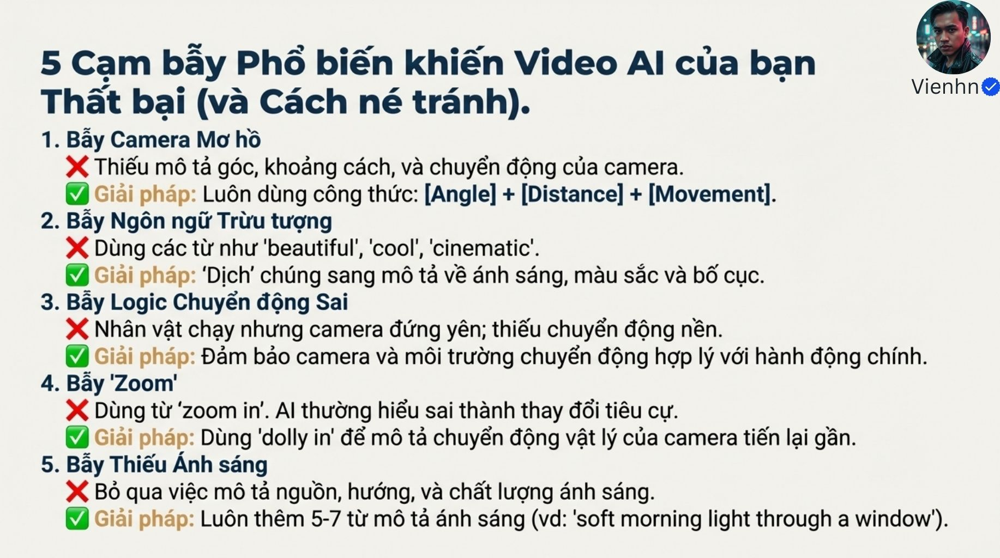

**Nội dung chính đọc được:** Nguồn nêu thiếu máy, ngôn ngữ trừu tượng, chuyển động chưa hợp lý, nhầm zoom/dolly và thiếu ánh sáng.

**Hình minh họa:** Năm nhóm lỗi/cách sửa.

**Phân tích bổ sung:** Zoom đổi tiêu cự là đúng nghĩa; chạy với máy đứng yên không sai vật lý; không có số từ ánh sáng cố định 5–7 từ.

## B015-11 — Đưa vào thực hành

Tên gốc: `011.jpg`.

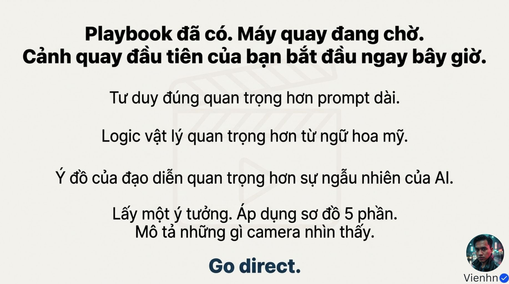

**Nội dung chính đọc được:** Tư duy rõ, logic vật lý và ý đồ; áp dụng năm phần, mô tả điều camera thấy.

**Hình minh họa:** Chữ kết trên nền clapboard.

**Phân tích bổ sung:** Thêm điều tai nghe khi có âm; tạo video rồi đối chiếu, không chỉ tối ưu câu chữ.

## Kiểm kê

Đã mở trực tiếp 12/12 ảnh. Các mã nguồn theo thứ tự ở trên khớp [danh mục tệp](nguon.json). Chưa sinh hoặc đánh giá video từ câu lệnh của bài này.
