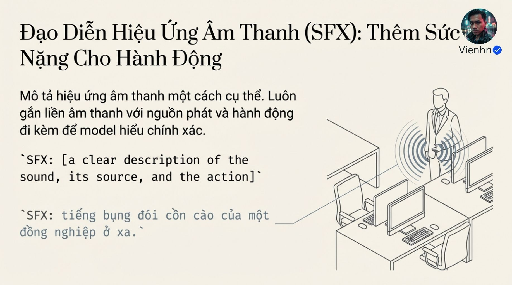
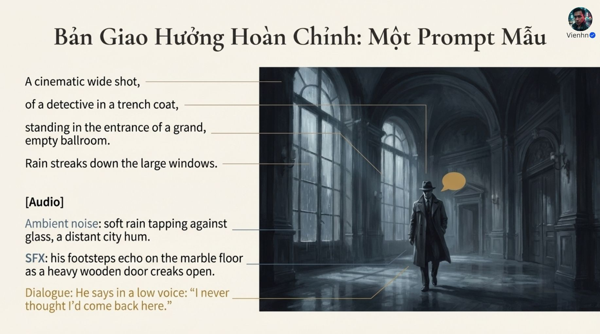
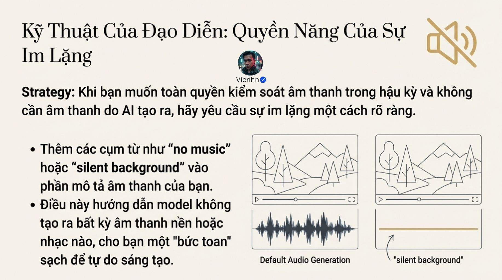

# Bài 016 — Thiết kế âm thanh: thoại, tiếng thao tác và môi trường

14 ảnh về chỉ đạo âm thanh trong video AI. Bài học chuyển ba lớp thoại–SFX–môi trường thành bảng âm có nguồn phát, thời điểm và độ ưu tiên; sửa nhầm 'không nhạc' thành 'im lặng' và bổ sung quy trình nghe kiểm tra.

**Nguồn:** [Bí Quyết Mô Tả Audio Cho Video AI (Trải nghiệm Điện Ảnh Sống Động với Veo3.1)](https://drive.google.com/drive/folders/1OMA50oqtlKvMFP25a5aPTrixLYecm3YO). Đã đọc **14/14 ảnh**. Ngày biên soạn: 17/10/2026.

[Đọc từng ảnh](doc-anh.md) · [Bài thực hành](thuc-hanh.md) · [Nguồn và mã kiểm tra](nguon.json) · [Danh mục toàn bộ](../../DANH-MUC-BAI-HOC.md)

**Quy ước:** phần “Nguồn” diễn đạt ý trong bộ ảnh. Phần “Phân tích và áp dụng” do người biên soạn bổ sung. Hiệu quả của câu lệnh chưa được kiểm nghiệm bằng lần tạo video trong đợt này.

## Những điều cần học

| Nội dung | Mã ảnh nguồn |
| --- | --- |
| Lập ba lớp âm có chức năng | B016-01, B016-02, B016-05, B016-07 |
| Gắn từng tiếng với vật và sự kiện | B016-04, B016-06, B016-09, B016-12 |
| Viết thoại dễ gán cho người nói | B016-03, B016-08 |
| Âm và hình phải kể cùng diễn biến | B016-08, B016-10, B016-12 |
| Chọn mức yên lặng và kế hoạch hậu kỳ | B016-10, B016-11, B016-13 |

## 1. Lập ba lớp âm có chức năng

**Nguồn:** Nguồn chia thoại, hiệu ứng hành động và môi trường; ghép vào prompt hình hoặc mục Audio riêng.

**Phân tích và áp dụng:** Thoại cần đúng nội dung/người; SFX (sound effects) là hiệu ứng cụ thể như tiếng ca đặt xuống; ambient là nền không gian như gió vườn. Nhạc là lựa chọn bổ sung. Ba lớp không bắt buộc cùng xuất hiện và không hàm ý đầu ra có các track riêng. Viết ưu tiên: việc gì nghe nổi, việc gì làm nền.

**Ví dụ cho cảnh nông thôn:** Cảnh người rửa rau có tiếng nước/lá ở gần làm âm chính, gió và chim xa làm nền, không cần lời hoặc nhạc.

**Kiểm tra kết quả:** Có âm chủ đạo rõ, không che thông tin cần nghe; nền hợp nơi và thời điểm.

## 2. Gắn từng tiếng với vật và sự kiện

**Nguồn:** Nguồn khuyên mô tả âm, nguồn phát và hành động trực tiếp.

**Phân tích và áp dụng:** Dùng mẫu nguồn + vật liệu + hành động + thời điểm + khoảng cách/cường độ. Tiếng chạm chỉ xuất hiện lúc chạm; nước chỉ chảy khi rót; tiếng chân theo bề mặt và nhịp bước. Nếu âm ngoài khung, ghi rõ nguồn ngoài khung thay vì buộc mọi âm phải thấy.

**Ví dụ cho cảnh nông thôn:** Đáy ca kim loại chạm bàn gỗ phát tiếng cộc ngắn, gần, đúng lúc ca dừng; sau đó nền gió nhẹ tiếp tục.

**Kiểm tra kết quả:** Không có tiếng chạm sớm/muộn, không tiếng bước khi đứng; vật liệu nghe hợp hình.

## 3. Viết thoại dễ gán cho người nói

**Nguồn:** Nguồn dùng câu nói gắn mô tả nhân vật và ngoặc kép.

**Phân tích và áp dụng:** Ghi người nói, ngôn ngữ/giọng, nhịp và câu ngắn. Blog Google Veo 3.1 dùng ngoặc kép; trang best practices hiện hướng dẫn dấu hai chấm và tránh ngoặc để hạn chế chữ hiện trong hình. Vì vậy theo giao diện đang dùng, thử có ghi chép; điều cốt lõi là gán câu đúng người. Bài thực hành dùng dấu hai chấm.

**Ví dụ cho cảnh nông thôn:** Người phụ nữ áo nâu nói giọng Việt nhẹ, tốc độ vừa: Rau này để ráo rồi mới cất.

**Kiểm tra kết quả:** Nghe đủ câu, đúng giọng/người, không nhầm thành lời dẫn hoặc phụ đề; xem khớp khẩu hình nếu miệng thấy rõ.

## 4. Âm và hình phải kể cùng diễn biến

**Nguồn:** Nguồn dùng mẫu thám tử cùng tiếng bước, cửa, mưa và khuyên đồng bộ hành động–âm.

**Phân tích và áp dụng:** Sửa mẫu 'đứng nhưng có bước chân' bằng thứ tự: mở cửa → bước vào → dừng → nói. Có thể chủ ý dùng âm ngoài khung hoặc âm báo trước, nhưng phải mô tả rõ. Tách âm trong thế giới cảnh khỏi nhạc/hiệu ứng phục vụ dựng; chuyển động máy nhanh không đòi hỏi tiếng gió tự nhiên.

**Ví dụ cho cảnh nông thôn:** Cận tay đặt rau vào giỏ: lá cọ nan nghe gần. Nếu cắt sang mặt người, nền vườn nối qua cắt; không tự thêm tiếng vút vì camera chuyển.

**Kiểm tra kết quả:** Các sự kiện có mốc hợp lý; âm không mô tả hành động chưa xảy ra hoặc người không có trong cảnh.

## 5. Chọn mức yên lặng và kế hoạch hậu kỳ

**Nguồn:** Nguồn có phương án dùng âm nháp, thay/mix hậu kỳ và yêu cầu nền yên.

**Phân tích và áp dụng:** Phân biệt không nhạc, không thoại, chỉ âm hiện trường và im lặng hoàn toàn. Nếu cần chắc chắn loại âm khỏi bản cuối, xử lý track trong trình dựng; prompt chỉ định hướng. Nghe ở mức âm lượng ổn định, kiểm tra đoạn nối và nghe trên thiết bị dùng để xem sản phẩm.

**Ví dụ cho cảnh nông thôn:** Video học đan giỏ giữ tiếng nan cọ và giọng giải thích; hạ nền vườn khi lời vào. Bản chỉ hình có thể tắt toàn bộ âm trong dựng.

**Kiểm tra kết quả:** Đúng lớp âm đã chọn, lời rõ, không âm bất ngờ hoặc thay nền đột ngột qua cắt.

## Điểm cần hiểu có điều kiện

- Ảnh tĩnh và đường sóng vẽ không chứng minh chất lượng hay đồng bộ âm.
- Không nhạc không đồng nghĩa không tiếng; silent background cũng không bảo đảm tệp cuối im lặng.
- Các nhãn Dialogue/SFX/Ambient là cách tổ chức, không cam kết xuất track âm riêng.
- Cú máy nhanh không bắt buộc tiếng gió; hiệu ứng vút có thể là lựa chọn cách điệu.
- Mẫu đại sảnh cần nhất quán giữa đứng/đi và tiếng bước. Hướng dẫn dấu ngoặc cho thoại khác nhau giữa các nguồn chính thức nên cần theo ngữ cảnh công cụ.

## Cách đưa vào quy trình sản xuất

Lập shot → ghi nguồn âm trong/ngoài khung → chọn âm chính và nền → viết câu Audio riêng → tạo → nghe riêng rồi xem nghe cùng hình → ghi lỗi theo giây → sửa hoặc dựng lại đường tiếng. Không cần bổ sung nhạc nếu tiếng thao tác đã đủ truyền tải.

## Tự kiểm tra kiến thức

- Không nhạc và im lặng hoàn toàn khác nhau ra sao?
- Vì sao cần ghi vật liệu khi mô tả tiếng chạm?
- Một âm ngoài khung có thể hợp cảnh dù không nhìn thấy nguồn không?

## Nguồn đối chiếu bổ sung

- [Google: prompt video, mục Audio](https://docs.cloud.google.com/gemini-enterprise-agent-platform/models/video/video-gen-prompt-guide): Đối chiếu cách tách mô tả âm thành câu riêng và ba loại âm.
- [Google Cloud: chỉ đạo âm trong Veo 3.1](https://cloud.google.com/blog/products/ai-machine-learning/ultimate-prompting-guide-for-veo-3-1/): Blog dùng ngoặc kép khi ghi thoại; là chỉ dẫn theo ngữ cảnh bài viết.
- [Google: best practices](https://docs.cloud.google.com/gemini-enterprise-agent-platform/models/video/best-practice): Trang hiện hướng dẫn dấu hai chấm, tránh ngoặc kép nhằm giảm chữ xuất hiện; ghi khác biệt để không coi một cách viết là luật chung.

**Giới hạn:** đây là tài liệu học từ ảnh. Không dùng một hình minh họa để xác nhận chuyển động, thời lượng, độ chính xác thao tác hay khả năng hiện tại của một sản phẩm. Những phần chưa kiểm chứng được ghi rõ trong bản đọc ảnh.
