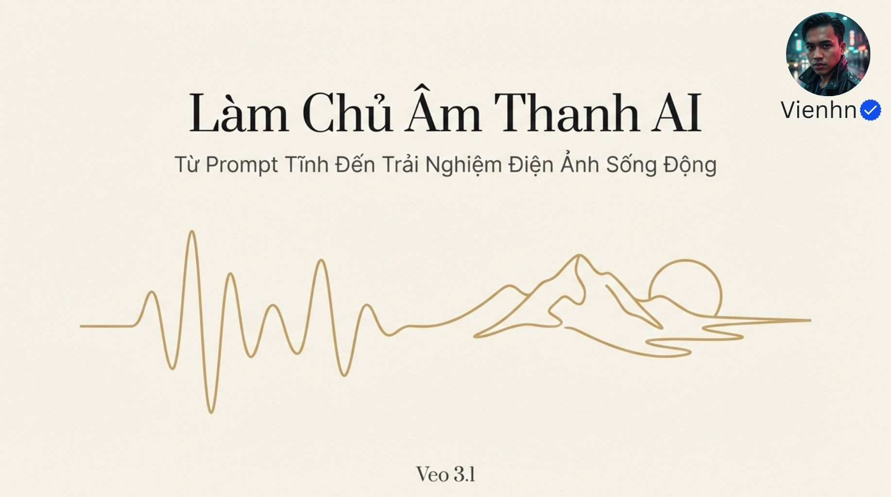
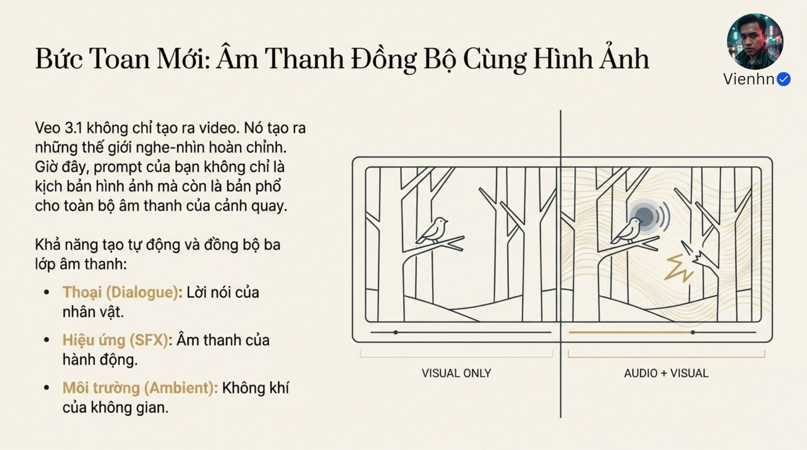
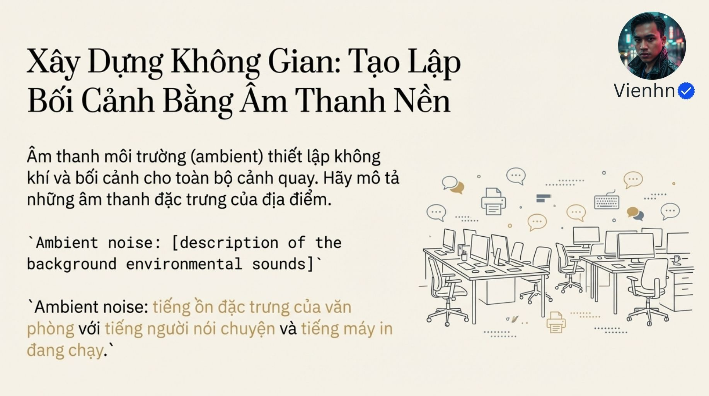
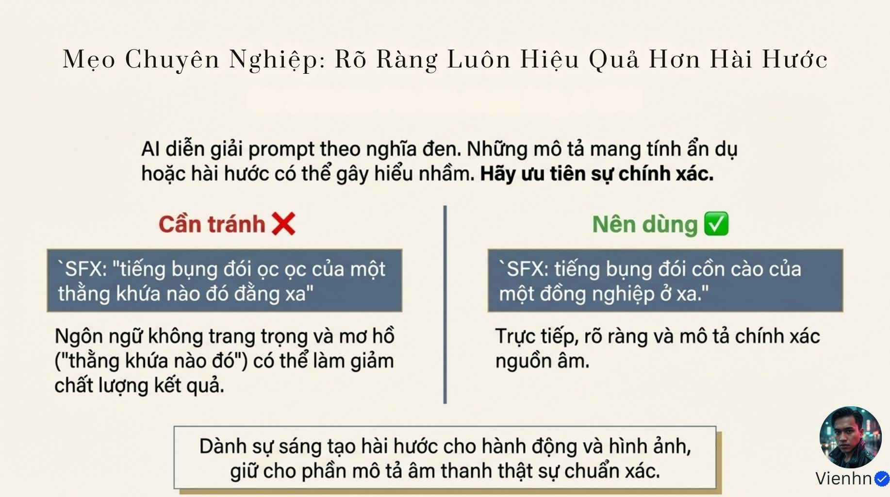
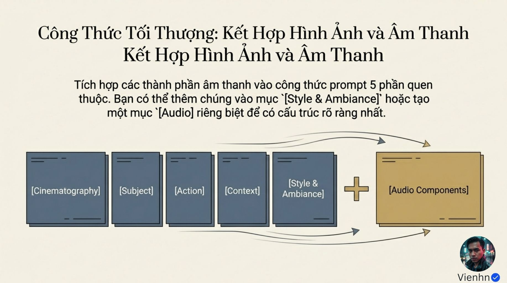
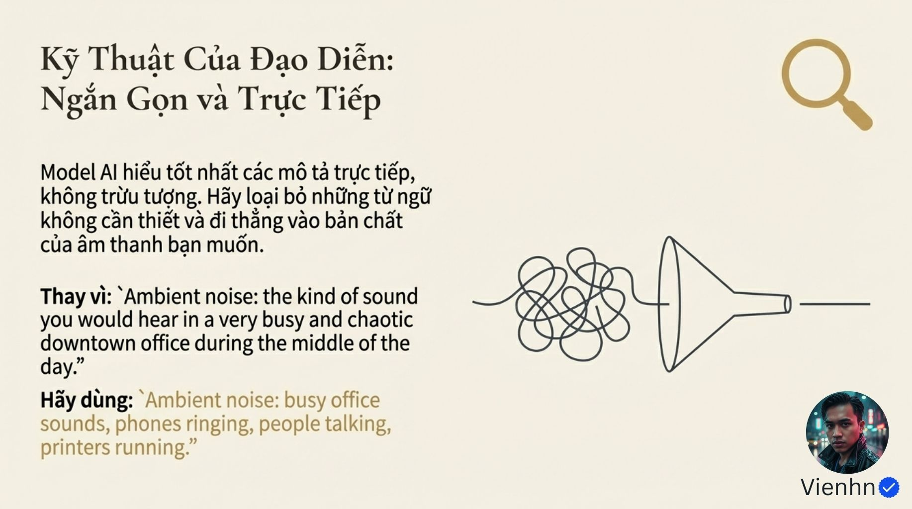
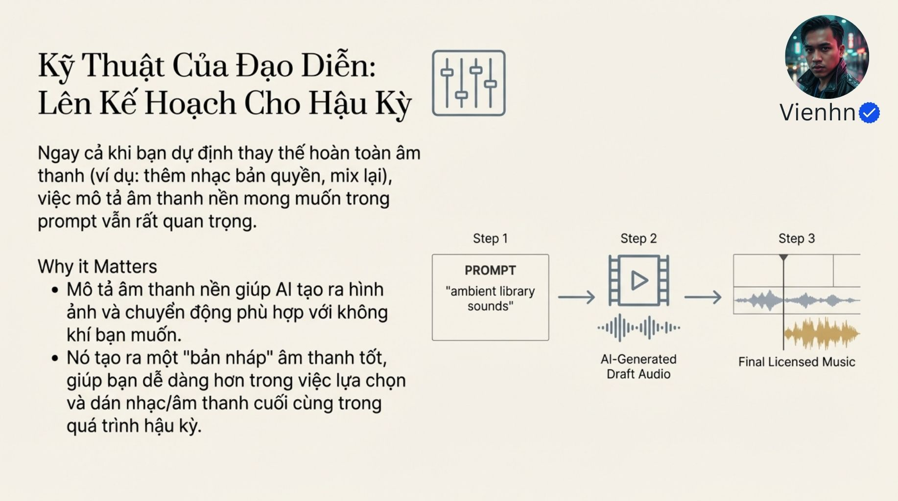
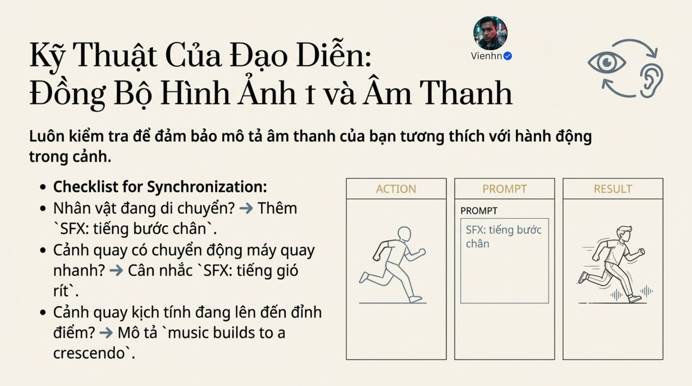
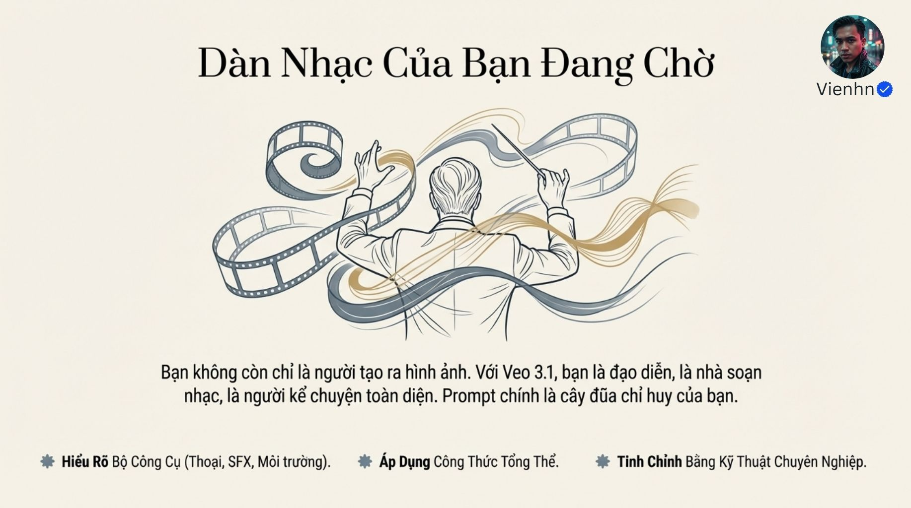

# B016 — Bản đọc toàn bộ 14 ảnh

Nguồn: [Bí Quyết Mô Tả Audio Cho Video AI (Trải nghiệm Điện Ảnh Sống Động với Veo3.1)](https://drive.google.com/drive/folders/1OMA50oqtlKvMFP25a5aPTrixLYecm3YO).

**Cách ghi:** nội dung chính được diễn đạt lại từ chữ và hình trong ảnh; không phải bản chép nguyên văn toàn bộ. Quan sát ảnh tĩnh được tách khỏi lời giải thích bổ sung. Ảnh gốc được giữ nguyên để đối chiếu.

[Bài chính](README.md) · [Thực hành](thuc-hanh.md) · [Dữ liệu nguồn](nguon.json)

## B016-00 — Làm chủ âm thanh

Tên gốc: `Bí Quyết Mô Tả Audio Cho Video AI (Trải nghiệm Điện Ảnh Sống Động với Veo3.1).jpg`.

**Nội dung chính đọc được:** Giới thiệu prompt nghe–nhìn cho trải nghiệm điện ảnh.

**Hình minh họa:** Đường sóng âm nối thành núi và sông.

**Phân tích bổ sung:** Đường vẽ là biểu tượng, không phải bản ghi âm.

## B016-01 — Âm thanh cùng hình

Tên gốc: `01.jpg`.

**Nội dung chính đọc được:** Nguồn giới thiệu khả năng âm đồng bộ và ba lớp thoại, SFX, môi trường.

**Hình minh họa:** Hai khung rừng chỉ hình và hình kèm sóng âm.

**Phân tích bổ sung:** Ảnh không có âm để nghe; khả năng và chất lượng tùy chế độ tạo.

## B016-02 — Ba thành phần

Tên gốc: `02.jpg`.

**Nội dung chính đọc được:** Thoại kể chuyện; SFX gắn hành động; ambient tạo bối cảnh, tâm trạng và chiều sâu.

**Hình minh họa:** Ba biểu tượng lời nói, sóng, gió.

**Phân tích bổ sung:** Đây là lớp thiết kế khái niệm, không đồng nghĩa công cụ xuất ba track tách rời.

## B016-03 — Viết lời thoại

Tên gốc: `03.jpg`.

**Nội dung chính đọc được:** Nguồn dùng mô tả người + says + câu trong ngoặc kép, ví dụ lời mời uống trà sữa.

**Hình minh họa:** Nét vẽ gương mặt nghiêng và câu thoại.

**Phân tích bổ sung:** Nguồn chính thức hiện có cả hướng dẫn dùng ngoặc và hướng dẫn tránh ngoặc để giảm chữ xuất hiện; không coi một dấu câu là bắt buộc.

## B016-04 — SFX có nguồn phát

Tên gốc: `04.jpg`.

**Nội dung chính đọc được:** Mô tả âm cụ thể, nguồn và hành động; ví dụ tiếng bụng đói của đồng nghiệp ở xa.

**Hình minh họa:** Người trong văn phòng và sóng âm quanh bụng.

**Phân tích bổ sung:** Chọn khoảng cách/độ rõ hợp cảnh; tiếng rất nhỏ ở xa nếu phóng đại là lựa chọn hài có chủ ý.

## B016-05 — Âm môi trường

Tên gốc: `05.jpg`.

**Nội dung chính đọc được:** Mô tả đặc trưng không gian, ví dụ tiếng người nói và máy in trong văn phòng.

**Hình minh họa:** Văn phòng với biểu tượng máy in, bàn phím và hội thoại.

**Phân tích bổ sung:** Chọn vài âm đặc trưng; không cần nhồi mọi thiết bị.

## B016-06 — Rõ thay vì mơ hồ

Tên gốc: `06.jpg`.

**Nội dung chính đọc được:** Nguồn đối chiếu cách gọi nhân vật mơ hồ với nguồn âm xác định, khuyên mô tả chính xác.

**Hình minh họa:** Hai khối ví dụ tránh/nên dùng.

**Phân tích bổ sung:** Vấn đề là tính cụ thể, không phải mức trang trọng tự động quyết định chất lượng.

## B016-07 — Gắn âm vào cấu trúc

Tên gốc: `07.jpg`.

**Nội dung chính đọc được:** Thêm các thành phần âm vào Style & Ambiance hoặc mục Audio riêng sau năm phần hình.

**Hình minh họa:** Năm thẻ hình cộng một thẻ âm; tiêu đề bị lặp.

**Phân tích bổ sung:** Nên tách mục cho dễ kiểm tra, không bắt buộc nhãn như mã lập trình.

## B016-08 — Prompt thám tử

Tên gốc: `08.jpg`.

**Nội dung chính đọc được:** Toàn cảnh thám tử áo khoác trong đại sảnh vắng, mưa trên cửa kính; âm mưa/phố xa, bước chân vang, cửa gỗ kêu, lời nói trầm về việc trở lại.

**Hình minh họa:** Người trong đại sảnh và đường nối từng thành phần prompt.

**Phân tích bổ sung:** Phần hình nói đứng, phần âm nói bước chân: cần bổ sung hành động đi rồi dừng để nhất quán.

## B016-09 — Viết gọn, trực tiếp

Tên gốc: `09.jpg`.

**Nội dung chính đọc được:** Thay câu dài về văn phòng bận bằng danh sách âm điện thoại, người nói, máy in.

**Hình minh họa:** Phễu biến nét rối thành đường gọn.

**Phân tích bổ sung:** Gọn nhưng giữ nguồn, thời điểm và ưu tiên; không phải càng ít chữ càng tốt.

## B016-10 — Kế hoạch hậu kỳ

Tên gốc: `010.jpg`.

**Nội dung chính đọc được:** Nguồn khuyên mô tả âm dù dự định thay sau, dùng bản AI làm nháp cho dựng/mix cuối.

**Hình minh họa:** Prompt → bản âm nháp → dòng thời gian hậu kỳ.

**Phân tích bổ sung:** Âm có thể hướng nhịp cảnh, nhưng không bảo đảm hình sẽ cải thiện; xuất âm tách lớp tùy công cụ.

## B016-11 — Im lặng

Tên gốc: `011.jpg`.

**Nội dung chính đọc được:** Nguồn gợi ý no music hoặc silent background khi muốn tự làm hậu kỳ.

**Hình minh họa:** Hai khung sóng âm và đường phẳng.

**Phân tích bổ sung:** Không nhạc khác im lặng hoàn toàn; cần nghe lại hoặc tắt/xóa đường tiếng khi dựng.

## B016-12 — Đồng bộ

Tên gốc: `012.jpg`.

**Nội dung chính đọc được:** Nguồn khuyên gắn bước chân với di chuyển, cân nhắc gió khi máy nhanh, nhạc tăng dần khi cao trào.

**Hình minh họa:** Ba cột hành động/prompt/kết quả có người chạy.

**Phân tích bổ sung:** Máy quay nhanh không tự tạo gió trong thế giới truyện; tiếng whoosh chỉ thêm nếu hợp dụng ý.

## B016-13 — Ôn tập

Tên gốc: `013.jpg`.

**Nội dung chính đọc được:** Hiểu thoại/SFX/môi trường, kết hợp công thức và tinh chỉnh.

**Hình minh họa:** Người chỉ huy với dải phim và sóng âm.

**Phân tích bổ sung:** Chất lượng chỉ đánh giá khi nghe video thực tế, không từ hình tượng dàn nhạc.

## Kiểm kê

Đã mở trực tiếp 14/14 ảnh. Các mã nguồn theo thứ tự ở trên khớp [danh mục tệp](nguon.json). Chưa sinh hoặc đánh giá video từ câu lệnh của bài này.
