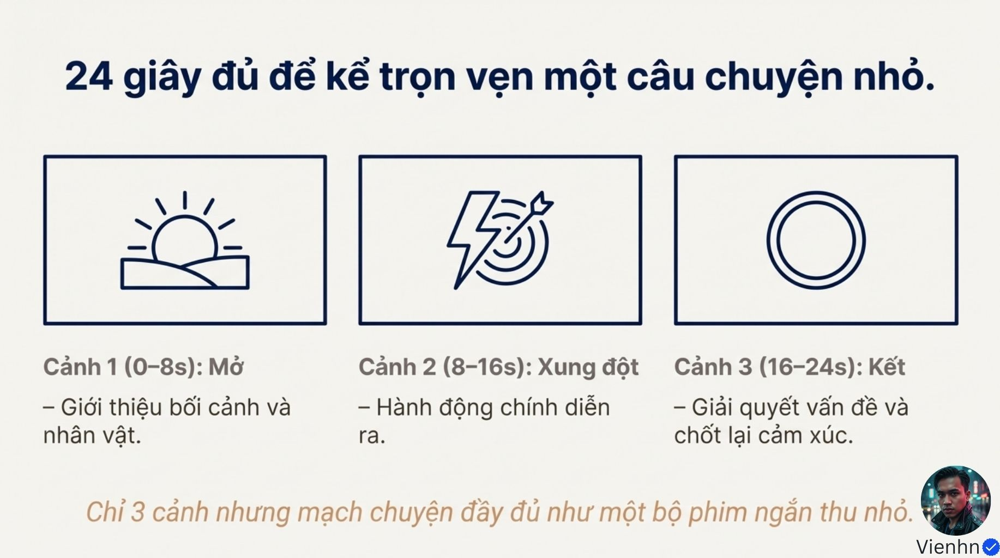
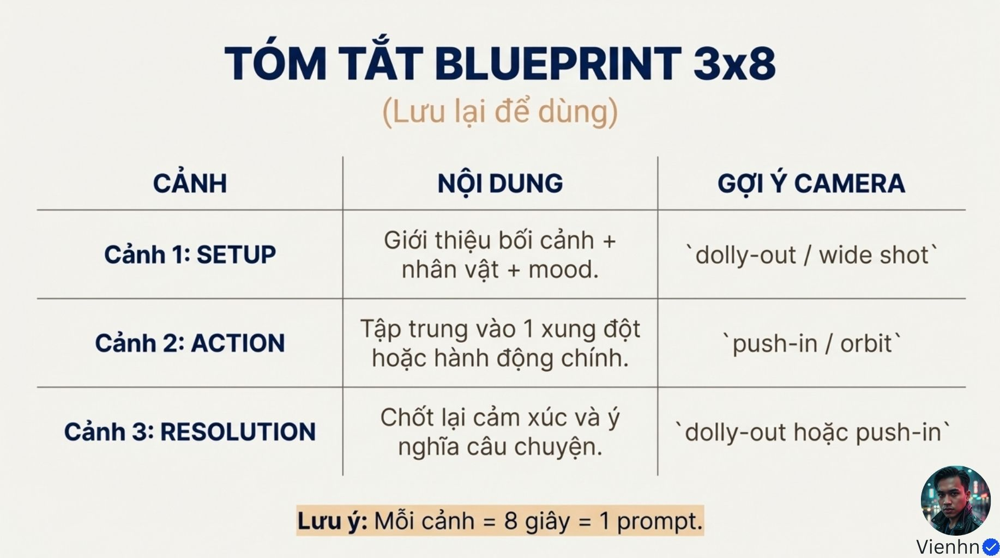
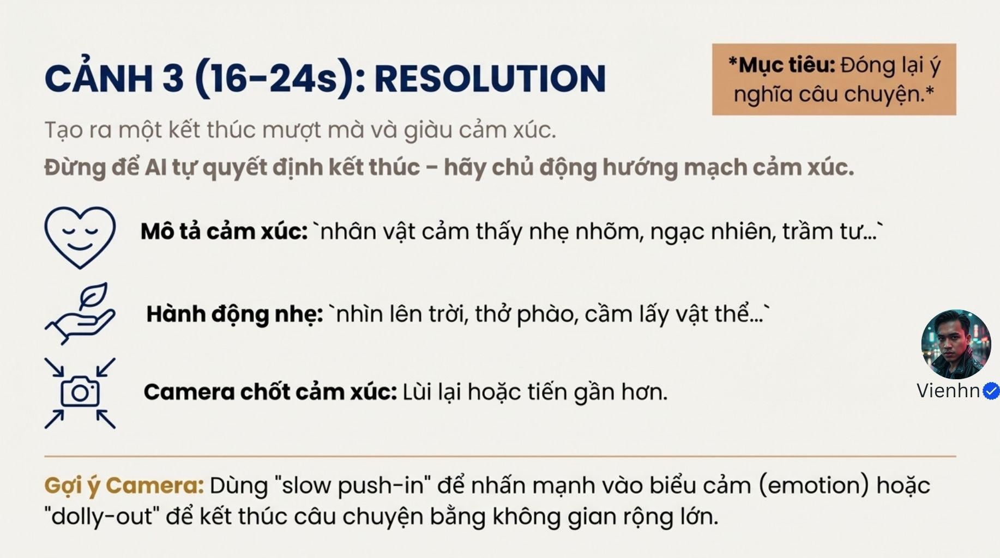
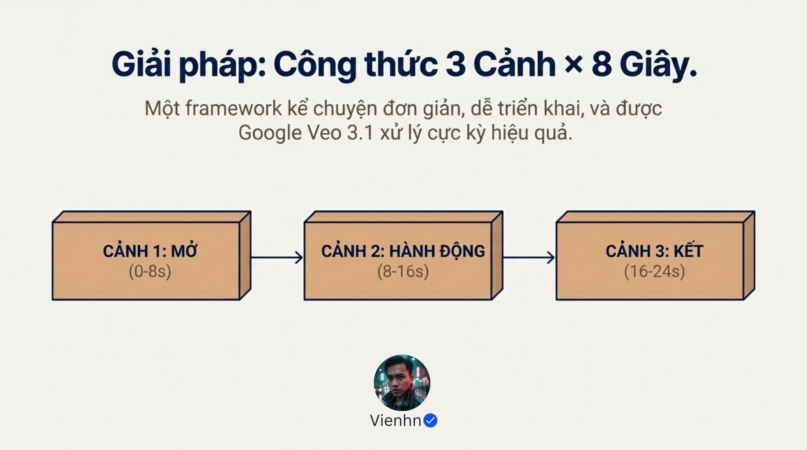

# Bài 017 — Mini story ba nhịp: mở, hành động, kết

10 ảnh trình bày mẫu 3×8 giây để lập một câu chuyện nhỏ. Tài liệu tập trung quan hệ nguyên nhân–hành động–kết quả, chia ba clip riêng, giữ liên tục và điều chỉnh nhịp dựng; không coi 24 giây là công thức thành công bắt buộc.

**Nguồn:** [CHỈ 24 GIÂY ĐỔI ĐỜI! Công thức "vàng" (3x8) khiến Veo 3.1 tạo ra mini story hoàn chỉnh, vượt xa video AI thông thường!](https://drive.google.com/drive/folders/1qepchr-kwNzUsXqxz87RG0dqwGuWAU8R). Đã đọc **10/10 ảnh**. Ngày biên soạn: 17/10/2026.

[Đọc từng ảnh](doc-anh.md) · [Bài thực hành](thuc-hanh.md) · [Nguồn và mã kiểm tra](nguon.json) · [Danh mục toàn bộ](../../DANH-MUC-BAI-HOC.md)

**Quy ước:** phần “Nguồn” diễn đạt ý trong bộ ảnh. Phần “Phân tích và áp dụng” do người biên soạn bổ sung. Hiệu quả của câu lệnh chưa được kiểm nghiệm bằng lần tạo video trong đợt này.

## Những điều cần học

| Nội dung | Mã ảnh nguồn |
| --- | --- |
| Ba nhịp phải có thay đổi | B017-01, B017-02, B017-03, B017-04 |
| Lập bảng ba clip trước khi viết prompt | B017-05, B017-06, B017-07, B017-09 |
| Giữ liên tục qua hai điểm nối | B017-05, B017-06, B017-07, B017-08 |
| Tám giây là giới hạn luyện tập, nhịp dựng do nội dung | B017-03, B017-06, B017-08, B017-09 |

## 1. Ba nhịp phải có thay đổi

**Nguồn:** Nguồn đề xuất ba đoạn: mở, hành động/xung đột, kết.

**Phân tích và áp dụng:** Viết câu chuyện bằng một câu: nhân vật thấy vấn đề → thực hiện một việc → trạng thái thay đổi. Mỗi nhịp bổ sung thông tin hoặc cảm xúc. 'Xung đột' có thể là trở ngại nhỏ, không cần kịch tính lớn; với phim thao tác, có thể là nhu cầu chưa được đáp ứng.

**Ví dụ cho cảnh nông thôn:** Người thấy chậu đất khô → tưới lượng nước vừa đủ → đất quanh gốc đã ẩm, người đặt ca xuống.

**Kiểm tra kết quả:** Có thể nêu điều gì khác giữa đầu và cuối; đoạn giữa trực tiếp tạo kết quả.

## 2. Lập bảng ba clip trước khi viết prompt

**Nguồn:** Mỗi đoạn nguồn giao một nhiệm vụ và gợi ý camera.

**Phân tích và áp dụng:** Bảng áp dụng tự biên soạn:

| Nhịp | Thông tin phải thấy | Máy gợi ý | Trạng thái cuối |
| --- | --- | --- | --- |
| Mở | Người, chậu đất khô, ca nước | Trung cảnh tĩnh | Người chuẩn bị tưới |
| Hành động | Miệng ca, dòng nước, đất | Cận vừa đủ, tĩnh | Ca dựng lại, đất đã ẩm |
| Kết | Đất ẩm và phản ứng nhỏ | Trung cận hoặc tiến rất nhẹ | Người yên tâm, ca đặt xuống |

Đây là ba shot/clip trong cùng một cảnh sân vườn; từ 'cảnh' trong nguồn được dùng khá rộng.

**Ví dụ cho cảnh nông thôn:** Giữ chậu ở trái bàn, ca ở tay phải và cùng áo nâu xuyên suốt; chọn máy tĩnh trong đoạn tưới để đọc rõ nước chạm đất.

**Kiểm tra kết quả:** Mỗi clip có trạng thái đầu/cuối riêng; không bỏ qua việc chuyển ca từ tay sang bàn.

## 3. Giữ liên tục qua hai điểm nối

**Nguồn:** Nguồn kỳ vọng ba đoạn giúp dễ quản lý nhân vật, màu và ánh sáng.

**Phân tích và áp dụng:** Lưu khối nhân vật, sơ đồ, đạo cụ và nguồn sáng chung. So cuối clip trước với đầu clip sau: tay cầm, độ đầy ca, đất khô/ẩm, vị trí người và hướng nhìn. Âm nền nối ổn định; cắt theo hành động hoặc sau nhịp dừng có chủ ý. Không tự coi ba lần tạo là một chuỗi có trí nhớ.

**Ví dụ cho cảnh nông thôn:** Sau clip tưới, đất phải ẩm trong clip kết; không khô trở lại hoặc mọc cây lớn tức thì.

**Kiểm tra kết quả:** Hai điểm nối không đổi trạng thái vật trái diễn biến; nhận diện và âm nền khớp.

## 4. Tám giây là giới hạn luyện tập, nhịp dựng do nội dung

**Nguồn:** Nguồn đặt ba đoạn tám giây, tổng 24 giây, và gọi đây là thời lượng vàng cho mạng xã hội.

**Phân tích và áp dụng:** Có thể chọn tám giây mỗi clip khi công cụ hỗ trợ, rồi giữ phần hữu ích khi dựng. Không kéo dài động tác chỉ để đủ tám giây hoặc nhồi thêm sự kiện. Ba clip tám giây ghép thẳng được 24 giây; nếu cắt gọn hay chồng chuyển cảnh, tổng có thể ngắn hơn. Đánh giá người xem có hiểu mạch, không suy hiệu quả từ một con số.

**Ví dụ cho cảnh nông thôn:** Nếu thao tác tưới đọc rõ trong sáu giây, dùng bản dựng ngắn hơn thay vì thêm quay vòng hoặc nhân vật thứ hai.

**Kiểm tra kết quả:** Không khoảng rỗng, không gấp gáp; câu chuyện hiểu được khi bỏ phần lời giải thích.

## Điểm cần hiểu có điều kiện

- Không có chứng cứ trong ảnh rằng 24 giây tối ưu thời gian xem trên mọi nền tảng hoặc giúp video 'đổi đời'.
- 3×8 là kế hoạch ba clip; không phải cam kết một lần tạo sinh cả 24 giây hay luật mọi câu chuyện.
- 'Handheld motion 3%' không có định nghĩa đo lường trong bài; không coi là thông số chuẩn.
- Hồ sơ và HEX không tự khóa nhất quán; vẫn cần tham chiếu và đối chiếu các điểm nối.
- Ba nhịp không bắt buộc ba địa điểm, ba góc máy chuyển động hoặc ba đoạn dài bằng nhau ở bản cuối.

## Cách đưa vào quy trình sản xuất

Viết thay đổi đầu/cuối → chia ba chức năng → lập bảng trạng thái/nhận diện → viết và tạo riêng từng clip → kiểm tra hình/âm và điểm nối → dựng theo nhịp → xem lại không cần giải thích ngoài phim. Đối chiếu B015 về vật lý, B016 về âm thanh.

## Tự kiểm tra kiến thức

- Ba cảnh đẹp liên tiếp khác một mini story ở đâu?
- Nếu cắt hai clip ngắn hơn, bản cuối có còn bắt buộc 24 giây không?
- Tại sao đất ẩm/khô là dấu hiệu liên tục quan trọng hơn cùng một nhãn cinematic?

## Nguồn đối chiếu bổ sung

- [Google: tập trung clip ngắn vào một khoảnh khắc](https://docs.cloud.google.com/gemini-enterprise-agent-platform/models/video/best-practice): Đối chiếu việc tách các sự kiện khác nhau thành clip riêng; không xác nhận 24 giây là tối ưu mạng xã hội.

**Giới hạn:** đây là tài liệu học từ ảnh. Không dùng một hình minh họa để xác nhận chuyển động, thời lượng, độ chính xác thao tác hay khả năng hiện tại của một sản phẩm. Những phần chưa kiểm chứng được ghi rõ trong bản đọc ảnh.
