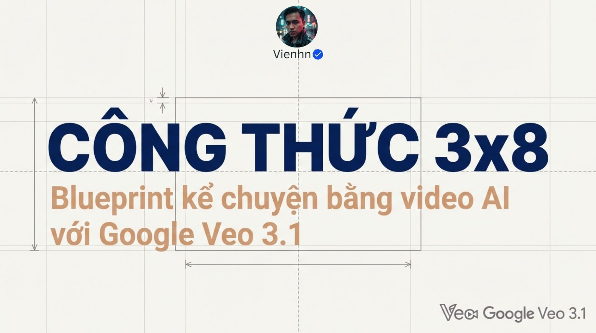
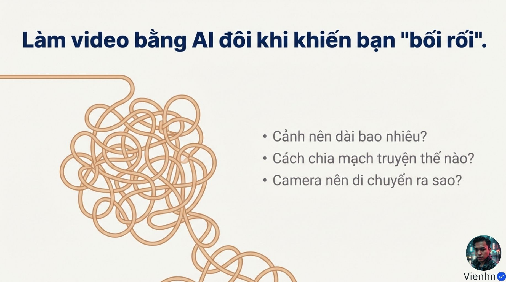
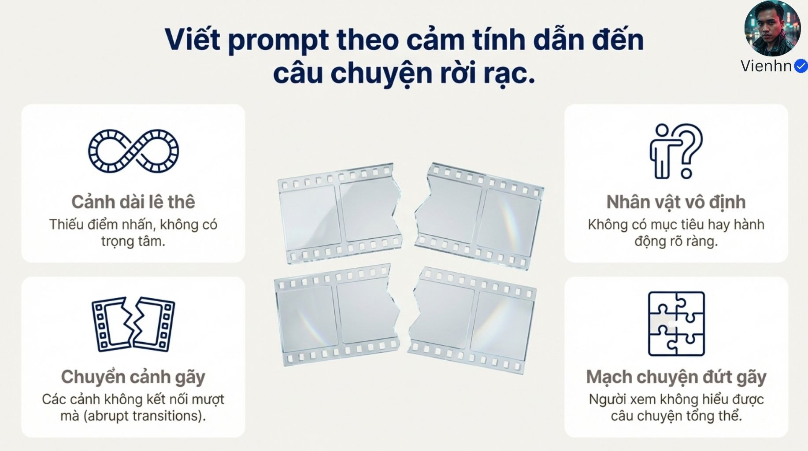
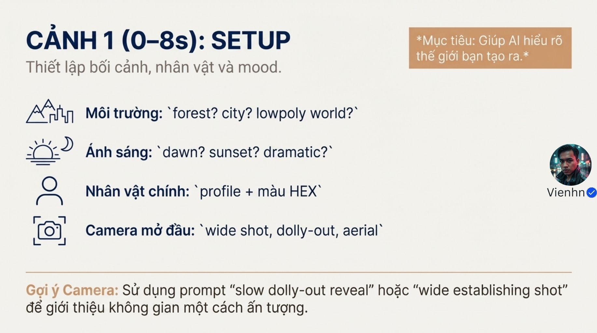
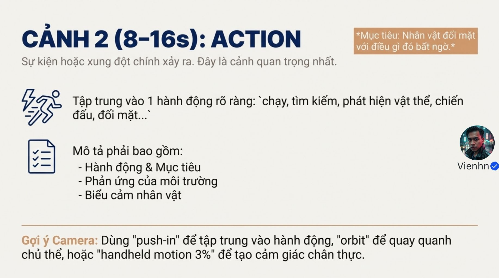
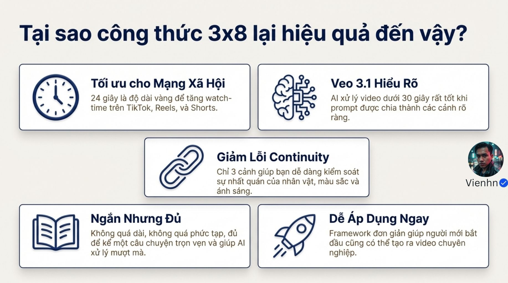

# B017 — Bản đọc toàn bộ 10 ảnh

Nguồn: [CHỈ 24 GIÂY ĐỔI ĐỜI! Công thức "vàng" (3x8) khiến Veo 3.1 tạo ra mini story hoàn chỉnh, vượt xa video AI thông thường!](https://drive.google.com/drive/folders/1qepchr-kwNzUsXqxz87RG0dqwGuWAU8R).

**Cách ghi:** nội dung chính được diễn đạt lại từ chữ và hình trong ảnh; không phải bản chép nguyên văn toàn bộ. Quan sát ảnh tĩnh được tách khỏi lời giải thích bổ sung. Ảnh gốc được giữ nguyên để đối chiếu.

[Bài chính](README.md) · [Thực hành](thuc-hanh.md) · [Dữ liệu nguồn](nguon.json)

## B017-00 — Công thức 3×8

Tên gốc: `CHỈ 24 GIÂY ĐỔI ĐỜI! Công thức "vàng" (3x8) khiến Veo 3.1 tạo ra mini story hoàn chỉnh, vượt xa video AI thông thường!.jpg`.

**Nội dung chính đọc được:** Giới thiệu bản thiết kế kể chuyện bằng video AI với ba đoạn tám giây.

**Hình minh họa:** Chữ lớn trên nền đường thiết kế.

**Phân tích bổ sung:** Đây là tên phương pháp trong nguồn, không phải tính năng bảo đảm của mô hình.

## B017-01 — Ba câu hỏi mở

Tên gốc: `01.jpg`.

**Nội dung chính đọc được:** Cảnh dài bao nhiêu, chia mạch ra sao, camera chuyển động thế nào?

**Hình minh họa:** Nét dây rối và ba câu hỏi.

**Phân tích bổ sung:** Trả lời mục đích kể chuyện trước khi ấn định độ dài.

## B017-02 — Lỗi khi thiếu kế hoạch

Tên gốc: `02.jpg`.

**Nội dung chính đọc được:** Cảnh dài không trọng tâm, chuyển cảnh gãy, nhân vật không đích và mạch rời.

**Hình minh họa:** Bốn ô lỗi quanh dải phim đứt.

**Phân tích bổ sung:** Độ dài tự nó không quyết định chất lượng; cần quan hệ giữa các sự kiện.

## B017-03 — Ba đoạn tám giây

Tên gốc: `03.jpg`.

**Nội dung chính đọc được:** Mở 0–8, hành động 8–16, kết 16–24; nguồn cho rằng Veo xử lý hiệu quả.

**Hình minh họa:** Ba khối nối nhau với mốc tổng 24 giây.

**Phân tích bổ sung:** Ba clip riêng rồi dựng; không hiểu thành một lệnh mặc định sinh 24 giây.

## B017-04 — Ba chức năng

Tên gốc: `04.jpg`.

**Nội dung chính đọc được:** Mở giới thiệu nơi/người, giữa có hành động hoặc xung đột, cuối giải quyết và chốt cảm xúc.

**Hình minh họa:** Ba ô biểu tượng bình minh, hành động, vòng kết.

**Phân tích bổ sung:** Để thành truyện cần thay đổi có ý nghĩa; ba cảnh đẹp chưa đủ.

## B017-05 — Setup

Tên gốc: `05.jpg`.

**Nội dung chính đọc được:** Thiết lập môi trường, sáng, hồ sơ nhân vật và màu; gợi ý rộng, máy lùi lộ cảnh hoặc nhìn trên cao.

**Hình minh họa:** Bốn mục nội dung và gợi ý camera.

**Phân tích bổ sung:** Wide là cỡ, dolly-out là chuyển động, aerial là vị trí nhìn; chọn theo thông tin, không buộc dùng cả ba.

## B017-06 — Action

Tên gốc: `06.jpg`.

**Nội dung chính đọc được:** Một sự kiện rõ gồm mục tiêu, phản ứng môi trường, biểu cảm; gợi ý tiến gần, quay vòng hoặc handheld motion 3%.

**Hình minh họa:** Biểu tượng sét/người chạy và danh sách.

**Phân tích bổ sung:** 3% không có đơn vị hay tham số được xác nhận; thay bằng mô tả rung nhẹ nếu cần.

## B017-07 — Resolution

Tên gốc: `07.jpg`.

**Nội dung chính đọc được:** Kết bằng cảm xúc và hành động nhỏ; camera tiến gần nhấn biểu cảm hoặc lùi mở không gian.

**Hình minh họa:** Biểu tượng tim, bàn tay, camera.

**Phân tích bổ sung:** Kết cần cho thấy hệ quả của đoạn giữa, không chỉ thay cỡ cảnh.

## B017-08 — Lý do tác giả đề xuất

Tên gốc: `08.jpg`.

**Nội dung chính đọc được:** Nguồn cho rằng 24 giây tối ưu mạng xã hội, dễ xử lý, giảm lỗi liên tục và dễ áp dụng.

**Hình minh họa:** Năm ô lợi ích.

**Phân tích bổ sung:** Không có dữ liệu chứng minh thời lượng vàng hoặc mức giảm lỗi; đây là nhận định của nguồn.

## B017-09 — Bảng tóm tắt

Tên gốc: `09.jpg`.

**Nội dung chính đọc được:** Mở, hành động, kết cùng các lựa chọn camera; mỗi đoạn tám giây một prompt.

**Hình minh họa:** Bảng ba hàng và ghi chú.

**Phân tích bổ sung:** Dùng như bài tập tạo ba clip; điểm cắt, nhịp và độ dài thực tế cần quyết định khi dựng.

## Kiểm kê

Đã mở trực tiếp 10/10 ảnh. Các mã nguồn theo thứ tự ở trên khớp [danh mục tệp](nguon.json). Chưa sinh hoặc đánh giá video từ câu lệnh của bài này.
