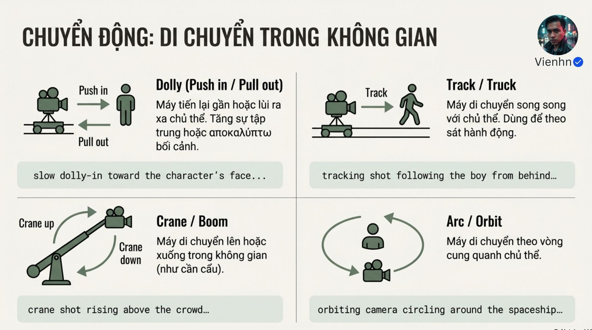
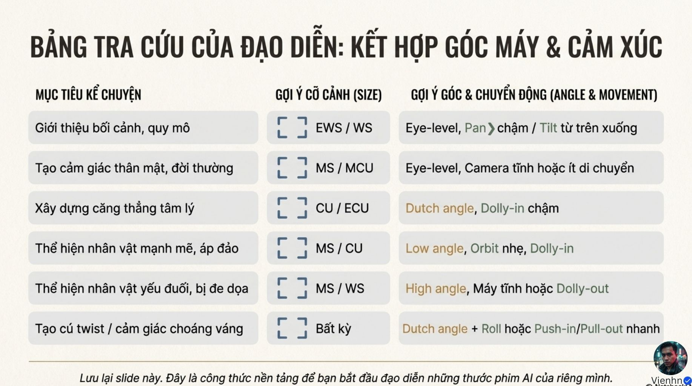

# Bài 018 — Cỡ cảnh, góc máy và chuyển động: bảng tra đúng nghĩa

12 ảnh hệ thống hóa từ vựng máy quay. Bản học tách ba quyết định độc lập, phân biệt xoay tại chỗ với dịch máy, Dutch angle với tilt/roll và tracking với đi ngang, kèm bài tập dùng đúng dolly–pan–tilt trong cảnh nông thôn.

**Nguồn:** [Dolly, Pan, Tilt- Ứng Dụng Chuyển Động Camera Cực Kỳ Quan Trọng Trong Việc Tạo Hình Ảnh Veo 3.1](https://drive.google.com/drive/folders/1r-plZ2jVlT7gmh6XJK_Fd7MIQ3jI8b-C). Đã đọc **12/12 ảnh**. Ngày biên soạn: 17/10/2026.

[Đọc từng ảnh](doc-anh.md) · [Bài thực hành](thuc-hanh.md) · [Nguồn và mã kiểm tra](nguon.json) · [Danh mục toàn bộ](../../DANH-MUC-BAI-HOC.md)

**Quy ước:** phần “Nguồn” diễn đạt ý trong bộ ảnh. Phần “Phân tích và áp dụng” do người biên soạn bổ sung. Hiệu quả của câu lệnh chưa được kiểm nghiệm bằng lần tạo video trong đợt này.

## Những điều cần học

| Nội dung | Mã ảnh nguồn |
| --- | --- |
| Chọn cỡ cảnh theo thông tin cần thấy | B018-01, B018-02, B018-03, B018-04 |
| Góc nhìn và độ cao là lựa chọn kể chuyện | B018-00, B018-05, B018-06, B018-07 |
| Phân biệt xoay tại chỗ với dịch máy | B018-08, B018-09, B018-10 |
| Đưa điểm đầu, đường đi và điểm dừng vào prompt | B018-09, B018-10, B018-11 |
| Dùng bảng cảm xúc như giả thuyết | B018-06, B018-07, B018-11 |

## 1. Chọn cỡ cảnh theo thông tin cần thấy

**Nguồn:** Nguồn có sáu mức từ rất rộng tới cực cận để hướng chú ý.

**Phân tích và áp dụng:** Bảng tra diễn đạt lại:

| Mã | Nghĩa | Ưu tiên thường dùng |
| --- | --- | --- |
| EWS | Rất rộng | Quy mô, quan hệ người–cảnh |
| WS/LS | Rộng/toàn thân theo quy ước nguồn | Dáng đi, không gian |
| MS | Trung, thường khoảng eo trở lên | Thao tác lớn, hội thoại |
| MCU | Trung cận, thường khoảng ngực trở lên | Biểu cảm có chút nền |
| CU | Cận | Mặt hoặc đồ vật/việc chính |
| ECU | Cực cận | Một chi tiết nhỏ |

Tên cỡ không thay việc ghi giới hạn khung cần giữ.

**Ví dụ cho cảnh nông thôn:** Với đan giỏ, cận vừa đủ chứa hai tay và mép giỏ có ích hơn cực cận một đầu ngón khiến không hiểu đường nan.

**Kiểm tra kết quả:** Mọi vật cần thiết để hiểu thao tác đều trong khung; chi tiết đủ lớn để quan sát.

## 2. Góc nhìn và độ cao là lựa chọn kể chuyện

**Nguồn:** Nguồn giới thiệu ngang mắt, cao, thấp, Dutch cùng vị trí ngang hông/gối/sát đất.

**Phân tích và áp dụng:** Góc cao nhìn xuống, góc thấp nhìn lên; ngang mắt theo tầm mắt chủ thể. Độ cao máy không tự xác định hướng nhìn. Dutch là khung nghiêng đường chân trời; không phải tilt ngẩng/cúi. Hiệu quả quyền lực, yếu thế hay bất an chỉ là khả năng, cần ngữ cảnh.

**Ví dụ cho cảnh nông thôn:** Góc cao nhẹ nhìn xuống bàn giúp thấy cách đặt hạt vào rãnh, phục vụ đọc thao tác; không cần gán ý nghĩa nhân vật yếu đuối.

**Kiểm tra kết quả:** Góc giúp thấy thông tin và phù hợp sắc thái; không nghiêng khung vô cớ.

## 3. Phân biệt xoay tại chỗ với dịch máy

**Nguồn:** Nguồn chia hai nhóm chuyển động máy với sơ đồ.

**Phân tích và áp dụng:** Bảng áp dụng:

| Thuật ngữ | Điều thay đổi | Ví dụ ngắn |
| --- | --- | --- |
| Pan | Hướng nhìn ngang, vị trí giữ nguyên | Lia từ cổng sang vườn |
| Tilt | Hướng nhìn lên/xuống, vị trí giữ nguyên | Từ giỏ lên mặt |
| Roll | Xoay quanh trục ống kính | Khung xoay nghiêng dần |
| Dolly | Máy tiến gần/lùi xa | Tiến từ trung vào cận |
| Truck | Máy dịch ngang | Đi ngang dọc luống |
| Tracking | Máy bám chủ thể, nhiều đường có thể dùng | Theo từ phía sau |
| Crane/Boom | Máy được nâng/hạ hoặc quét cung bằng cần | Lên cao lộ ruộng |
| Arc/Orbit | Máy đi cung quanh chủ thể | Từ trước sang bên giỏ |
| Zoom – bổ sung | Đổi tiêu cự, máy không dịch vì zoom | Thu khung trên vật |

Không suy chuyển động đúng chỉ từ một khung ảnh.

**Ví dụ cho cảnh nông thôn:** Lia pan từ cổng sang vườn giữ nguyên chân máy. Nếu muốn thấy mặt bên của giỏ đổi theo vị trí nhìn, yêu cầu máy dịch hoặc đi cung, không chỉ lia.

**Kiểm tra kết quả:** Toàn clip có đường máy đúng; vật thể không tự xoay thay máy; không nhầm zoom với tiến gần.

## 4. Đưa điểm đầu, đường đi và điểm dừng vào prompt

**Nguồn:** Nguồn cho các mẫu slow pan, tilt từ chân lên mặt, dolly-in và bảng ghép mục đích.

**Phân tích và áp dụng:** Mẫu tự biên soạn: cỡ đầu + góc đầu + đường máy/tốc độ + đích cuối + phần luôn phải trong khung. Chọn một chuyển động trước; nếu phối hợp, nêu mục đích và thứ tự. Máy tĩnh là lựa chọn đầy đủ khi thao tác hoặc bố cục cần ổn định.

**Ví dụ cho cảnh nông thôn:** Bắt đầu trung cảnh người ôm bó rau ở ngang ngực; máy tilt xuống chậm tới giỏ trên bàn, giữ nguyên vị trí, dừng khi thấy tay đặt rau vào giỏ.

**Kiểm tra kết quả:** Đích lộ đúng lúc, không cắt mất điểm tiếp xúc; đường chân trời ổn định nếu không yêu cầu roll.

## 5. Dùng bảng cảm xúc như giả thuyết

**Nguồn:** Nguồn gợi ý cỡ/góc/chuyển động cho thân mật, căng thẳng, uy lực và choáng.

**Phân tích và áp dụng:** Chọn hình thức vì lý do của cảnh rồi xem hiệu quả. Đừng ghép tất cả từ khóa trong một ô thành lệnh cùng lúc. Với cảnh thao tác, chấm rõ việc và vật lý trước, sau đó nhịp, cảm xúc và phong cách.

**Ví dụ cho cảnh nông thôn:** Người chăm cây có thể gần gũi với trung cảnh ngang mắt tĩnh, chỉ một nụ cười nhỏ sau khi xong việc; không cần orbit hay Dutch để 'điện ảnh'.

**Kiểm tra kết quả:** Người xem hiểu việc và sắc thái mà không cần giải thích từ khóa đã dùng.

## Điểm cần hiểu có điều kiện

- Tracking không chỉ là máy đi song song; cần nêu hướng bám cụ thể.
- Dutch angle là khung nghiêng; tilt là ngẩng/cúi, roll là chuyển động xoay quanh trục ống kính.
- Góc thấp/cao không tự gây uy lực/yếu thế; góc cao cũng có chức năng mô tả thao tác.
- Hình B018-00 không khớp chặt nhãn medium shot; cỡ cảnh nên đọc theo nội dung khung.
- Chữ lạc ngôn ngữ ở B018-10 là lỗi biên tập; không dùng làm thuật ngữ.
- Một từ khóa kỹ thuật không bảo đảm mô hình tuân thủ; kiểm tra video và sửa bằng mô tả đường máy.

## Cách đưa vào quy trình sản xuất

Chọn thông tin → cỡ cảnh → góc/độ cao → tĩnh hoặc đường máy có đích → thêm chủ thể/hành động/bối cảnh/âm → tạo từng biến để so → xem toàn chuyển động và điểm đầu/cuối. Dùng B012 cho cấu trúc kể chuyện, B015 cho quan hệ máy–chủ thể.

## Tự kiểm tra kiến thức

- Tilt lên khác nâng cả camera lên ở đâu?
- Khung Dutch cố định khác roll liên tục như thế nào?
- Vì sao một ảnh không chứng minh camera đã dolly hay zoom?

## Nguồn đối chiếu bổ sung

- [Google: thuật ngữ góc và chuyển động camera](https://docs.cloud.google.com/gemini-enterprise-agent-platform/models/video/video-gen-prompt-guide): Đối chiếu pan, tilt, dolly, truck, zoom và các góc; kết quả thực tế vẫn cần kiểm tra.

**Giới hạn:** đây là tài liệu học từ ảnh. Không dùng một hình minh họa để xác nhận chuyển động, thời lượng, độ chính xác thao tác hay khả năng hiện tại của một sản phẩm. Những phần chưa kiểm chứng được ghi rõ trong bản đọc ảnh.
