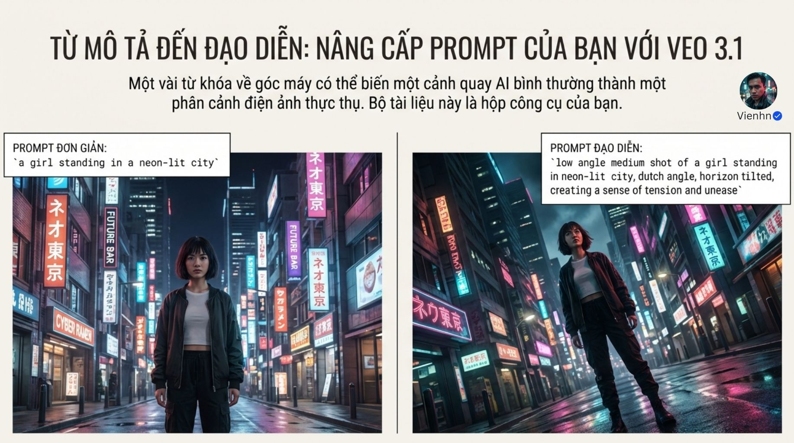
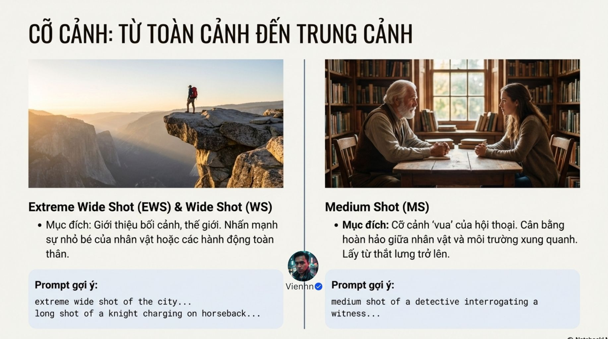
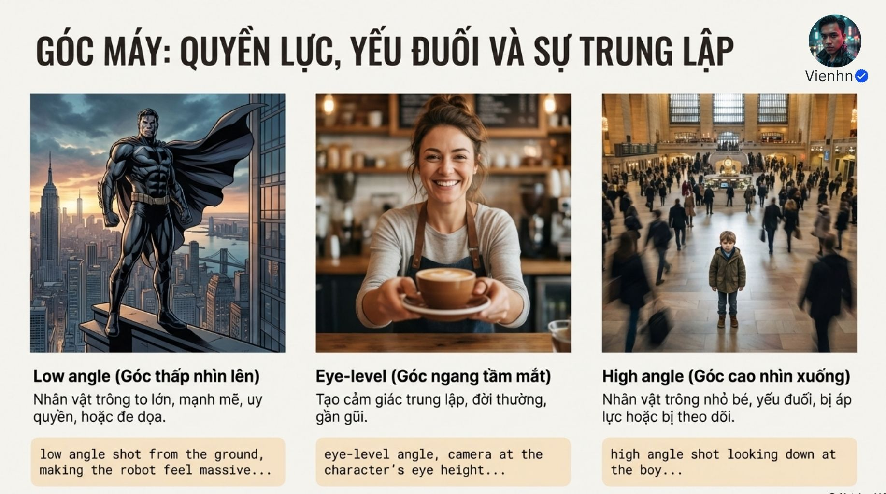
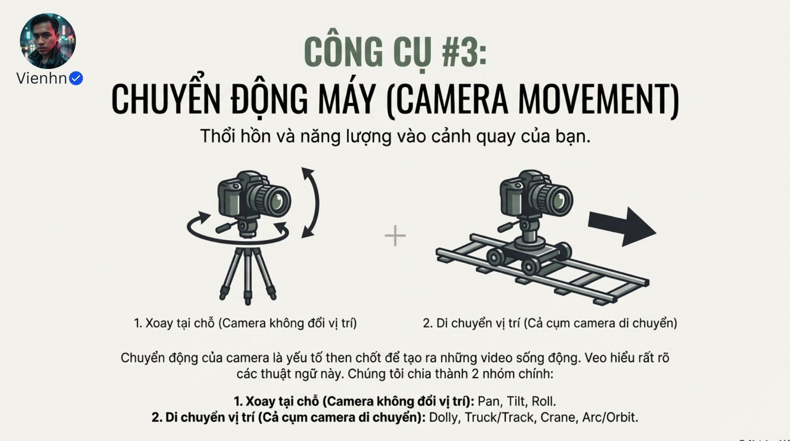

# B018 — Bản đọc toàn bộ 12 ảnh

Nguồn: [Dolly, Pan, Tilt- Ứng Dụng Chuyển Động Camera Cực Kỳ Quan Trọng Trong Việc Tạo Hình Ảnh Veo 3.1](https://drive.google.com/drive/folders/1r-plZ2jVlT7gmh6XJK_Fd7MIQ3jI8b-C).

**Cách ghi:** nội dung chính được diễn đạt lại từ chữ và hình trong ảnh; không phải bản chép nguyên văn toàn bộ. Quan sát ảnh tĩnh được tách khỏi lời giải thích bổ sung. Ảnh gốc được giữ nguyên để đối chiếu.

[Bài chính](README.md) · [Thực hành](thuc-hanh.md) · [Dữ liệu nguồn](nguon.json)

## B018-00 — Từ mô tả tới chỉ đạo

Tên gốc: `Dolly, Pan, Tilt- Ứng Dụng Chuyển Động Camera Cực Kỳ Quan Trọng Trong Việc Tạo Hình Ảnh Veo 3.1.jpg`.

**Nội dung chính đọc được:** So cô gái đứng phố neon với bản thêm góc thấp, trung cảnh, đường chân trời nghiêng để gợi bất an.

**Hình minh họa:** Hai hình phố, bản phải nghiêng và nhìn từ thấp hơn.

**Phân tích bổ sung:** Hình sau có vẻ toàn thân dù ghi medium; đọc nhãn cùng hình nhưng không coi mọi ảnh là ví dụ cỡ cảnh chính xác.

## B018-01 — Ba lựa chọn camera

Tên gốc: `01.jpg`.

**Nội dung chính đọc được:** Công thức cỡ cảnh + góc máy + chuyển động máy.

**Hình minh họa:** Ba biểu tượng khung, thước góc và mũi tên.

**Phân tích bổ sung:** Ba trục độc lập: cùng cỡ có thể nhiều góc và nhiều chuyển động.

## B018-02 — Dải cỡ cảnh

Tên gốc: `02.jpg`.

**Nội dung chính đọc được:** EWS, WS/LS, MS, MCU, CU, ECU để hướng chú ý vào không gian, hành động hoặc cảm xúc.

**Hình minh họa:** Dải phim phi hành gia từ rất xa tới chi tiết mắt.

**Phân tích bổ sung:** Tên gọi là quy ước, biên cắt có thể khác; phải mô tả phần cần thấy.

## B018-03 — Rộng và trung

Tên gốc: `03.jpg`.

**Nội dung chính đọc được:** Rất rộng/rộng giới thiệu bối cảnh và toàn thân; trung thường từ eo, cân người và môi trường, hay dùng hội thoại.

**Hình minh họa:** Người trên vách núi, hai người ngồi bàn thư viện.

**Phân tích bổ sung:** Không bắt buộc mọi hội thoại dùng trung hoặc mọi cảnh mở dùng rộng.

## B018-04 — Trung cận tới cực cận

Tên gốc: `04.jpg`.

**Nội dung chính đọc được:** MCU từ ngực, CU mặt/chi tiết, ECU một phần nhỏ; ví dụ phi công, người già và nút bấm.

**Hình minh họa:** Ba khung cỡ nhỏ dần.

**Phân tích bổ sung:** Cận cũng dành cho thao tác/đồ vật; cực cận có thể làm mất quan hệ giữa tay và dụng cụ.

## B018-05 — Góc máy

Tên gốc: `05.jpg`.

**Nội dung chính đọc được:** Ngang mắt, cao, thấp, nghiêng tác động cách cảm nhận nhân vật.

**Hình minh họa:** Sơ đồ vị trí camera so với người.

**Phân tích bổ sung:** Hiệu quả phụ thuộc nội dung, diễn xuất và dựng; không tự quyết định cảm xúc.

## B018-06 — Ba góc thường dùng

Tên gốc: `06.jpg`.

**Nội dung chính đọc được:** Góc thấp gợi uy lực, ngang mắt gần gũi, cao có thể gợi nhỏ bé/bị theo dõi.

**Hình minh họa:** Siêu anh hùng, người phục vụ đưa cốc, người nhỏ trong nhà ga.

**Phân tích bổ sung:** Góc cao cũng hữu ích đọc mặt bàn hoặc bố trí ruộng, không phải luôn làm yếu nhân vật.

## B018-07 — Nghiêng và độ cao máy

Tên gốc: `07.jpg`.

**Nội dung chính đọc được:** Dutch angle tạo đường chân trời xiên; vị trí ngang hông/đầu gối/sát đất để nhấn chi tiết.

**Hình minh họa:** Hành lang nghiêng và cận ngang hông.

**Phân tích bổ sung:** Dutch là trạng thái nghiêng quanh trục ống kính, không đồng nghĩa tilt lên/xuống. Độ cao máy khác hướng trục nhìn.

## B018-08 — Hai nhóm chuyển động

Tên gốc: `08.jpg`.

**Nội dung chính đọc được:** Xoay tại chỗ: pan, tilt, roll. Dịch vị trí: dolly, truck/track, crane, arc/orbit.

**Hình minh họa:** Máy trên chân và máy trên ray.

**Phân tích bổ sung:** Có thể phối hợp nhưng nên học từng biến; thêm zoom là thay tiêu cự, không thuộc dịch vị trí.

## B018-09 — Pan, tilt, roll

Tên gốc: `09.jpg`.

**Nội dung chính đọc được:** Pan xoay ngang, tilt ngẩng/cúi, roll xoay quanh trục ống kính; dùng lộ cảnh, chiều cao hoặc mất định hướng.

**Hình minh họa:** Ba sơ đồ camera và mũi tên xoay.

**Phân tích bổ sung:** Roll liên tục khác giữ một góc Dutch cố định; tilt không phải nâng thân máy.

## B018-10 — Dịch trong không gian

Tên gốc: `010.jpg`.

**Nội dung chính đọc được:** Dolly tới/lùi; track/truck đi theo/ngang; crane lên/xuống; arc/orbit quanh chủ thể.

**Hình minh họa:** Bốn nhóm sơ đồ ray/cần cẩu/quỹ đạo.

**Phân tích bổ sung:** Tracking rộng hơn chỉ đi song song; ví dụ nguồn cũng bám từ sau. Chữ Hy Lạp lạc trong câu dolly là lỗi biên tập.

## B018-11 — Bảng mục đích kể chuyện

Tên gốc: `011.jpg`.

**Nội dung chính đọc được:** Ghép mục đích giới thiệu, thân mật, căng thẳng, uy lực, yếu thế hoặc choáng với cỡ/góc/chuyển động gợi ý.

**Hình minh họa:** Bảng sáu hàng mục tiêu và lựa chọn.

**Phân tích bổ sung:** Bảng gợi ý để thử, không phải công thức cảm xúc bất biến hoặc lệnh trộn tất cả lựa chọn.

## Kiểm kê

Đã mở trực tiếp 12/12 ảnh. Các mã nguồn theo thứ tự ở trên khớp [danh mục tệp](nguon.json). Chưa sinh hoặc đánh giá video từ câu lệnh của bài này.
