# B019 — Bản đọc toàn bộ 13 ảnh

Nguồn: [Hệ thống Bánh Đà học tập bằng AI](https://drive.google.com/drive/folders/1K77-ERUz2a6e-xvyEb3J1rZ36YaLvgPw).

**Cách ghi:** nội dung chính được diễn đạt lại từ chữ và hình trong ảnh; không phải bản chép nguyên văn toàn bộ. Quan sát ảnh tĩnh được tách khỏi lời giải thích bổ sung. Ảnh gốc được giữ nguyên để đối chiếu.

[Bài chính](README.md) · [Thực hành](thuc-hanh.md) · [Dữ liệu nguồn](nguon.json)

## B019-00 — Bánh đà học tập

Tên gốc: `Hệ thống Bánh Đà học tập bằng AI.jpg`.

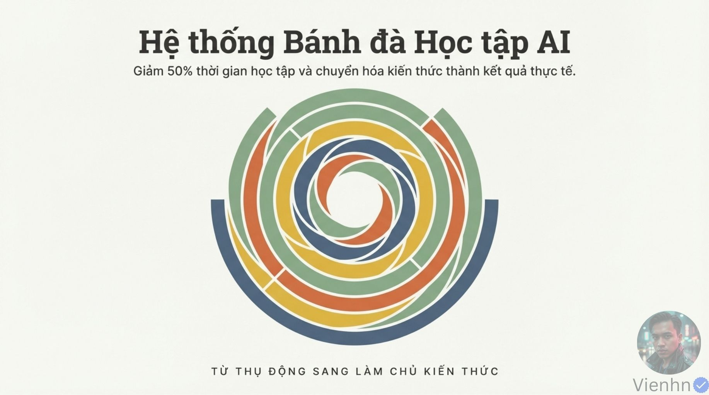

**Nội dung chính đọc được:** Giới thiệu hệ thống học bằng AI, hứa giảm 50% thời gian và chuyển kiến thức thành kết quả.

**Hình minh họa:** Vòng nhiều màu như bánh đà.

**Phân tích bổ sung:** Không có thử nghiệm cho mức 50%; dùng như mục tiêu, không kết quả được bảo đảm.

## B019-01 — Chủ động thay thụ động

Tên gốc: `02.jpg`.

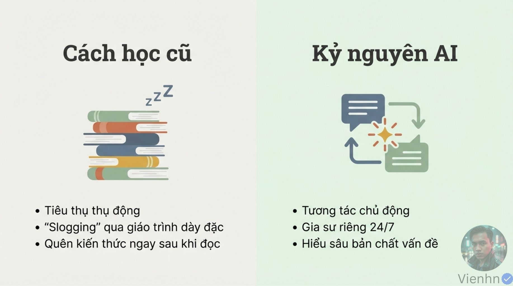

**Nội dung chính đọc được:** Nguồn đối chiếu chỉ đọc giáo trình với hội thoại, gia sư AI và hiểu sâu.

**Hình minh họa:** Chồng sách và hai bong bóng hội thoại vòng nhau.

**Phân tích bổ sung:** Đọc sách có thể rất chủ động; có AI cũng có thể thụ động nếu chỉ nhận đáp án.

## B019-02 — Hỏi gợi mở

Tên gốc: `03.jpg`.

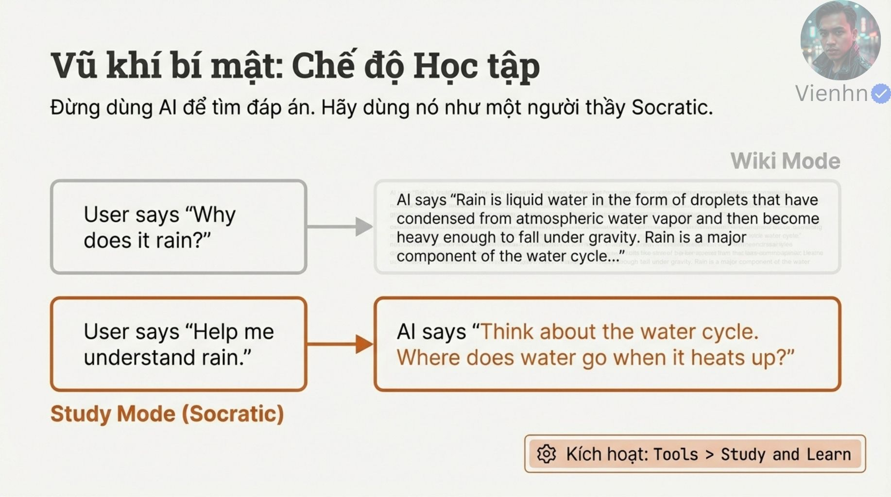

**Nội dung chính đọc được:** Dùng AI hỏi lại để hiểu thay vì chỉ đưa lời giải; ví dụ hỏi vòng tuần hoàn nước, nêu menu Tools > Study and Learn.

**Hình minh họa:** Hai cách đối thoại Wiki Mode và Study Mode.

**Phân tích bổ sung:** Chỉ ghi đường menu như nội dung trong ảnh; chưa xác minh vị trí/tên trên mọi giao diện. Có thể yêu cầu kiểu hỏi gợi mở bằng văn bản.

## B019-03 — Bảy bước

Tên gốc: `04.jpg`.

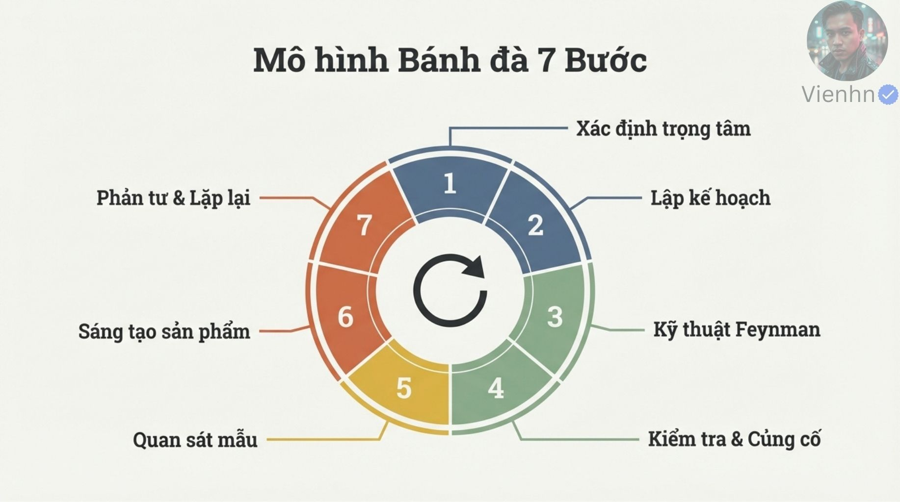

**Nội dung chính đọc được:** Trọng tâm, kế hoạch, giải thích lại, kiểm tra, quan sát mẫu, sản phẩm, phản tư rồi lặp.

**Hình minh họa:** Bánh đà chia bảy phần.

**Phân tích bổ sung:** Chu trình chỉ hữu ích khi có phản hồi đáng tin và sản phẩm cụ thể.

## B019-04 — Chọn trọng tâm

Tên gốc: `05.jpg`.

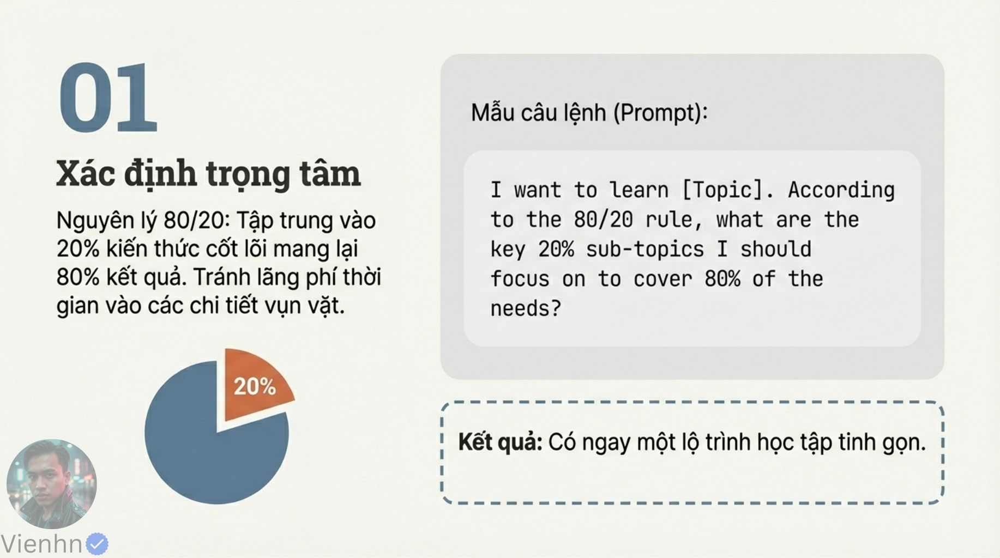

**Nội dung chính đọc được:** Dùng nguyên lý 80/20 để ưu tiên kiến thức cốt lõi; mẫu yêu cầu AI chọn chủ đề con quan trọng.

**Hình minh họa:** Biểu đồ 20% và khối prompt.

**Phân tích bổ sung:** 80/20 là cách ưu tiên, không định lượng bảo đảm cho mọi môn. Cần căn cứ mục tiêu và lỗi hiện có.

## B019-05 — Kế hoạch thực chiến

Tên gốc: `06.jpg`.

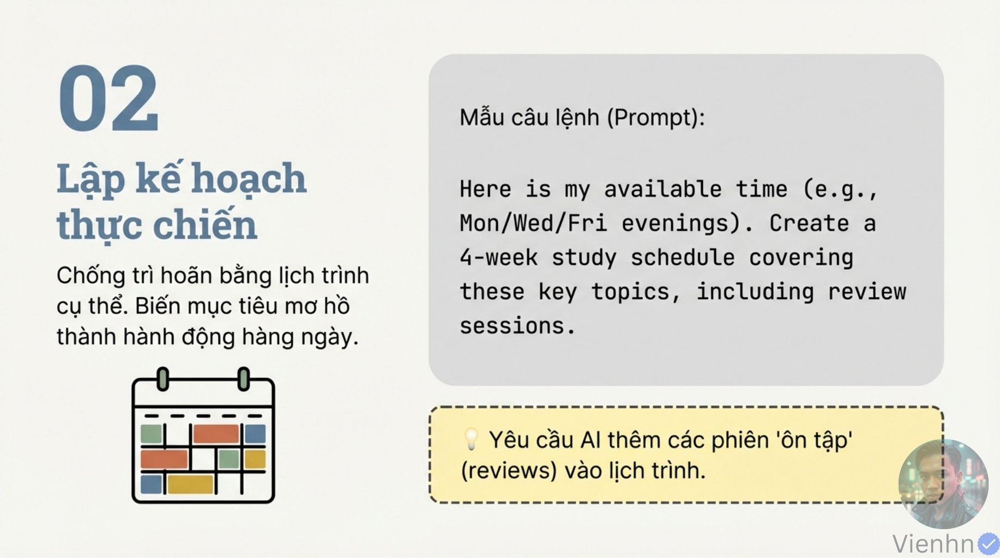

**Nội dung chính đọc được:** Cung cấp thời gian rảnh, yêu cầu lịch bốn tuần có ôn tập.

**Hình minh họa:** Lịch nhiều màu và prompt.

**Phân tích bổ sung:** Lịch cần phù hợp thời gian thực; bản kế hoạch không tự tạo nhắc việc hoặc tự chạy.

## B019-06 — Giải thích lại

Tên gốc: `07.jpg`.

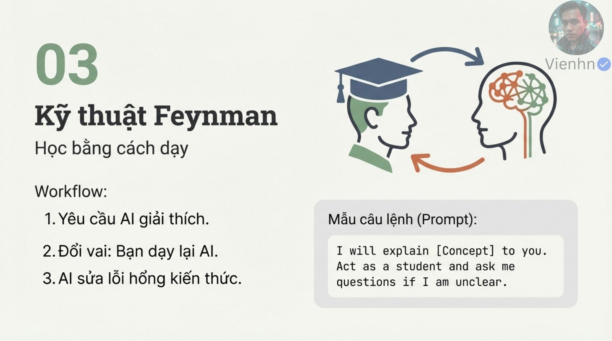

**Nội dung chính đọc được:** Nguồn gọi kỹ thuật Feynman: AI giải thích, người học dạy lại, AI hỏi chỗ chưa rõ và chỉ lỗ hổng.

**Hình minh họa:** Hai người đổi vai với mũi tên.

**Phân tích bổ sung:** Dạy lại AI là hoạt động kiểm tra người học, không huấn luyện lại mô hình; AI có thể chấm sai nên đối chiếu nguồn.

## B019-07 — Kiểm tra và củng cố

Tên gốc: `08.jpg`.

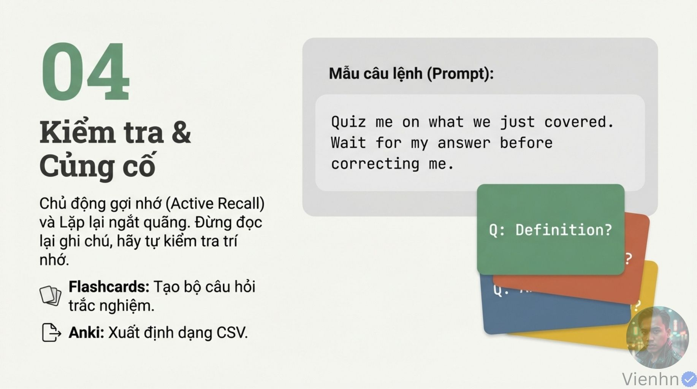

**Nội dung chính đọc được:** Gợi nhớ chủ động, ôn cách quãng; yêu cầu hỏi rồi chờ đáp; đề cập flashcards và CSV cho Anki.

**Hình minh họa:** Thẻ câu hỏi màu.

**Phân tích bổ sung:** Flashcard không chỉ trắc nghiệm. Nếu xuất Anki cần trường mặt trước/mặt sau và kiểm tra nhập thực tế; đợt này không tạo file Anki.

## B019-08 — Quan sát mẫu

Tên gốc: `09.jpg`.

**Nội dung chính đọc được:** Xem AI giải bài từ đầu tới cuối, ví dụ lập trình và tìm nguồn; nhắc Agent Mode.

**Hình minh họa:** Màn hình mã và chữ Show, Don't Tell.

**Phân tích bổ sung:** Theo dõi bước làm công khai, lý do lựa chọn tóm tắt và chứng cứ; không coi AI là chuyên gia luôn đúng hoặc suy luận kín là vật cần xem.

## B019-09 — Tạo sản phẩm

Tên gốc: `010.jpg`.

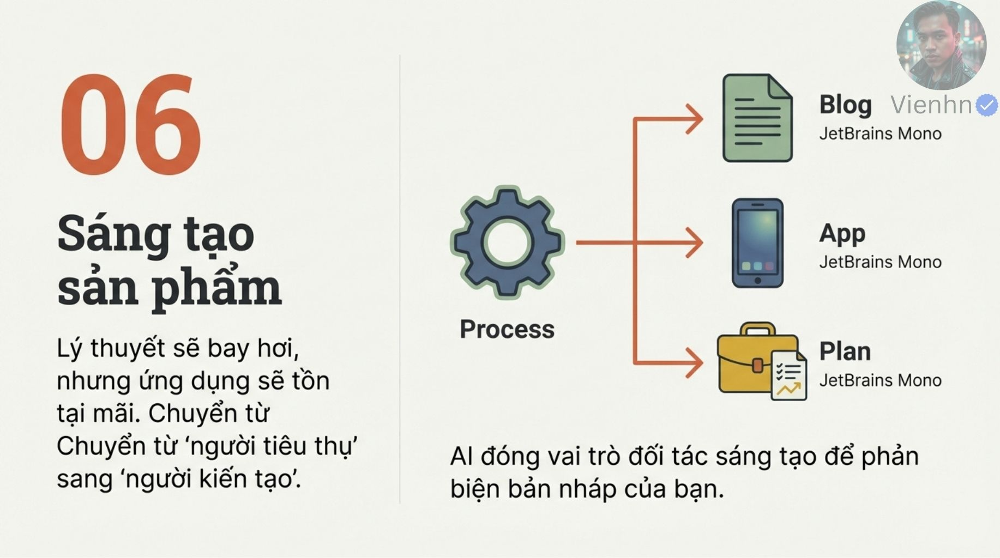

**Nội dung chính đọc được:** Biến kiến thức thành bài viết, ứng dụng hoặc kế hoạch; AI phản biện bản nháp.

**Hình minh họa:** Bánh răng nối ba sản phẩm, còn chữ JetBrains Mono.

**Phân tích bổ sung:** Tên font là dấu dàn trang. Với khóa này sản phẩm phù hợp là shot list/prompt/clip, không cần làm app.

## B019-10 — Phản tư

Tên gốc: `011.jpg`.

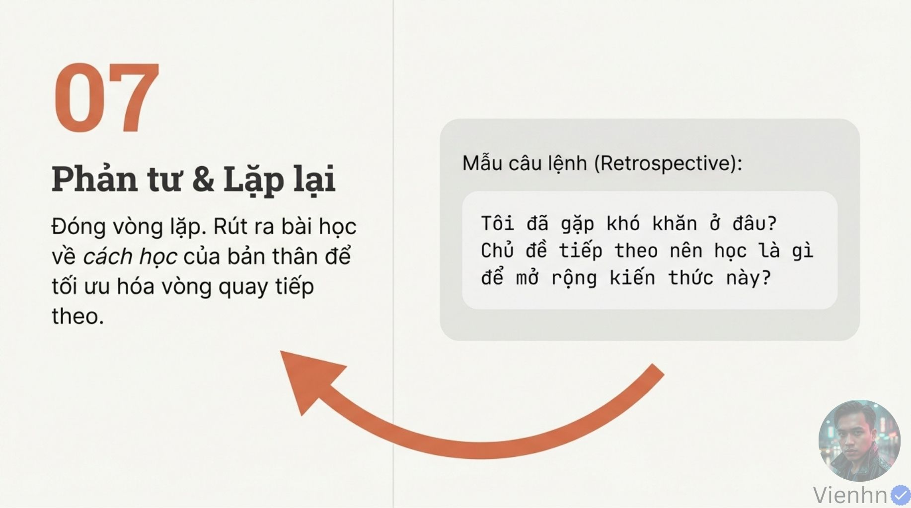

**Nội dung chính đọc được:** Hỏi khó ở đâu và học gì tiếp, rút bài học cho vòng sau.

**Hình minh họa:** Mũi tên quay lại và câu hỏi.

**Phân tích bổ sung:** Dùng lỗi thực tế để chọn chủ đề tiếp thay vì học thêm ngẫu nhiên.

## B019-11 — Ba bẫy

Tên gốc: `012.jpg`.

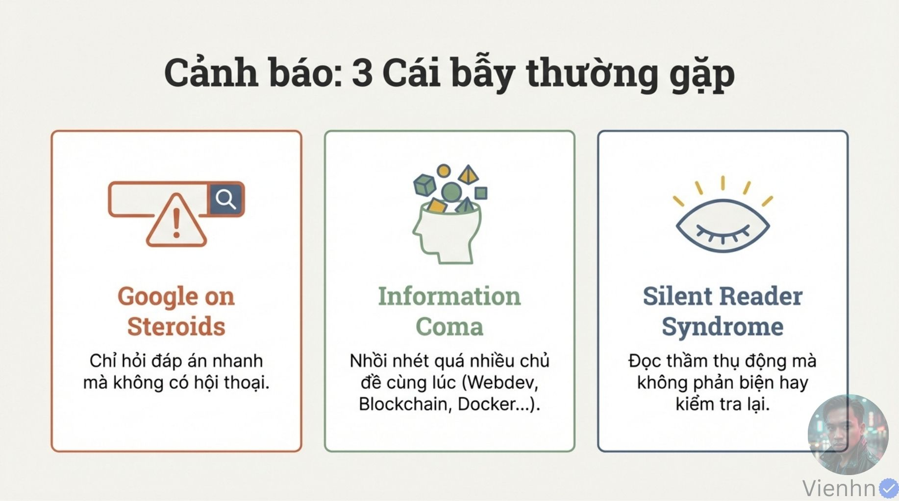

**Nội dung chính đọc được:** Chỉ hỏi đáp án nhanh, nhồi nhiều chủ đề và chỉ đọc không phản biện/kiểm tra.

**Hình minh họa:** Ba ô cảnh báo mang tên ẩn dụ.

**Phân tích bổ sung:** Đây là nhãn giáo dục, không phải chẩn đoán hay hội chứng y khoa.

## B019-12 — Bắt đầu nhỏ

Tên gốc: `013.jpg`.

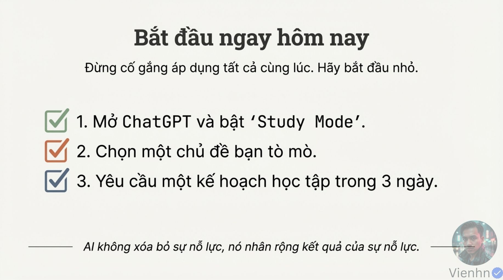

**Nội dung chính đọc được:** Nguồn đề xuất mở chế độ học, chọn chủ đề tò mò và xin kế hoạch ba ngày; nhấn vẫn cần nỗ lực.

**Hình minh họa:** Ba mục đánh dấu.

**Phân tích bổ sung:** Bản học bên dưới có kế hoạch mẫu tự biên soạn, không có lịch/nhắc tự động được bật.

## Kiểm kê

Đã mở trực tiếp 13/13 ảnh. Các mã nguồn theo thứ tự ở trên khớp [danh mục tệp](nguon.json). Chưa sinh hoặc đánh giá video từ câu lệnh của bài này.
