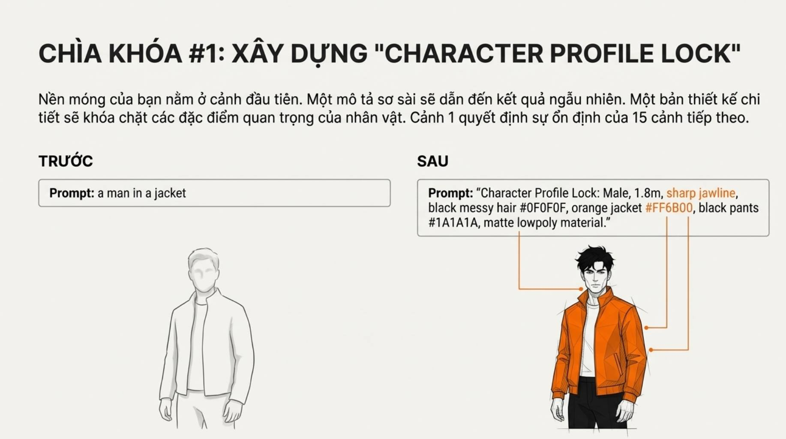
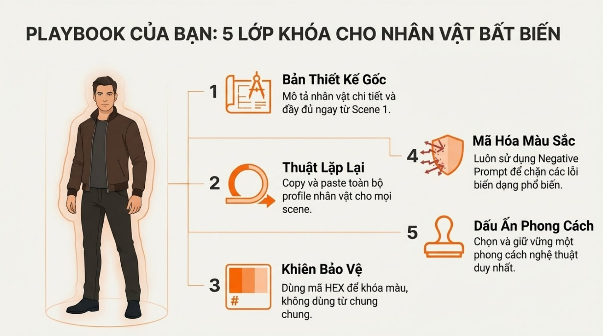

# Bài 020 — Năm lớp giữ nhất quán nhân vật — bài ôn và áp dụng

B020 có 10/10 tệp ảnh trùng nguyên vẹn với B003 theo SHA-256. Bài được giữ riêng theo thư mục nguồn và dùng để ôn hồ sơ, bảng màu, nội dung loại trừ và phong cách. Phần bổ sung phân biệt tạo từ văn bản với tạo chuyển động từ ảnh đã duyệt, giúp tránh mô tả lại làm lệch nhận diện.

**Nguồn:** [Khóa Nhân Vật AI - 5 Chìa Khóa Vàng Cho Sự Bất Biến](https://drive.google.com/drive/folders/1-usvc29Tp4x1gsq3RZRaXYDVHayWouOw). Đã đọc **10/10 ảnh**. Ngày biên soạn: 17/10/2026.

[Đọc từng ảnh](doc-anh.md) · [Bài thực hành](thuc-hanh.md) · [Nguồn và mã kiểm tra](nguon.json) · [Danh mục toàn bộ](../../DANH-MUC-BAI-HOC.md)

**Quy ước:** phần “Nguồn” diễn đạt ý trong bộ ảnh. Phần “Phân tích và áp dụng” do người biên soạn bổ sung. Hiệu quả của câu lệnh chưa được kiểm nghiệm bằng lần tạo video trong đợt này.

## Những điều cần học

| Nội dung | Mã ảnh nguồn |
| --- | --- |
| Lập hồ sơ bất biến trước khi viết cảnh | B020-01, B020-03 |
| Mỗi cảnh có đầu vào đủ rõ | B020-04 |
| Bảng màu là mục tiêu đối chiếu | B020-05 |
| Nội dung loại trừ và kiểm lỗi hình thể | B020-06 |
| Giữ hệ tạo hình và đo tính liên tục | B020-07, B020-08, B020-09 |
| Áp dụng cho hồ sơ mặt, vóc dáng và trang phục đã duyệt | B020-03, B020-04, B020-05, B020-08 |

## 1. Lập hồ sơ bất biến trước khi viết cảnh

**Nguồn:** Nguồn đề xuất ghi hình thể, khuôn mặt, tóc, trang phục, chất liệu ngay từ cảnh đầu.

**Phân tích và áp dụng:** Tạo một khối mô tả ổn định và một khối hành động thay đổi. Chỉ chọn đặc điểm quan trọng, nhìn thấy được. Thêm ảnh chuẩn chính diện, góc ba phần tư và toàn thân nếu chế độ sử dụng hỗ trợ ảnh tham chiếu.

**Ví dụ cho cảnh nông thôn:** Lan, nữ 30 tuổi, tóc đen búi thấp, áo bà ba nâu vải thô, quần đen, không trang sức; ảnh chuẩn dưới ánh sáng trung tính.

**Kiểm tra kết quả:** So mặt, đường tóc, dáng người, cổ áo và vật liệu với ảnh chuẩn; không chỉ kiểm màu áo.

## 2. Mỗi cảnh có đầu vào đủ rõ

**Nguồn:** Lặp lại đầy đủ hồ sơ thay cho việc trông cậy vào câu cùng người như trước.

**Phân tích và áp dụng:** Với yêu cầu tạo từ văn bản độc lập, giữ nguyên khối nhận diện để tránh vô tình đổi người. Với image-to-video (tạo video từ ảnh đầu vào), ảnh đã chốt người, cảnh và phong cách; hướng dẫn Google khuyên tập trung chuyển động và tránh mô tả lại nội dung ảnh. Với chế độ dùng nhiều ảnh tham chiếu, chỉ rõ vai trò từng ảnh theo khả năng công cụ. Ghi phiên bản hồ sơ và ảnh đã dùng; không trông cậy vào câu 'giống cảnh trước' khi đầu vào không chứa cảnh trước.

**Ví dụ cho cảnh nông thôn:** Cảnh ở sân và cảnh trong bếp cùng dùng hồ sơ Lan v1; chỉ thay địa điểm, động tác và vị trí camera.

**Kiểm tra kết quả:** Đối chiếu các trường hồ sơ giữa hai prompt trước khi chạy; xem lại khung đầu, giữa, cuối sau khi chạy.

## 3. Bảng màu là mục tiêu đối chiếu

**Nguồn:** Nguồn dùng HEX để cụ thể hóa các tên màu mơ hồ.

**Phân tích và áp dụng:** Ghép tên màu dễ hiểu, ô màu tham chiếu và HEX. Phân biệt màu vật liệu gốc với màu quan sát dưới ánh sáng. Cảnh đèn vàng có thể làm áo nâu ấm hơn mà vẫn đúng tính liên tục.

**Ví dụ cho cảnh nông thôn:** Áo nâu đất mục tiêu #6B4938; giữ cùng loại vải. Cảnh sân sáng dịu và bếp ấm cần thay đổi ánh sáng có lý do.

**Kiểm tra kết quả:** Kiểm tương quan màu với da và đồ vật trung tính; không đòi từng pixel trùng HEX ở mọi vùng sáng tối.

## 4. Nội dung loại trừ và kiểm lỗi hình thể

**Nguồn:** Dùng negative prompt để giảm các lỗi hình thể, màu và chất liệu.

**Phân tích và áp dụng:** Khi có trường negative riêng, liệt kê lỗi cần tránh phù hợp cú máy: thừa ngón, mặt méo, đổi áo. Không mặc định một danh sách dài sẽ chữa mọi lỗi. Đồng thời mô tả tích cực động tác tay đơn giản, dễ đọc.

**Ví dụ cho cảnh nông thôn:** Lan nhấc một rổ rau bằng hai tay; trường loại trừ ghi thừa ngón, ngón dính, rổ biến dạng, thay trang phục.

**Kiểm tra kết quả:** Xem từng giai đoạn cầm–nhấc–đặt, kiểm ngón tay, tiếp xúc và hình dạng rổ; tạo lại nếu lỗi.

## 5. Giữ hệ tạo hình và đo tính liên tục

**Nguồn:** Chọn phong cách nhất quán và dùng checklist năm lớp.

**Phân tích và áp dụng:** Cố định tỷ lệ cơ thể, nét vẽ hoặc vật liệu, cách chiếu sáng và mức cách điệu. Ghi từng lỗi theo cảnh thay vì báo phần trăm không định nghĩa. Một video đẹp vẫn có thể sai danh tính.

**Ví dụ cho cảnh nông thôn:** Toàn phim dùng hiện thực tự nhiên, vải thô và ánh sáng mềm; không để một cảnh chuyển thành nhân vật đồ chơi.

**Kiểm tra kết quả:** Lập bảng từng cảnh với mặt, tóc, áo, hình thể, chất liệu và đạo cụ; đánh dấu đạt/chưa đạt và mốc giây.

## 6. Áp dụng cho hồ sơ mặt, vóc dáng và trang phục đã duyệt

**Nguồn:** Nguồn coi hồ sơ gốc là nền tảng rồi giữ các đặc điểm qua nhiều cảnh.

**Phân tích và áp dụng:** Phần tự biên soạn cho quy trình dùng ảnh tham chiếu:

| Thành phần | Nguồn chuẩn | Điều phải so |
| --- | --- | --- |
| Danh tính | Ảnh mặt đã duyệt | Tỷ lệ mặt, mắt, mũi, môi, đường tóc |
| Hình thể | Ảnh toàn thân đã duyệt | Tỷ lệ đầu–người, chân/tay và dáng |
| Trang phục | Bộ đồ đã duyệt | Cổ áo, tay áo, màu/vải, phụ kiện |
| Cảnh riêng | Ảnh cảnh của shot | Tư thế đầu, đạo cụ, bố cục |
| Chuyển động | Prompt của shot | Hướng, tiếp xúc, trạng thái cuối |

Duyệt ảnh cảnh trước khi tạo video. Nếu ảnh cảnh đã sai nhận diện, sửa ảnh cảnh rồi mới tiếp tục; câu 'khóa tuyệt đối' không tự chữa một đầu vào sai.

**Ví dụ cho cảnh nông thôn:** Dùng mặt, hình thể và bộ đồ đã duyệt để tạo ảnh người ngồi đan giỏ trong sân. Khi ảnh đạt, prompt video chỉ đạo một lần luồn nan và kéo nhẹ; không tự tăng chiều cao, đổi tóc hoặc đổi tỷ lệ đang được duyệt.

**Kiểm tra kết quả:** So gốc với ảnh cảnh, rồi ảnh cảnh với video. Ghi lỗi nằm ở bước tạo ảnh hay bước tạo chuyển động; không sửa nhầm cả hồ sơ.

## Điểm cần hiểu có điều kiện

- Toàn bộ 10 tệp B020 trùng SHA-256 với 10 tệp B003. Số ảnh tiến độ tính theo tệp của từng bài, không phải số hình độc nhất.
- Các tỷ lệ 95–99% và 95–100% trong ảnh không kèm cách đo, tập mẫu hay kết quả thử; không được dùng làm bảo đảm.
- HEX trong câu lệnh không bảo đảm màu pixel chính xác; hình minh họa không chứng minh khóa màu.
- Hồ sơ văn bản không phải cơ chế khóa danh tính hoặc bộ nhớ xuyên mọi lần sinh. Ảnh tham chiếu có thể hỗ trợ tùy mô hình và chế độ.
- Nguồn viết no trong negative prompt. Hướng dẫn Google được đối chiếu khuyên trường loại trừ liệt kê yếu tố không mong muốn, tránh no/don't.
- Ảnh B020-08 đảo tên nhãn màu và khiên ở bước 3–4. Tài liệu dùng thứ tự theo nội dung.
- Nguồn không cung cấp video hoặc thông số thử đủ để kiểm tra 15 cảnh tiếp theo.
- Lời khuyên chép toàn bộ hồ sơ không áp dụng máy móc cho mọi chế độ; ảnh đầu vào đủ rõ có thể phù hợp prompt tập trung chuyển động.
- Không diễn giải 'AI không hiểu blue' theo nghĩa đen; nhiều sắc xanh là sự mơ hồ cần cụ thể hóa, không chứng minh mô hình không hiểu tên màu.

## Cách đưa vào quy trình sản xuất

Ôn [B003](../003-khoa-thiet-ke-nhan-vat/README.md) → duyệt hồ sơ và ảnh chuẩn → chọn chế độ tạo phù hợp → duyệt ảnh cảnh → tạo chuyển động ngắn → kiểm nhận diện, thao tác và điểm nối → sửa đúng bước gây lỗi. Lưu phiên bản đầu vào và kết quả; chưa có video được tạo/kiểm nghiệm trong lần biên soạn này.

## Tự kiểm tra kiến thức

- Hồ sơ nhân vật khác mô tả hành động ở chỗ nào?
- Vì sao áo có thể đổi sắc độ dưới đèn vàng mà không phải đổi màu vật liệu?
- Cần dữ liệu gì trước khi khẳng định độ nhất quán 99%?

## Nguồn đối chiếu bổ sung

- [Google: best practices, mục Image-to-video](https://docs.cloud.google.com/gemini-enterprise-agent-platform/models/video/best-practice): Đối chiếu khác biệt giữa lặp nhận diện khi tạo độc lập và tập trung chuyển động khi đã có ảnh đầu vào.
- [Google: hướng dẫn prompt video](https://docs.cloud.google.com/gemini-enterprise-agent-platform/models/video/video-gen-prompt-guide): Đối chiếu cách liệt kê yếu tố không muốn trong trường negative riêng.
- [Google: Ingredients to Video](https://blog.google/innovation-and-ai/technology/ai/veo-3-1-ingredients-to-video/): Đối chiếu dùng ảnh tham chiếu để hỗ trợ nhất quán; không xác nhận các tỷ lệ 95–100% trong ảnh khóa học.

**Giới hạn:** đây là tài liệu học từ ảnh. Không dùng một hình minh họa để xác nhận chuyển động, thời lượng, độ chính xác thao tác hay khả năng hiện tại của một sản phẩm. Những phần chưa kiểm chứng được ghi rõ trong bản đọc ảnh.
