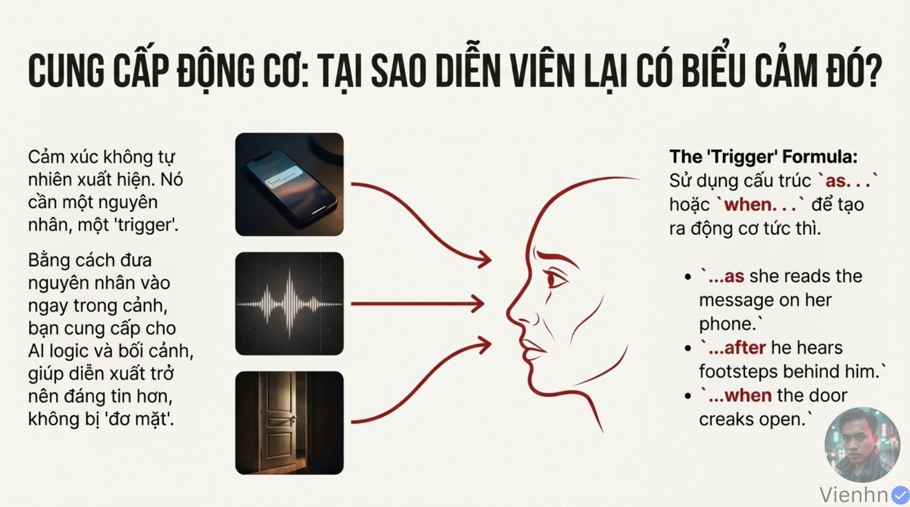
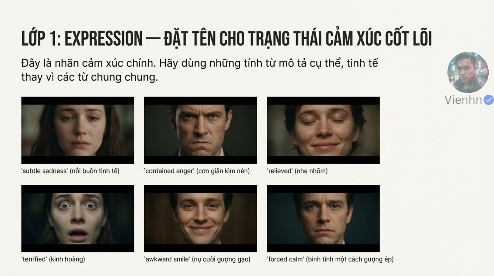
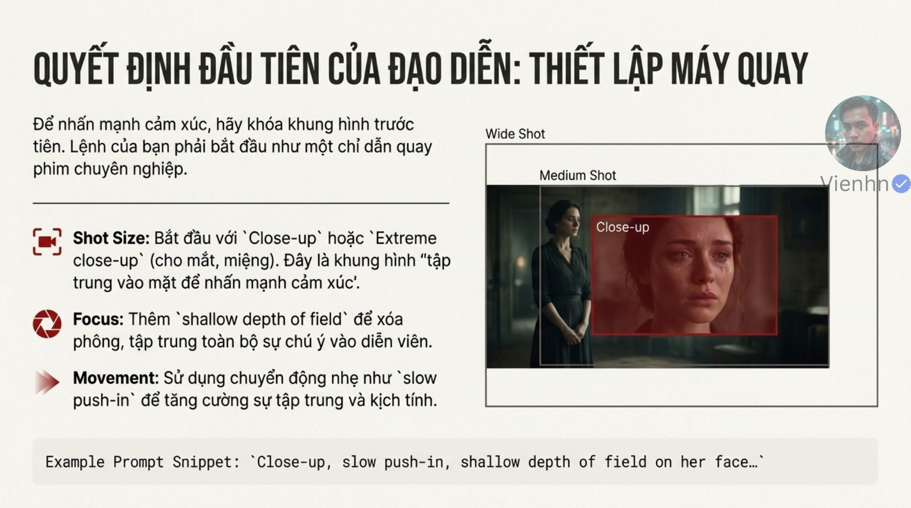
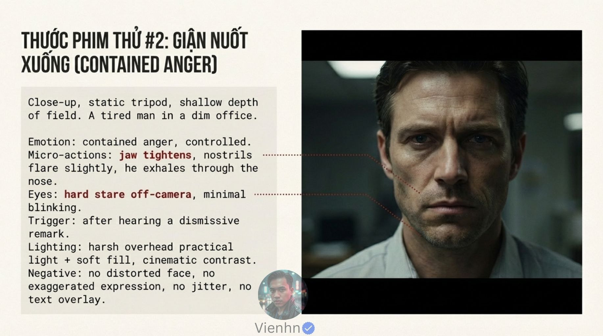
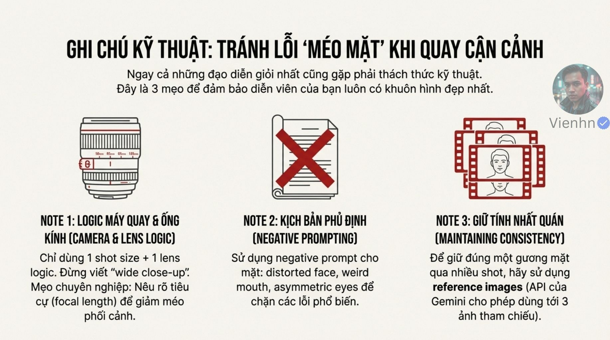

# Bài 021 — Chỉ đạo cảm xúc bằng hành vi và nguyên nhân

Đọc đủ 15 tệp ảnh hiện có về diễn xuất cận mặt: nhãn cảm xúc, cử động nhỏ, ánh mắt và sự kiện gây phản ứng. Phần áp dụng ưu tiên biểu hiện vừa đủ, thời điểm hợp lý, giữ danh tính và tiêu chí xem video; không xem nước mắt hay một cỡ cảnh là điều kiện bắt buộc của cảm xúc.

**Nguồn:** [Làm chủ cảm xúc trong Video VEO](https://drive.google.com/drive/folders/1T76HGlM0jhsDFB1OAJCcpnYfqJHnUQwK). Đã đọc **15/15 ảnh**. Ngày biên soạn: 17/10/2026.

[Đọc từng ảnh](doc-anh.md) · [Bài thực hành](thuc-hanh.md) · [Nguồn và mã kiểm tra](nguon.json) · [Danh mục toàn bộ](../../DANH-MUC-BAI-HOC.md)

**Quy ước:** phần “Nguồn” diễn đạt ý trong bộ ảnh. Phần “Phân tích và áp dụng” do người biên soạn bổ sung. Hiệu quả của câu lệnh chưa được kiểm nghiệm bằng lần tạo video trong đợt này.

## Những điều cần học

| Nội dung | Mã ảnh nguồn |
| --- | --- |
| Cảm xúc cần hoàn cảnh và diễn biến | B021-01, B021-03, B021-07, B021-08 |
| Ba lớp: nhãn, cử động nhỏ và ánh mắt | B021-03, B021-04, B021-05, B021-06 |
| Camera, nét và ánh sáng giữ người xem theo được | B021-02, B021-08, B021-12, B021-13 |
| Chọn biểu diễn theo nhịp, tránh danh sách quá tải | B021-09, B021-10, B021-11, B021-13 |
| Giữ khuôn mặt tự nhiên và chấm bằng chuyển động | B021-08, B021-12, B021-13 |

## 1. Cảm xúc cần hoàn cảnh và diễn biến

**Nguồn:** Nguồn kết hợp nhãn cảm xúc, hành vi nhìn thấy và trigger, tức sự kiện gây phản ứng.

**Phân tích và áp dụng:** Viết một nhịp: trạng thái ban đầu → nhận biết sự kiện → một thay đổi nhỏ → trạng thái cuối. 'Buồn', 'giận' hoặc 'nhẹ nhõm' giúp định hướng, còn hành động giúp xác định điều cần xuất hiện. Không cần giải thích toàn bộ đời nhân vật trong một clip; chỉ chọn tác nhân đủ hiểu.

**Ví dụ cho cảnh nông thôn:** Người phụ nữ đang đan giỏ nghe tiếng người thân gọi từ ngoài cổng; cô dừng tay, nhìn sang cổng rồi mỉm cười nhẹ.

**Kiểm tra kết quả:** Phản ứng đến sau sự kiện; có thay đổi đọc được nhưng không biến thành diễn xuất quá mức.

## 2. Ba lớp: nhãn, cử động nhỏ và ánh mắt

**Nguồn:** Nguồn chia expression, micro-actions và eyes để chỉ đạo cụ thể.

**Phân tích và áp dụng:** Bảng gợi ý tự biên soạn, không phải quy tắc tâm lý phổ quát:

| Ý đồ | Một cử động nhỏ có thể dùng | Đích nhìn hoặc mắt | Điều dễ bị làm quá |
| --- | --- | --- | --- |
| Lo lắng nhẹ | Bàn tay dừng, môi khép | Nhìn vật cần kiểm tra | Run toàn thân hoặc khóc |
| Giận kìm nén | Hàm căng nhẹ, thở ra | Giữ nhìn người ngoài khung | Gào, nghiến răng lớn |
| Nhẹ nhõm | Vai hạ, khóe môi nâng nhẹ | Nhìn lại kết quả rồi thư giãn | Cười lớn vô cớ |
| Cười gượng | Nụ cười thoáng, giữ thân ít động | Nhìn lệch một nhịp | Đồng thời cười/khóc cường điệu |

Chọn một đến hai dấu hiệu trước. Không bắt mọi hàng xuất hiện, không dùng hình mặt để kết luận chắc cảm xúc đời thực.

**Ví dụ cho cảnh nông thôn:** Sau khi giỏ đứng vững, cô buông vai nhẹ và nhìn người thân cạnh bàn. Không thêm nước mắt vào cảnh vui bình dị.

**Kiểm tra kết quả:** Mỗi hành vi phù hợp ý đồ; ánh mắt có đích; khuôn mặt không bị kéo lệch vì quá nhiều lệnh.

## 3. Camera, nét và ánh sáng giữ người xem theo được

**Nguồn:** Nguồn ưu tiên cận/cực cận, vùng nét nông, máy tiến nhẹ, ánh sáng chính và catchlight.

**Phân tích và áp dụng:** Close-up là cận, extreme close-up là cực cận; dùng khi chi tiết mặt là thông tin chính. Shallow depth of field là vùng nét nông, có thể tách mặt khỏi nền nhưng vẫn phải giữ phần cần đọc rõ. Key light là ánh sáng chính; catchlight là phản chiếu nguồn sáng trong mắt. Máy tĩnh cũng đủ cho biểu cảm; toàn thân hoặc tay có thể mang cảm xúc ở cảnh khác.

**Ví dụ cho cảnh nông thôn:** Cận mặt khi người ngẩng lên khỏi giỏ, ánh sáng mềm từ sân, hai mắt nét. Shot thao tác tiếp theo rộng hơn để thấy tay, không giữ vùng nét quá mỏng từ shot mặt.

**Kiểm tra kết quả:** Mắt/miệng cần thiết đều đọc được; chuyển nét không vô cớ; máy không cắt mặt hoặc che điểm nhìn.

## 4. Chọn biểu diễn theo nhịp, tránh danh sách quá tải

**Nguồn:** Ba mẫu trong nguồn là buồn nhẹ sau tin nhắn, giận kìm nén sau lời nói, sợ tăng khi nghe bước chân.

**Phân tích và áp dụng:** Các mẫu là ví dụ chỉ đạo, chưa phải clip thử được cung cấp. Nếu thời gian ngắn, chỉ giữ tác nhân và một phản ứng chính. Tách cận phản ứng khỏi thao tác phức tạp khi cần. Âm ngoài khung có thể làm tác nhân mà không thêm nhân vật vào hình; phân biệt chỉ dẫn cảm xúc với một lượt thoại phải phát đúng câu.

**Ví dụ cho cảnh nông thôn:** Cô đang chạm vào miệng giỏ, nghe lời gọi rồi dừng tay; cắt sang cận mặt mỉm cười. Không đồng thời bắt cô luồn nan, quay người, nói, khóc và nhìn camera.

**Kiểm tra kết quả:** Nhịp không vội, không nhiều phản ứng cạnh tranh; âm có nguồn và đúng thời điểm.

## 5. Giữ khuôn mặt tự nhiên và chấm bằng chuyển động

**Nguồn:** Nguồn đề xuất mô tả máy/ống kính nhất quán, loại trừ méo và dùng ảnh tham chiếu.

**Phân tích và áp dụng:** Duyệt ảnh nhận diện và ảnh cảnh trước. Nếu đã có ảnh đầu vào, tránh thêm chi tiết mặt trái ảnh; tập trung phản ứng. Cận góc rộng có thể dùng chủ ý; muốn tỷ lệ tự nhiên hãy mô tả khoảng cách/góc và tỉ lệ mặt mong muốn thay vì tin chỉ một số mm sẽ sửa mọi lỗi. Negative prompt (nội dung loại trừ) theo giao diện, không thay bước xem lại. So toàn clip, nhất là lúc chớp mắt, há miệng hoặc quay đầu.

**Ví dụ cho cảnh nông thôn:** Dùng cùng ảnh mặt đã duyệt cho cảnh nhìn cổng và cảnh nhìn giỏ. So đường hàm, mí mắt, mũi, miệng trước–trong–sau nụ cười; không yêu cầu mặt đối xứng hoàn hảo.

**Kiểm tra kết quả:** Nhận diện ổn định, hai mắt chuyển hợp lý, không nháy sáng hay đổi mặt; cảm xúc vừa đủ theo ý đồ.

## Điểm cần hiểu có điều kiện

- Thư mục hiện có 15 tệp: trang đầu mang số 01, các số 02–11 rồi 013–016. Không có tệp số 012; đã đọc 15/15 tệp hiện có, không suy đoán nội dung thiếu.
- Cảm xúc không bắt buộc cận cảnh, bokeh, nước mắt hoặc camera tiến gần. Những lựa chọn này phục vụ dạng bài cận mặt của nguồn.
- Không quy mọi lỗi biểu cảm cho người viết prompt; đầu vào và mô hình có thể gây lỗi.
- 'Wide close-up' mơ hồ nếu trộn hai cỡ cảnh, nhưng wide-angle close-up (cận với ống góc rộng) là lựa chọn khả thi. Cần phân biệt cỡ cảnh và góc nhìn của ống kính.
- Ghi tiêu cự không bảo đảm loại méo hoặc giữ mặt; tách lỗi phối cảnh, quang học và sinh hình.
- Danh sách loại trừ 'no asymmetry' không nên áp thành mặt đối xứng tuyệt đối; giữ bất đối xứng tự nhiên trong ảnh chuẩn.
- Đồng tử giãn khác mở to mắt; mắt long lanh/catchlight không tự chứng minh nhân vật khóc. Chọn dấu hiệu thị giác theo ý đồ, không coi là bằng chứng chẩn đoán cảm xúc.
- Nguồn nói tối đa ba ảnh tham chiếu ở API; tài liệu Gemini API hiện có khả năng này cho chế độ Veo 3.1 tương ứng, không phải cam kết mọi công cụ đều hỗ trợ.

## Cách đưa vào quy trình sản xuất

Chốt một chuyển biến cảm xúc → ghi tác nhân và thứ tự → chọn ít hành vi mặt/mắt → chọn cỡ cảnh, máy và sáng → rà ảnh nhận diện → tạo clip ngắn → xem hình/âm ở thời gian thật → kiểm mặt, nét và mức biểu diễn → chỉ sửa biến gây lỗi. Đọc cùng [B020](../020-nam-chia-khoa-nhat-quan/README.md) để giữ danh tính và [B016](../016-thiet-ke-am-thanh/README.md) để đồng bộ tác nhân âm.

## Tự kiểm tra kiến thức

- Vì sao có nguyên nhân rõ vẫn chưa đủ nếu phản ứng xảy ra trước sự kiện?
- Khi nào vai hoặc bàn tay truyền cảm xúc tốt hơn một cảnh nước mắt?
- Cỡ cận khác ống góc rộng như thế nào?

## Nguồn đối chiếu bổ sung

- [Google: hành động và biểu cảm trong prompt](https://docs.cloud.google.com/gemini-enterprise-agent-platform/models/video/video-gen-prompt-guide): Đối chiếu hành động nhỏ, biểu cảm, cỡ/góc máy và negative; không chứng minh hiệu quả từng mẫu trong ảnh.
- [Google: hướng dẫn image-to-video](https://docs.cloud.google.com/gemini-enterprise-agent-platform/models/video/best-practice): Đối chiếu vai trò ảnh đầu vào và prompt tập trung chuyển động.
- [Google AI: ảnh tham chiếu Veo 3.1](https://ai.google.dev/gemini-api/docs/veo): Xác minh tùy chọn tối đa ba ảnh ở chế độ được tài liệu mô tả; cần kiểm tra đúng mô hình và giao diện.
- [Adobe: phối cảnh](https://www.adobe.com/creativecloud/photography/technique/perspective.html): Đối chiếu vai trò khoảng cách và tỷ lệ quan sát, tránh gộp mọi méo mặt thành lỗi tiêu cự.

**Giới hạn:** đây là tài liệu học từ ảnh. Không dùng một hình minh họa để xác nhận chuyển động, thời lượng, độ chính xác thao tác hay khả năng hiện tại của một sản phẩm. Những phần chưa kiểm chứng được ghi rõ trong bản đọc ảnh.
