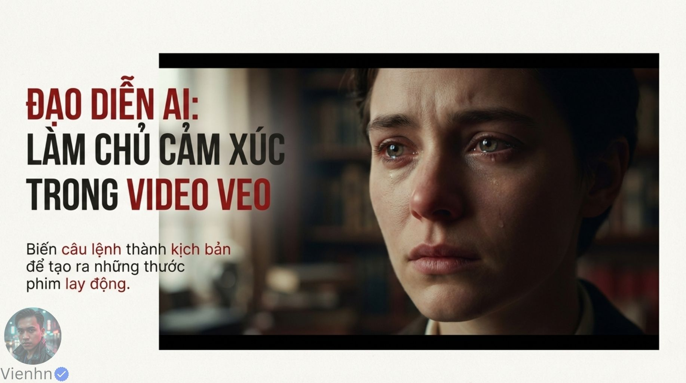
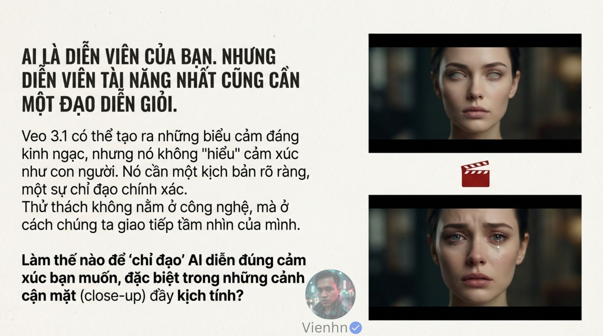
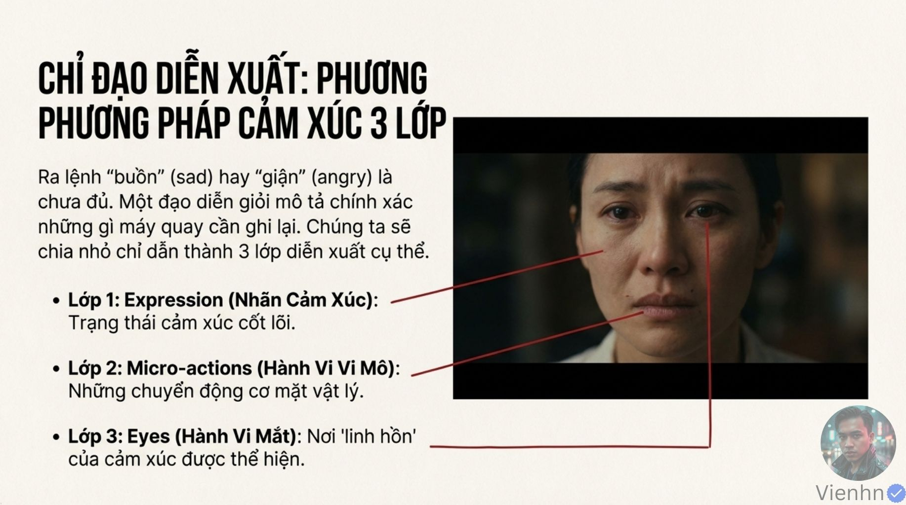
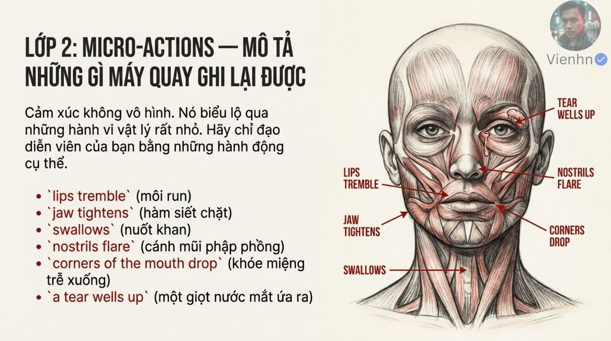
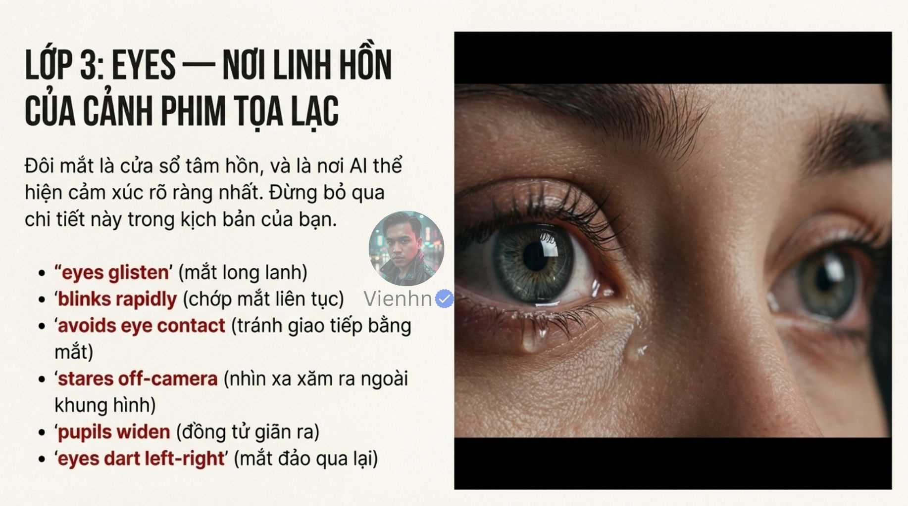
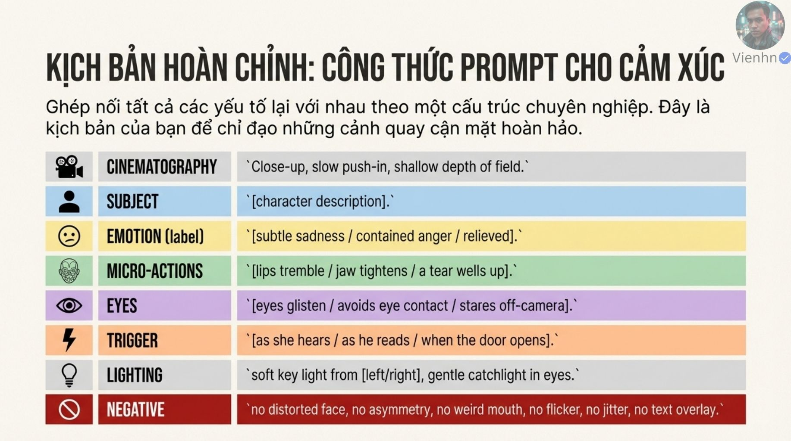
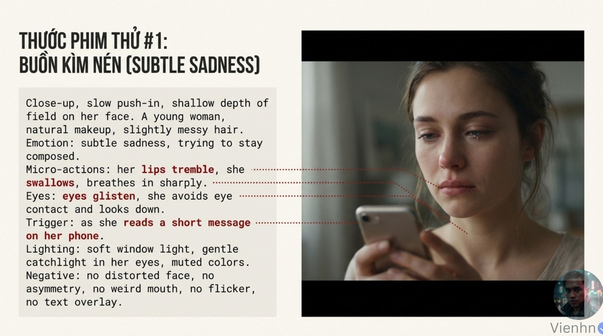
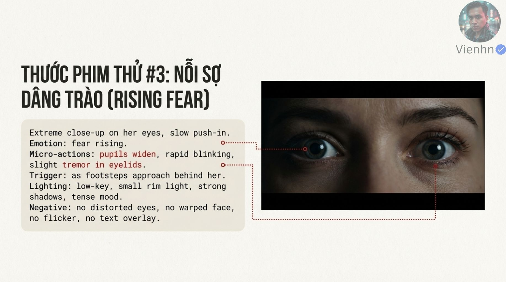
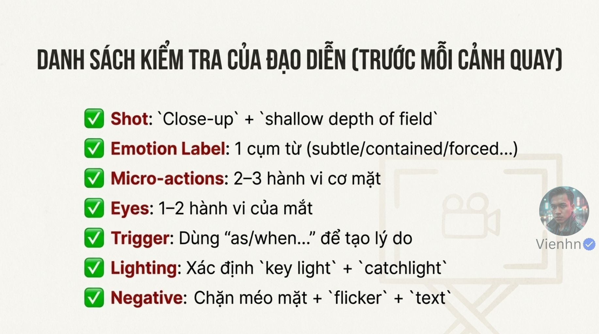
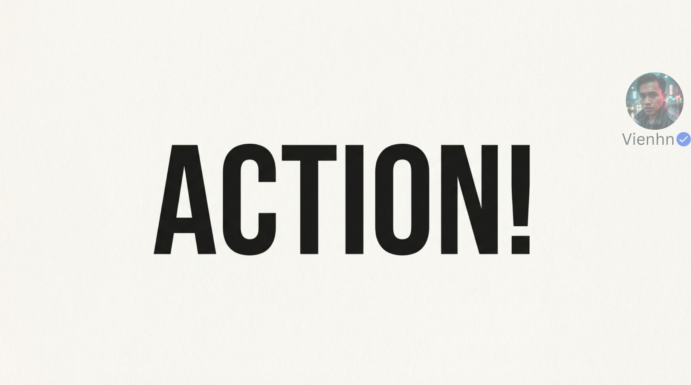

# B021 — Bản đọc toàn bộ 15 ảnh

Nguồn: [Làm chủ cảm xúc trong Video VEO](https://drive.google.com/drive/folders/1T76HGlM0jhsDFB1OAJCcpnYfqJHnUQwK).

**Cách ghi:** nội dung chính được diễn đạt lại từ chữ và hình trong ảnh; không phải bản chép nguyên văn toàn bộ. Quan sát ảnh tĩnh được tách khỏi lời giải thích bổ sung. Ảnh gốc được giữ nguyên để đối chiếu.

[Bài chính](README.md) · [Thực hành](thuc-hanh.md) · [Dữ liệu nguồn](nguon.json)

## B021-00 — Làm chủ cảm xúc

Tên gốc: `01 Làm chủ cảm xúc trong Video AI.jpg`.

**Nội dung chính đọc được:** Giới thiệu biến câu lệnh thành chỉ dẫn diễn xuất để tạo cảnh có cảm xúc.

**Hình minh họa:** Cận mặt người phụ nữ mắt ướt, nhìn lệch ngoài khung.

**Phân tích bổ sung:** Đây là ảnh minh họa; chưa có clip để xem diễn biến hoặc tính tự nhiên theo thời gian.

## B021-01 — Chỉ đạo rõ

Tên gốc: `02.jpg`.

**Nội dung chính đọc được:** Nguồn ví AI như diễn viên cần kịch bản và chỉ đạo; nhấn khả năng biểu cảm của Veo 3.1.

**Hình minh họa:** Hai gương mặt, phía trên có mắt trắng bất thường, phía dưới có nước mắt.

**Phân tích bổ sung:** Lỗi không chỉ do cách giao tiếp; đầu vào và giới hạn mô hình vẫn ảnh hưởng. Không dùng một ảnh làm chứng cứ mô hình hiểu cảm xúc.

## B021-02 — Thiết lập camera

Tên gốc: `03.jpg`.

**Nội dung chính đọc được:** Nguồn đề xuất cận hoặc cực cận, vùng nét nông, tiến gần chậm để tập trung vào mặt.

**Hình minh họa:** Khung rộng/trung/cận lồng nhau và ví dụ người phụ nữ.

**Phân tích bổ sung:** Đó là lựa chọn cho bài cận mặt, không phải mọi cảnh cảm xúc; cần giữ mắt nét khi đầu di chuyển.

## B021-03 — Ba lớp diễn xuất

Tên gốc: `04.jpg`.

**Nội dung chính đọc được:** Nhãn cảm xúc, micro-actions là cử động nhỏ, và hành vi mắt.

**Hình minh họa:** Gương mặt có ba đường nối minh họa; tiêu đề bị lặp từ.

**Phân tích bổ sung:** Ba lớp giúp tổ chức yêu cầu nhưng có phần giao nhau; chọn ít hành vi rõ thay vì nhồi hết.

## B021-04 — Tên cảm xúc cụ thể

Tên gốc: `05.jpg`.

**Nội dung chính đọc được:** Sáu ví dụ: buồn nhẹ, giận kìm nén, nhẹ nhõm, kinh hoàng, cười gượng và cố bình tĩnh.

**Hình minh họa:** Sáu ảnh mặt với nhãn tiếng Anh.

**Phân tích bổ sung:** Những hình này là gợi ý diễn xuất, không định nghĩa một kiểu mặt duy nhất cho từng cảm xúc.

## B021-05 — Cử động nhỏ

Tên gốc: `06.jpg`.

**Nội dung chính đọc được:** Nguồn liệt kê môi run, hàm siết, nuốt, cánh mũi nở, khóe miệng hạ và lệ ứa.

**Hình minh họa:** Nét vẽ cơ mặt có nhãn, mũi tên và giọt lệ.

**Phân tích bổ sung:** Mô tả hành vi quan sát được; sơ đồ chỉ minh họa, không cần biến thành chỉ dẫn cơ giải phẫu. Nuốt không mặc nhiên luôn là nuốt khan.

## B021-06 — Ánh mắt

Tên gốc: `07.jpg`.

**Nội dung chính đọc được:** Nguồn gợi mắt long lanh, chớp nhanh, tránh nhìn nhau, nhìn ngoài khung, đồng tử giãn và mắt đảo trái/phải.

**Hình minh họa:** Cực cận hai mắt có giọt nước.

**Phân tích bổ sung:** Ghi đích nhìn và chuyển hướng cụ thể. 'Off-camera' chỉ ngoài camera/khung, không mặc định xa xăm. Đồng tử giãn khác mở to mắt, không dùng như dấu hiệu cảm xúc bắt buộc.

## B021-07 — Sự kiện gây phản ứng

Tên gốc: `08.jpg`.

**Nội dung chính đọc được:** Gắn biểu cảm với lúc đọc tin nhắn, nghe bước chân hoặc cửa mở bằng as/when/after.

**Hình minh họa:** Điện thoại, sóng âm, cửa nối tới mặt nghiêng.

**Phân tích bổ sung:** Cần thứ tự sự kiện → nhận biết → phản ứng, không bắt cảm xúc xảy ra trước nguyên nhân. Có thể dùng tiếng ngoài khung.

## B021-08 — Mẫu prompt hoàn chỉnh

Tên gốc: `09.jpg`.

**Nội dung chính đọc được:** Ghép camera, chủ thể, nhãn cảm xúc, cử động nhỏ, mắt, tác nhân, ánh sáng và negative.

**Hình minh họa:** Bảng tám hàng tô màu.

**Phân tích bổ sung:** Các lựa chọn ngăn bằng dấu gạch chéo cần chọn khi dùng. Danh sách no của nguồn không phải cú pháp trường negative chung.

## B021-09 — Ví dụ buồn nhẹ

Tên gốc: `10.jpg`.

**Nội dung chính đọc được:** Cận tiến chậm, người phụ nữ đọc tin trên điện thoại; môi run, nuốt, hít vào, mắt ướt rồi nhìn xuống; sáng cửa sổ mềm, màu dịu.

**Hình minh họa:** Prompt cùng ảnh người cầm điện thoại.

**Phân tích bổ sung:** Nguồn có nhiều hành vi liên tiếp; nên giới hạn phù hợp thời lượng. Không cần tạo chữ tin nhắn nếu chỉ cần phản ứng.

## B021-10 — Ví dụ giận kìm nén

Tên gốc: `011.jpg`.

**Nội dung chính đọc được:** Cận máy tĩnh, người đàn ông trong văn phòng sau lời coi thường; hàm siết, cánh mũi nở nhẹ, thở ra mũi, nhìn cứng ngoài khung, đèn trần và bù sáng.

**Hình minh họa:** Prompt cùng ảnh mặt nam căng.

**Phân tích bổ sung:** Chưa có âm/clip để xác minh lời tác động hoặc nhịp phản ứng. Giận kìm nén không bắt buộc nghiến răng hay chuyển sang la hét.

## B021-11 — Ví dụ sợ tăng

Tên gốc: `013.jpg`.

**Nội dung chính đọc được:** Cực cận mắt, tiến chậm; nghe bước chân tới sau lưng, đồng tử giãn, chớp nhanh, mí run; sáng tối có viền.

**Hình minh họa:** Prompt và cận hai mắt mở lớn.

**Phân tích bổ sung:** Tệp gốc là 013.jpg; không có trang số 012 trong thư mục hiện tại. Không suy phần thiếu. Một ảnh mắt mở lớn không chứng minh đồng tử đã giãn.

## B021-12 — Giảm méo mặt

Tên gốc: `014.jpg`.

**Nội dung chính đọc được:** Nguồn khuyên một cỡ/mô tả ống kính rõ, nêu tiêu cự, dùng negative và ảnh tham chiếu; nhắc tối đa ba ảnh ở API.

**Hình minh họa:** Ba nhóm biểu tượng ống kính, văn bản gạch và khung mặt.

**Phân tích bổ sung:** Cận cảnh với ống góc rộng vẫn là lựa chọn có chủ ý. Phân biệt méo phối cảnh do khoảng cách, méo quang học và lỗi sinh hình. Ba ảnh là thông số theo chế độ, không chung mọi giao diện.

## B021-13 — Danh sách kiểm tra

Tên gốc: `015.jpg`.

**Nội dung chính đọc được:** Chọn cận/vùng nét nông, một nhãn, hai–ba cử động, một–hai hành vi mắt, tác nhân, ánh sáng chính/phản chiếu và loại trừ.

**Hình minh họa:** Bảy dòng đánh dấu.

**Phân tích bổ sung:** Số lượng hành vi là gợi ý luyện tập; bớt đi nếu biểu diễn quá dày. Ánh phản chiếu trong mắt không phải nước mắt.

## B021-14 — Bắt đầu thử

Tên gốc: `016.jpg`.

**Nội dung chính đọc được:** Trang kết chỉ có ACTION!.

**Hình minh họa:** Chữ ACTION lớn và dấu tên tác giả.

**Phân tích bổ sung:** Lời kêu gọi thực hành, không thêm kiến thức hay kết quả thử.

## Kiểm kê

Đã mở trực tiếp 15/15 ảnh. Các mã nguồn theo thứ tự ở trên khớp [danh mục tệp](nguon.json). Chưa sinh hoặc đánh giá video từ câu lệnh của bài này.
