# B022 — Bản đọc toàn bộ 14 ảnh

Nguồn: [Làm Chủ Google Veo Từ Cơ Bản đến Chuyên Nghiệp](https://drive.google.com/drive/folders/1TnL2r1IsnEXkVOgT4MRnsNRn0l2PzlBt).

**Cách ghi:** nội dung chính được diễn đạt lại từ chữ và hình trong ảnh; không phải bản chép nguyên văn toàn bộ. Quan sát ảnh tĩnh được tách khỏi lời giải thích bổ sung. Ảnh gốc được giữ nguyên để đối chiếu.

[Bài chính](README.md) · [Thực hành](thuc-hanh.md) · [Dữ liệu nguồn](nguon.json)

## B022-00 — Bìa và phạm vi

Tên gốc: `Làm Chủ Google Veo Từ Cơ Bản đến Chuyên Nghiệp.jpg`.

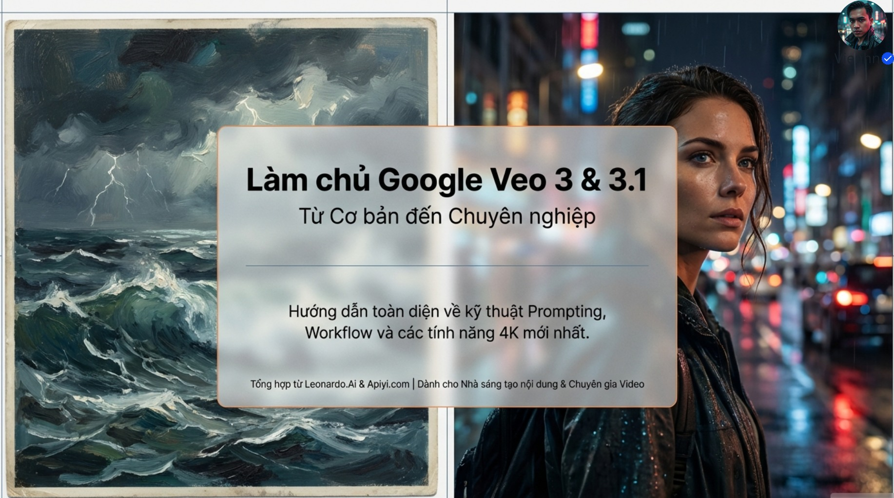

**Nội dung chính đọc được:** Nguồn giới thiệu Veo 3/3.1, cách viết câu lệnh, quy trình và 4K; ghi tổng hợp từ Leonardo.Ai và Apiyi.com.

**Hình minh họa:** Nửa trái là tranh biển động, nửa phải là chân dung trong ánh đèn màu.

**Phân tích bổ sung:** Đây là tài liệu tổng hợp, không thay thế tài liệu chính thức của từng phiên bản.

## B022-01 — Bốn trụ cột

Tên gốc: `01.jpg`.

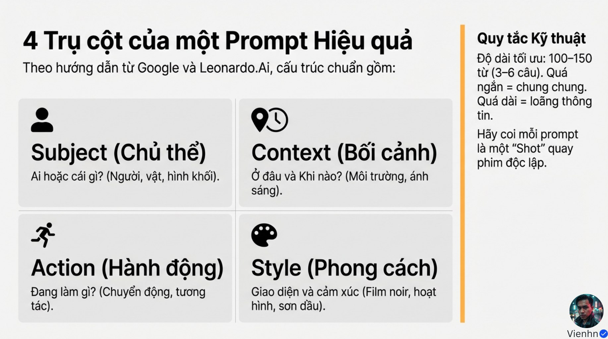

**Nội dung chính đọc được:** Chủ thể, bối cảnh, hành động và phong cách là khung triển khai. Nguồn gợi ý 100–150 từ, 3–6 câu và một cảnh cho mỗi yêu cầu.

**Hình minh họa:** Bốn ô màu kèm ví dụ mô tả.

**Phân tích bổ sung:** Độ dài là mẹo biên soạn, không phải ngưỡng bắt buộc; ảnh đầu vào có thể đã chứa nhiều thông tin.

## B022-02 — Ngôn ngữ máy quay

Tên gốc: `02.jpg`.

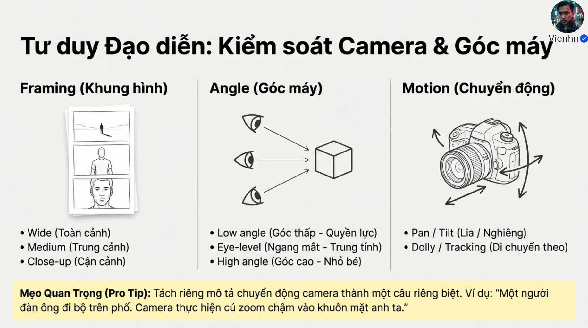

**Nội dung chính đọc được:** Nguồn phân biệt cỡ cảnh, góc máy và chuyển động; khuyên viết chuyển động máy thành câu riêng.

**Hình minh họa:** Ba cột với ví dụ toàn–trung–cận, thấp–ngang–cao và pan/tilt/dolly.

**Phân tích bổ sung:** Tilt là ngẩng/cúi máy; lia ngang khác di chuyển ngang. Zoom đổi góc nhìn qua tiêu cự, khác tiến máy trong không gian.

## B022-03 — Không khí và âm thanh

Tên gốc: `03.jpg`.

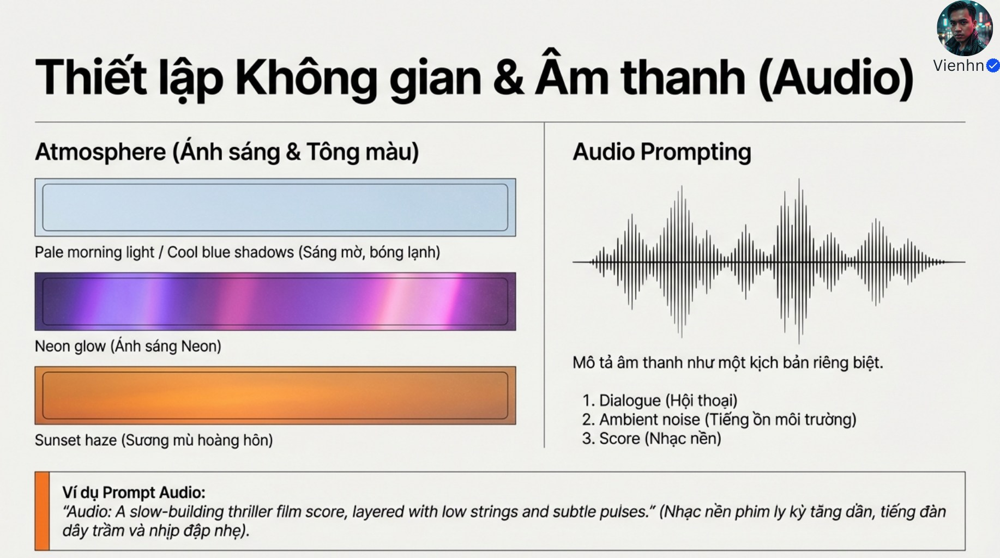

**Nội dung chính đọc được:** Ánh sáng, bảng màu, lời thoại, âm thanh môi trường và nhạc giúp định hình cảm xúc.

**Hình minh họa:** Các dải màu và ví dụ nhạc căng thẳng.

**Phân tích bổ sung:** Thêm tiếng thao tác nếu cần; không bắt buộc mọi cảnh phải có nhạc hay thoại. Ảnh không chứng minh âm thanh đã sinh đúng.

## B022-04 — Hai cách tổ chức câu lệnh

Tên gốc: `04.jpg`.

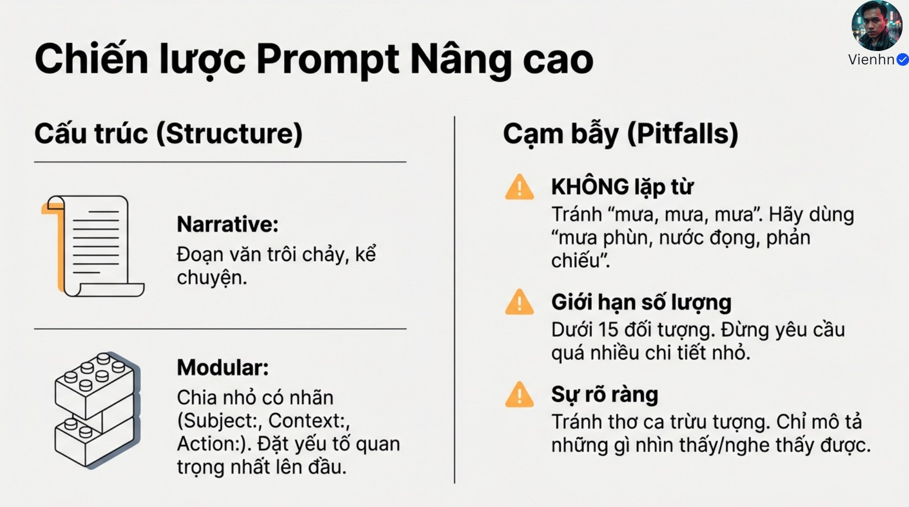

**Nội dung chính đọc được:** Nguồn đề xuất đoạn văn liền mạch hoặc các mục riêng; ưu tiên chi tiết quan trọng và tránh lặp từ thừa.

**Hình minh họa:** Hai khối văn bản đối chiếu cách kể và cách chia mục.

**Phân tích bổ sung:** Con số dưới 15 vật thể chỉ là gợi ý trong nguồn; cần giảm xung đột, không đếm máy móc.

## B022-05 — Chọn cách tạo

Tên gốc: `05.jpg`.

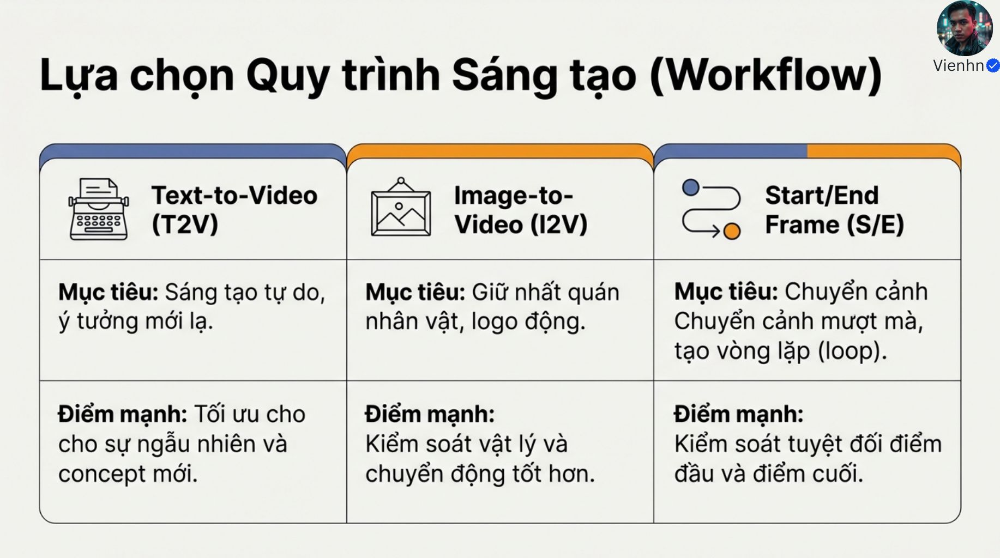

**Nội dung chính đọc được:** Tạo từ chữ phù hợp khám phá ý tưởng; tạo từ ảnh hỗ trợ neo diện mạo; khung đầu/cuối định hướng chuyển tiếp.

**Hình minh họa:** Ba nhánh T2V, I2V và Start/End.

**Phân tích bổ sung:** Ảnh neo không bảo đảm vật lý; hai đầu không khóa tuyệt đối đường đi giữa.

## B022-06 — Tập trung vào chuyển động khi đã có ảnh

Tên gốc: `06.jpg`.

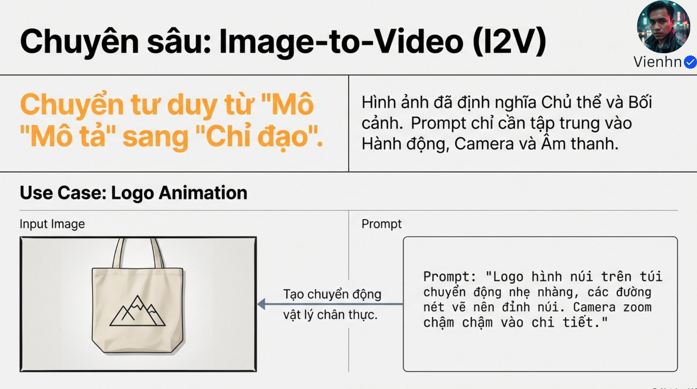

**Nội dung chính đọc được:** Ví dụ túi có biểu tượng núi: mô tả biến đổi đường nét và chuyển động máy thay vì tả lại toàn bộ túi.

**Hình minh họa:** Ảnh túi và mũi tên hướng tới video minh họa.

**Phân tích bổ sung:** Biểu tượng tự biến đổi là hiệu ứng thiết kế; cần kiểm tra chữ/logo, không suy ra tính chính xác từ ảnh.

## B022-07 — Khung đầu và cuối

Tên gốc: `07.jpg`.

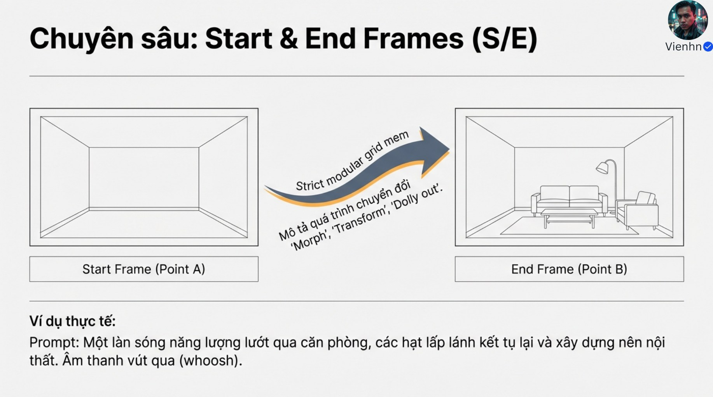

**Nội dung chính đọc được:** Ví dụ phòng trống thành phòng có nội thất nhờ sóng năng lượng, hạt sáng và âm thanh chuyển cảnh.

**Hình minh họa:** Hai ảnh căn phòng và mũi tên.

**Phân tích bổ sung:** Đây là chuyển cảnh kỳ ảo, không phải ghi lại quá trình kê đồ có thật. Cụm chữ khó hiểu trên mũi tên không được coi là tham số hợp lệ.

## B022-08 — Những cập nhật được nguồn giới thiệu

Tên gốc: `08.jpg`.

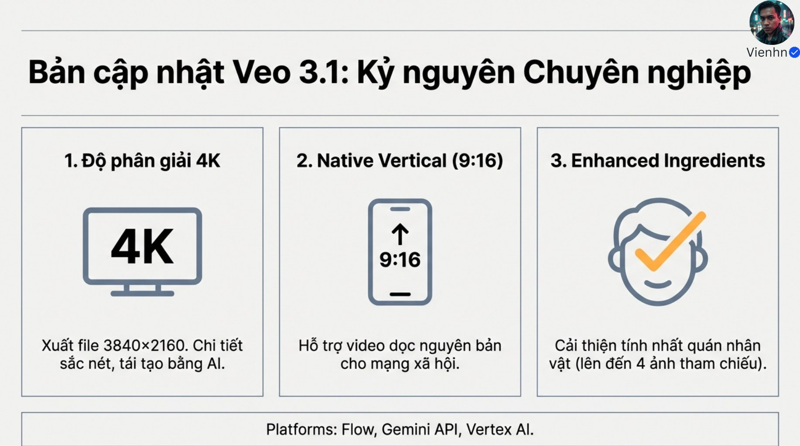

**Nội dung chính đọc được:** Nguồn nêu 4K, khung dọc 9:16 và phối hợp nhiều ảnh tham chiếu; ghi tối đa 4 ảnh.

**Hình minh họa:** Ba cột độ phân giải, khung dọc và ảnh thành phần.

**Phân tích bổ sung:** Đối chiếu Gemini API ở thời điểm biên soạn ghi tối đa 3 ảnh tham chiếu, không phải 4; khả năng còn phụ thuộc chế độ và phiên bản.

## B022-09 — Thiết kế khung dọc

Tên gốc: `09.jpg`.

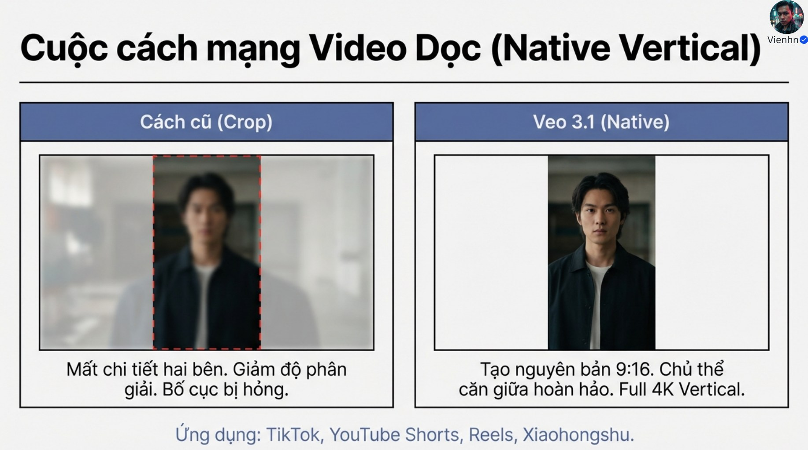

**Nội dung chính đọc được:** Nguồn so sánh cắt khung ngang với tạo khung dọc ngay từ đầu.

**Hình minh họa:** Ảnh dọc đóng khung giữa cảnh ngang.

**Phân tích bổ sung:** Nên bố trí tay, mặt và vật quan trọng cho khung đích; không bắt buộc đặt mọi chủ thể chính giữa. Tỷ lệ khung không tự quyết định độ phân giải.

## B022-10 — Bảng Veo và Sora

Tên gốc: `10.jpg`.

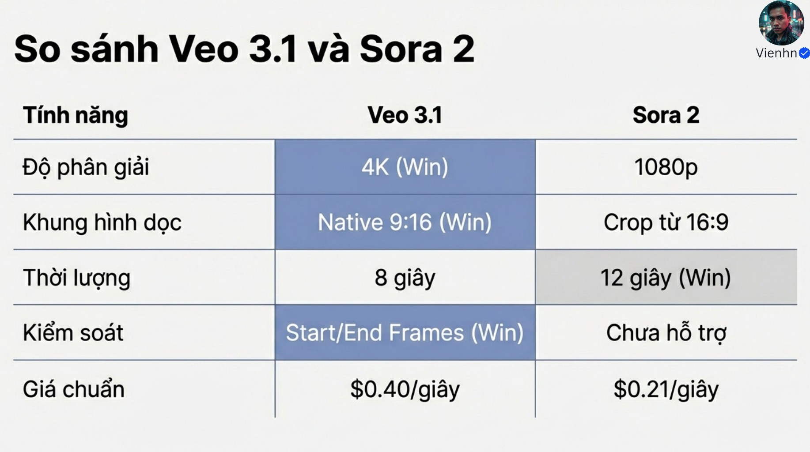

**Nội dung chính đọc được:** Nguồn so sánh độ phân giải, khung dọc, thời lượng, khung đầu/cuối và giá; đánh dấu thắng ở từng ô.

**Hình minh họa:** Bảng hai sản phẩm, nhiều nhãn Win.

**Phân tích bổ sung:** Bảng thiếu mã phiên bản, ngày và nhà cung cấp, nên không dùng để kết luận sản phẩm hiện hành hay mua gói dịch vụ. Các ô Sora không được xác nhận trong bài học này.

## B022-11 — Thử bản nháp trước

Tên gốc: `011.jpg`.

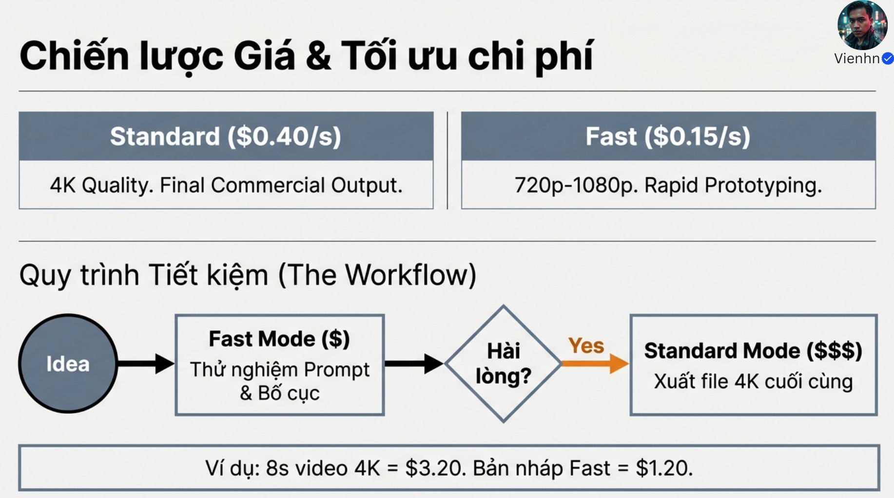

**Nội dung chính đọc được:** Nguồn ghi Standard 0,40 USD/giây, Fast 0,15 USD/giây; ví dụ 8 giây lần lượt 3,20 và 1,20 USD. Quy trình: ý tưởng → thử nhanh → duyệt → bản cuối.

**Hình minh họa:** Sơ đồ quyết định hài lòng và hai ô giá.

**Phân tích bổ sung:** Phép tính đúng theo giả định của ảnh, không xác nhận giá hiện hành. Chạy lại bản chuẩn có thể đổi kết quả; phải duyệt lại.

## B022-12 — Bảng kiểm

Tên gốc: `012.jpg`.

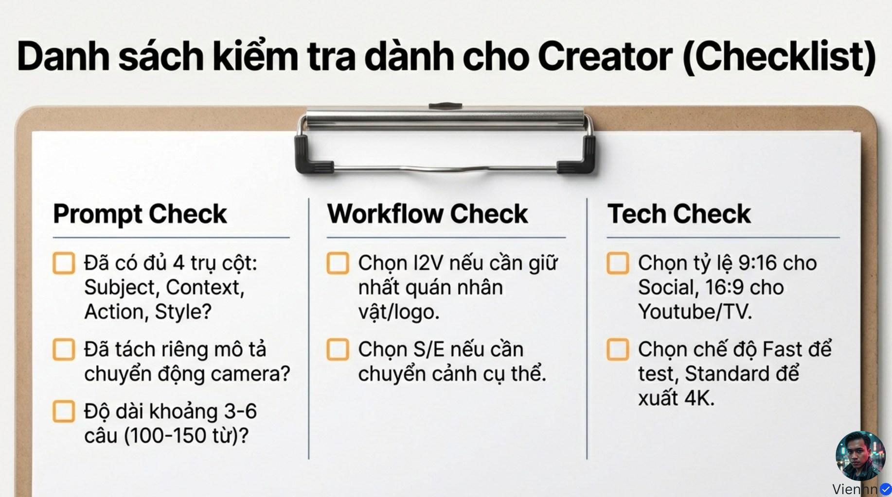

**Nội dung chính đọc được:** Nguồn gom kiểm tra câu lệnh, quy trình và thiết lập kỹ thuật.

**Hình minh họa:** Tờ checklist ba cột.

**Phân tích bổ sung:** Bảng kiểm nên ưu tiên hành động đúng và ảnh đúng trước độ dài câu lệnh. 16:9 hay 9:16 chọn theo đầu ra cụ thể, không theo tên nền tảng một cách tuyệt đối.

## B022-13 — Lời kết và tài nguyên

Tên gốc: `013.jpg`.

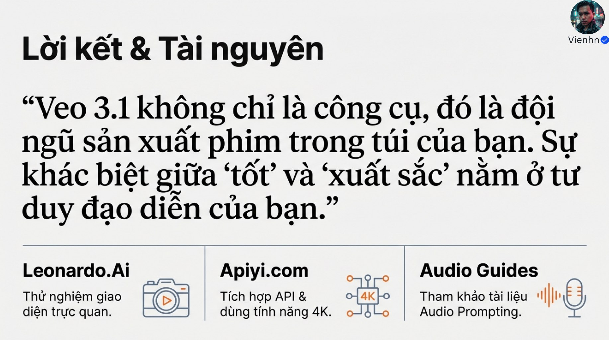

**Nội dung chính đọc được:** Nguồn nhấn mạnh tư duy đạo diễn, dẫn Leonardo.Ai, Apiyi.com và tài liệu âm thanh.

**Hình minh họa:** Chữ kết luận cùng ba nhóm tài nguyên.

**Phân tích bổ sung:** Giữ thông tin tác giả trên ảnh; việc dẫn nhà cung cấp không đồng nghĩa đã kiểm chứng dịch vụ, quyền lợi hay giá.

## Kiểm kê

Đã mở trực tiếp 14/14 ảnh. Các mã nguồn theo thứ tự ở trên khớp [danh mục tệp](nguon.json). Chưa sinh hoặc đánh giá video từ câu lệnh của bài này.
