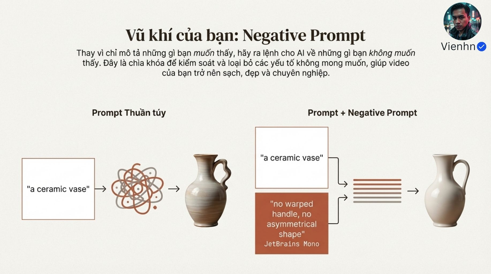
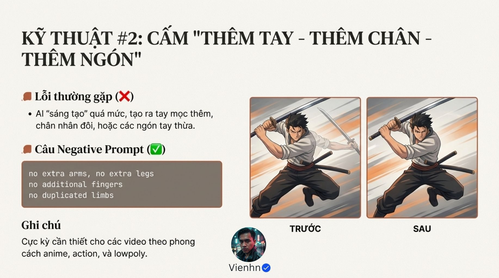
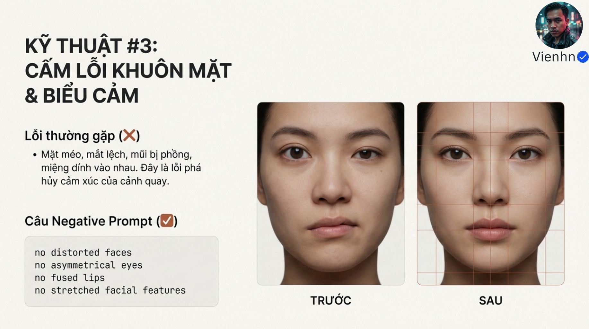
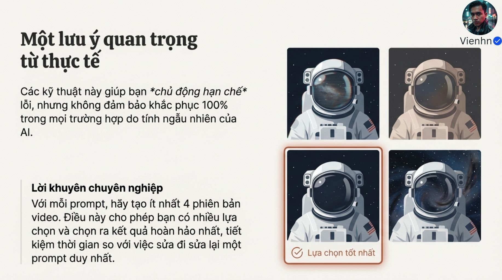

# Bài 023 — Câu lệnh loại trừ: sửa đúng nhóm lỗi, giữ đúng thiết kế

Negative prompt (danh sách yếu tố cần loại trừ) hỗ trợ hạn chế lỗi hình thể, khuôn mặt, chất liệu và chi tiết phát sinh. Bài học hữu ích nhất khi biến các nhóm lỗi thành tiêu chí quan sát, phối hợp với ảnh đúng và mô tả hành động rõ, rồi thử có kiểm soát.

**Nguồn:** [Làm Chủ Nagative Prompt! Cẩm Nang Xử lý - Hạn Chế Lỗi Với Google Veo!](https://drive.google.com/drive/folders/1KvuuXJx7k9qJXmTebV9Ij9OzD4kDqMSD). Đã đọc **13/13 ảnh**. Ngày biên soạn: 17/10/2026.

[Đọc từng ảnh](doc-anh.md) · [Bài thực hành](thuc-hanh.md) · [Nguồn và mã kiểm tra](nguon.json) · [Danh mục toàn bộ](../../DANH-MUC-BAI-HOC.md)

**Quy ước:** phần “Nguồn” diễn đạt ý trong bộ ảnh. Phần “Phân tích và áp dụng” do người biên soạn bổ sung. Hiệu quả của câu lệnh chưa được kiểm nghiệm bằng lần tạo video trong đợt này.

## Những điều cần học

| Nội dung | Mã ảnh nguồn |
| --- | --- |
| Nêu điều đúng trước khi loại lỗi | B023-00, B023-01, B023-12 |
| Hình học: xem cả chuỗi tiếp xúc | B023-02, B023-03 |
| Giữ mặt gốc và chất liệu có chủ đích | B023-04, B023-05, B023-06 |
| Tính liên tục không phải màu bất biến | B023-07, B023-09, B023-10 |
| Thử ít biến và ghi lỗi cụ thể | B023-08, B023-11, B023-12 |

## 1. Nêu điều đúng trước khi loại lỗi

**Nguồn:** Nguồn kết hợp mô tả mong muốn với điều cần tránh.

**Phân tích và áp dụng:** Viết hành động, số người và quan hệ vật rõ trước. Nếu công cụ có ô loại trừ riêng, đưa các lỗi quan sát được vào đó. Hướng dẫn Google khuyên liệt kê yếu tố không muốn, tránh dùng 'no/don’t' trong mục loại trừ; không sao chép máy móc chuỗi 'no...' của bộ ảnh.

**Ví dụ cho cảnh nông thôn:** Cảnh phủ luống cần mô tả một người kéo mép tấm phủ lùi theo luống. Danh sách 'người nhân đôi, tay thừa' không thay thế hướng kéo và điểm bám.

**Kiểm tra kết quả:** Có mô tả tích cực đủ rõ; danh sách loại trừ đúng ô được công cụ hỗ trợ.

## 2. Hình học: xem cả chuỗi tiếp xúc

**Nguồn:** Hai nhóm đầu nhắm vào hình dạng biến đổi và chi phát sinh.

**Phân tích và áp dụng:** Dùng ảnh đầu đúng cấu trúc; giảm chồng tay và chuyển động quá phức tạp khi thử. Kiểm tra số tay/ngón phù hợp thiết kế, điểm cầm và tiếp xúc nền qua từng đoạn. Nếu vật liên tục hòa vào tay, có thể cần đổi góc hoặc tách cảnh, không chỉ tăng từ cấm.

**Ví dụ cho cảnh nông thôn:** Cận tay đan: một tay giữ nan, tay kia luồn một nan qua đúng khe. Đừng đồng thời yêu cầu nhấc rổ, xoay người và đổi góc.

**Kiểm tra kết quả:** Nan còn liền; tay không xuyên nan; không xuất hiện tay thứ ba trong khung.

## 3. Giữ mặt gốc và chất liệu có chủ đích

**Nguồn:** Nguồn nhắm vào mặt méo, màu loang và phụ kiện phát sinh.

**Phân tích và áp dụng:** Đối chiếu với tham chiếu đã duyệt, không với khuôn mặt 'chuẩn đẹp'. Bất đối xứng, nếp da, bóng trên kim loại hoặc nếp vải có thể đúng. Danh sách chung như 'da nhựa' hay 'phụ kiện thừa' chỉ dùng khi liên quan đến lỗi của cảnh.

**Ví dụ cho cảnh nông thôn:** Giữ mặt và hoa cài tóc đúng mẫu; áo vải mềm có nếp tự nhiên, nan tre có thớ và độ bóng nhẹ theo ảnh.

**Kiểm tra kết quả:** Mặt vẫn là cùng người; phụ kiện gốc không biến mất; vật liệu không bị làm lì hàng loạt.

## 4. Tính liên tục không phải màu bất biến

**Nguồn:** Nguồn muốn ổn định hình thể, mặt và vật liệu, gom thành ba nhóm.

**Phân tích và áp dụng:** Dùng ba nhóm như bảng kiểm. Khi so màu giữa cảnh, xét nguồn sáng và phơi sáng trước khi kết luận áo đổi màu. Ưu tiên ảnh tham chiếu và đối chiếu cạnh nhau; mã HEX là gợi ý thiết kế, không phép đo bảo đảm.

**Ví dụ cho cảnh nông thôn:** Áo đi từ hiên râm ra nắng có thể sáng hơn nhưng vẫn phải là cùng màu vải và họa tiết; không chuyển thành áo khác.

**Kiểm tra kết quả:** Tách được biến đổi chiếu sáng hợp lý khỏi đổi vật liệu, trang phục hoặc nhận dạng.

## 5. Thử ít biến và ghi lỗi cụ thể

**Nguồn:** Nguồn khuyên rút gọn danh sách và tạo nhiều phương án, đồng thời thừa nhận giới hạn.

**Phân tích và áp dụng:** Thử bản cơ sở rồi thêm đúng một nhóm lỗi liên quan. Ghi thời điểm lỗi và ảnh hưởng tới thao tác. Nếu lỗi chủ yếu do nhiệm vụ quá tải, tách cảnh. Chọn số lần thử theo chất lượng và ngân sách, không mặc định phải bốn lần.

**Ví dụ cho cảnh nông thôn:** Giữ timelapse đã đạt và chỉ sửa số người; đừng tiện thể đổi máy quay, nhịp lao động và thao tác phủ luống.

**Kiểm tra kết quả:** Biến cần sửa thay đổi, những phần đã đạt vẫn đạt; không chỉ chọn ảnh đại diện đẹp.

## Điểm cần hiểu có điều kiện

- Nguồn dùng nhiều chuỗi 'no...'; mục loại trừ của Google được đối chiếu khuyên liệt kê yếu tố thay vì câu cấm. Giao diện khác có thể khác, phải xem hỗ trợ thực tế.
- Không có bằng chứng cho ổn định 95–100%, hiệu quả gấp đôi hoặc 'hết lỗi'.
- Không cấm bất đối xứng tự nhiên của khuôn mặt, phụ kiện đã duyệt hay phản xạ đúng của vật liệu.
- Các ảnh trước/sau không cung cấp mô hình, câu lệnh đầy đủ, seed (giá trị khởi tạo) hay số lần thử nên không chứng minh quan hệ nhân quả.
- Ba 'khóa' là cách nhóm yêu cầu, không phải cơ chế cố định danh tính. Bốn phiên bản là gợi ý của tác giả.

## Cách đưa vào quy trình sản xuất

Ảnh và thiết kế đã duyệt → mô tả thao tác chính → tạo bản cơ sở → phân loại lỗi hình học/mặt/vật liệu/chi tiết → thêm yêu cầu loại trừ liên quan nếu được hỗ trợ → so toàn chuyển động → lưu lỗi theo giây. Chỉ thay đúng phần chưa đạt. Nếu hình học tiếp tục hỏng, giảm độ phức tạp hoặc tách cảnh.

## Tự kiểm tra kiến thức

- Vì sao cấm 'mắt bất đối xứng' có thể làm sai mặt gốc?
- Danh sách lỗi có thay được mô tả hướng kéo tấm phủ không?
- Muốn biết danh sách loại trừ có ích cần giữ những biến nào ổn định?

## Nguồn đối chiếu bổ sung

- [Google — hướng dẫn mục loại trừ](https://docs.cloud.google.com/gemini-enterprise-agent-platform/models/video/video-gen-prompt-guide#negative_prompts): Đối chiếu cú pháp: liệt kê yếu tố không mong muốn, tránh câu 'no/don’t'. Không coi danh sách là bảo đảm sửa lỗi.

**Giới hạn:** đây là tài liệu học từ ảnh. Không dùng một hình minh họa để xác nhận chuyển động, thời lượng, độ chính xác thao tác hay khả năng hiện tại của một sản phẩm. Những phần chưa kiểm chứng được ghi rõ trong bản đọc ảnh.
