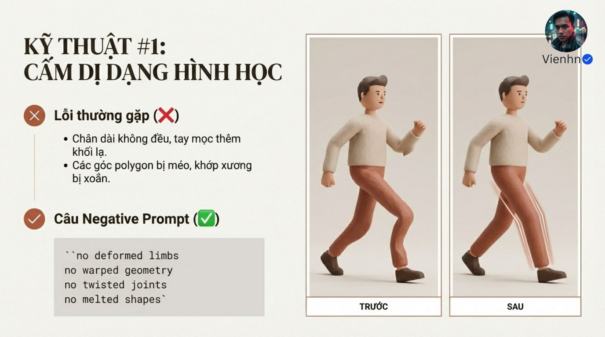
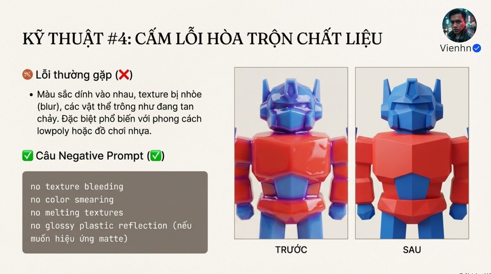
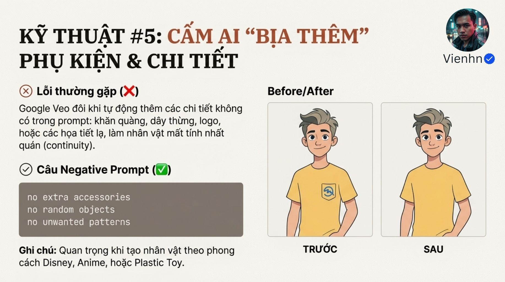
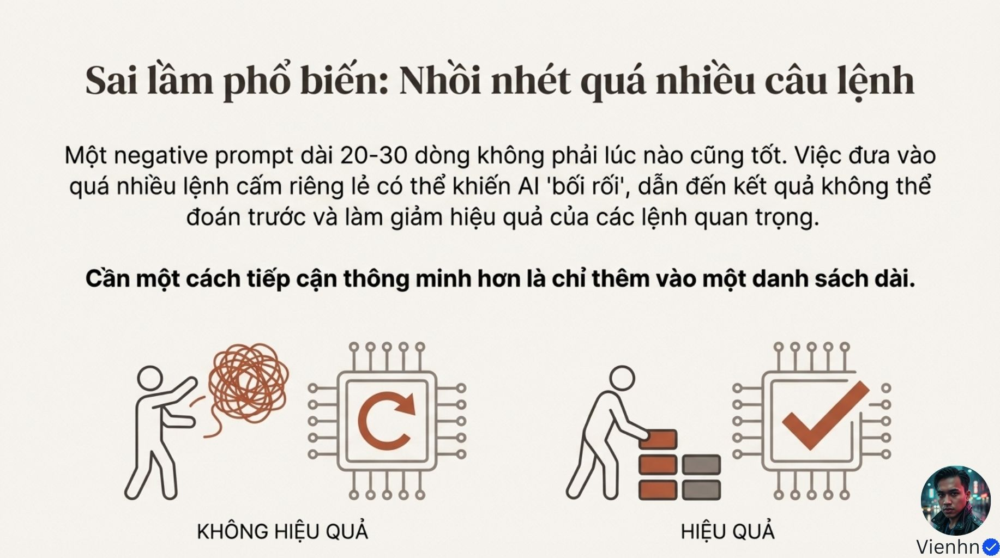
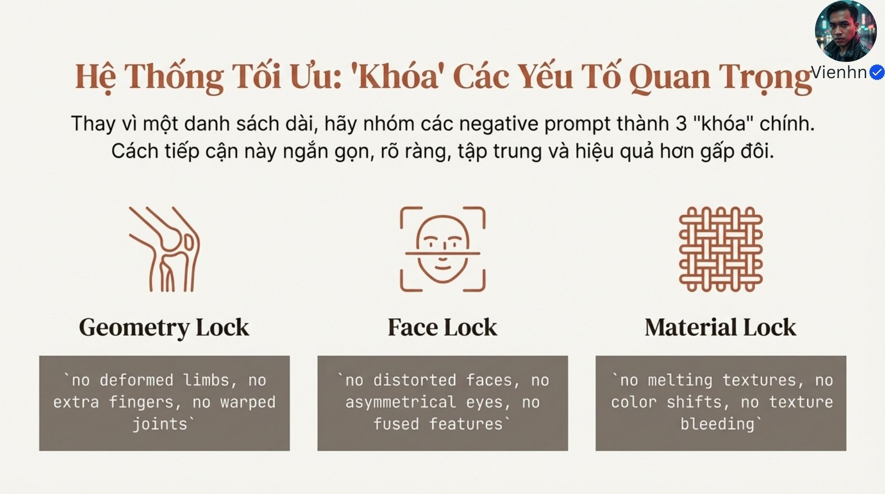
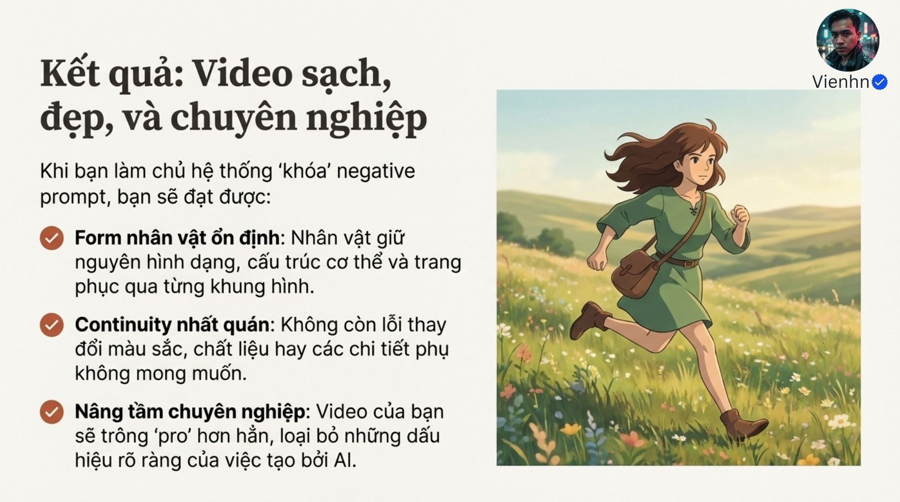
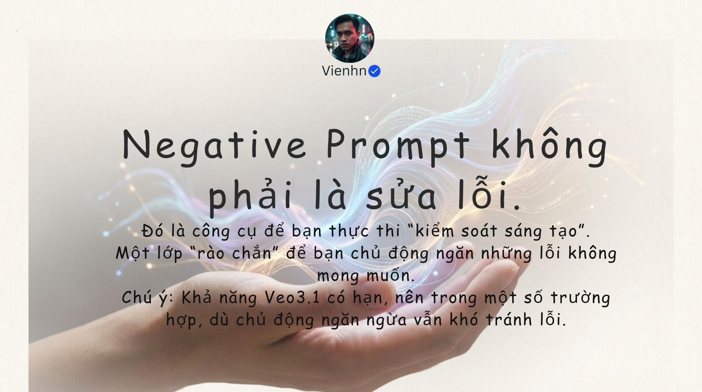

# B023 — Bản đọc toàn bộ 13 ảnh

Nguồn: [Làm Chủ Nagative Prompt! Cẩm Nang Xử lý - Hạn Chế Lỗi Với Google Veo!](https://drive.google.com/drive/folders/1KvuuXJx7k9qJXmTebV9Ij9OzD4kDqMSD).

**Cách ghi:** nội dung chính được diễn đạt lại từ chữ và hình trong ảnh; không phải bản chép nguyên văn toàn bộ. Quan sát ảnh tĩnh được tách khỏi lời giải thích bổ sung. Ảnh gốc được giữ nguyên để đối chiếu.

[Bài chính](README.md) · [Thực hành](thuc-hanh.md) · [Dữ liệu nguồn](nguon.json)

## B023-00 — Phạm vi

Tên gốc: `Làm Chủ Nagative Prompt! Cẩm Nang Xử lý - Hạn Chế Lỗi Với Google Veo!.jpg`.

**Nội dung chính đọc được:** Bìa giới thiệu xử lý lỗi video AI bằng câu lệnh loại trừ cho Veo, Pika và Runway.

**Hình minh họa:** Khối kim loại tan thành mảnh và tên tác giả.

**Phân tích bổ sung:** Không mặc định ba công cụ có cùng cú pháp hay cùng hiệu quả.

## B023-01 — Cơ chế theo cách diễn giải của nguồn

Tên gốc: `01.jpg`.

**Nội dung chính đọc được:** Nguồn bổ sung điều không mong muốn bên cạnh mô tả tích cực; ví dụ bình gốm với quai méo.

**Hình minh họa:** Hai sơ đồ bình gốm; khối chữ có cả tên phông JetBrains Mono.

**Phân tích bổ sung:** Tên phông là chi tiết trình bày, không đưa vào câu lệnh. Hình trước/sau không phải dữ liệu thử có kiểm soát.

## B023-02 — Hình thể

Tên gốc: `02.jpg`.

**Nội dung chính đọc được:** Loại trừ chi biến dạng, hình học méo, khớp xoắn và hình dạng tan chảy.

**Hình minh họa:** Nhân vật dạng đồ chơi đang bước, hai phiên bản.

**Phân tích bổ sung:** Xem tiếp xúc chân với đất và cấu trúc qua toàn chuyển động, không chỉ một khung.

## B023-03 — Chi thừa

Tên gốc: `03.jpg`.

**Nội dung chính đọc được:** Nguồn liệt kê tay, chân, ngón phát sinh hoặc nhân đôi; nhấn mạnh cảnh hoạt hình và hành động.

**Hình minh họa:** Kiếm sĩ bên trái có tay thừa, bên phải giảm chi bất thường.

**Phân tích bổ sung:** Cần giữ đúng hình thể thiết kế; không ép mọi nhân vật hoạt hình phải theo giải phẫu người.

## B023-04 — Mặt và biểu cảm

Tên gốc: `04.jpg`.

**Nội dung chính đọc được:** Nguồn nêu mặt méo, mắt lệch, môi dính và nét mặt kéo giãn.

**Hình minh họa:** Hai chân dung, một ảnh phủ lưới cân đối.

**Phân tích bổ sung:** Bất đối xứng tự nhiên có thể là nhận dạng. Không sửa mặt gốc thành đối xứng tuyệt đối.

## B023-05 — Ranh giới chất liệu

Tên gốc: `05.jpg`.

**Nội dung chính đọc được:** Nguồn nêu màu loang, bề mặt nhòe, vật như tan chảy; bỏ phản xạ bóng nếu muốn bề mặt lì.

**Hình minh họa:** Robot đỏ–xanh từ bóng loang sang các mảng lì rõ.

**Phân tích bổ sung:** Bóng hay lì là lựa chọn thiết kế; không loại bỏ bóng đúng của vật liệu thực.

## B023-06 — Phụ kiện phát sinh

Tên gốc: `06.jpg`.

**Nội dung chính đọc được:** Nguồn nêu khăn, dây, logo, hoa văn tự thêm làm mất nhất quán.

**Hình minh họa:** Áo vàng có và không có biểu tượng ở ngực.

**Phân tích bổ sung:** Bảo toàn phụ kiện đã duyệt; chỉ loại chi tiết phát sinh ngoài thiết kế.

## B023-07 — Màu và vật liệu giữa cảnh

Tên gốc: `07.jpg`.

**Nội dung chính đọc được:** Nguồn nêu áo đổi màu, lì đổi bóng và ánh sáng bất nhất; gợi ý mã HEX, tuyên bố 95–100%.

**Hình minh họa:** Hai cặp nhân vật áo xanh, một cặp lệch sắc.

**Phân tích bổ sung:** Tỷ lệ không có phương pháp đo. Màu nhìn thấy có thể đổi hợp lý dưới ánh sáng; mã HEX không khóa màu từng điểm ảnh.

## B023-08 — Tránh danh sách dài

Tên gốc: `08.jpg`.

**Nội dung chính đọc được:** Nguồn cảnh báo nhồi 20–30 dòng có thể làm yêu cầu kém tập trung.

**Hình minh họa:** Biểu tượng chuỗi rối đối chiếu các khối ngăn nắp.

**Phân tích bổ sung:** Số dòng không là ngưỡng kỹ thuật; ưu tiên lỗi thật và bỏ xung đột.

## B023-09 — Ba nhóm khóa

Tên gốc: `09.jpg`.

**Nội dung chính đọc được:** Nguồn gom hình học, mặt và chất liệu, kèm tuyên bố hiệu quả gấp đôi.

**Hình minh họa:** Ba biểu tượng khớp, mặt và vải.

**Phân tích bổ sung:** Đây là cách tổ chức nội dung, không phải tính năng khóa cứng hoặc mức cải thiện đã đo.

## B023-10 — Mục tiêu đầu ra

Tên gốc: `10.jpg`.

**Nội dung chính đọc được:** Nguồn mong hình dáng, trang phục và màu ổn định qua khung.

**Hình minh họa:** Cô gái hoạt hình chạy trên đồng.

**Phân tích bổ sung:** Một ảnh chạy không chứng minh chuỗi chuyển động hoặc danh tính ổn định.

## B023-11 — Giới hạn và lựa chọn

Tên gốc: `011.jpg`.

**Nội dung chính đọc được:** Nguồn thừa nhận không sửa được 100%; khuyên ít nhất bốn phiên bản rồi chọn.

**Hình minh họa:** Bốn ảnh phi hành gia với một ảnh được khoanh.

**Phân tích bổ sung:** Bốn là gợi ý thử, không định mức bắt buộc; dừng hoặc sửa cấu trúc khi lỗi lặp.

## B023-12 — Tổng kết

Tên gốc: `012.jpg`.

**Nội dung chính đọc được:** Nguồn coi loại trừ là công cụ chủ động hạn chế lỗi, vẫn chịu giới hạn mô hình.

**Hình minh họa:** Bàn tay dưới dải sáng.

**Phân tích bổ sung:** Không thể sửa trực tiếp video đã sai chỉ bằng thêm danh sách; thường cần tạo lại hoặc hậu kỳ.

## Kiểm kê

Đã mở trực tiếp 13/13 ảnh. Các mã nguồn theo thứ tự ở trên khớp [danh mục tệp](nguon.json). Chưa sinh hoặc đánh giá video từ câu lệnh của bài này.
