# B024 — Bản đọc toàn bộ 15 ảnh

Nguồn: [Làm phim chuyên nghiệp với Google Veo 3- Từ Prompt cơ bản đến kỹ thuật Xâu chuỗi (Chaining)](https://drive.google.com/drive/folders/1kgxRLK9WGqrFxDsNpD9umwIIlL8oZUGZ).

**Cách ghi:** nội dung chính được diễn đạt lại từ chữ và hình trong ảnh; không phải bản chép nguyên văn toàn bộ. Quan sát ảnh tĩnh được tách khỏi lời giải thích bổ sung. Ảnh gốc được giữ nguyên để đối chiếu.

[Bài chính](README.md) · [Thực hành](thuc-hanh.md) · [Dữ liệu nguồn](nguon.json)

## B024-00 — Bìa

Tên gốc: `Làm phim chuyên nghiệp với Google Veo 3- Từ Prompt cơ bản đến kỹ thuật Xâu chuỗi (Chaining).jpg`.

**Nội dung chính đọc được:** Nguồn giới thiệu vượt giới hạn clip ngắn bằng tư duy đạo diễn và xâu chuỗi.

**Hình minh họa:** Clapperboard (bảng ghi cảnh) pha sơ đồ kỹ thuật.

**Phân tích bổ sung:** Các ký tự trang trí trong hình không phải mã lệnh thực thi.

## B024-01 — Clip ngắn và phim dài

Tên gốc: `01.jpg`.

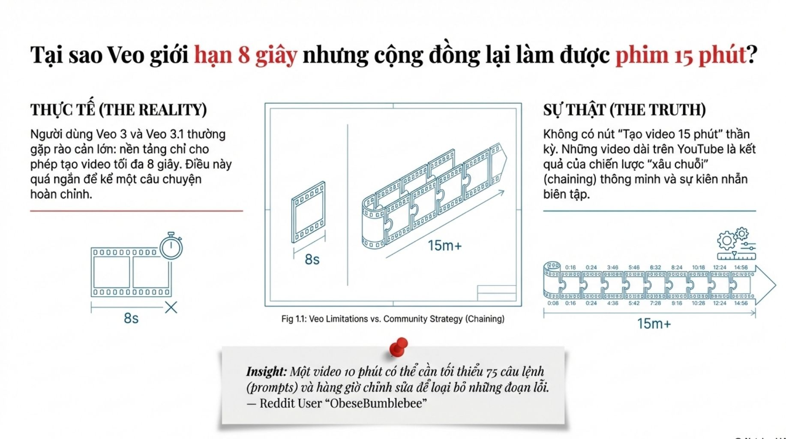

**Nội dung chính đọc được:** Nguồn nói video dài được ghép từ đoạn ngắn, đưa ví dụ 10 phút cần tối thiểu 75 câu lệnh khi mỗi đoạn 8 giây.

**Hình minh họa:** Dải phim 8 giây và chuỗi 15 phút.

**Phân tích bổ sung:** 600/8 = 75 đoạn lý tưởng không hao hụt, không phải số lần tạo thực tế; phải cộng đoạn hỏng, cắt và chồng nối.

## B024-02 — Extend

Tên gốc: `02.jpg`.

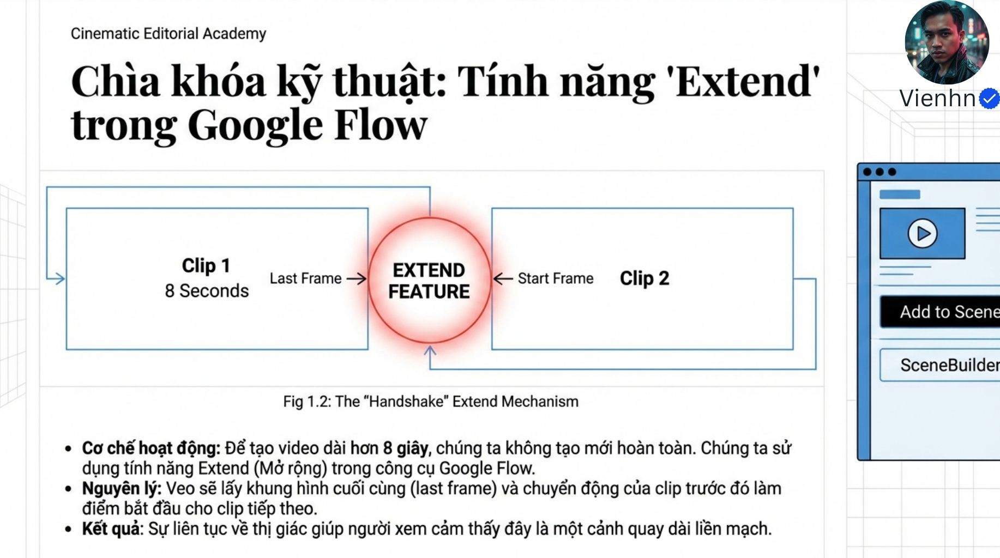

**Nội dung chính đọc được:** Nguồn giới thiệu Extend (mở rộng) trong Flow, tiếp diễn từ phần cuối clip trước.

**Hình minh họa:** Hai khối clip với nút nối giữa.

**Phân tích bổ sung:** Sơ đồ khái niệm, không mô tả đầy đủ cơ chế nội bộ. Mở rộng video khác lấy một ảnh cuối để tạo mới.

## B024-03 — Duyệt clip gốc

Tên gốc: `03.jpg`.

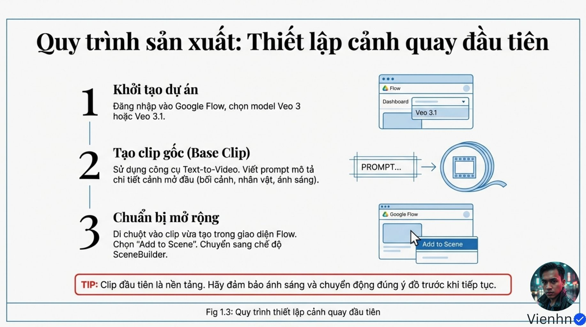

**Nội dung chính đọc được:** Nguồn hướng dẫn chọn mô hình, tạo cảnh đầu và thêm vào SceneBuilder (trình dựng cảnh).

**Hình minh họa:** Ba bước kèm giao diện vẽ lại.

**Phân tích bổ sung:** Ảnh giao diện là minh họa; vị trí nút có thể thay đổi. Có thể dùng ảnh đầu đã duyệt nếu bài toán cần giữ người.

## B024-04 — Tạo phần tiếp diễn

Tên gốc: `04.jpg`.

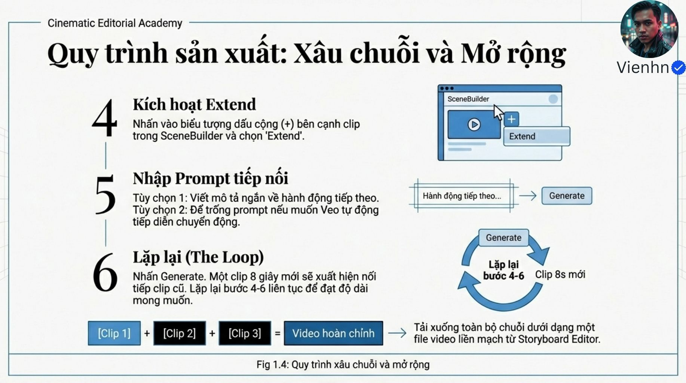

**Nội dung chính đọc được:** Nguồn mô tả chọn Extend, viết hành động tiếp theo hoặc để trống, lặp và tải chuỗi.

**Hình minh họa:** Các bước 4–6 và vòng lặp.

**Phân tích bổ sung:** Không mặc định để trống được hỗ trợ hoặc mỗi lần luôn thêm đúng 8 giây; kiểm tra chế độ thực tế và duyệt trước mỗi bước.

## B024-05 — Giữ nhất quán

Tên gốc: `05.jpg`.

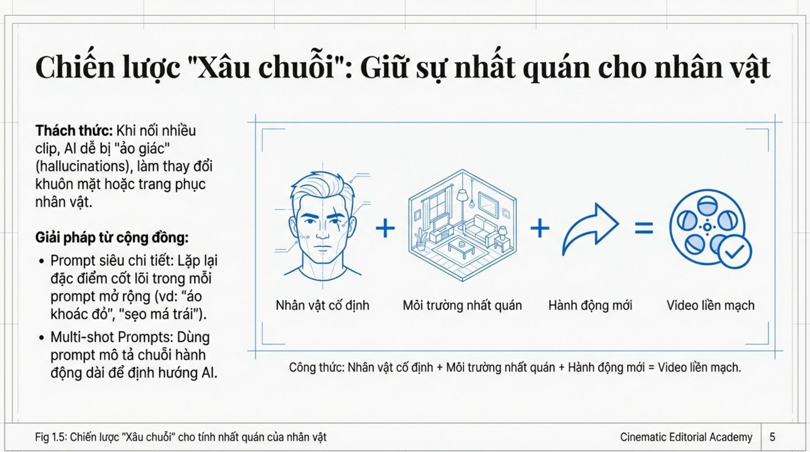

**Nội dung chính đọc được:** Nguồn khuyên lặp đặc điểm nhận dạng, giữ môi trường và thay hành động; nhắc câu lệnh nhiều cảnh.

**Hình minh họa:** Mặt, căn phòng và mũi tên thành cuộn phim.

**Phân tích bổ sung:** Không cần chép lại mọi chi tiết đã có trong đầu vào; giữ đặc điểm cốt lõi khi cần, tránh nhồi chuỗi quá dài.

## B024-06 — Chủ thể–hành động–bối cảnh

Tên gốc: `06.jpg`.

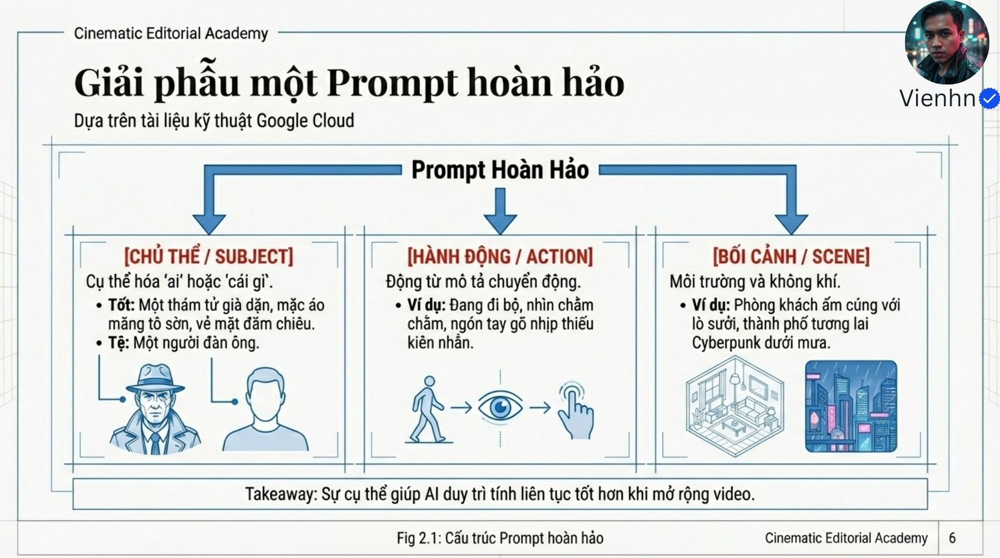

**Nội dung chính đọc được:** Nguồn phân rã yêu cầu thành ai/cái gì, đang làm gì, trong không gian nào.

**Hình minh họa:** Ba cột thám tử, động tác và căn phòng/thành phố.

**Phân tích bổ sung:** Cụ thể hóa bằng trạng thái vật và hướng thao tác giúp nối chính xác hơn các tính từ chung.

## B024-07 — Góc và cỡ cảnh

Tên gốc: `07.jpg`.

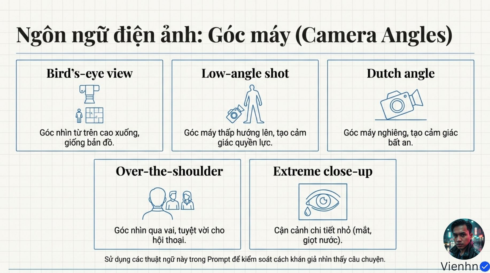

**Nội dung chính đọc được:** Nguồn liệt kê nhìn từ trên, góc thấp, góc nghiêng, qua vai và đặc tả.

**Hình minh họa:** Năm ô biểu tượng.

**Phân tích bổ sung:** Đặc tả là cỡ cảnh; qua vai là cách đặt nhìn; không phải tất cả đều là góc cao/thấp.

## B024-08 — Chuyển động máy

Tên gốc: `08.jpg`.

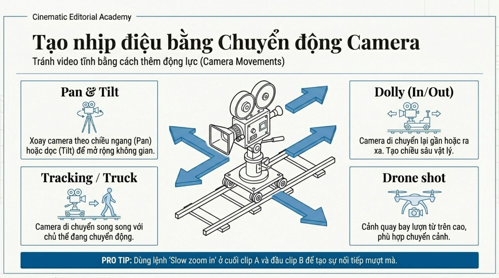

**Nội dung chính đọc được:** Nguồn nêu pan/tilt, tracking/truck, dolly và drone; gợi ý slow zoom in ở hai đoạn.

**Hình minh họa:** Máy trên ray với các mũi tên.

**Phân tích bổ sung:** Cùng từ zoom không bảo đảm nối mượt; còn phải khớp tốc độ, vị trí chủ thể, tỷ lệ và hướng.

## B024-09 — Ánh sáng và ống kính

Tên gốc: `09.jpg`.

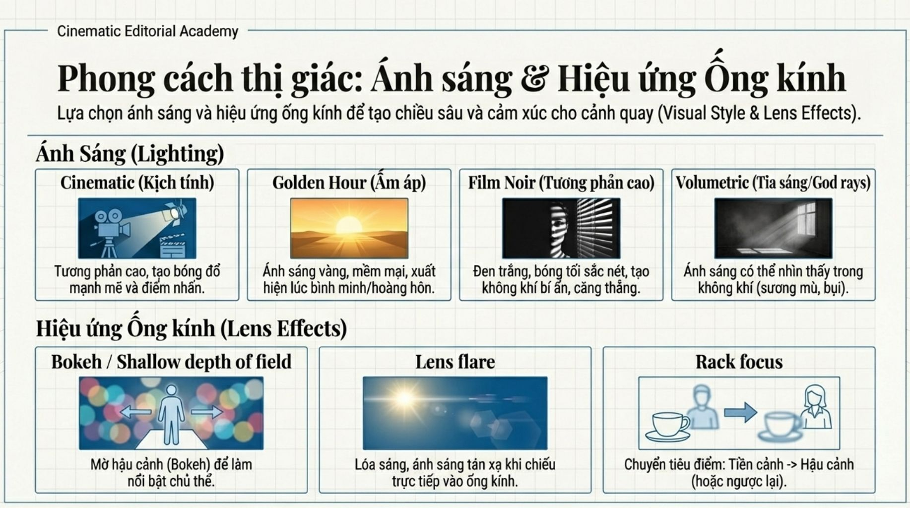

**Nội dung chính đọc được:** Nguồn nêu tương phản, giờ vàng, noir, tia sáng, bokeh, lóe và chuyển nét.

**Hình minh họa:** Bảy ô ảnh và sơ đồ.

**Phân tích bổ sung:** Điện ảnh không đồng nghĩa tương phản cao. Bokeh là tính chất vùng mờ; không chỉ là một nút xóa hậu cảnh.

## B024-10 — Âm thanh và thời gian

Tên gốc: `010.jpg`.

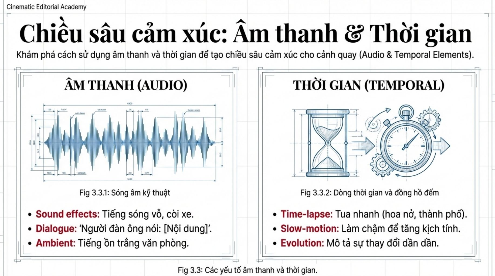

**Nội dung chính đọc được:** Nguồn tách tiếng động, thoại, môi trường; phân biệt tua nhanh, chuyển động chậm và biến đổi dần.

**Hình minh họa:** Dạng sóng và đồng hồ.

**Phân tích bổ sung:** Tua nhanh làm lao động dài được nén; máy chạy chậm không đồng nghĩa nhân vật chuyển động chậm.

## B024-11 — Loại trừ

Tên gốc: `011.jpg`.

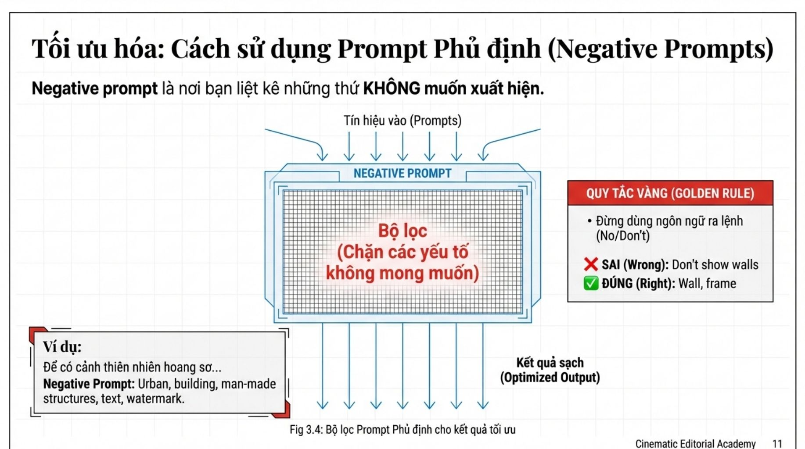

**Nội dung chính đọc được:** Nguồn khuyên liệt kê yếu tố không muốn, tránh dạng câu No/Don't; ví dụ cảnh thiên nhiên loại đô thị, chữ.

**Hình minh họa:** Bộ lọc khái niệm.

**Phân tích bổ sung:** Chỉ dùng nếu công cụ hỗ trợ; không cấm cấu trúc nhân tạo khi cảnh là nông trại có nhà.

## B024-12 — Hậu kỳ

Tên gốc: `012.jpg`.

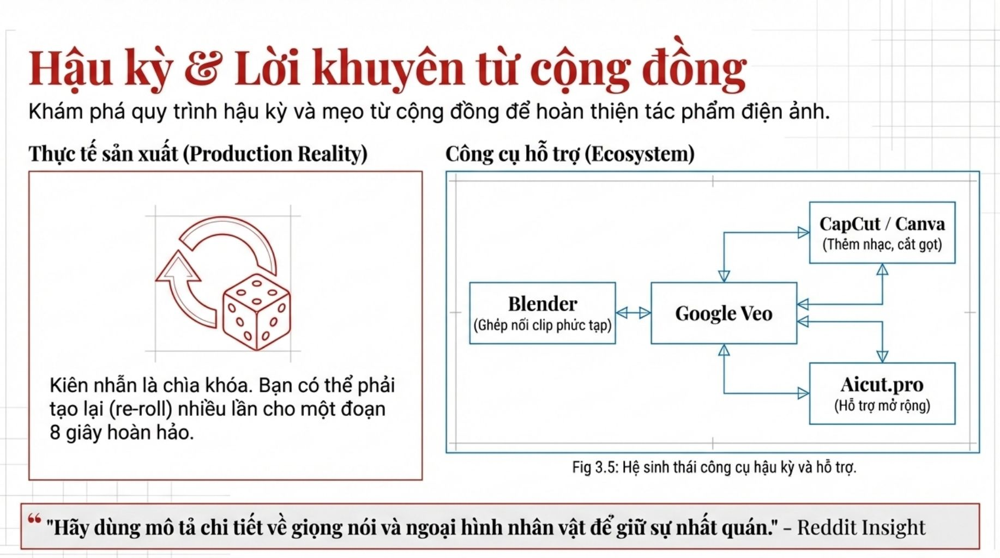

**Nội dung chính đọc được:** Nguồn thừa nhận cần tạo lại, cắt gọt, nhạc và các công cụ hỗ trợ.

**Hình minh họa:** Veo nối với Blender, CapCut/Canva, Aicut.pro.

**Phân tích bổ sung:** Đây là danh sách trong nguồn, không đánh giá dịch vụ hiện tại hay yêu cầu phải dùng đủ.

## B024-13 — Checklist

Tên gốc: `013.jpg`.

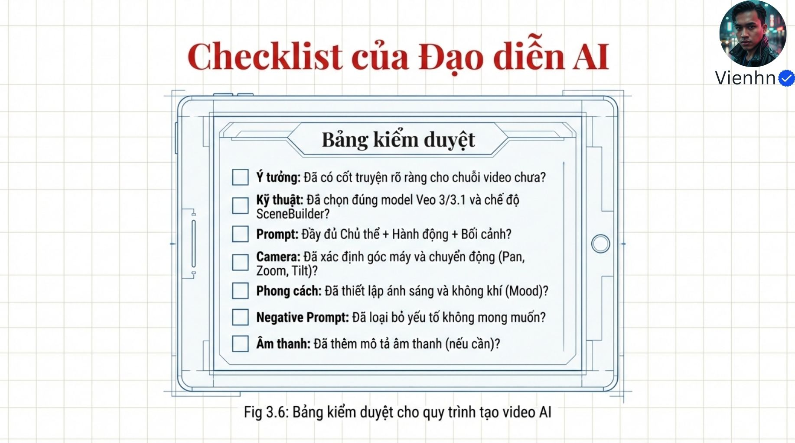

**Nội dung chính đọc được:** Nguồn kiểm tra cốt truyện, kỹ thuật, câu lệnh, máy, phong cách, loại trừ và âm thanh.

**Hình minh họa:** Bảng kiểm có ô đánh dấu.

**Phân tích bổ sung:** Bổ sung kiểm tra điểm nối về tay, vật, lực, hướng và tiếng nền.

## B024-14 — Kết

Tên gốc: `014.jpg`.

**Nội dung chính đọc được:** Nguồn khuyến khích xây phim từ từng đoạn, ghi tổng hợp Toolfolio, Reddit và Google Cloud.

**Hình minh họa:** Trang chữ kết và tên tác giả.

**Phân tích bổ sung:** Không suy ra có thể Extend vô hạn hoặc mọi clip ghép đều thành cảnh liền mạch.

## Kiểm kê

Đã mở trực tiếp 15/15 ảnh. Các mã nguồn theo thứ tự ở trên khớp [danh mục tệp](nguon.json). Chưa sinh hoặc đánh giá video từ câu lệnh của bài này.
