# B025 — Bản đọc toàn bộ 15 ảnh

Nguồn: [Mẹo Điều khiển CAMERA- Trở thành "Đạo diễn thật sự trong prompt" để video lập tức cinematic gấp… 5 lần](https://drive.google.com/drive/folders/1FSlu5jphR2IxsoQ4zVhhNpvnqjX1qIuq).

**Cách ghi:** nội dung chính được diễn đạt lại từ chữ và hình trong ảnh; không phải bản chép nguyên văn toàn bộ. Quan sát ảnh tĩnh được tách khỏi lời giải thích bổ sung. Ảnh gốc được giữ nguyên để đối chiếu.

[Bài chính](README.md) · [Thực hành](thuc-hanh.md) · [Dữ liệu nguồn](nguon.json)

## B025-00 — Bìa ba kỹ thuật

Tên gốc: `Mẹo Điều khiển CAMERA- Trở thành "Đạo diễn thật sự trong prompt" để video lập tức cinematic gấp… 5 lần.jpg`.

**Nội dung chính đọc được:** Nguồn kêu gọi chuyển từ mô tả sang đạo diễn qua ba kỹ thuật cho Veo 3.1.

**Hình minh họa:** Dấu nháy, bảng ghi cảnh và tên tác giả.

**Phân tích bổ sung:** Mô tả vẫn cần thiết; bổ sung quyết định quay và dựng theo mục tiêu.

## B025-01 — Có chủ đích

Tên gốc: `01.jpg`.

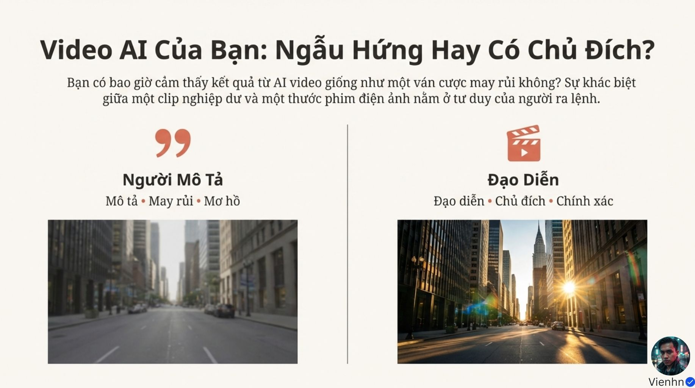

**Nội dung chính đọc được:** Nguồn so sánh yêu cầu mơ hồ với tư duy đạo diễn chính xác.

**Hình minh họa:** Hai cảnh đường phố khác ánh sáng.

**Phân tích bổ sung:** Ảnh khác nhau còn do thời tiết/ánh sáng; không chứng minh chỉ tư duy đã tạo toàn bộ khác biệt.

## B025-02 — Cách quay

Tên gốc: `02.jpg`.

**Nội dung chính đọc được:** Nguồn nhấn mạnh hướng dẫn cách quay bên cạnh nội dung được thấy.

**Hình minh họa:** Trang chữ lớn.

**Phân tích bổ sung:** Cần nêu nội dung và cách nhìn cùng nhau; không bỏ thao tác thực.

## B025-03 — Ba công cụ

Tên gốc: `03.jpg`.

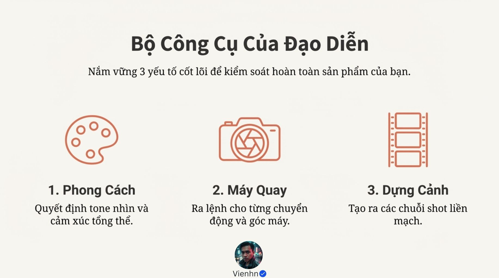

**Nội dung chính đọc được:** Phong cách, máy quay và dựng cảnh là ba nhóm chính.

**Hình minh họa:** Bảng màu, máy ảnh, dải phim.

**Phân tích bổ sung:** Ba nhóm không bao quát mọi yếu tố; âm thanh, hành động và ảnh tham chiếu vẫn quan trọng.

## B025-04 — Phong cách

Tên gốc: `04.jpg`.

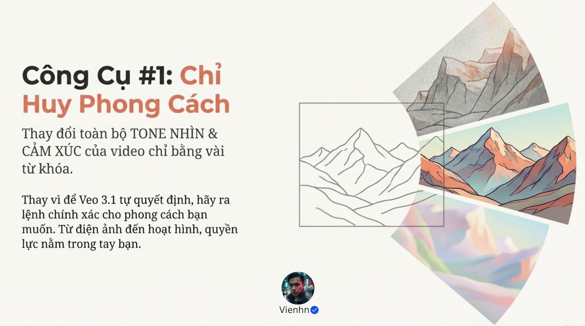

**Nội dung chính đọc được:** Nguồn cho rằng vài từ khóa có thể đổi sắc thái và cảm xúc.

**Hình minh họa:** Các phiên bản tranh núi.

**Phân tích bổ sung:** Từ khóa định hướng, không bảo đảm mọi chi tiết hoặc danh tính.

## B025-05 — Ví dụ phong cách

Tên gốc: `05.jpg`.

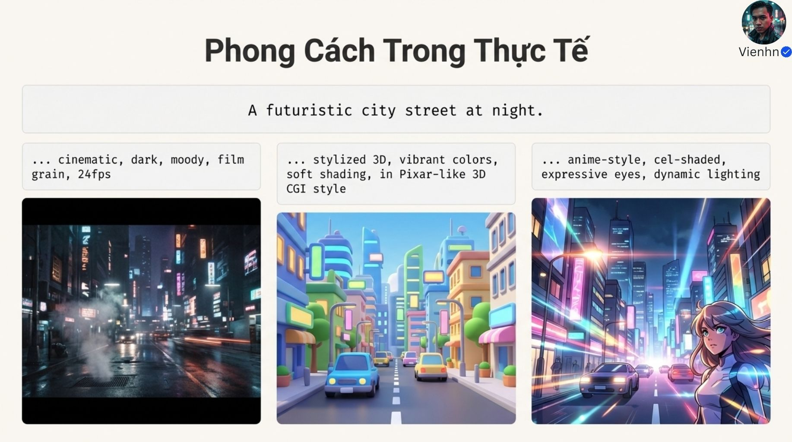

**Nội dung chính đọc được:** Cùng ý tưởng phố tương lai, nguồn minh họa hình điện ảnh tối, hoạt hình 3D nhiều màu và anime.

**Hình minh họa:** Ba ảnh đô thị khác kiểu tạo hình.

**Phân tích bổ sung:** 24fps là tốc độ khung hình cần kiểm tra trong thiết lập/tệp, không có được chắc chắn chỉ bằng chữ.

## B025-06 — Máy quay

Tên gốc: `06.jpg`.

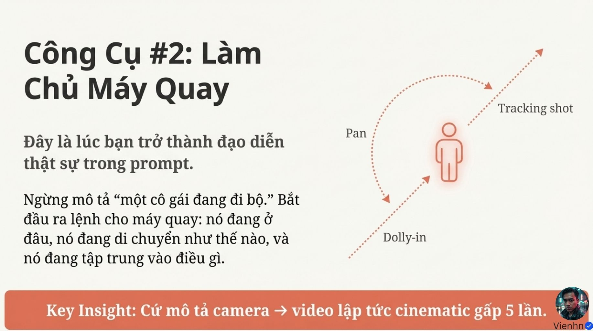

**Nội dung chính đọc được:** Nguồn yêu cầu vị trí, chuyển động và đối tượng tập trung; tuyên bố điện ảnh gấp 5 lần.

**Hình minh họa:** Mũi tên dolly-in, tracking và pan quanh người.

**Phân tích bổ sung:** Không có thước đo gấp 5. Đường cong quanh người dễ gợi orbit (đi vòng), khác pan là xoay máy tại chỗ.

## B025-07 — Bám theo nhân vật

Tên gốc: `07.jpg`.

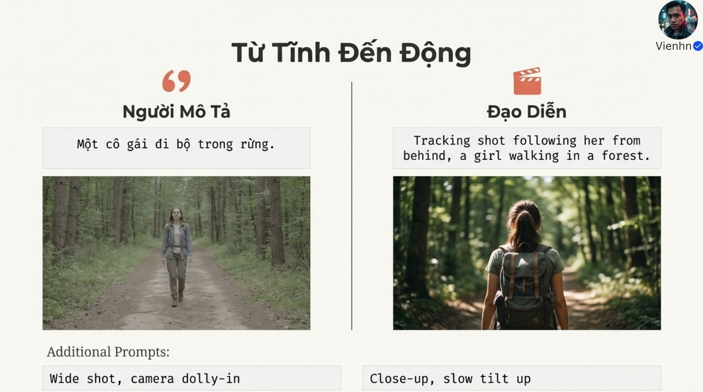

**Nội dung chính đọc được:** Nguồn chuyển câu cô gái đi rừng thành bám máy từ phía sau; thêm gợi ý toàn cảnh tiến máy và cận ngẩng máy.

**Hình minh họa:** Hai người đi rừng, khác trang phục và góc.

**Phân tích bổ sung:** Ảnh không thể hiện quỹ đạo hay tốc độ. So sánh còn thay nhiều biến nên không phải thử nghiệm một biến.

## B025-08 — Xuống dòng và nhiều cảnh

Tên gốc: `08.jpg`.

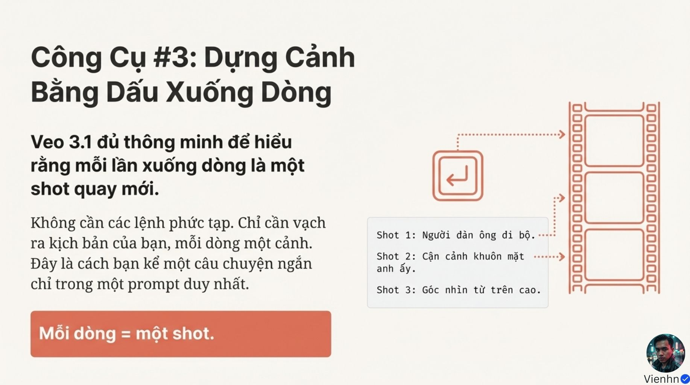

**Nội dung chính đọc được:** Nguồn nói mỗi dòng là một cảnh và có thể kể trong một câu lệnh.

**Hình minh họa:** Phím Enter nối sang cuộn phim.

**Phân tích bổ sung:** Đây là khẳng định quá mức: xuống dòng giúp đọc, không bảo đảm số cảnh, mốc cắt hoặc thời lượng.

## B025-09 — Ví dụ ba cảnh

Tên gốc: `09.jpg`.

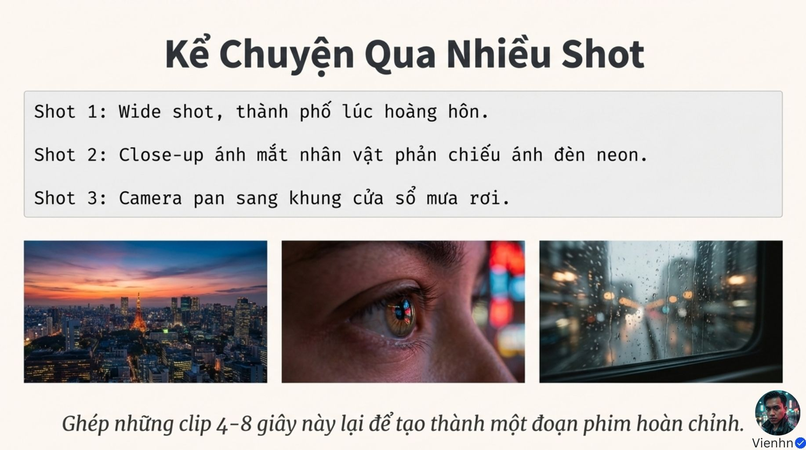

**Nội dung chính đọc được:** Nguồn đưa toàn thành phố, cận mắt phản chiếu đèn và lia tới cửa sổ mưa; cuối trang nói ghép các clip 4–8 giây.

**Hình minh họa:** Ba ảnh riêng.

**Phân tích bổ sung:** Nguồn có hai cách hiểu: một yêu cầu nhiều cảnh hoặc tạo clip riêng rồi dựng. Cần chọn rõ, không trộn cả hai.

## B025-10 — Kết hợp ba nhóm — tệp 011

Tên gốc: `011.jpg`.

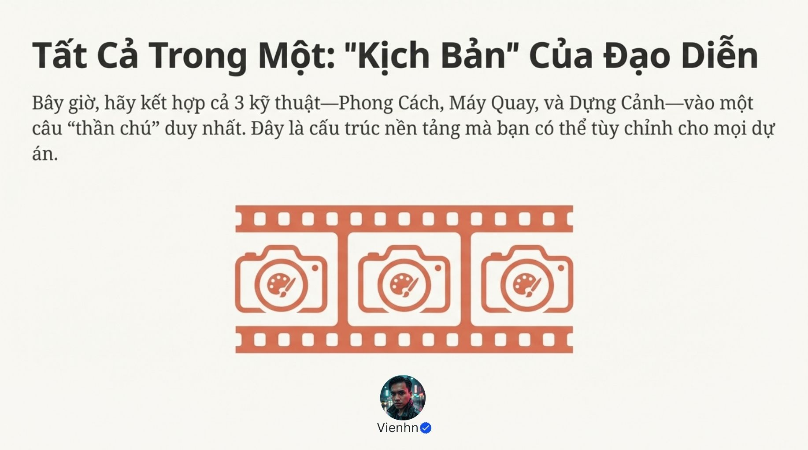

**Nội dung chính đọc được:** Nguồn gom phong cách, máy và dựng thành khung tùy chỉnh.

**Hình minh họa:** Ba máy có bảng màu nằm trong dải phim.

**Phân tích bổ sung:** Khung tổ chức không thay thế chủ thể/hành động cụ thể.

## B025-11 — Kết hợp ba nhóm — tệp 012

Tên gốc: `012.jpg`.

**Nội dung chính đọc được:** Nội dung trùng hoàn toàn tệp 011.

**Hình minh họa:** Cùng trang chữ và biểu tượng.

**Phân tích bổ sung:** Mã SHA256 xác nhận trùng tệp; vẫn lưu để khớp kiểm kê, không đếm là kiến thức mới.

## B025-12 — Mẫu khung

Tên gốc: `013.jpg`.

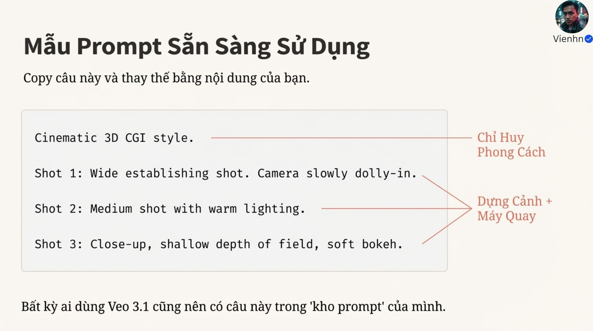

**Nội dung chính đọc được:** Nguồn đưa phong cách 3D, toàn cảnh tiến máy, trung cảnh ánh sáng ấm và cận độ sâu nét mỏng.

**Hình minh họa:** Câu lệnh ba cảnh với đường chú giải.

**Phân tích bổ sung:** Đây là khung còn trống nội dung/hành động; nếu dùng nguyên sẽ để mô hình tự quyết nhiều phần.

## B025-13 — Kết quả kỳ vọng

Tên gốc: `014.jpg`.

**Nội dung chính đọc được:** Nguồn mong kiểm soát, nhất quán và ít méo hình hơn.

**Hình minh họa:** Ba biểu tượng điều chỉnh, mắt xích và khiên.

**Phân tích bổ sung:** Các lợi ích là mục tiêu, chưa có video hay số liệu kiểm chứng.

## B025-14 — Lời kết

Tên gốc: `015.jpg`.

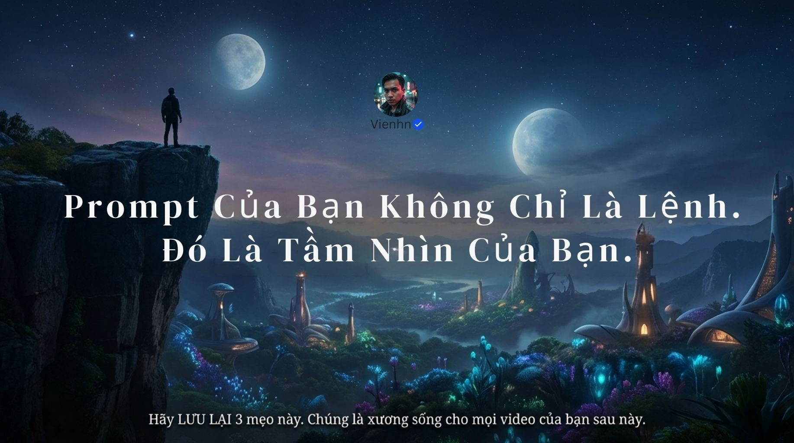

**Nội dung chính đọc được:** Nguồn nhấn mạnh tầm nhìn hình ảnh và lưu ba mẹo.

**Hình minh họa:** Cảnh giả tưởng hai thiên thể và người trên vách.

**Phân tích bổ sung:** Không dùng cảnh giả tưởng làm bằng chứng vật lý của video.

## Kiểm kê

Đã mở trực tiếp 15/15 ảnh. Các mã nguồn theo thứ tự ở trên khớp [danh mục tệp](nguon.json). Chưa sinh hoặc đánh giá video từ câu lệnh của bài này.
