# B026 — Bản đọc toàn bộ 11 ảnh

Nguồn: [Năm Trụ Cột Vàng- Công Thức Prompt Đạo Diễn Hoàn Hảo Cho Video Veo 3.1](https://drive.google.com/drive/folders/1LsNiDrXGR5yyYjSNf-3u_P3DCcSyk5t5).

**Cách ghi:** nội dung chính được diễn đạt lại từ chữ và hình trong ảnh; không phải bản chép nguyên văn toàn bộ. Quan sát ảnh tĩnh được tách khỏi lời giải thích bổ sung. Ảnh gốc được giữ nguyên để đối chiếu.

[Bài chính](README.md) · [Thực hành](thuc-hanh.md) · [Dữ liệu nguồn](nguon.json)

## B026-00 — Bìa

Tên gốc: `Năm Trụ Cột Vàng- Công Thức Prompt Đạo Diễn Hoàn Hảo Cho Video Veo 3.1.jpg`.

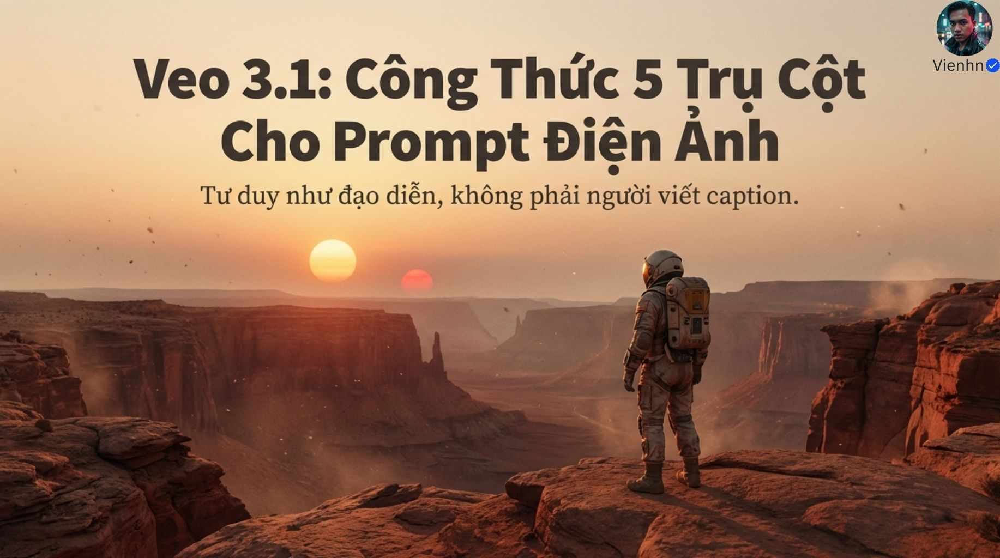

**Nội dung chính đọc được:** Nguồn giới thiệu công thức năm trụ cột để tư duy như đạo diễn.

**Hình minh họa:** Phi hành gia trên vách đá, hai mặt trời.

**Phân tích bổ sung:** Bối cảnh giả tưởng là ý đồ tạo hình, không chứng minh tính chân thực vật lý.

## B026-01 — Yêu cầu quá chung

Tên gốc: `01.jpg`.

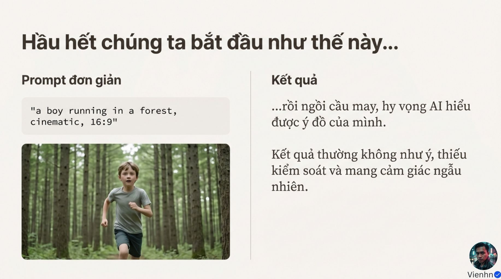

**Nội dung chính đọc được:** Ví dụ cậu bé chạy trong rừng kèm cinematic và 16:9 vẫn để nhiều lựa chọn cho mô hình.

**Hình minh họa:** Cậu bé chạy trên đường rừng.

**Phân tích bổ sung:** Yêu cầu ngắn có thể đủ nếu ảnh đã cung cấp bối cảnh; vấn đề là thiếu thông tin cần thiết, không chỉ số từ.

## B026-02 — Khung năm phần

Tên gốc: `02.jpg`.

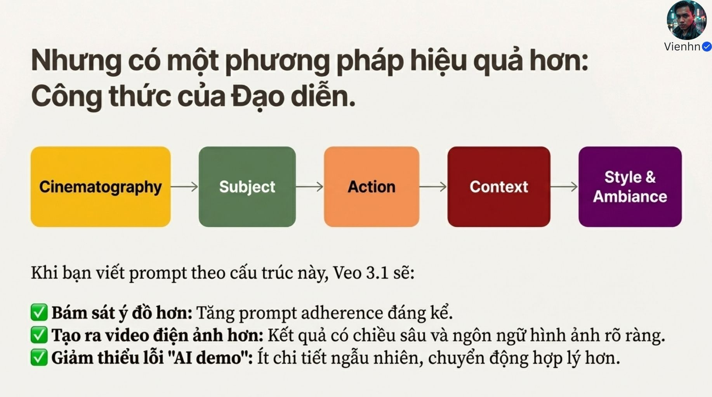

**Nội dung chính đọc được:** Nguồn xếp máy quay → chủ thể → hành động → bối cảnh → phong cách/không khí, kỳ vọng bám ý đồ và ít lỗi.

**Hình minh họa:** Năm ô màu nối tiếp.

**Phân tích bổ sung:** Đây là cấu trúc biên soạn; không có dữ liệu cho thấy riêng thứ tự này luôn tốt nhất.

## B026-03 — Ngôn ngữ máy quay

Tên gốc: `03.jpg`.

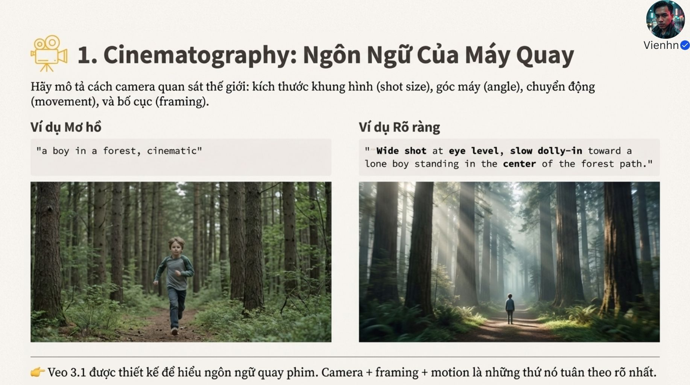

**Nội dung chính đọc được:** Nguồn yêu cầu cỡ cảnh, góc, chuyển động và bố cục; ví dụ toàn cảnh ngang mắt, tiến chậm tới cậu bé trên đường.

**Hình minh họa:** Hai ảnh rừng khác cỡ, ánh sáng và bố cục.

**Phân tích bổ sung:** Shot size là cỡ cảnh, không là độ phân giải tệp. Ảnh không chứng minh chuyển động.

## B026-04 — Chủ thể

Tên gốc: `04.jpg`.

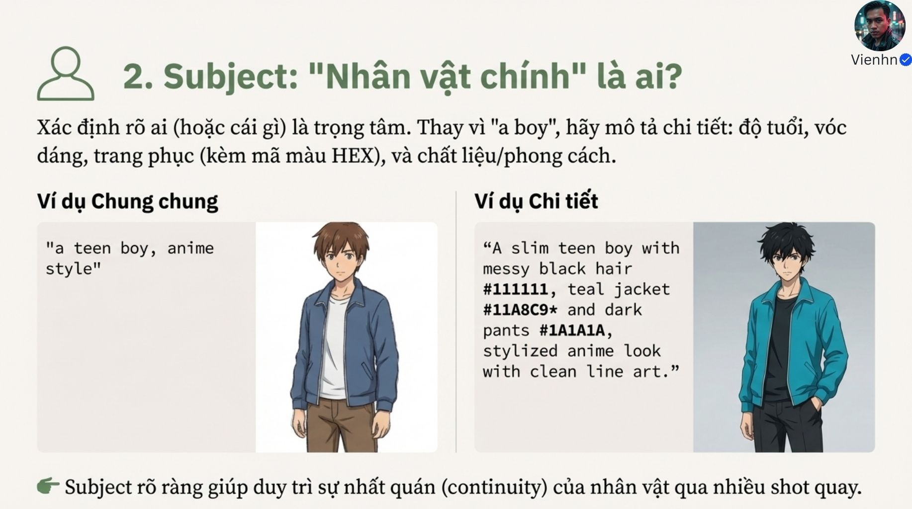

**Nội dung chính đọc được:** Nguồn cụ thể tuổi, vóc dáng, tóc, trang phục, màu HEX và kiểu tạo hình.

**Hình minh họa:** Hai nhân vật anime, bảng mô tả áo xanh.

**Phân tích bổ sung:** Mã HEX hỗ trợ định hướng màu nhưng không khóa chính xác; dấu sao trong ví dụ là lỗi trình bày.

## B026-05 — Hành động có mục tiêu

Tên gốc: `05.jpg`.

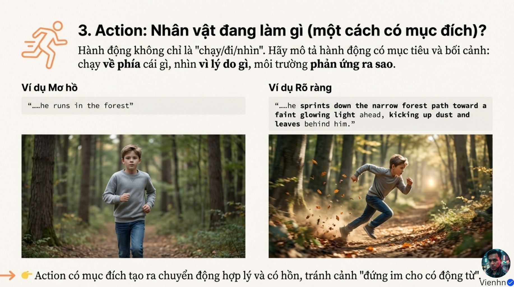

**Nội dung chính đọc được:** Nguồn bổ sung hướng đến ánh sáng và phản ứng lá bụi khi chạy.

**Hình minh họa:** Cậu bé đứng/chạy và lá bay.

**Phân tích bổ sung:** Nêu điều thấy được thay vì chỉ động cơ nội tâm; lá bụi phải hợp nền và lực.

## B026-06 — Bối cảnh

Tên gốc: `06.jpg`.

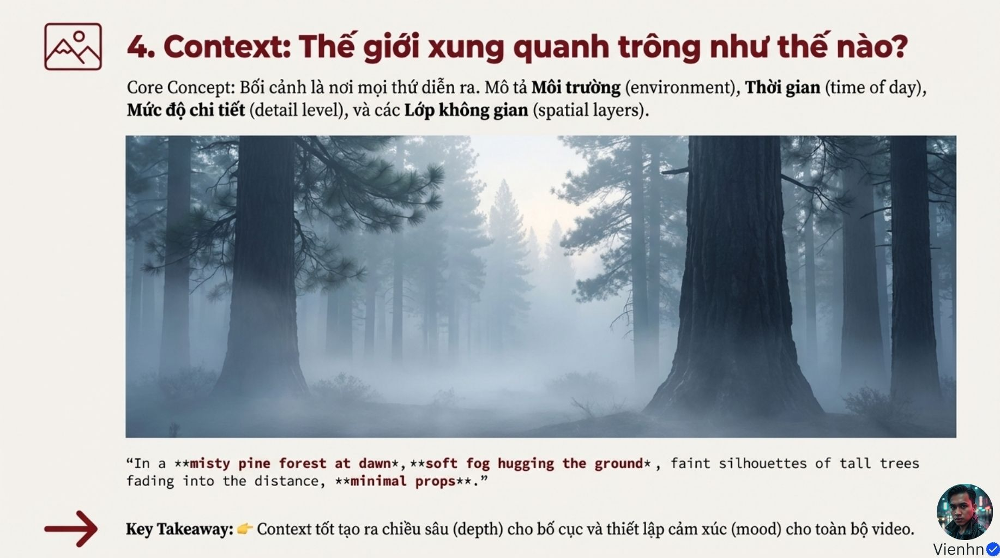

**Nội dung chính đọc được:** Nguồn nêu địa điểm, thời điểm, mức chi tiết và lớp không gian; ví dụ rừng thông lúc bình minh có sương.

**Hình minh họa:** Rừng mờ dần theo chiều sâu.

**Phân tích bổ sung:** Tối giản đạo cụ là tùy chọn, không xóa vật cần cho hành động.

## B026-07 — Phong cách và không khí

Tên gốc: `07.jpg`.

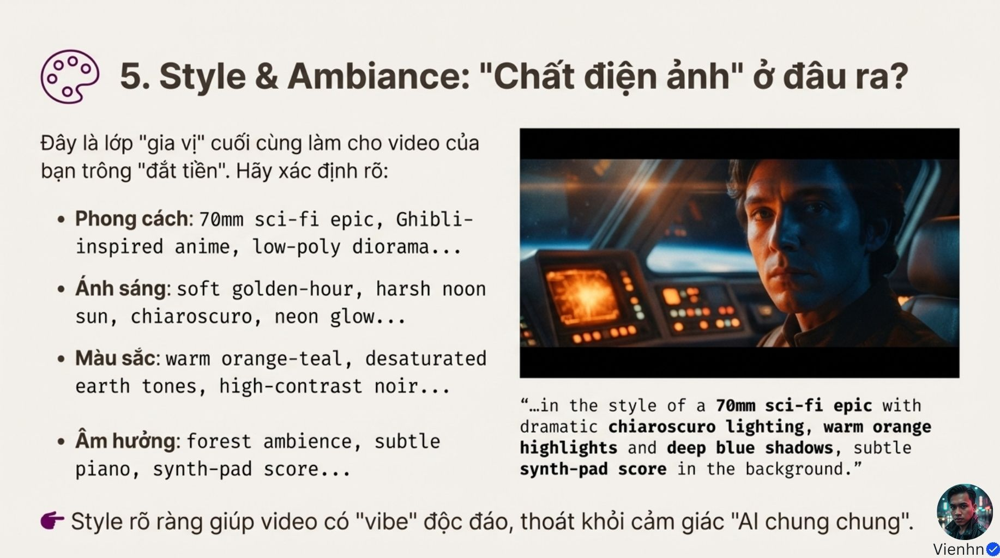

**Nội dung chính đọc được:** Nguồn gom kiểu tạo hình, ánh sáng, màu và âm thanh; ví dụ khoa học viễn tưởng, sáng tối, cam–xanh và nhạc nền.

**Hình minh họa:** Nhân vật trong khoang tàu, ánh cam và xanh.

**Phân tích bổ sung:** Các nhóm có thể giao nhau; ánh sáng bối cảnh và phong cách cần thống nhất. Không cần mọi cảnh đều có nhạc.

## B026-08 — Ví dụ ghép năm phần

Tên gốc: `08.jpg`.

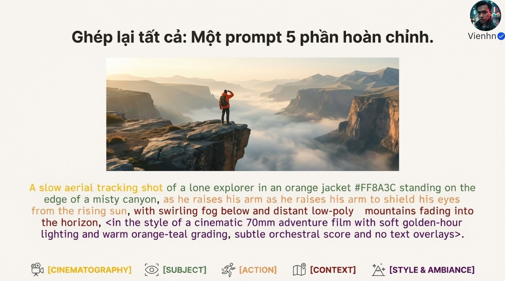

**Nội dung chính đọc được:** Nguồn mô tả người áo cam ở hẻm núi, giơ tay che nắng, sương và núi cách điệu, máy trên cao bám chậm.

**Hình minh họa:** Ảnh hẻm núi và câu lệnh tô màu theo phần.

**Phân tích bổ sung:** Cụm giơ tay bị lặp; tracking chưa nêu đường đi cụ thể. Dấu ngoặc góc chỉ là trình bày, không tham số mô hình.

## B026-09 — Bảng kiểm

Tên gốc: `09.jpg`.

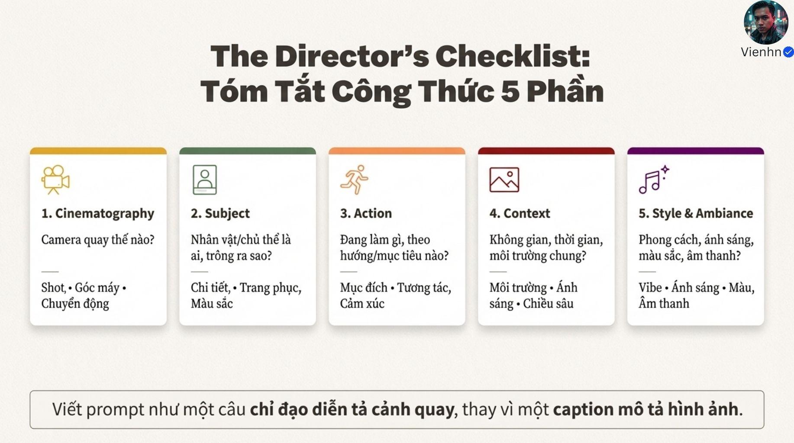

**Nội dung chính đọc được:** Nguồn tóm tắt năm câu hỏi về máy, ai, làm gì, ở đâu và phong cách.

**Hình minh họa:** Năm thẻ màu.

**Phân tích bổ sung:** Bổ sung tiêu chí đạt cho thao tác và nguồn ảnh; không điền phần không cần chỉ để đủ công thức.

## B026-10 — Kết

Tên gốc: `010.jpg`.

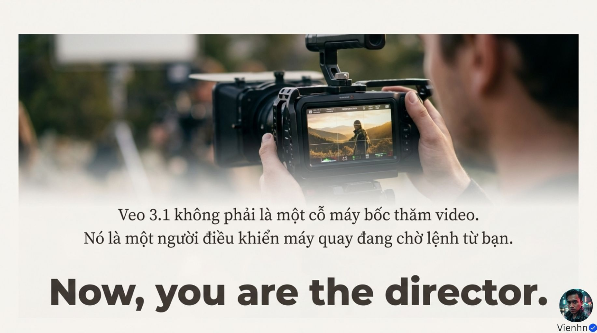

**Nội dung chính đọc được:** Nguồn ví mô hình như người điều khiển máy chờ lệnh.

**Hình minh họa:** Người quay nhìn màn hình.

**Phân tích bổ sung:** Là ẩn dụ; đầu ra vẫn có sai lệch, cần kiểm tra và thử lại.

## Kiểm kê

Đã mở trực tiếp 11/11 ảnh. Các mã nguồn theo thứ tự ở trên khớp [danh mục tệp](nguon.json). Chưa sinh hoặc đánh giá video từ câu lệnh của bài này.
