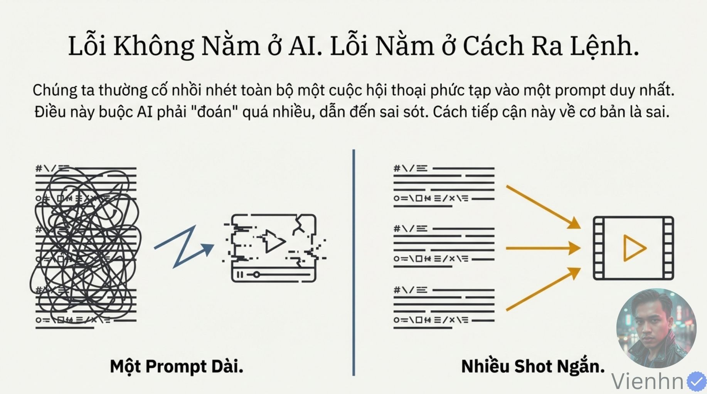
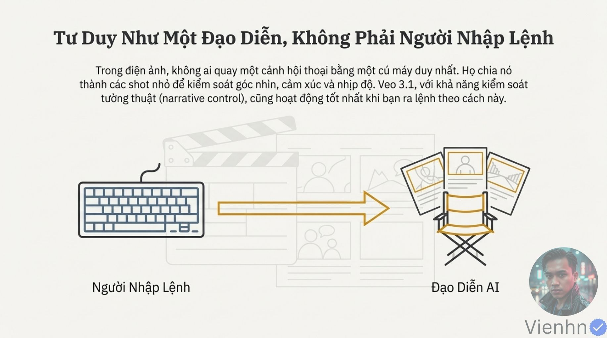
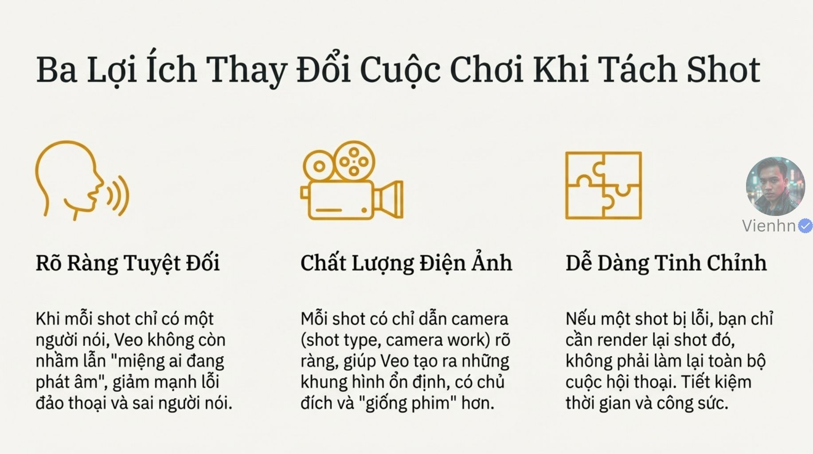
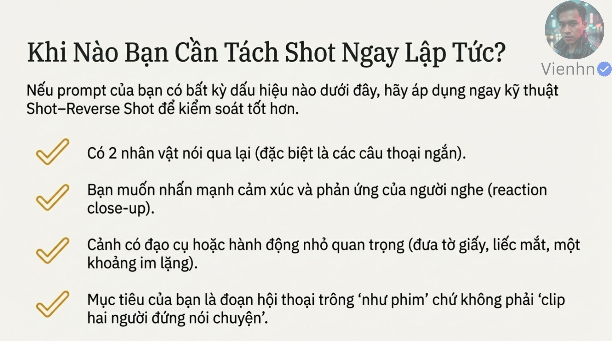
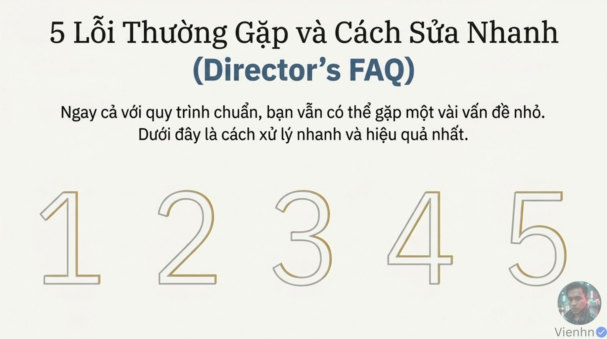
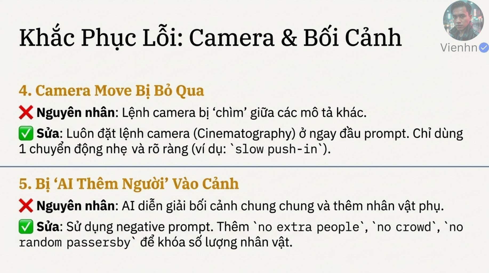

# B027 — Bản đọc toàn bộ 15 ảnh

Nguồn: [Tại sao video AI của bạn bị lỗi lip-sync? Cách khắc phục triệt để bằng phương pháp tách shot đơn giản](https://drive.google.com/drive/folders/1_cyMghOhl8O241qxJWE9pdcpu7x_NGBP).

**Cách ghi:** nội dung chính được diễn đạt lại từ chữ và hình trong ảnh; không phải bản chép nguyên văn toàn bộ. Quan sát ảnh tĩnh được tách khỏi lời giải thích bổ sung. Ảnh gốc được giữ nguyên để đối chiếu.

[Bài chính](README.md) · [Thực hành](thuc-hanh.md) · [Dữ liệu nguồn](nguon.json)

## B027-00 — Nhận diện lỗi

Tên gốc: `Tại sao video AI của bạn bị lỗi lip-sync? Cách khắc phục triệt để bằng phương pháp tách shot đơn giản.jpg`.

**Nội dung chính đọc được:** Nguồn nêu nhầm người nói, khớp môi/cảm xúc sai, máy tĩnh và nhịp thoại rối.

**Hình minh họa:** Bốn khung hội thoại.

**Phân tích bổ sung:** Máy tĩnh tự nó không là lỗi; ảnh không chứng minh âm thanh hay thời điểm môi.

## B027-01 — Giảm yêu cầu trong một lần tạo

Tên gốc: `01.jpg`.

**Nội dung chính đọc được:** Nguồn cho rằng nhồi toàn hội thoại vào một yêu cầu làm tăng nhầm lẫn và quy lỗi cho cách ra lệnh.

**Hình minh họa:** Khối chữ rối đối chiếu ba đoạn ngắn.

**Phân tích bổ sung:** Giảm tải là chiến lược hợp lý để thử; không loại trừ giới hạn mô hình dù yêu cầu rõ.

## B027-02 — Tư duy đạo diễn

Tên gốc: `02.jpg`.

**Nội dung chính đọc được:** Nguồn khuyên chia cảnh để kiểm soát góc, cảm xúc và nhịp; nói không ai quay hội thoại bằng một cú máy.

**Hình minh họa:** Bàn phím chuyển thành ghế đạo diễn.

**Phân tích bổ sung:** Câu tuyệt đối không đúng: hội thoại vẫn có thể quay một cảnh dài hoặc hai người chung khung.

## B027-03 — Quay–đảo góc

Tên gốc: `03.jpg`.

**Nội dung chính đọc được:** Nguồn tập trung A khi A nói rồi đổi sang B khi B nói.

**Hình minh họa:** Hai sơ đồ qua vai với vai người nghe tiền cảnh.

**Phân tích bổ sung:** Góc đảo không phải lật ảnh gương; phải giữ quan hệ trái–phải và hướng nhìn.

## B027-04 — Ba lợi ích

Tên gốc: `04.jpg`.

**Nội dung chính đọc được:** Nguồn kỳ vọng rõ người nói, chỉ đạo máy rõ và chỉ tạo lại đoạn sai.

**Hình minh họa:** Ba biểu tượng giọng, máy, mảnh ghép.

**Phân tích bổ sung:** Lợi ích tiết kiệm cần xét số lần thử và chi phí; không có số liệu bảo đảm.

## B027-05 — Khi nên tách

Tên gốc: `05.jpg`.

**Nội dung chính đọc được:** Nguồn gợi ý khi hai người đáp ngắn, cần phản ứng, đạo cụ hoặc khoảng im.

**Hình minh họa:** Bốn mục gạch kiểm.

**Phân tích bổ sung:** Có thể chọn tách theo nhu cầu; không bắt buộc mọi cuộc đối thoại đều phải dùng cách này.

## B027-06 — Sáu bước

Tên gốc: `06.jpg`.

**Nội dung chính đọc được:** Khóa địa điểm, nhân vật, tách A/B, giới hạn hành động, xác định người nói và ráp lại.

**Hình minh họa:** Sáu ô nối.

**Phân tích bổ sung:** Khóa là cách mô tả và dùng tham chiếu, không cơ chế bảo đảm kỹ thuật.

## B027-07 — Nền tảng liên tục

Tên gốc: `07.jpg`.

**Nội dung chính đọc được:** Nguồn yêu cầu cùng ánh sáng/thời điểm, lặp nhận dạng và chuẩn bị hai góc qua vai.

**Hình minh họa:** Ba đoạn hướng dẫn.

**Phân tích bổ sung:** Ảnh bối cảnh và từng góc đã duyệt giúp đối chiếu; không chép mô tả dài bất kể đầu vào.

## B027-08 — Một người nói

Tên gốc: `08.jpg`.

**Nội dung chính đọc được:** Nguồn giới hạn một hành động chính, A nói/B im, rồi ghép bằng công cụ dựng.

**Hình minh họa:** Ba bước điều khiển và ráp.

**Phân tích bổ sung:** Người nghe có thể thở, chớp, nuốt tự nhiên; im không đồng nghĩa mặt bất động.

## B027-09 — Mẫu A

Tên gốc: `09.jpg`.

**Nội dung chính đọc được:** Nguồn đặt máy qua vai B nhìn A, trung cận, tĩnh hoặc tiến nhẹ; chỉ A nói, B phản ứng.

**Hình minh họa:** Mẫu chia máy, chủ thể, hành động, cảnh, phong cách, âm thanh và loại trừ.

**Phân tích bổ sung:** Khi sử dụng phải chọn tĩnh hoặc tiến, điền lời thật và mô tả riêng. Không để lựa chọn 'hoặc' mơ hồ.

## B027-10 — Mẫu B

Tên gốc: `10.jpg`.

**Nội dung chính đọc được:** Nguồn đảo vai người nói, chủ thể nhìn và âm thanh, giữ thế giới hình ảnh.

**Hình minh họa:** Mẫu gạch tên A/B để thay.

**Phân tích bổ sung:** Phải sửa cả vị trí máy và hướng nhìn, không chỉ đổi nhãn âm thanh.

## B027-11 — Giới thiệu năm lỗi

Tên gốc: `011.jpg`.

**Nội dung chính đọc được:** Nguồn mở phần hỏi đáp năm lỗi thường gặp.

**Hình minh họa:** Năm chữ số lớn.

**Phân tích bổ sung:** Trang này không chứa cách sửa cụ thể; chi tiết ở hai ảnh sau.

## B027-12 — Thoại, môi và sáng

Tên gốc: `012.jpg`.

**Nội dung chính đọc được:** Nguồn gợi ý một người nói, rút câu, nói vừa phải, giữ nguồn sáng và màu.

**Hình minh họa:** Ba cặp nguyên nhân–sửa.

**Phân tích bổ sung:** Đây là các giả thuyết sửa cần thử; sai môi còn có thể tồn tại sau khi rút ngắn.

## B027-13 — Máy và người phát sinh

Tên gốc: `013.jpg`.

**Nội dung chính đọc được:** Nguồn gợi ý máy ở đầu câu lệnh, một chuyển động nhẹ, loại người lạ.

**Hình minh họa:** Hai nhóm lỗi.

**Phân tích bổ sung:** Đặt đầu là mẹo tổ chức, không bảo đảm tuân thủ; số người cần kiểm tra toàn clip.

## B027-14 — Kết

Tên gốc: `014.jpg`.

**Nội dung chính đọc được:** Nguồn nhấn mạnh tách lượt bằng quay–đảo góc để bám ý đồ.

**Hình minh họa:** Người dựng trước hai góc hội thoại.

**Phân tích bổ sung:** Tóm tắt phương pháp, không là luật duy nhất của điện ảnh.

## Kiểm kê

Đã mở trực tiếp 15/15 ảnh. Các mã nguồn theo thứ tự ở trên khớp [danh mục tệp](nguon.json). Chưa sinh hoặc đánh giá video từ câu lệnh của bài này.
