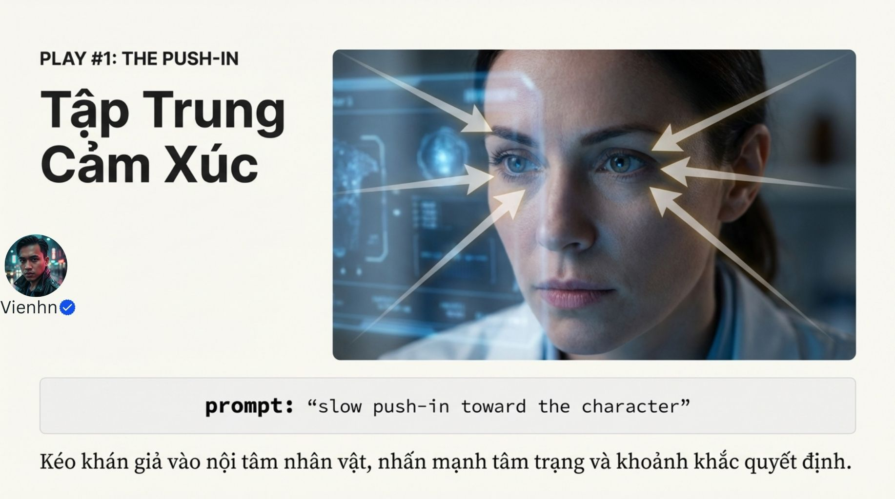
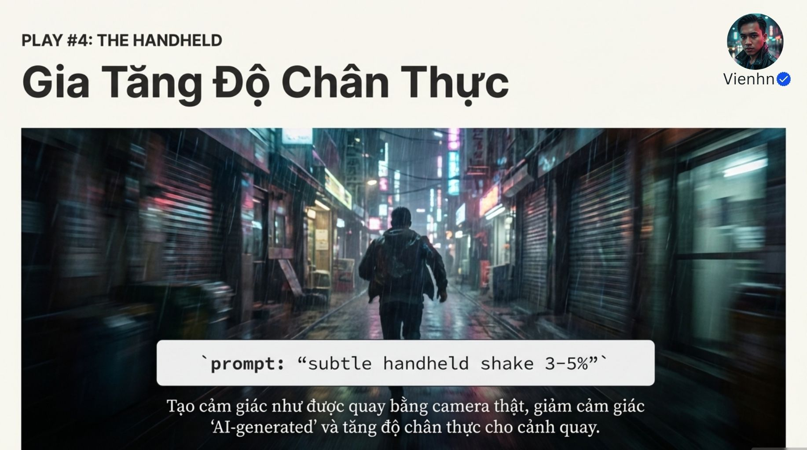

# Bài 028 — Tiến máy chậm và bốn cách điều hướng sự chú ý

Tên thư mục nhấn mạnh slow push-in (tiến máy chậm), nhưng 13 ảnh thực tế dạy bốn cấu trúc: tiến gần, đi vòng, mở không gian và máy cầm tay. Chọn chuyển động theo thông tin và cảm xúc của cảnh; không gắn mức tăng cảm xúc hay tính chân thực vào một từ khóa.

**Nguồn:** [TĂNG CẢM XÚC LÊN 1000%- Bí kíp “slow push-in” (TIẾN GẦN) mà các cảnh độc thoại Hollywood luôn dùng!](https://drive.google.com/drive/folders/1hcYzx35MKqf4GhdkMKPKCm8voBNOHq4w). Đã đọc **13/13 ảnh**. Ngày biên soạn: 18/10/2026.

[Đọc từng ảnh](doc-anh.md) · [Bài thực hành](thuc-hanh.md) · [Nguồn và mã kiểm tra](nguon.json) · [Danh mục toàn bộ](../../DANH-MUC-BAI-HOC.md)

**Quy ước:** phần “Nguồn” diễn đạt ý trong bộ ảnh. Phần “Phân tích và áp dụng” do người biên soạn bổ sung. Hiệu quả của câu lệnh chưa được kiểm nghiệm bằng lần tạo video trong đợt này.

## Những điều cần học

| Nội dung | Mã ảnh nguồn |
| --- | --- |
| Tiến máy đúng lúc, có cỡ bắt đầu và kết thúc | B028-00, B028-01, B028-02, B028-03, B028-04 |
| Đi vòng để hé lộ quan hệ không gian | B028-05, B028-06 |
| Mở cảnh bằng thông tin mới | B028-07, B028-08 |
| Cầm tay là lựa chọn nhìn, không chứng nhận sự thật | B028-09, B028-10 |
| Chọn một cấu trúc theo nhiệm vụ | B028-11, B028-12 |

## 1. Tiến máy đúng lúc, có cỡ bắt đầu và kết thúc

**Nguồn:** Nguồn xem tiến chậm là cách đưa sự chú ý vào trạng thái nhân vật.

**Phân tích và áp dụng:** Xác định sự thay đổi cảm xúc có nguyên nhân trước. Nêu máy bắt đầu trung cảnh, tiến chậm tới trung cận, giữ mắt trong khung và dừng trước khi quá sát. Chuyển động máy chậm không yêu cầu nhân vật chuyển động chậm. So với máy tĩnh để chọn theo tác dụng thực.

**Ví dụ cho cảnh nông thôn:** Cô gái nghe lời khen ngoài khung, nhìn xuống giỏ rồi mỉm cười kín đáo; máy tiến nhẹ để nhấn khoảnh khắc nhận ra, không tự thêm nước mắt.

**Kiểm tra kết quả:** Cỡ hình thay đổi mượt; mặt không trôi danh tính; nhịp phản ứng vẫn tự nhiên.

## 2. Đi vòng để hé lộ quan hệ không gian

**Nguồn:** Nguồn gợi ý một vòng cung nhỏ quanh chủ thể.

**Phân tích và áp dụng:** Nêu phía di chuyển, quãng cung, cỡ cảnh và điểm nhìn. Giữ nhân vật ở vị trí thật, tránh để nhân vật xoay thay máy. Với mặt và trang phục cần nhất quán, duyệt các góc lộ thêm; một ảnh đơn không cho mọi chi tiết phía sau.

**Ví dụ cho cảnh nông thôn:** Máy đi vòng nhỏ từ chính diện sang bên phải cô gái đang đứng cạnh giỏ, để lộ sân phía sau. Không yêu cầu vừa đi vòng vừa cận tay đan nhanh.

**Kiểm tra kết quả:** Vật mốc thay góc theo máy; cô không bị xoay tại chỗ để giả quỹ đạo.

## 3. Mở cảnh bằng thông tin mới

**Nguồn:** Nguồn dùng máy lùi để chuyển từ chi tiết sang môi trường.

**Phân tích và áp dụng:** Nêu vật đã thấy và vùng cần lộ thêm. Chuyển động phải giúp hiểu cảnh, không chỉ rộng hơn. Nếu làm từ ảnh, chuẩn bị nguồn đủ bối cảnh hoặc chấp nhận phần ngoài ảnh cần tạo mới và phải duyệt.

**Ví dụ cho cảnh nông thôn:** Bắt đầu gần chiếc giỏ trên bàn, máy lùi chậm để thấy cô gái ngồi dưới hiên cùng bó tre. Sân và vật liệu phải cùng thế giới đã duyệt.

**Kiểm tra kết quả:** Giỏ không biến hình; phần vừa lộ có vị trí hợp lý; máy lùi khác zoom thuần.

## 4. Cầm tay là lựa chọn nhìn, không chứng nhận sự thật

**Nguồn:** Nguồn dùng dao động nhẹ cho cảm giác người quay hiện diện.

**Phân tích và áp dụng:** Mô tả dao động nhỏ và giữ vật cần nhìn ổn định tương đối; tránh phần trăm không có định nghĩa. Với cảnh thao tác phục vụ học và cảnh thư giãn, có thể chọn máy tĩnh. Phong cách tài liệu không biến cảnh tổng hợp thành bằng chứng sự kiện thật.

**Ví dụ cho cảnh nông thôn:** Cảnh đi theo người mang giỏ có thể dao động nhẹ theo bước. Cảnh cận lưỡi dao vót tre giữ máy ổn định để thấy điểm tiếp xúc.

**Kiểm tra kết quả:** Dao động có tiết chế, không che tay hoặc gây nhòe; không dùng rung để lấp lỗi vật lý.

## 5. Chọn một cấu trúc theo nhiệm vụ

**Nguồn:** Nguồn tổng hợp bốn cách và khuyên kết hợp.

**Phân tích và áp dụng:** Hỏi cần tập trung cảm xúc, đổi quan hệ góc, lộ bối cảnh hay tạo cảm giác hiện diện. Chọn một cách trước, chỉ thêm cách thứ hai nếu có lý do và hỗ trợ thực tế. Không gắn chất lượng vào số chuyển động.

**Ví dụ cho cảnh nông thôn:** Toàn sân mở không gian; cận tay máy tĩnh; phản ứng nhẹ tiến gần. Không dùng cùng vòng máy cho mọi cảnh.

**Kiểm tra kết quả:** Mỗi cách có nhiệm vụ rõ; cảnh không mất nội dung vì chuyển động phức tạp.

## Điểm cần hiểu có điều kiện

- Đã đọc đủ 13 ảnh; nội dung là bốn cấu trúc, không chỉ riêng slow push-in như tên thư mục.
- 90%, tăng cảm xúc 1000% và 'Hollywood luôn dùng' không có bằng chứng đo trong nguồn.
- Máy đứng yên không đồng nghĩa không cảm xúc; hình ổn định không tự động giả.
- Rung 3–5% thiếu định nghĩa; góc vòng 30 độ là yêu cầu cần kiểm tra, không bảo đảm định lượng.
- Tiến máy khác zoom; reveal là mục đích hé lộ, không một loại quỹ đạo duy nhất.
- Không bắt buộc dùng 1–2 chuyển động trong mọi cảnh. Ảnh minh họa không xác nhận chất lượng chuyển động hoặc phản ứng người xem.

## Cách đưa vào quy trình sản xuất

Chốt thông tin/cảm xúc cần nhấn → chọn cỡ đầu/cuối và một cấu trúc máy → duyệt ảnh đầu → tạo với hành động đơn giản → xem cả máy lẫn mặt/vật → so với bản tĩnh nếu cần → giữ cách phục vụ cảnh tốt hơn. Có thể đối chiếu thêm nhóm bài camera trong danh mục.

## Tự kiểm tra kiến thức

- Vì sao tiến máy chậm không đồng nghĩa slow motion (chuyển động chậm)?
- Khi đi vòng, cách phát hiện nhân vật đang xoay thay máy là gì?
- Mở khung cần cho thấy thông tin mới nào?

**Giới hạn:** đây là tài liệu học từ ảnh. Không dùng một hình minh họa để xác nhận chuyển động, thời lượng, độ chính xác thao tác hay khả năng hiện tại của một sản phẩm. Những phần chưa kiểm chứng được ghi rõ trong bản đọc ảnh.
