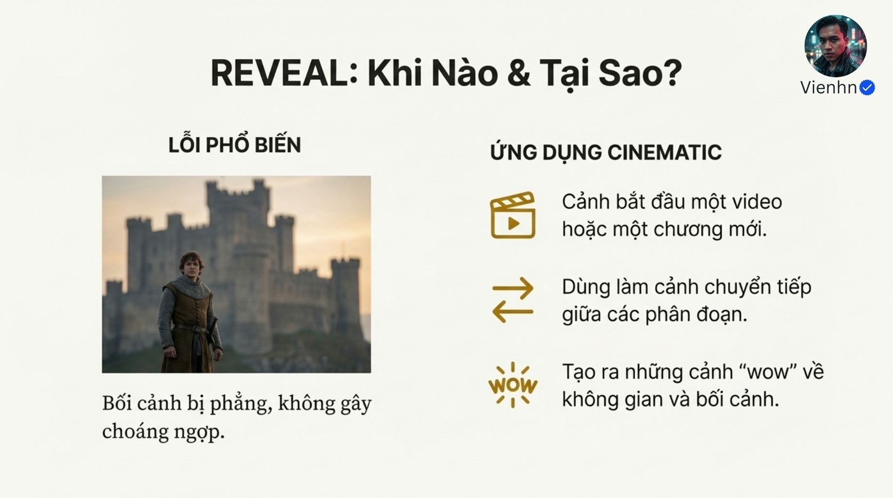

# B028 — Bản đọc toàn bộ 13 ảnh

Nguồn: [TĂNG CẢM XÚC LÊN 1000%- Bí kíp “slow push-in” (TIẾN GẦN) mà các cảnh độc thoại Hollywood luôn dùng!](https://drive.google.com/drive/folders/1hcYzx35MKqf4GhdkMKPKCm8voBNOHq4w).

**Cách ghi:** nội dung chính được diễn đạt lại từ chữ và hình trong ảnh; không phải bản chép nguyên văn toàn bộ. Quan sát ảnh tĩnh được tách khỏi lời giải thích bổ sung. Ảnh gốc được giữ nguyên để đối chiếu.

[Bài chính](README.md) · [Thực hành](thuc-hanh.md) · [Dữ liệu nguồn](nguon.json)

## B028-00 — Bìa bốn cấu trúc

Tên gốc: `TĂNG CẢM XÚC LÊN 1000%- Bí kíp “slow push-in” (TIẾN GẦN) mà các cảnh độc thoại Hollywood luôn dùng!.jpg`.

**Nội dung chính đọc được:** Nguồn ghi bốn cấu trúc máy thiết yếu.

**Hình minh họa:** Người trong không gian giả tưởng hai mặt trời.

**Phân tích bổ sung:** Phạm vi ảnh rộng hơn tên thư mục về riêng tiến máy chậm.

## B028-01 — Chẩn đoán thiếu cảm xúc

Tên gốc: `01.jpg`.

**Nội dung chính đọc được:** Nguồn đối chiếu chân dung trung tính và gương mặt khóc, gán 90% nguyên nhân cho máy không có cấu trúc.

**Hình minh họa:** Hai chân dung khác ánh sáng và biểu cảm.

**Phân tích bổ sung:** Không có dữ liệu cho 90%; khác biệt còn do diễn xuất, nội dung và ánh sáng.

## B028-02 — Ý đồ đạo diễn

Tên gốc: `02.jpg`.

**Nội dung chính đọc được:** Nguồn nhấn mạnh người tạo phải đưa ngôn ngữ quay phim.

**Hình minh họa:** Bàn tay điều khiển lưới hình.

**Phân tích bổ sung:** Mô tả máy hỗ trợ ý đồ; không bảo đảm kết quả.

## B028-03 — Tiến gần

Tên gốc: `03.jpg`.

**Nội dung chính đọc được:** Nguồn dùng máy tiến chậm tới nhân vật để tập trung tâm trạng và khoảnh khắc quyết định.

**Hình minh họa:** Các mũi tên vào mắt nhân vật.

**Phân tích bổ sung:** Máy dịch chuyển trong không gian khác phóng to ảnh; ảnh tĩnh không thể chứng minh chuyển động.

## B028-04 — Khi dùng tiến gần

Tên gốc: `04.jpg`.

**Nội dung chính đọc được:** Nguồn gợi ý suy tư, độc thoại, nhìn vật quan trọng và cao trào; coi máy đứng yên bằng không cảm xúc.

**Hình minh họa:** Chân dung trung tính và ba biểu tượng.

**Phân tích bổ sung:** Máy tĩnh vẫn có thể tạo cảm xúc mạnh; tiến máy cần động cơ và điểm kết.

## B028-05 — Đi vòng

Tên gốc: `05.jpg`.

**Nội dung chính đọc được:** Nguồn đề xuất vòng cung khoảng 30 độ quanh chủ thể để tạo chiều sâu và cảm giác anh hùng.

**Hình minh họa:** Chiến binh trên đá với vòng mũi tên.

**Phân tích bổ sung:** 30 độ là ý đồ quỹ đạo, không tham số được bảo đảm; cần nêu hướng và giữ chủ thể.

## B028-06 — Khi dùng đi vòng

Tên gốc: `06.jpg`.

**Nội dung chính đọc được:** Nguồn gợi ý môi trường rộng, hé lộ địa điểm và khoảnh khắc nổi bật.

**Hình minh họa:** Người đá chân và ba nhóm ứng dụng.

**Phân tích bổ sung:** Đi vòng có thể làm thao tác khó đọc; không dùng chỉ vì cảnh hành động.

## B028-07 — Mở không gian

Tên gốc: `07.jpg`.

**Nội dung chính đọc được:** Nguồn gợi ý máy lùi để hé lộ môi trường.

**Hình minh họa:** Hai khung từ vai người đến thung lũng giả tưởng.

**Phân tích bổ sung:** Hai ảnh khác không đủ chứng minh cùng cảnh máy lùi; cần liên tục hình học và vật mốc.

## B028-08 — Khi mở không gian

Tên gốc: `08.jpg`.

**Nội dung chính đọc được:** Nguồn dùng cho mở đầu, chuyển đoạn và giới thiệu bối cảnh rộng.

**Hình minh họa:** Người trước lâu đài và ba gợi ý.

**Phân tích bổ sung:** Reveal (hé lộ) là chức năng, có thể làm bằng nhiều cách máy khác nhau.

## B028-09 — Máy cầm tay

Tên gốc: `09.jpg`.

**Nội dung chính đọc được:** Nguồn gợi ý rung nhẹ, ghi 3–5% để giống máy thật.

**Hình minh họa:** Người chạy trong phố, vệt mờ.

**Phân tích bổ sung:** Phần trăm không có đại lượng chuẩn trong ảnh; không coi là tham số thật của mô hình.

## B028-10 — Khi dùng máy cầm tay

Tên gốc: `010.jpg`.

**Nội dung chính đọc được:** Nguồn đề xuất hành động, đối thoại căng và phong cách tài liệu; cho rằng hình sạch quá giống CGI.

**Hình minh họa:** Ảnh bếp ổn định và các ứng dụng.

**Phân tích bổ sung:** Sạch/ổn định không đồng nghĩa giả. Rung không biến nội dung AI thành footage thật.

## B028-11 — Tóm tắt

Tên gốc: `011.jpg`.

**Nội dung chính đọc được:** Nguồn gắn tiến gần với cảm xúc, đi vòng với chiều sâu, mở với không gian và cầm tay với hiện diện.

**Hình minh họa:** Bốn ô biểu tượng.

**Phân tích bổ sung:** Đây là các hướng sử dụng, không tác dụng tâm lý bắt buộc.

## B028-12 — Kết hợp

Tên gốc: `012.jpg`.

**Nội dung chính đọc được:** Nguồn khuyên thêm 1–2 cấu trúc mỗi cảnh.

**Hình minh họa:** Cảnh người và bướm phát sáng.

**Phân tích bổ sung:** Không cần ghép hai chuyển động; ưu tiên một ý rõ và kiểm tra theo cảnh.

## Kiểm kê

Đã mở trực tiếp 13/13 ảnh. Các mã nguồn theo thứ tự ở trên khớp [danh mục tệp](nguon.json). Chưa sinh hoặc đánh giá video từ câu lệnh của bài này.
