# B029 — Bản đọc toàn bộ 13 ảnh

Nguồn: [Trị Bệnh Chó Nói Thoại Của Mèo - 6 Bí Quyết Lip-Sync Hoạt Hình AI Hoàn Hảo](https://drive.google.com/drive/folders/1JJGBH0ew1DF-EjXmZR-TA_rZJ_FLsOdv).

**Cách ghi:** nội dung chính được diễn đạt lại từ chữ và hình trong ảnh; không phải bản chép nguyên văn toàn bộ. Quan sát ảnh tĩnh được tách khỏi lời giải thích bổ sung. Ảnh gốc được giữ nguyên để đối chiếu.

[Bài chính](README.md) · [Thực hành](thuc-hanh.md) · [Dữ liệu nguồn](nguon.json)

## B029-00 — Bìa sáu chiến lược

Tên gốc: `Trị Bệnh Chó Nói Thoại Của Mèo - 6 Bí Quyết Lip-Sync Hoạt Hình AI Hoàn Hảo.jpg`.

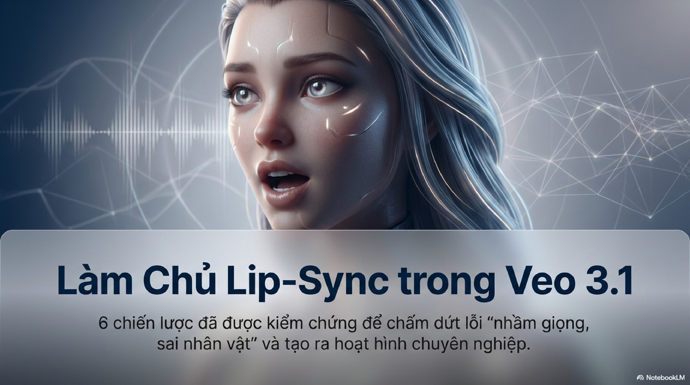

**Nội dung chính đọc được:** Nguồn tuyên bố các chiến lược đã kiểm chứng, chấm dứt nhầm giọng/nhân vật.

**Hình minh họa:** Chân dung 3D cạnh đường sóng âm, dấu NotebookLM.

**Phân tích bổ sung:** Không có bộ video, phương pháp đo hay kết quả thử kèm theo để xác nhận tuyên bố.

## B029-01 — Bốn biểu hiện lỗi

Tên gốc: `01.jpg`.

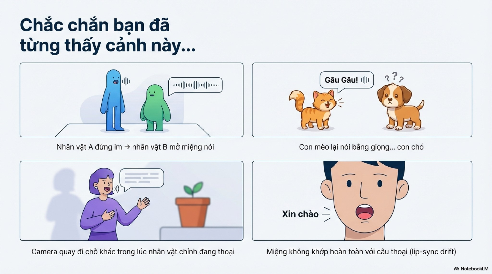

**Nội dung chính đọc được:** Nguồn nêu sai người nói, mèo phát tiếng chó, máy rời người đang nói và môi lệch.

**Hình minh họa:** Bốn sơ đồ hoạt hình.

**Phân tích bổ sung:** Tách được lỗi gán người, loại giọng/tiếng, bố cục và thời điểm môi; không gom thành một lỗi.

## B029-02 — Ảnh hưởng tới xem

Tên gốc: `02.jpg`.

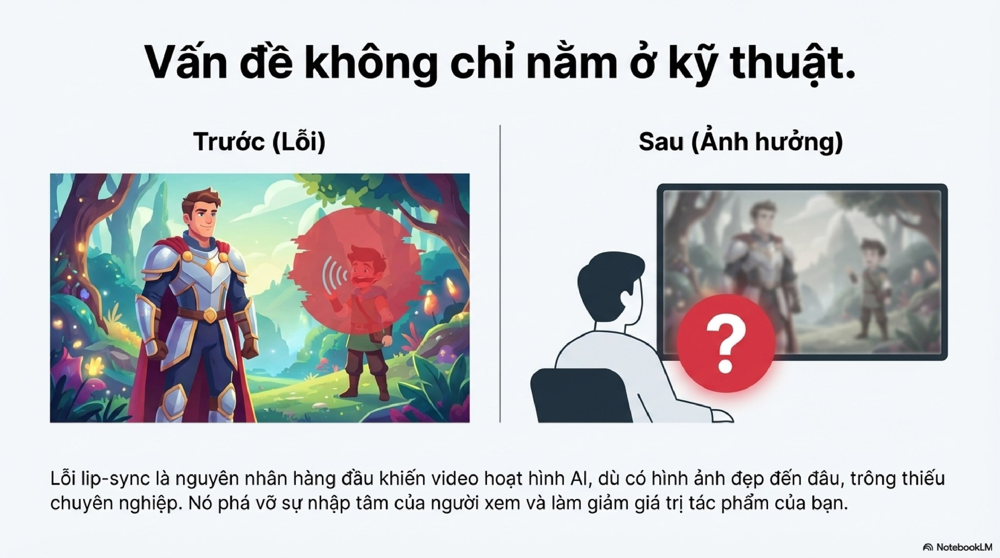

**Nội dung chính đọc được:** Nguồn cho rằng sai khớp môi làm mất nhập tâm và chuyên nghiệp.

**Hình minh họa:** Nhân vật sai vai và người xem dấu hỏi.

**Phân tích bổ sung:** Không có khảo sát để xếp hạng nguyên nhân hàng đầu; xem là lập luận của tác giả.

## B029-03 — Giải thích cơ chế

Tên gốc: `03.jpg`.

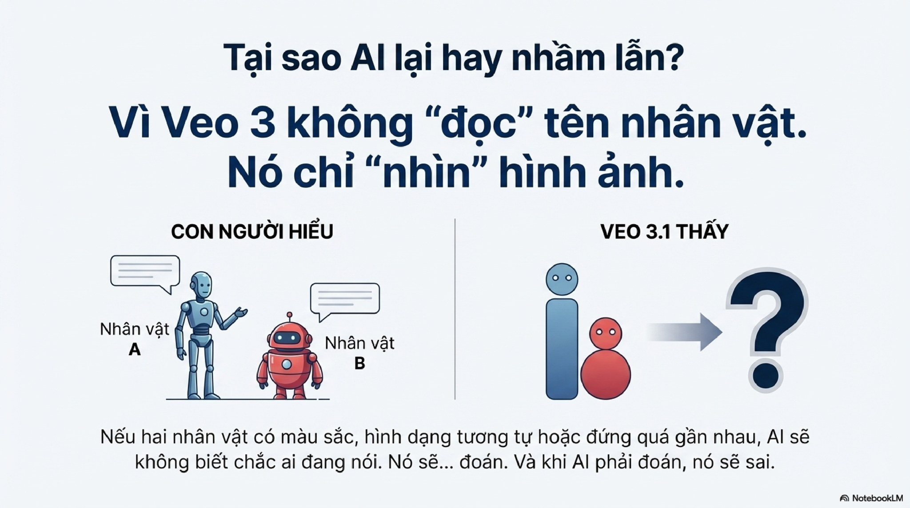

**Nội dung chính đọc được:** Nguồn nói Veo không đọc tên, chỉ nhìn ảnh và đoán khi hình gần nhau.

**Hình minh họa:** Hai robot có nhãn đối chiếu hai khối màu.

**Phân tích bổ sung:** Đây là giải thích quá đơn giản, không là mô tả kỹ thuật đã chứng minh. Mô hình nhận cả văn bản; tên vẫn cần gắn với mô tả phân biệt.

## B029-04 — Giới thiệu sáu cách

Tên gốc: `04.jpg`.

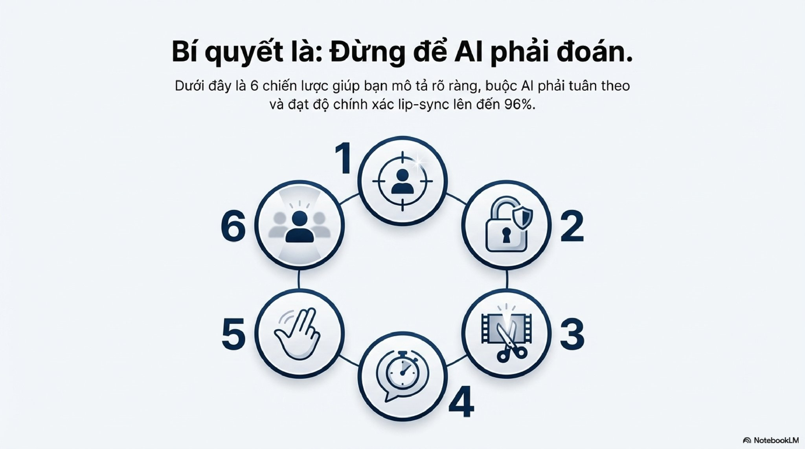

**Nội dung chính đọc được:** Nguồn nêu sáu chiến lược và mức chính xác tới 96%.

**Hình minh họa:** Vòng sáu biểu tượng.

**Phân tích bổ sung:** 96% thiếu định nghĩa đúng và bộ thử.

## B029-05 — Làm nổi người nói

Tên gốc: `05.jpg`.

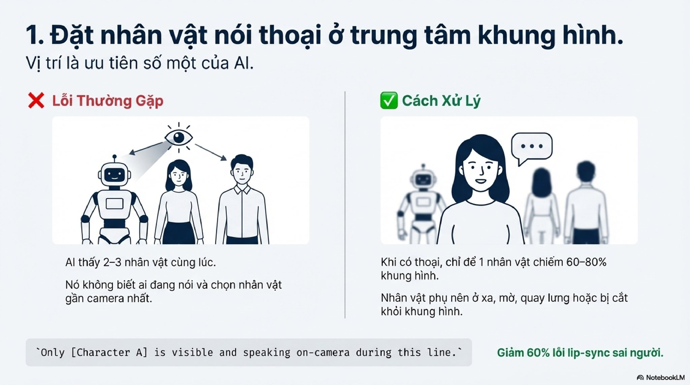

**Nội dung chính đọc được:** Nguồn đặt chủ thể ở giữa, chiếm 60–80% khung; người khác xa/mờ/quay lưng; tuyên bố giảm 60% lỗi.

**Hình minh họa:** Ba người ngang hàng đối chiếu người nói lớn tiền cảnh.

**Phân tích bổ sung:** 60–80% là gợi ý bố cục không rõ đo diện tích hay chiều cao. Không cần mọi góc chính giữa.

## B029-06 — Lip-sync lock

Tên gốc: `06.jpg`.

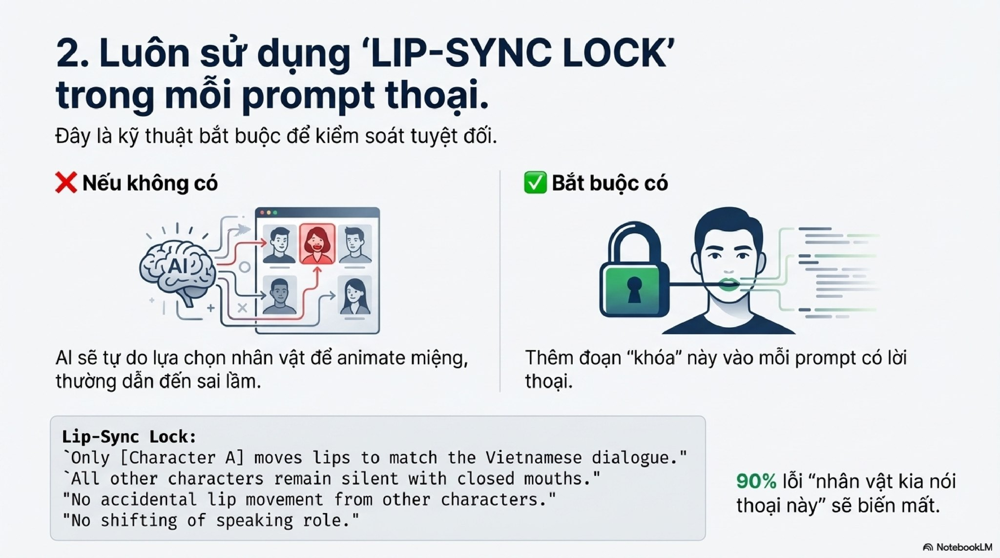

**Nội dung chính đọc được:** Nguồn yêu cầu chỉ A khớp môi, người khác im/miệng đóng; tuyên bố 90% lỗi biến mất.

**Hình minh họa:** Ổ khóa và đường nối tới miệng.

**Phân tích bổ sung:** Nhãn này là văn bản tự đặt, không tính năng khóa đã xác nhận. Miệng nghỉ tự nhiên phù hợp hơn kẹp bất động.

## B029-07 — Tách lượt

Tên gốc: `07.jpg`.

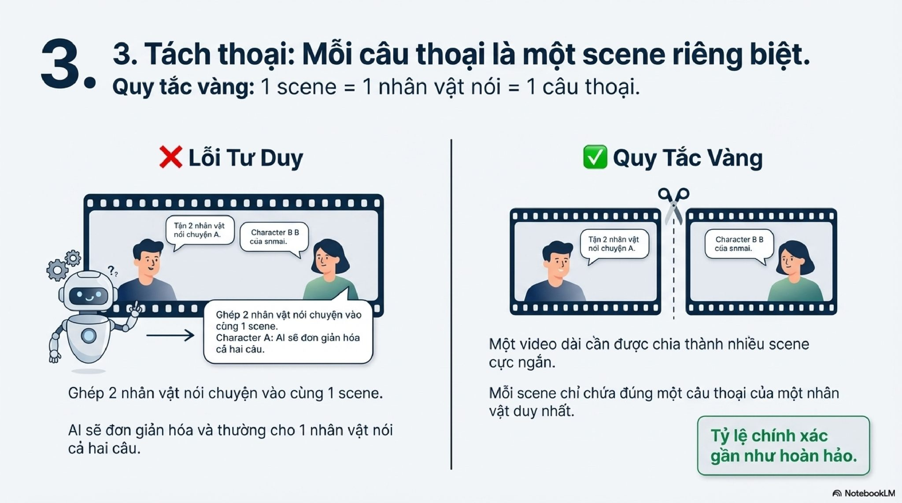

**Nội dung chính đọc được:** Nguồn gợi ý một đoạn tạo, một người nói, một câu.

**Hình minh họa:** Cuộn phim chia hai.

**Phân tích bổ sung:** Hữu ích khi thử sửa, không phải định nghĩa scene (cảnh kịch) trong điện ảnh; một cảnh có thể gồm nhiều lượt và góc.

## B029-08 — Câu ngắn

Tên gốc: `08.jpg`.

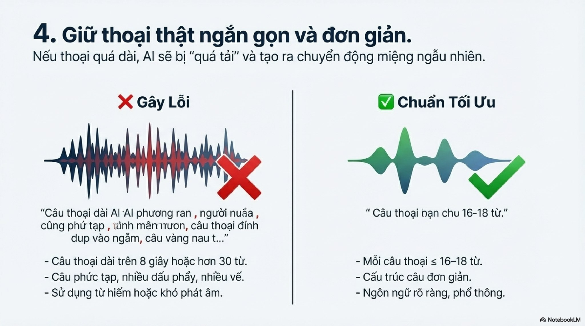

**Nội dung chính đọc được:** Nguồn đề xuất tối đa 16–18 từ, đối chiếu câu dài hơn 8 giây/30 từ; nhiều chữ ví dụ bị lỗi.

**Hình minh họa:** Hai dạng sóng và các gạch đầu dòng.

**Phân tích bổ sung:** Các ngưỡng không phổ quát; phải nghe theo ngôn ngữ, tốc độ và độ dài thực. Không sửa chữ vô nghĩa thành câu gốc giả định.

## B029-09 — Cử chỉ nhỏ

Tên gốc: `09.jpg`.

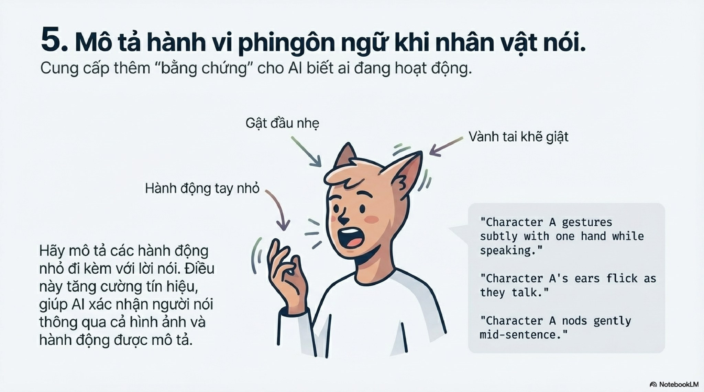

**Nội dung chính đọc được:** Nguồn thêm gật nhẹ, tay nhỏ hoặc tai động để làm rõ ai đang nói.

**Hình minh họa:** Nhân vật tai thú với mũi tên.

**Phân tích bổ sung:** Chọn một cử chỉ hợp thiết kế; không áp tai thú cho người hoặc thêm quá nhiều động tác.

## B029-10 — Giảm người cạnh tranh

Tên gốc: `010.jpg`.

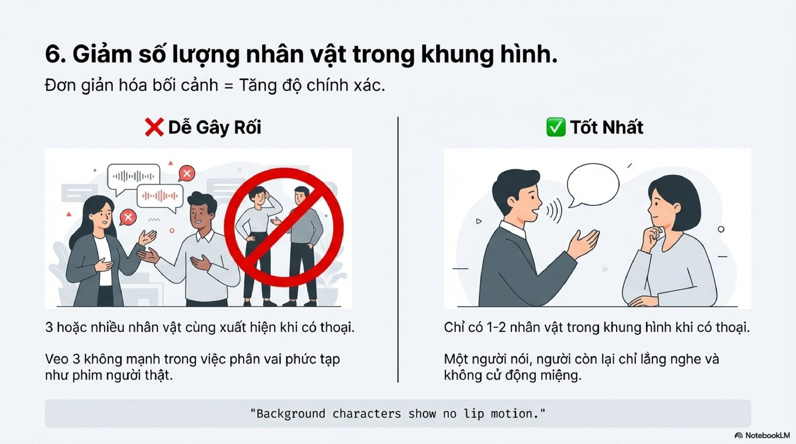

**Nội dung chính đọc được:** Nguồn gợi ý chỉ một hoặc hai nhân vật, một người nói, người kia nghe.

**Hình minh họa:** Nhóm đông bị loại đối chiếu hai người.

**Phân tích bổ sung:** Đây là cách giảm tải khi lỗi; không phải giới hạn cứng số người trong mọi chế độ.

## B029-11 — Checklist

Tên gốc: `011.jpg`.

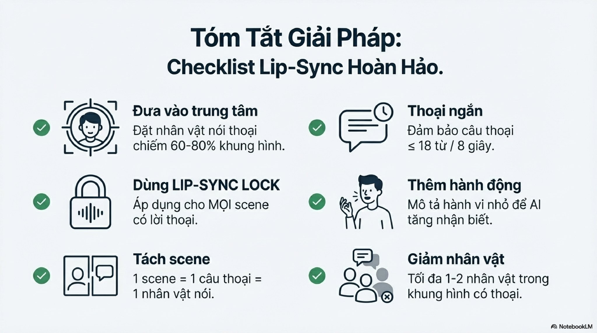

**Nội dung chính đọc được:** Nguồn gom trung tâm, nhãn khóa, tách lượt, câu ngắn, cử chỉ, giảm người.

**Hình minh họa:** Sáu biểu tượng kiểm tra.

**Phân tích bổ sung:** Chuyển thành bảng thử, không đánh dấu tất cả rồi mặc định đạt.

## B029-12 — Kết quả kỳ vọng

Tên gốc: `012.jpg`.

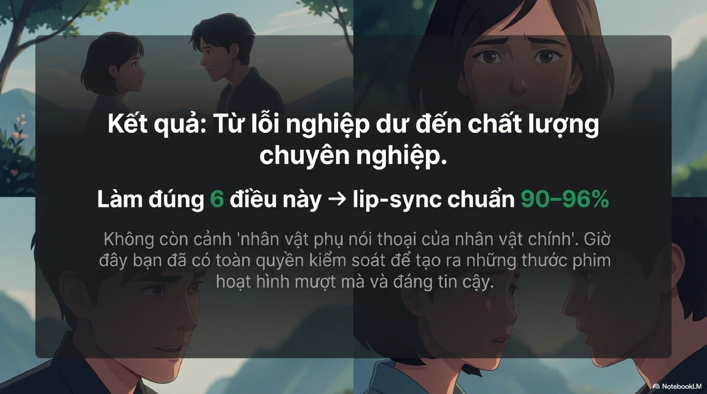

**Nội dung chính đọc được:** Nguồn tuyên bố đúng 90–96%, hết nhầm và toàn quyền kiểm soát.

**Hình minh họa:** Bốn chân dung hoạt hình với bảng chữ.

**Phân tích bổ sung:** Chỉ là cam kết của nguồn; chưa có dữ liệu thực hành để xác nhận.

## Kiểm kê

Đã mở trực tiếp 13/13 ảnh. Các mã nguồn theo thứ tự ở trên khớp [danh mục tệp](nguon.json). Chưa sinh hoặc đánh giá video từ câu lệnh của bài này.
