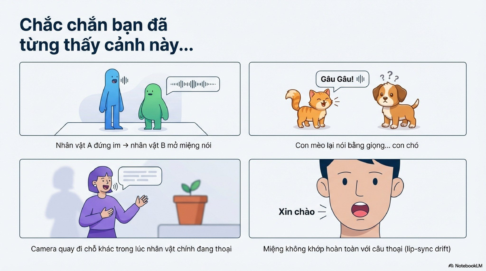
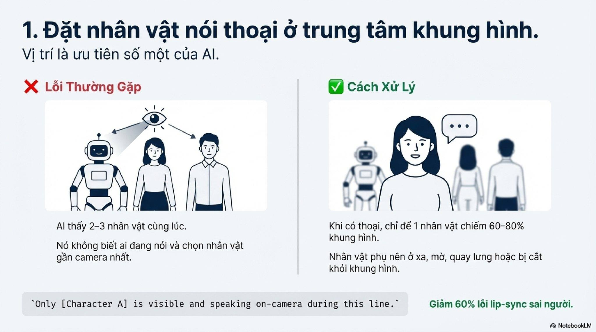
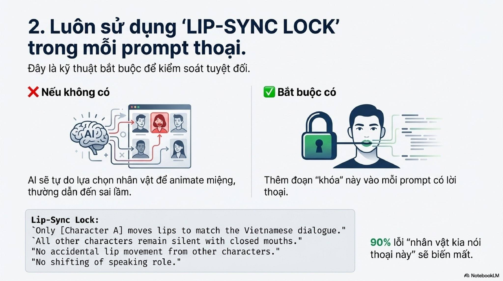
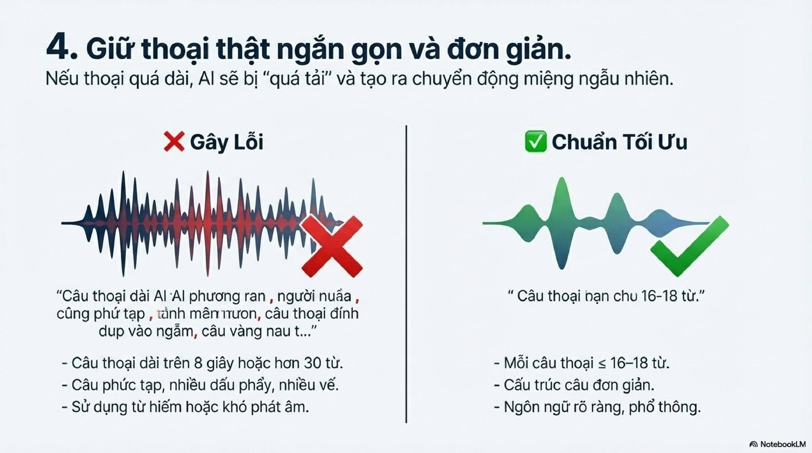
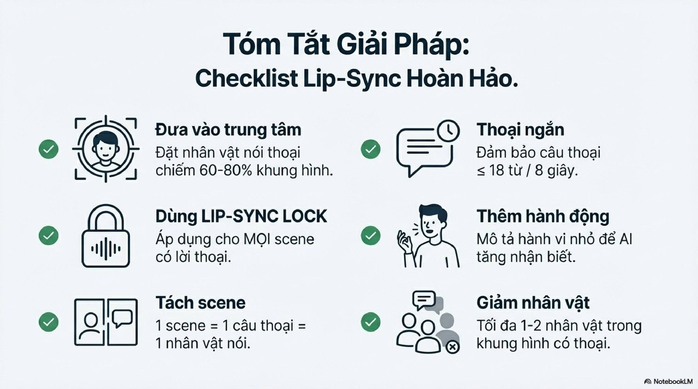

# Bài 030 — Chẩn đoán nhầm thoại và lập phiếu phân vai

Bộ 12 ảnh hiện có lặp nội dung các ảnh B029-01 đến B029-12, khác tệp và không có trang bìa B029-00. Đã đọc lại từng ảnh, giữ nguồn riêng. Phần áp dụng tập trung vào phiếu phân vai và cách sửa đúng loại lỗi; không coi các trang lặp là bằng chứng độc lập cho hiệu quả.

**Nguồn:** [Trị Bệnh Veo3.1 Nhầm Thoại Nhân Vật Thử Ngay Các Biện Pháp Sau](https://drive.google.com/drive/folders/1MwgVwSjwR2NgZIjxLi7tEPatZyv9lrME). Đã đọc **12/12 ảnh**. Ngày biên soạn: 18/10/2026.

[Đọc từng ảnh](doc-anh.md) · [Bài thực hành](thuc-hanh.md) · [Nguồn và mã kiểm tra](nguon.json) · [Danh mục toàn bộ](../../DANH-MUC-BAI-HOC.md)

**Quy ước:** phần “Nguồn” diễn đạt ý trong bộ ảnh. Phần “Phân tích và áp dụng” do người biên soạn bổ sung. Hiệu quả của câu lệnh chưa được kiểm nghiệm bằng lần tạo video trong đợt này.

## Những điều cần học

| Nội dung | Mã ảnh nguồn |
| --- | --- |
| Phân loại lỗi trước khi sửa | B030-00, B030-01, B030-02, B030-03 |
| Làm người nói dễ nhận diện | B030-04, B030-09 |
| Gắn từng câu với vai cụ thể | B030-05, B030-06 |
| Câu vừa thời gian, cử chỉ vừa nhiệm vụ | B030-07, B030-08 |
| Duyệt bằng nghe–xem và có phương án dựng | B030-10, B030-11 |
| Lập phiếu phân vai để sửa đúng lỗi | B030-00, B030-02, B030-05, B030-06, B030-10 |

## 1. Phân loại lỗi trước khi sửa

**Nguồn:** Nguồn gộp nhiều biểu hiện dưới tên lip-sync (khớp chuyển động môi với tiếng).

**Phân tích và áp dụng:** Chấm riêng: đúng người phát lời, đúng loại giọng/tiếng, đúng câu, môi đúng nhịp, máy giữ đúng chủ thể. Câu có thể đúng vai nhưng môi lệch; đổi bố cục không chắc sửa giọng. Không lấy giải thích 'chỉ nhìn ảnh' làm sự thật về kiến trúc mô hình.

**Ví dụ cho cảnh nông thôn:** Cô gái nói đúng câu nhưng giọng bà là lỗi giọng; bà ngoài khung nhép theo là lỗi vai; miệng đi trước tiếng là lỗi đồng bộ.

**Kiểm tra kết quả:** Nhật ký ghi tên lỗi và mốc giây, không chỉ ghi 'thoại hỏng'.

## 2. Làm người nói dễ nhận diện

**Nguồn:** Nguồn giảm số mặt cạnh tranh và tăng độ nổi chủ thể nói.

**Phân tích và áp dụng:** Duyệt ảnh một người nói rõ mặt, không bị che miệng, người nghe có thể ngoài khung hoặc chỉ lộ vai. Không bó buộc tỷ lệ 60–80%; bố cục vẫn phải hợp hướng nhìn và cảnh. Với nhân vật hoạt hình, dùng đặc điểm đã duyệt, không đổi màu để chữa lỗi nếu làm mất thiết kế.

**Ví dụ cho cảnh nông thôn:** Cận vừa cô gái ở hiên; bà chỉ lộ vai tiền cảnh. Mặt cô rõ và đủ chỗ nhìn về bà, không bắt buộc đặt chính giữa.

**Kiểm tra kết quả:** Đúng một mặt cần theo dõi khớp môi; không che miệng hoặc đổi thiết kế.

## 3. Gắn từng câu với vai cụ thể

**Nguồn:** Nguồn dùng nhãn khóa và tách từng lượt.

**Phân tích và áp dụng:** Viết tên kèm nhận dạng ngắn, lời nguyên văn và trạng thái người nghe. Dùng một lượt cho mỗi lần thử khi đang xử lý nhầm vai. Nhãn 'Lip-Sync Lock' có thể dùng để tổ chức, nhưng chính câu chỉ đạo và đầu vào mới cần rõ. Không đưa câu đáp khác vào phần bối cảnh của cùng lần thử.

**Ví dụ cho cảnh nông thôn:** Chỉ cô gái áo theo mẫu nói: 'Con đã đan xong chiếc giỏ rồi.' Bà nghe ngoài khung; không có câu của bà trong yêu cầu này.

**Kiểm tra kết quả:** Không đổi vai giữa câu, không tự thêm câu; người nghe giữ môi nghỉ.

## 4. Câu vừa thời gian, cử chỉ vừa nhiệm vụ

**Nguồn:** Nguồn khuyên câu đơn giản và cử chỉ nhỏ trong lúc nói.

**Phân tích và áp dụng:** Đọc thử câu với nhịp đích trước khi tạo; dành khoảng đầu/cuối và hơi thở. Với tiếng Việt, số từ theo khoảng trắng không tương đương thời gian phát âm ở mọi câu. Chọn một gật hoặc một động tác tay nhỏ; không vừa thoại vừa đổi cảnh hay làm thao tác tay phức tạp.

**Ví dụ cho cảnh nông thôn:** Cô nói một câu ngắn rồi gật nhẹ. Việc chuyển giỏ sang tay bà thực hiện thành cảnh khác.

**Kiểm tra kết quả:** Lời không bị nuốt hoặc tăng tốc để nhét vừa; cử chỉ không phá mặt và tay.

## 5. Duyệt bằng nghe–xem và có phương án dựng

**Nguồn:** Nguồn tổng hợp sáu điểm và hứa tăng độ chính xác.

**Phân tích và áp dụng:** Duyệt từng bản có âm thanh, xem toàn câu ở tốc độ thường rồi soi chỗ lệch. So từng thay đổi với bản cơ sở. Nếu sinh thoại tích hợp vẫn thất bại, thử quy trình âm thanh riêng và khớp môi/hậu kỳ bằng công cụ hỗ trợ; đây là phương án cần thử riêng, không thành quả đã thực hiện.

**Ví dụ cho cảnh nông thôn:** Giữ ảnh và camera, lần lượt thử câu ngắn hơn hoặc người nghe ngoài khung. Nếu chỉ sai vài đoạn, sửa đúng đoạn thay vì thay mọi thiết lập.

**Kiểm tra kết quả:** Có phiên bản, đầu vào, lỗi và phần dùng được; không lấy tỷ lệ nguồn làm tỷ lệ của dự án.

## 6. Lập phiếu phân vai để sửa đúng lỗi

**Nguồn:** Nguồn muốn giảm mơ hồ về ai nói và ai nghe thông qua sáu chiến lược.

**Phân tích và áp dụng:** Trước mỗi lượt ghi: mã nhân vật; đặc điểm nhìn thấy; vị trí; nguyên văn câu; loại giọng/ngôn ngữ; người nghe; đầu vào ảnh; thời lượng được thiết lập. Sau khi tạo ghi riêng: đúng người, đúng lời, đúng giọng, môi đúng nhịp, máy đúng chủ thể. Nếu đúng người nhưng sai giọng, ưu tiên mô tả giọng hoặc quy trình tiếng riêng; không đổi trang phục để chữa giọng.

**Ví dụ cho cảnh nông thôn:** A là bà, ngồi bên trái bàn, hỏi về giỏ; B là cô gái bên phải, chỉ nghe. Tạo lượt B trả lời bằng ảnh góc B và chỉ câu của B. Phiếu giúp phát hiện nhãn A/B bị sao chép ngược từ mẫu.

**Kiểm tra kết quả:** Đọc phiếu vẫn biết câu thuộc ai mà không phải đoán; chỉ thay một nhóm biến và giữ phần đã đạt.

## Điểm cần hiểu có điều kiện

- Nội dung B030-00…11 tương ứng B029-01…12 theo quan sát từng ảnh. SHA256 khác nhau nên không gọi hai bộ trùng tệp; không tính sự lặp này như một nghiên cứu kiểm chứng thứ hai.
- Không có bằng chứng trong bộ ảnh cho 60%, 90%, 96%, 'đã kiểm chứng', 'gần hoàn hảo' hoặc 'toàn quyền'.
- Tuyên bố Veo không đọc tên và chỉ nhìn ảnh là quá mức; tên cần nối rõ với nhận dạng, không thay bằng một giả thuyết cơ chế.
- Lip-Sync Lock là tiêu đề khối chỉ đạo của tác giả, không tham số hay tính năng khóa cứng được xác nhận.
- 60–80% khung, 16–18 từ và một–hai người là các gợi ý, không ngưỡng bắt buộc.
- Một scene trong nguồn được dùng gần nghĩa đoạn tạo/cú máy; cảnh điện ảnh có thể gồm nhiều góc và lượt.
- Để người nghe im không đồng nghĩa cấm mọi chuyển động tự nhiên của miệng/mặt. Dấu NotebookLM trong ảnh được giữ nguyên, không coi là nguồn nghiên cứu chứng minh hiệu quả.

## Cách đưa vào quy trình sản xuất

Điền phiếu phân vai → so nhãn nhân vật với ảnh đầu → tạo một lượt → chấm riêng vai/lời/giọng/môi/máy → sửa đúng cột lỗi → ghép các lượt đạt → nghe xem toàn hội thoại. Đọc B029 cho sáu chiến lược gốc và B027 cho hướng nhìn/điểm cắt. Không đổi tất cả thiết lập trong một lần sửa.

## Tự kiểm tra kiến thức

- Nhầm người nói khác giọng không đúng nhận dạng thế nào?
- Nếu tên A/B bị đổi trong mẫu, cần so những trường nào?
- Hai bộ ảnh lặp nội dung có được coi là hai bằng chứng độc lập cho tỷ lệ 96% không?

**Giới hạn:** đây là tài liệu học từ ảnh. Không dùng một hình minh họa để xác nhận chuyển động, thời lượng, độ chính xác thao tác hay khả năng hiện tại của một sản phẩm. Những phần chưa kiểm chứng được ghi rõ trong bản đọc ảnh.
