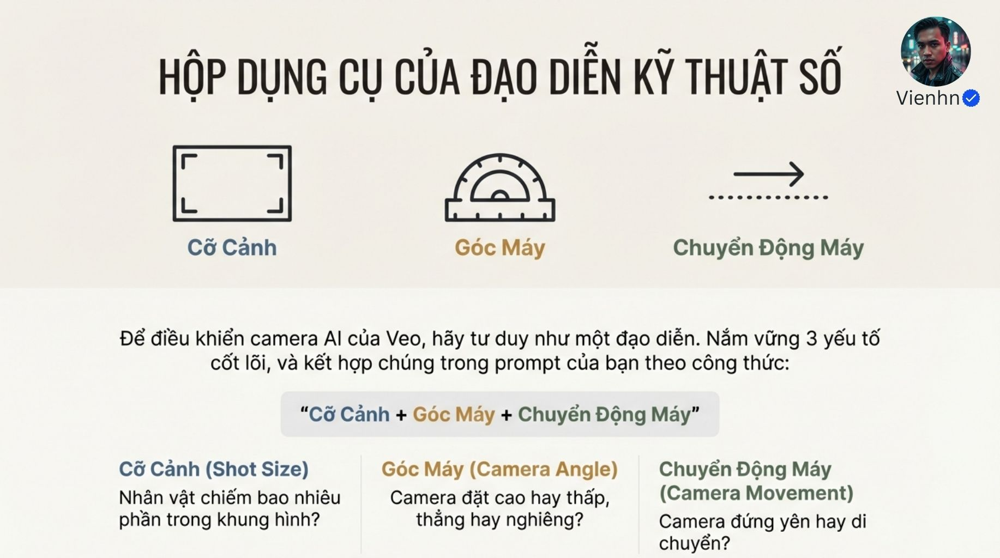
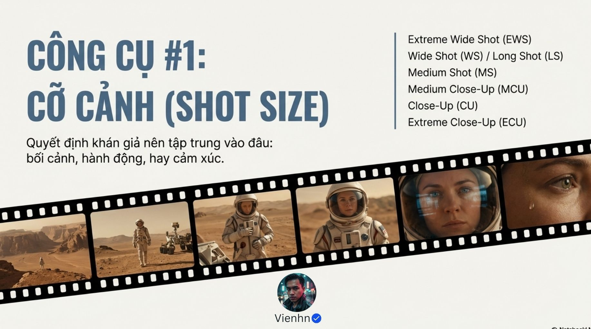
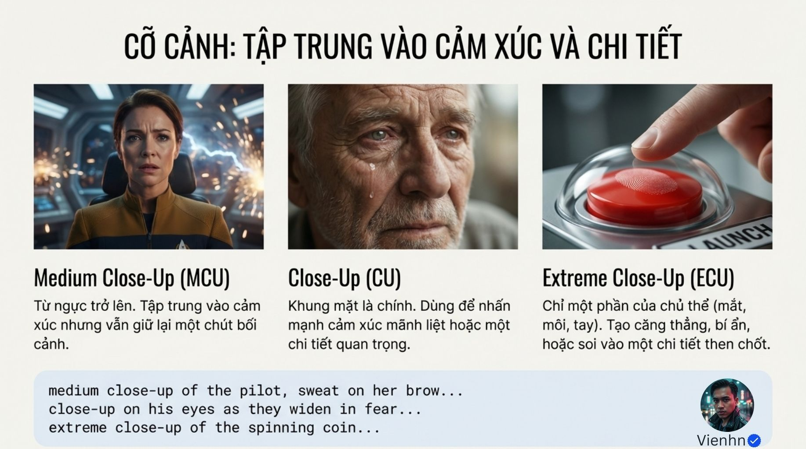
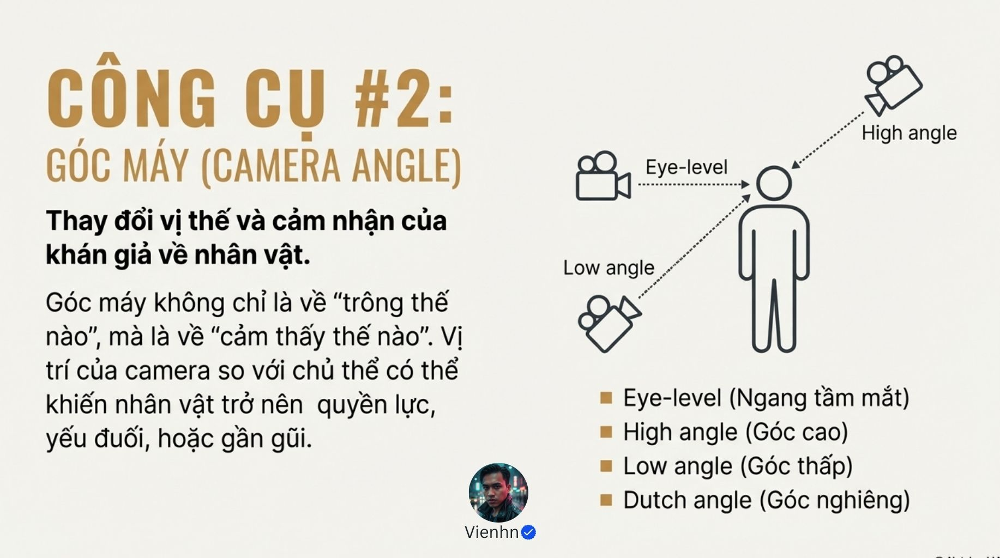
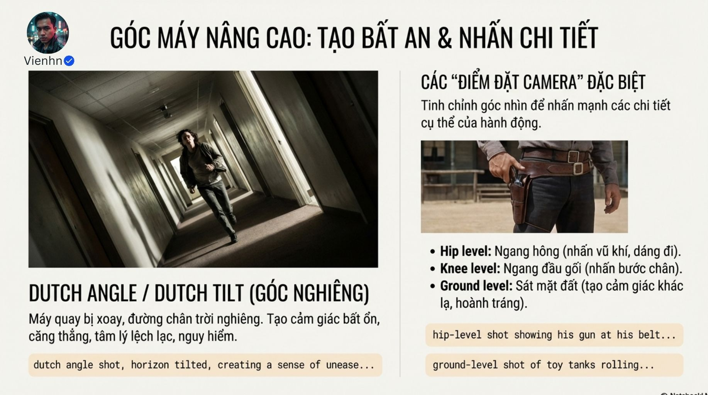
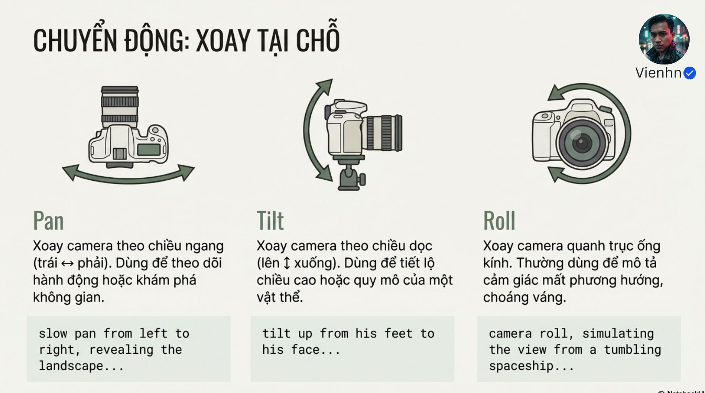

# B031 — Bản đọc toàn bộ 12 ảnh

Nguồn: [Từ Mô Tả đến Đạo Diễn- Nâng Cấp Prompt Veo3.1 Của Bạn Ngay Lập Tức](https://drive.google.com/drive/folders/17sYCtB5SAM-8djJiv-yRbp6-yBPuw9fM).

**Cách ghi:** nội dung chính được diễn đạt lại từ chữ và hình trong ảnh; không phải bản chép nguyên văn toàn bộ. Quan sát ảnh tĩnh được tách khỏi lời giải thích bổ sung. Ảnh gốc được giữ nguyên để đối chiếu.

[Bài chính](README.md) · [Thực hành](thuc-hanh.md) · [Dữ liệu nguồn](nguon.json)

## B031-00 — Mở bài

Tên gốc: `Từ Mô Tả đến Đạo Diễn- Nâng Cấp Prompt Veo3.1 Của Bạn Ngay Lập Tức.jpg`.

**Nội dung chính đọc được:** Nguồn so cô gái trong phố neon với góc thấp, khung nghiêng tạo căng thẳng.

**Hình minh họa:** Hai ảnh đô thị, ảnh phải nghiêng chân trời.

**Phân tích bổ sung:** Ảnh phải không hoàn toàn khớp nhãn trung cảnh vì thấy nhiều cơ thể; đọc khung thực thay vì chỉ tin nhãn.

## B031-01 — Ba nhóm

Tên gốc: `01.jpg`.

**Nội dung chính đọc được:** Nguồn ghép cỡ cảnh, góc máy và chuyển động.

**Hình minh họa:** Ba biểu tượng và câu hỏi.

**Phân tích bổ sung:** Đây là ba trục mô tả độc lập; một từ không thay được cả ba.

## B031-02 — Thang cỡ cảnh

Tên gốc: `02.jpg`.

**Nội dung chính đọc được:** Nguồn liệt kê EWS, WS/LS, MS, MCU, CU và ECU.

**Hình minh họa:** Dải hình phi hành gia từ rất rộng tới mắt.

**Phân tích bổ sung:** Cỡ cảnh theo phần chủ thể được thấy, không là độ phân giải hay tiêu cự cố định.

## B031-03 — Rộng và trung

Tên gốc: `03.jpg`.

**Nội dung chính đọc được:** Nguồn dùng rất rộng/rộng cho thế giới và toàn thân, trung từ thắt lưng cho hội thoại.

**Hình minh họa:** Người trên núi và hai người trong thư viện.

**Phân tích bổ sung:** Không phải mọi hội thoại đều cần trung cảnh; chọn theo thông tin.

## B031-04 — Trung cận, cận, đặc tả

Tên gốc: `04.jpg`.

**Nội dung chính đọc được:** Nguồn dùng trung cận từ ngực, cận mặt và đặc tả chi tiết.

**Hình minh họa:** Người trong khoang, mặt ông già, ngón tay và nút.

**Phân tích bổ sung:** Khung chỉ mắt có thể là đặc tả; tên gọi thay đổi theo mức cắt thật và đối tượng.

## B031-05 — Góc máy

Tên gốc: `05.jpg`.

**Nội dung chính đọc được:** Nguồn giới thiệu ngang mắt, cao, thấp và nghiêng để định hướng cảm nhận.

**Hình minh họa:** Máy ở ba độ cao nhìn người.

**Phân tích bổ sung:** Chiều cao máy và hướng nhìn cần nói rõ; máy thấp vẫn có thể nhìn ngang.

## B031-06 — Cảm nhận qua góc

Tên gốc: `06.jpg`.

**Nội dung chính đọc được:** Nguồn gợi góc thấp cho uy lực, ngang mắt gần gũi, cao cho nhỏ bé.

**Hình minh họa:** Nhân vật mạnh, người phục vụ, cậu bé giữa đám đông.

**Phân tích bổ sung:** Đó là quy ước gợi ý, không kết quả cảm xúc bắt buộc trong mọi cảnh.

## B031-07 — Nghiêng và vị trí đặc biệt

Tên gốc: `07.jpg`.

**Nội dung chính đọc được:** Nguồn mô tả chân trời nghiêng; thêm ngang hông, ngang gối và sát đất.

**Hình minh họa:** Người chạy trong hành lang nghiêng, cận hông có đạo cụ.

**Phân tích bổ sung:** Dutch angle là trạng thái khung xoay quanh trục nhìn; khác tilt ngẩng/cúi. Đặt sát đất không tự chỉ rõ đang nhìn lên hay ngang.

## B031-08 — Hai nhóm chuyển động

Tên gốc: `08.jpg`.

**Nội dung chính đọc được:** Nguồn chia xoay tại chỗ thành pan/tilt/roll; dịch vị trí thành dolly/truck/crane/orbit.

**Hình minh họa:** Máy trên chân và trên ray.

**Phân tích bổ sung:** Máy tĩnh vẫn hợp lệ. Chuyển động quang học zoom không nằm trong hai nhóm dịch chuyển thân máy này.

## B031-09 — Xoay tại chỗ

Tên gốc: `09.jpg`.

**Nội dung chính đọc được:** Nguồn định nghĩa lia ngang, ngẩng/cúi và xoay quanh trục ống kính.

**Hình minh họa:** Ba hình với mũi tên.

**Phân tích bổ sung:** Roll liên tục khác giữ một góc nghiêng cố định; hướng máy đổi nhưng tâm đặt máy gần như không đổi.

## B031-10 — Di chuyển không gian

Tên gốc: `011.jpg`.

**Nội dung chính đọc được:** Nguồn nêu tiến/lùi, bám/ngang, nâng/hạ và đi vòng.

**Hình minh họa:** Bốn sơ đồ, có một từ Hy Lạp lạc trong phần dolly.

**Phân tích bổ sung:** Bỏ chữ lạc khỏi mẫu thực hành, không coi là tham số. Tracking rộng nghĩa hơn chỉ chạy song song; cần mô tả đường cụ thể.

## B031-11 — Bảng mục tiêu

Tên gốc: `012.jpg`.

**Nội dung chính đọc được:** Nguồn ghép mục tiêu giới thiệu, thân mật, căng thẳng, uy lực, yếu thế và choáng với cỡ/góc/chuyển động.

**Hình minh họa:** Bảng sáu hàng.

**Phân tích bổ sung:** Dùng như điểm bắt đầu chọn phương án, không ghép hết các gợi ý trong một hàng thành lệnh cùng lúc.

## Kiểm kê

Đã mở trực tiếp 12/12 ảnh. Các mã nguồn theo thứ tự ở trên khớp [danh mục tệp](nguon.json). Chưa sinh hoặc đánh giá video từ câu lệnh của bài này.
