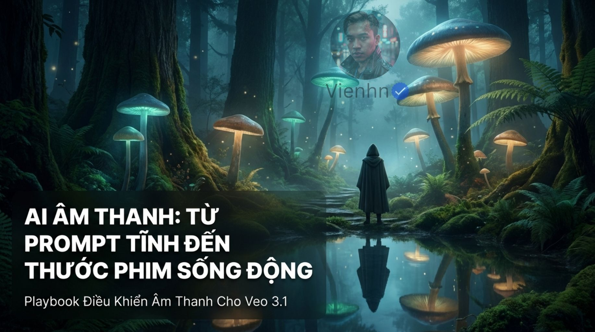
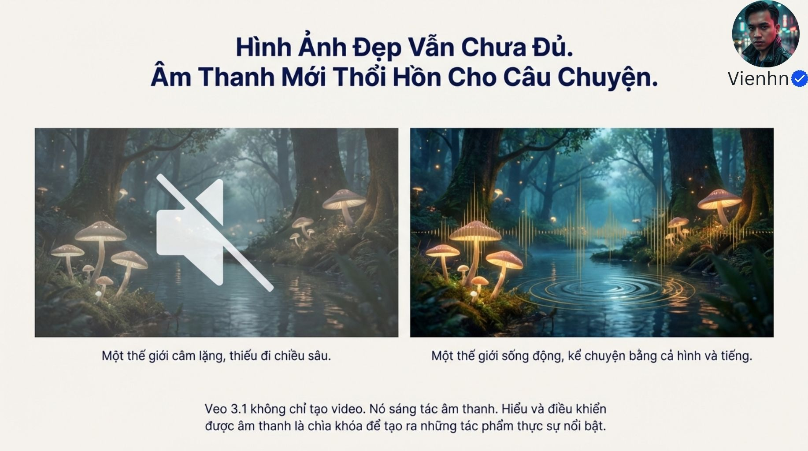
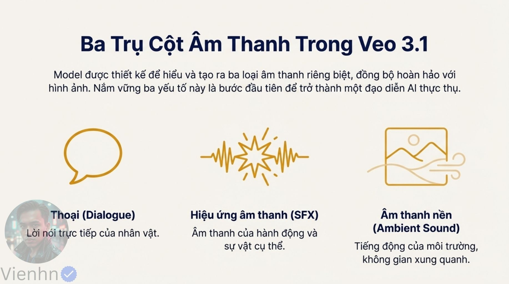
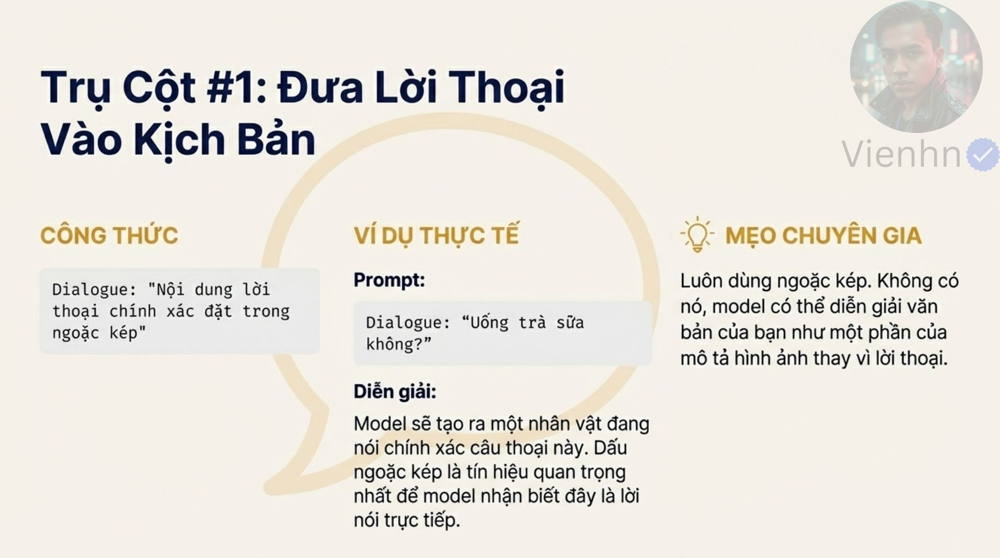
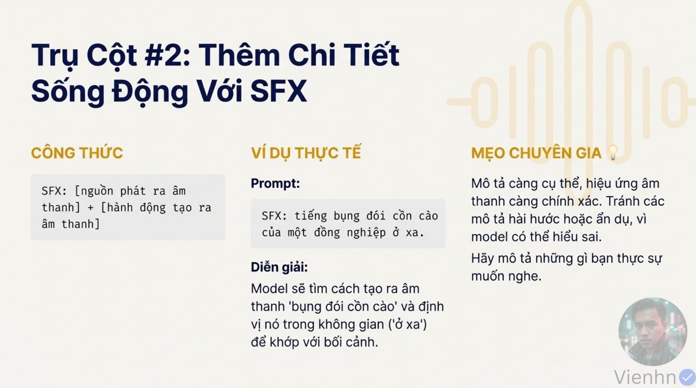
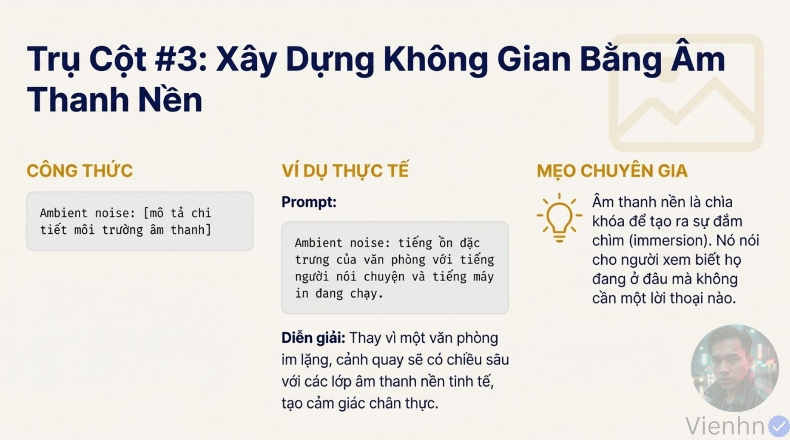
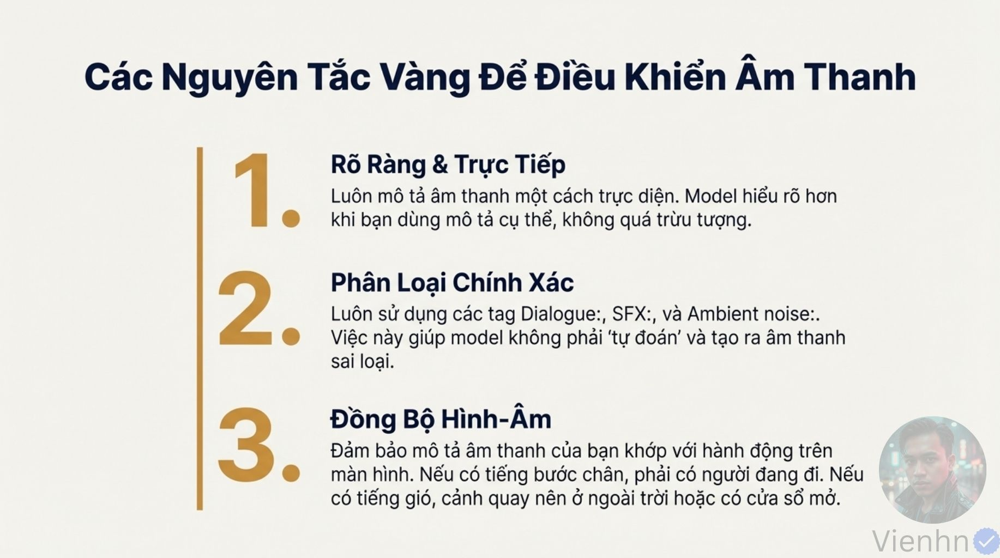
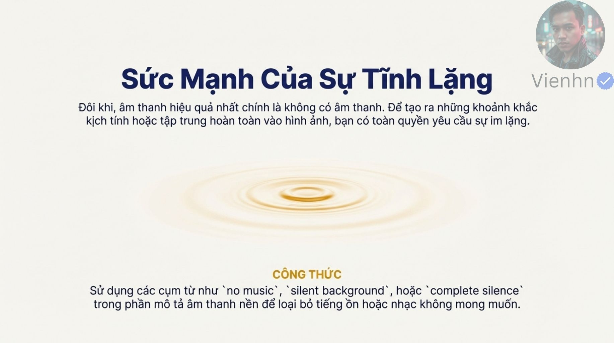
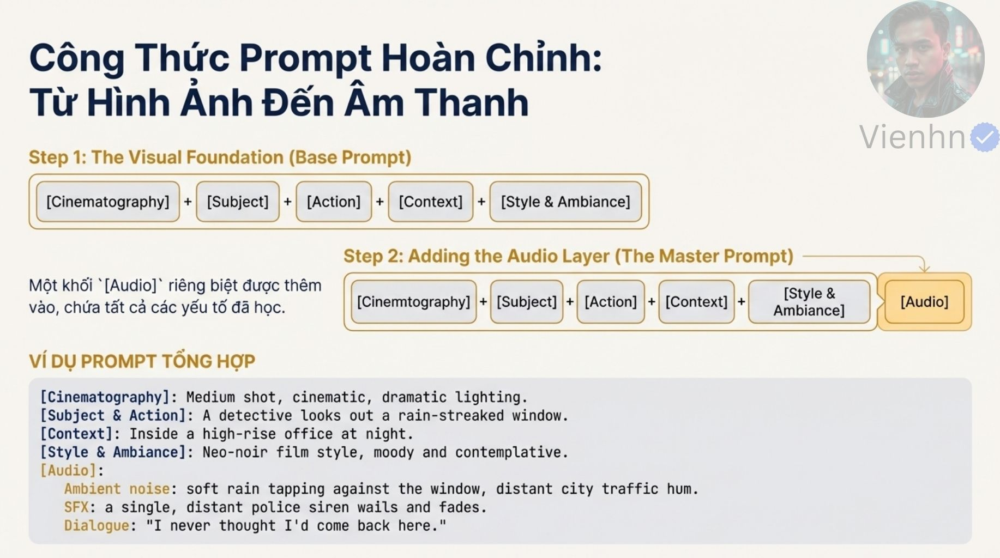
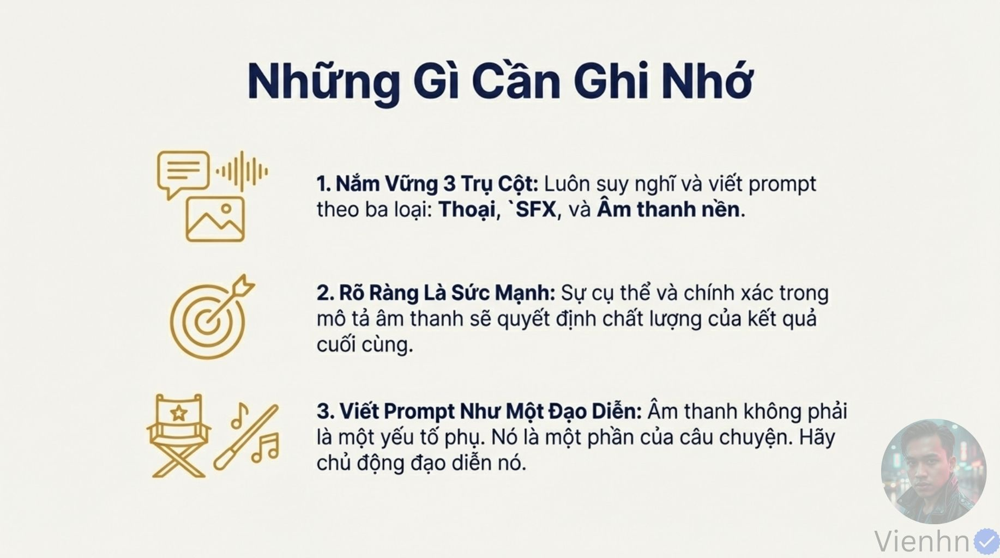

# B032 — Bản đọc toàn bộ 12 ảnh

Nguồn: [Từ Prompt Tĩnh Đến Thước Phim Sống Động - Cách Điều Khiển Âm Thanh Veo3.1](https://drive.google.com/drive/folders/1SsWJhGlNJgODyzgZ-hGfkouj-1YY-LAx).

**Cách ghi:** nội dung chính được diễn đạt lại từ chữ và hình trong ảnh; không phải bản chép nguyên văn toàn bộ. Quan sát ảnh tĩnh được tách khỏi lời giải thích bổ sung. Ảnh gốc được giữ nguyên để đối chiếu.

[Bài chính](README.md) · [Thực hành](thuc-hanh.md) · [Dữ liệu nguồn](nguon.json)

## B032-00 — Bìa

Tên gốc: `Từ Prompt Tĩnh Đến Thước Phim Sống Động - Cách Điều Khiển Âm Thanh Veo3.1.jpg`.

**Nội dung chính đọc được:** Nguồn giới thiệu điều khiển âm thanh cho Veo 3.1.

**Hình minh họa:** Rừng nấm phát sáng, người và mặt nước.

**Phân tích bổ sung:** Hình giả tưởng thể hiện không khí, không có tệp âm thanh để đánh giá.

## B032-01 — Vai trò âm thanh

Tên gốc: `01.jpg`.

**Nội dung chính đọc được:** Nguồn so hình im lặng với hình có chiều sâu âm thanh.

**Hình minh họa:** Hai ảnh rừng, biểu tượng tắt tiếng và sóng.

**Phân tích bổ sung:** Âm thanh có thể bổ sung kể chuyện; im lặng cũng có thể là ý đồ, không tự kém chất lượng.

## B032-02 — Ba nhóm

Tên gốc: `02.jpg`.

**Nội dung chính đọc được:** Nguồn chia thoại, SFX và âm thanh nền, tuyên bố đồng bộ hoàn hảo.

**Hình minh họa:** Ba biểu tượng miệng, sự kiện và cảnh.

**Phân tích bổ sung:** Chia nhóm hữu ích cho biên soạn; không có chứng cứ về đồng bộ hoàn hảo, cũng chưa gồm nhạc như nhóm riêng.

## B032-03 — Lời thoại

Tên gốc: `03.jpg`.

**Nội dung chính đọc được:** Nguồn khuyên nội dung chính xác trong ngoặc kép, ví dụ lời mời uống trà sữa.

**Hình minh họa:** Ba cột công thức, ví dụ và mẹo.

**Phân tích bổ sung:** Ngoặc giúp rõ ý, không bắt buộc duy nhất hoặc bảo đảm nguyên văn. Cần tên người nói và giọng.

## B032-04 — Tiếng sự kiện

Tên gốc: `04.jpg`.

**Nội dung chính đọc được:** Nguồn ghép vật phát âm với hành động; ví dụ tiếng bụng đói của đồng nghiệp ở xa.

**Hình minh họa:** Công thức và giải thích khoảng cách.

**Phân tích bổ sung:** Nguồn xa nhỏ có thể khó nghe thực tế; ví dụ này là hiệu ứng có thể cách điệu, không làm chuẩn cho phối âm tự nhiên.

## B032-05 — Nền môi trường

Tên gốc: `05.jpg`.

**Nội dung chính đọc được:** Nguồn gợi tiếng văn phòng, nói chuyện và máy in để tạo không gian.

**Hình minh họa:** Ba cột về ambient noise (nền môi trường).

**Phân tích bổ sung:** Nền nói chuyện có thể xung đột với mục tiêu không thêm thoại; chọn theo cảnh.

## B032-06 — Ba nguyên tắc

Tên gốc: `06.jpg`.

**Nội dung chính đọc được:** Nguồn khuyên cụ thể, dùng nhãn phân loại và khớp sự kiện; cho rằng bước chân phải có người đi trong hình.

**Hình minh họa:** Ba mục chữ.

**Phân tích bổ sung:** Âm ngoài khung là hợp lệ nếu nguồn và vị trí có lý do; các nhãn là tổ chức văn bản, không tham số bảo đảm.

## B032-07 — Kế hoạch hậu kỳ

Tên gốc: `07.jpg`.

**Nội dung chính đọc được:** Nguồn nói vẫn nên mô tả âm dù sẽ thay, liên hệ nhạc nhanh/chậm với nhịp hình.

**Hình minh họa:** Hai nhánh nhạc ra hình động/tĩnh.

**Phân tích bổ sung:** Liên hệ nhạc–nhịp là định hướng thử, không điều khiển tốc độ tuyệt đối; cần chỉ đạo hình riêng.

## B032-08 — Khoảng lặng

Tên gốc: `08.jpg`.

**Nội dung chính đọc được:** Nguồn đề xuất không nhạc, nền im và im hoàn toàn.

**Hình minh họa:** Vòng gợn trên nền trắng.

**Phân tích bổ sung:** Ba ý không tương đương: không nhạc vẫn có SFX/môi trường; im hoàn toàn phải bỏ mọi tiếng. Có thể cần xử lý hậu kỳ.

## B032-09 — Mẫu tổng hợp

Tên gốc: `09.jpg`.

**Nội dung chính đọc được:** Nguồn thêm khối Audio vào khung hình năm phần; ví dụ thám tử, mưa, xe xa, còi và một câu thoại.

**Hình minh họa:** Sơ đồ sáu phần và mẫu.

**Phân tích bổ sung:** Dọn trùng phần âm thanh trong phong cách; chỉ tạo những lớp cần thiết, xác định ưu tiên khi chồng nhau.

## B032-10 — Ghi nhớ

Tên gốc: `10.jpg`.

**Nội dung chính đọc được:** Nguồn nhắc ba nhóm, mô tả rõ và tư duy âm thanh như một phần câu chuyện.

**Hình minh họa:** Ba biểu tượng và đoạn chữ.

**Phân tích bổ sung:** Mô tả rõ giúp đánh giá, không duy nhất quyết định chất lượng.

## B032-11 — Kết

Tên gốc: `011.jpg`.

**Nội dung chính đọc được:** Nguồn kêu gọi chủ động sáng tác âm thanh.

**Hình minh họa:** Sóng âm nối bảng ghi cảnh.

**Phân tích bổ sung:** Chưa có minh chứng nghe trong bộ ảnh; thực hành cần kiểm tra tệp có tiếng.

## Kiểm kê

Đã mở trực tiếp 12/12 ảnh. Các mã nguồn theo thứ tự ở trên khớp [danh mục tệp](nguon.json). Chưa sinh hoặc đánh giá video từ câu lệnh của bài này.
