# B033 — Bản đọc toàn bộ 14 ảnh

Nguồn: [VEO đang làm ngơ prompt của bạn](https://drive.google.com/drive/folders/1_I1lxxVN8q4UgmE6NTPtgANVvrTZ_9kt).

**Cách ghi:** nội dung chính được diễn đạt lại từ chữ và hình trong ảnh; không phải bản chép nguyên văn toàn bộ. Quan sát ảnh tĩnh được tách khỏi lời giải thích bổ sung. Ảnh gốc được giữ nguyên để đối chiếu.

[Bài chính](README.md) · [Thực hành](thuc-hanh.md) · [Dữ liệu nguồn](nguon.json)

## B033-00 — Ba nhóm lỗi cần chẩn đoán

Tên gốc: `0 VEO đang làm ngơ prompt của bạn.jpg`.

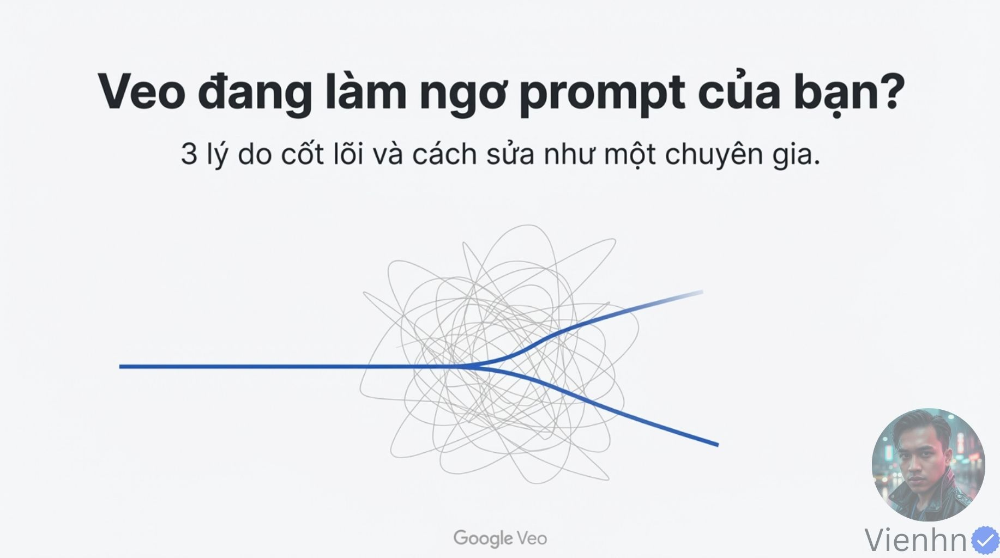

**Nội dung chính đọc được:** Bìa đặt vấn đề Veo không làm theo prompt và hứa giải thích ba lý do cùng cách sửa.

**Hình minh họa:** Đường xanh đi qua một khối nét rối màu xám, bên cạnh tiêu đề và dấu tên nguồn.

**Phân tích bổ sung:** Đây là lời giới thiệu một phương pháp sửa lỗi, chưa có cặp video trước/sau để chứng minh hiệu quả.

## B033-01 — Mơ hồ, quá tải và mâu thuẫn

Tên gốc: `01.jpg`.

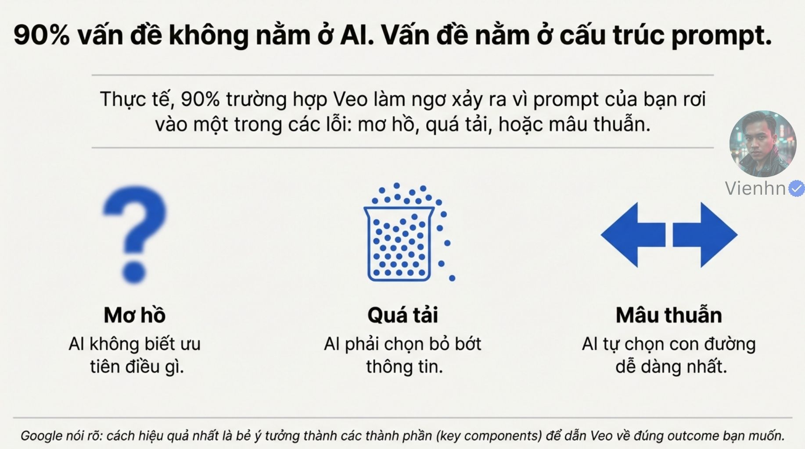

**Nội dung chính đọc được:** Ảnh nói phần lớn vấn đề đến từ cấu trúc prompt, chia thành mơ hồ, quá tải và mâu thuẫn; có con số 90%.

**Hình minh họa:** Ba khối nội dung tổ chức những nguyên nhân được nguồn đề xuất.

**Phân tích bổ sung:** 90% không kèm dữ liệu. Đây là các giả thuyết cần kiểm tra; đầu vào, thiết lập và giới hạn mô hình cũng có thể gây lỗi.

## B033-02 — Nhìn triệu chứng trước khi sửa

Tên gốc: `02.jpg`.

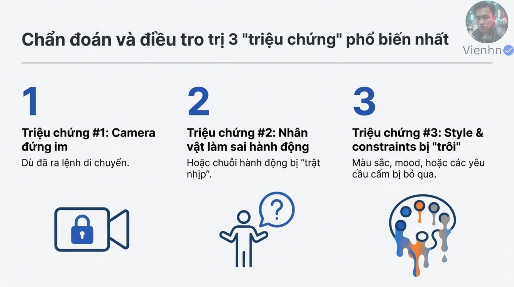

**Nội dung chính đọc được:** Ba triệu chứng: camera đứng yên hoặc sai chuyển động; hành động thiếu bước/sai trình tự; phong cách hoặc ràng buộc bị trôi.

**Hình minh họa:** Ba nhóm biểu tượng và mô tả ngắn sắp cạnh nhau.

**Phân tích bổ sung:** Ghi lỗi cụ thể theo mốc giây và tách các nhóm. Một clip có thể đồng thời đúng camera nhưng sai số người.

## B033-03 — Vì sao camera có thể không như ý

Tên gốc: `03.jpg`.

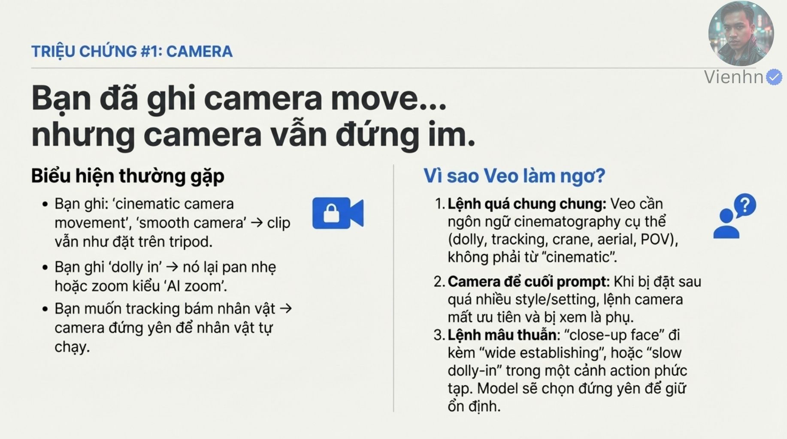

**Nội dung chính đọc được:** Nguồn nêu các yêu cầu chung như cinematic, smooth; gọi dolly nhưng ra pan/zoom; gọi tracking nhưng chỉ nhân vật di chuyển. Nguyên nhân được đề xuất gồm camera nằm cuối prompt, yêu cầu cỡ cảnh mâu thuẫn và quá nhiều hành động.

**Hình minh họa:** Các ví dụ đặt ý định quay cạnh kết quả sai được mô tả bằng chữ.

**Phân tích bổ sung:** Không có bằng chứng thứ tự câu luôn quyết định ưu tiên. Dolly chậm với nhân vật di chuyển nhanh không tự mâu thuẫn; cần xét quan hệ hình học. POV và góc trên cao mô tả điểm nhìn, không tự xác định đường máy.

## B033-04 — Cụ thể hóa máy quay

Tên gốc: `04.jpg`.

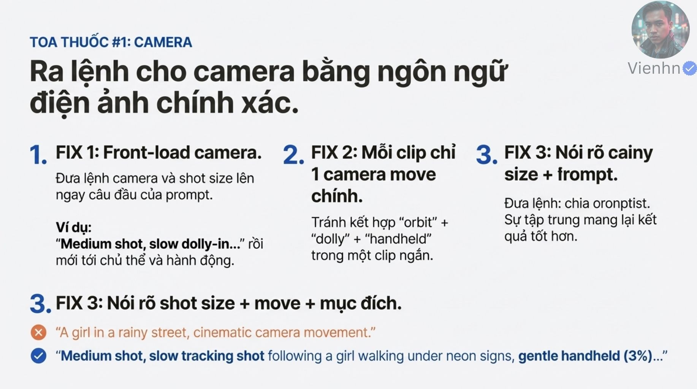

**Nội dung chính đọc được:** Nguồn khuyên đưa camera lên đầu, chọn một chuyển động chính và ghi cỡ cảnh + chuyển động + mục đích. Ví dụ có tracking theo cô gái và rung handheld nhẹ (3%). Một vùng chữ ở trên bên phải bị lỗi, không đọc được thành câu tin cậy; phần hướng dẫn rõ phía dưới vẫn đọc được.

**Hình minh họa:** Bố cục các cách sửa và một ví dụ prompt kết hợp nhiều thuộc tính máy quay.

**Phân tích bổ sung:** Không khôi phục vùng chữ hỏng. Ví dụ tracking cộng handheld không hoàn toàn khớp khẩu quyết chỉ một chuyển động; có thể hiểu là đường máy chính cộng tính chất rung phụ. Con số 3% không có thang đo hay tham số được xác nhận.

## B033-05 — Hành động và trình tự bị thiếu

Tên gốc: `05.jpg`.

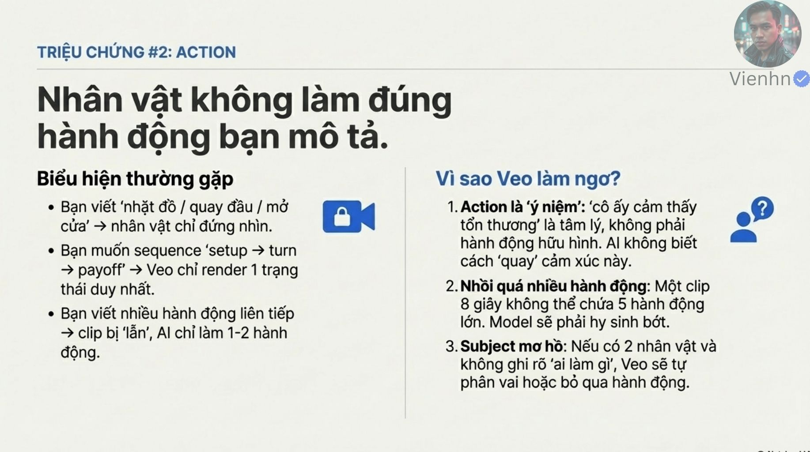

**Nội dung chính đọc được:** Nguồn mô tả cảnh nhân vật đứng thay vì nhặt/quay/mở, hoặc bỏ các nhịp setup–turn–payoff. Các lý do được nêu: cảm xúc không biểu hiện ra ngoài, nhiều hành động trong clip ngắn và chủ thể chưa rõ.

**Hình minh họa:** Các ví dụ hành động được chia thành lỗi và nguyên nhân.

**Phân tích bổ sung:** Không coi 5 hành động hay 8 giây là giới hạn cứng mọi công cụ. Turn trong chuỗi kể chuyện là nhịp chuyển biến, không nhất thiết quay đầu. Số thao tác khả thi còn phụ thuộc độ phức tạp và thời lượng thực tế.

## B033-06 — Động từ, đối tượng và kết quả

Tên gốc: `06.jpg`.

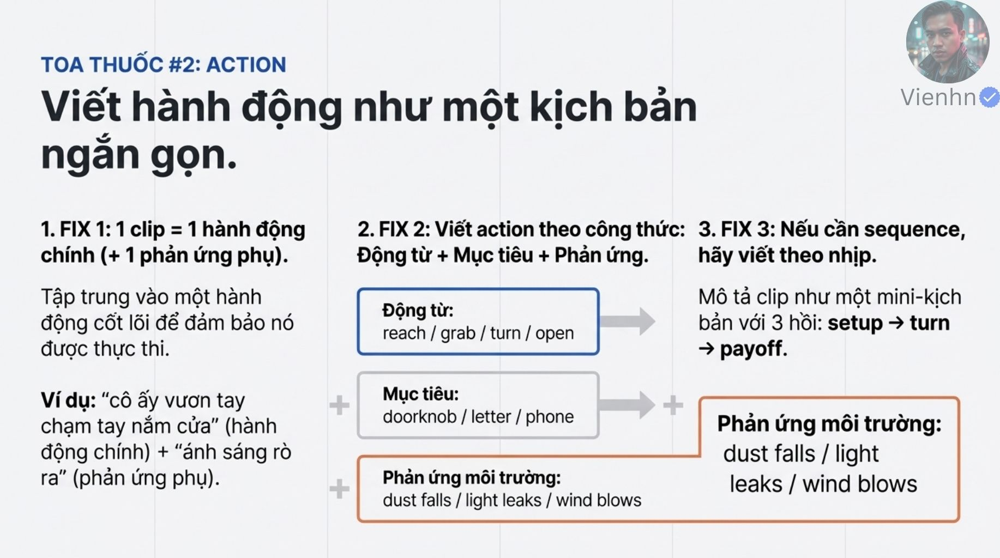

**Nội dung chính đọc được:** Nguồn khuyên một clip có hành động chính và phản ứng môi trường, viết động từ + đối tượng + phản ứng; dùng ba nhịp chuẩn bị–chuyển biến–kết quả. Ví dụ bàn tay chạm tay nắm và ánh sáng rọi ra.

**Hình minh họa:** Các động từ, đồ vật và phản ứng được nhóm thành thành phần có thể ghép.

**Phân tích bổ sung:** Phải bổ sung quan hệ nhân quả khi cần: chạm tay nắm không tự làm cửa kín mở. Ba nhịp có thể là ba giai đoạn của một thao tác; không cần ép ba sự kiện lớn vào một shot.

## B033-07 — Phong cách và ràng buộc bị trôi

Tên gốc: `07.jpg`.

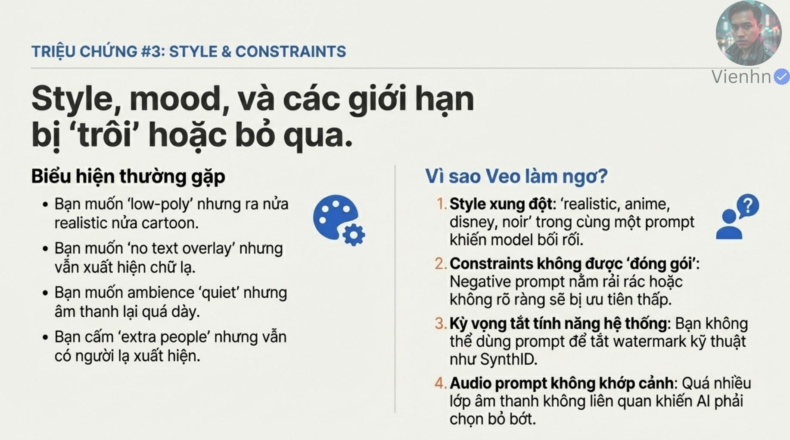

**Nội dung chính đọc được:** Nguồn nêu việc low-poly lẫn hiện thực/hoạt hình, chữ hoặc người thừa, âm thanh quá dày; nguyên nhân gồm trộn nhiều nhãn phong cách, ràng buộc phân tán và yêu cầu tắt watermark kỹ thuật SynthID.

**Hình minh họa:** Những loại lỗi hình và tiếng nằm trong cùng bảng chẩn đoán.

**Phân tích bổ sung:** Phong cách lai có thể là chủ ý; vấn đề là quan hệ không rõ. SynthID là dấu kỹ thuật vô hình, khác chữ phủ và dấu tên nhìn thấy; không xem câu no watermark là công tắc tắt nó.

## B033-08 — Một phong cách chủ đạo, ràng buộc rõ

Tên gốc: `08.jpg`.

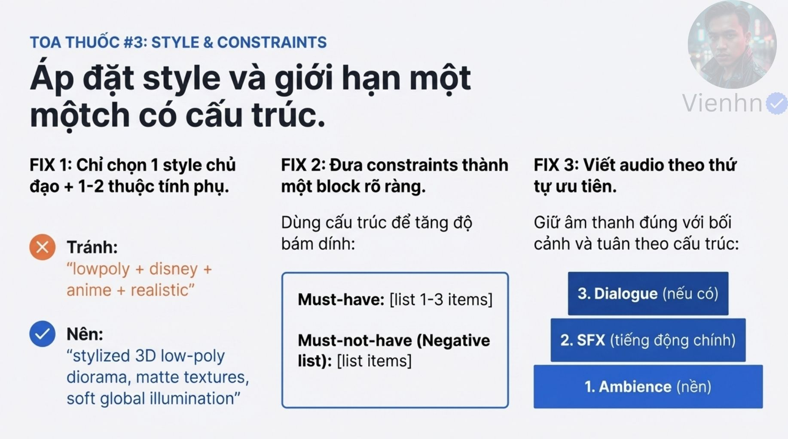

**Nội dung chính đọc được:** Nguồn đề xuất một phong cách chính với một hoặc hai thuộc tính phụ, nhóm Must-have/Must-not-have và tổ chức âm thanh thành ambience, SFX, dialogue.

**Hình minh họa:** Các khối phong cách, điều cần có/không có và lớp âm thanh được sắp theo nhóm.

**Phân tích bổ sung:** Các tiêu đề là cách tổ chức văn bản, không phải tham số bảo đảm. Thứ tự kể các lớp âm không đồng nghĩa thứ tự độ lớn; cảnh thoại có thể cần tiếng nói nổi bật nhất. Nếu công cụ có trường negative riêng, xem cách nhập phù hợp ở B023.

## B033-09 — Ví dụ từ cảm xúc chung đến hành vi cụ thể

Tên gốc: `09.jpg`.

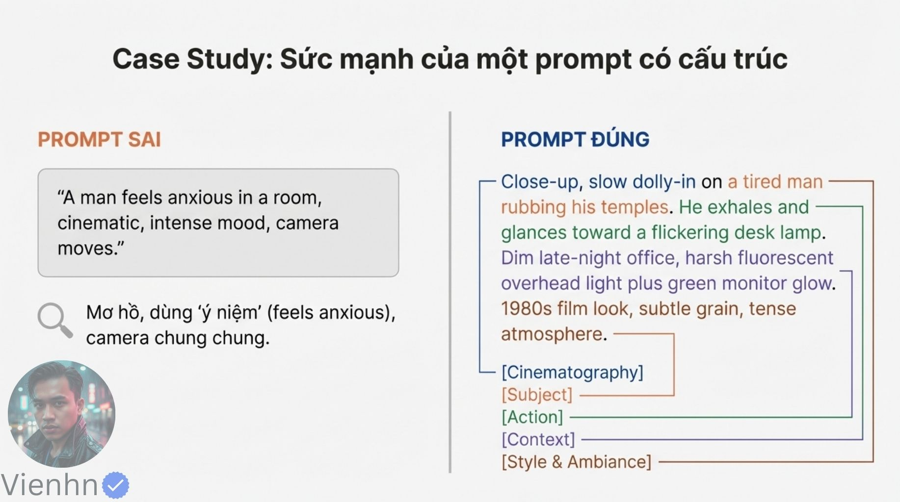

**Nội dung chính đọc được:** Nguồn so sánh mô tả người đàn ông lo lắng với cận cảnh dolly chậm: người mệt xoa thái dương, thở ra, liếc đèn bàn nhấp nháy trong văn phòng đêm, ánh đèn và màn hình xanh, hạt phim và không khí căng thẳng.

**Hình minh họa:** Hai cách viết prompt được trình bày cạnh nhau.

**Phân tích bổ sung:** Hữu ích ở chỗ biến cảm xúc thành điều nhìn/nghe được. Đây là cặp câu lệnh, chưa phải cặp video so sánh. Nhiều nguồn sáng có động cơ rõ có thể cùng tồn tại; không tự xem đó là mâu thuẫn.

## B033-10 — Tổ chức vòng sửa lỗi

Tên gốc: `010.jpg`.

**Nội dung chính đọc được:** Nguồn giới thiệu quy trình debug trong 10 phút, kết hợp cấu trúc prompt và thử nghiệm.

**Hình minh họa:** Tiêu đề thời gian đi cùng hình gợi bộ dụng cụ sửa lỗi.

**Phân tích bổ sung:** 10 phút nên hiểu là thời lượng gợi ý để rà câu lệnh, không bảo đảm đủ tạo/xem/sửa video hay giải quyết mọi lỗi.

## B033-11 — Rút về khung và thử một biến

Tên gốc: `011.jpg`.

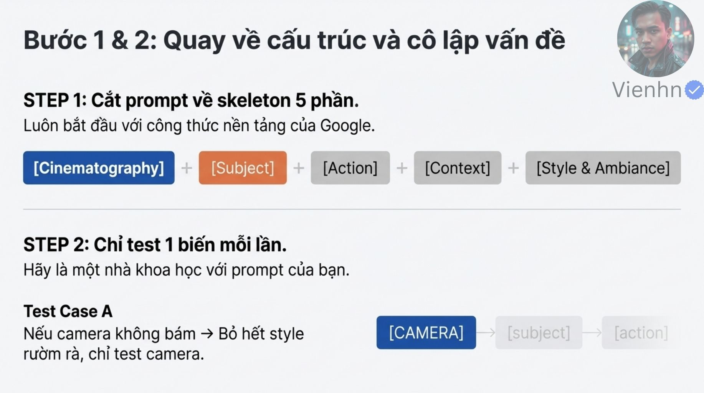

**Nội dung chính đọc được:** Hai bước đầu: dùng khung Cinematography, Subject, Action, Context, Style; khi lỗi camera có thể bỏ bớt phong cách để kiểm tra camera.

**Hình minh họa:** Khung năm thành phần và hướng thử nghiệm được phân thành bước.

**Phân tích bổ sung:** Tạo bản tối giản có thể thay nhiều biến cùng lúc: đó là dựng mốc ban đầu, chưa phải phép so sánh một biến. Sau khi có mốc ổn định, chỉ thay một thuộc tính. Với ảnh đầu vào, tránh mô tả lại dài dòng những gì ảnh đã cung cấp.

## B033-12 — Giữ một lựa chọn chính rồi thêm lớp

Tên gốc: `012.jpg`.

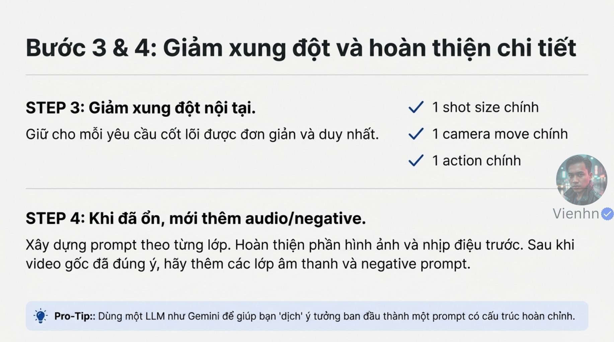

**Nội dung chính đọc được:** Nguồn khuyên một cỡ cảnh chính, một chuyển động chính, một hành động chính; khi ổn thì thêm âm thanh/negative. Có thể nhờ LLM như Gemini viết lại ý tưởng.

**Hình minh họa:** Các bước tiếp theo hướng tới prompt dễ kiểm soát hơn.

**Phân tích bổ sung:** Không bỏ ràng buộc quan trọng như một người chỉ để làm ngắn. Thêm câu rồi tạo lại là một lần sinh mới, không bảo đảm giữ nguyên video đã duyệt. LLM chỉ có thể chẩn đoán theo dữ liệu thực sự được cung cấp.

## B033-13 — Tổng kết ba hướng sửa

Tên gốc: `013.jpg`.

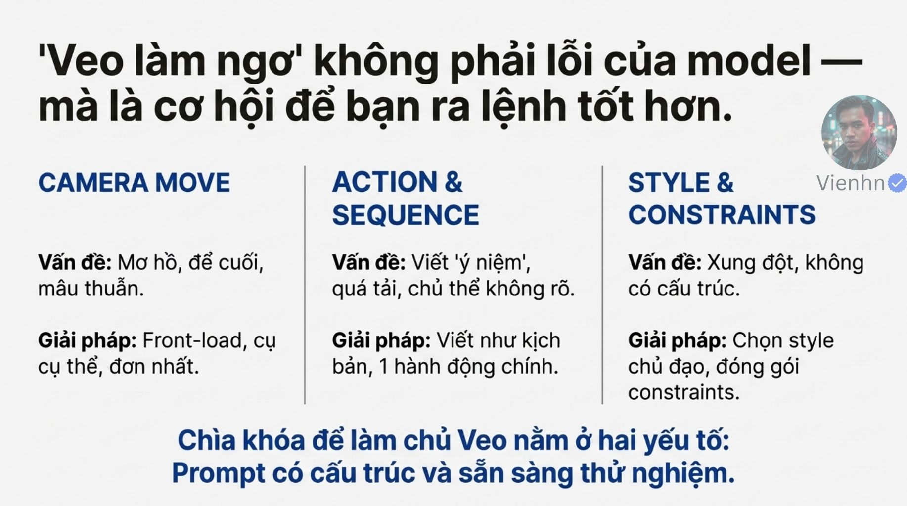

**Nội dung chính đọc được:** Ảnh kết nối Camera, Action Sequence và Style/Constraints với cấu trúc rõ và thử nghiệm.

**Hình minh họa:** Ba cột tổng kết đi cùng thông điệp cải thiện cách viết.

**Phân tích bổ sung:** Không kết luận mọi lỗi là lỗi người viết. Khi bản đơn giản vẫn thất bại, kiểm tra ảnh đầu vào, chế độ/tính năng thực tế và cân nhắc đổi cách quay hoặc dựng hậu kỳ.

## Kiểm kê

Đã mở trực tiếp 14/14 ảnh. Các mã nguồn theo thứ tự ở trên khớp [danh mục tệp](nguon.json). Chưa sinh hoặc đánh giá video từ câu lệnh của bài này.
