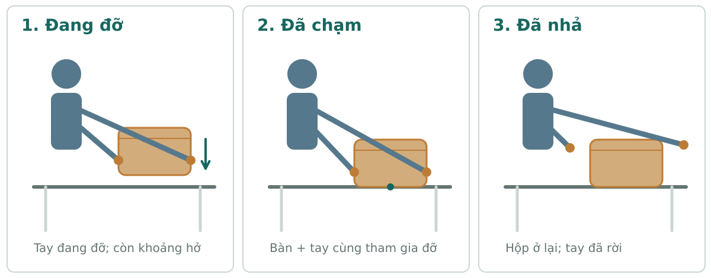
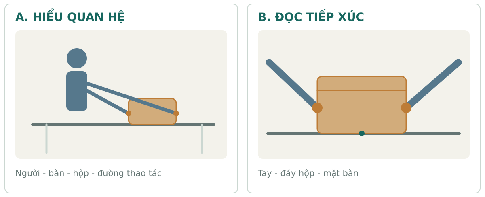
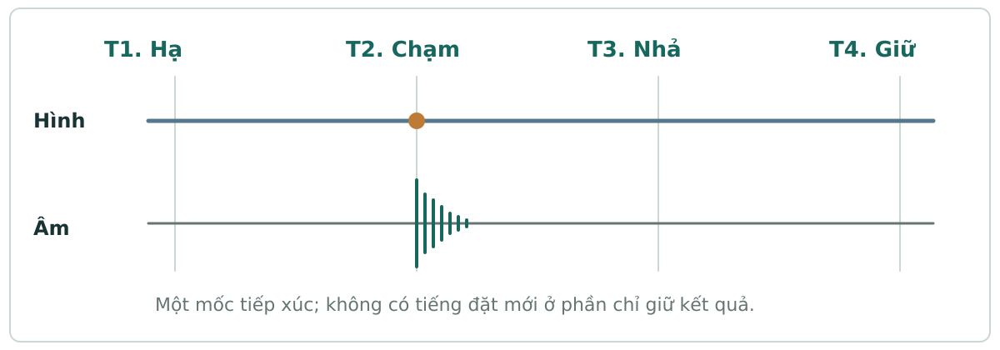

# Chương mẫu 01 — Một việc, ba cách kể

Từ điều muốn khán giả nhận được đến hình, âm và cách kiểm

Bản người học 0.1.0 · Core 1.3.1 · Mẫu để đọc thử.

[Mục lục](README.md) · [Bản PDF](SO_TAY_DIEN_ANH.pdf)

Một người mang hộp tới bàn, đặt xuống rồi mở nắp. Việc ấy có thể được kể để người xem dễ chịu, muốn khám phá hoặc chờ đợi một kết quả. Điểm bắt đầu là điều cần cho người xem hiểu và quan tâm; các lựa chọn hình–âm sẽ phục vụ điều đó.

## Sau bài này

- Nêu được người xem cần biết gì trước và sau một nhịp.
- Chọn khung hình theo bằng chứng cần thấy.
- Mô tả được đầu–chạm–nhả–kết thay vì chỉ yêu cầu hình đẹp.
- Tách ý đồ thiết kế khỏi điều đã quan sát hoặc đã kiểm với người xem.

## 1. Bắt đầu từ một việc

Tình huống tự biên soạn: một người lớn mang một hộp gỗ đóng tới bàn, hạ hộp xuống, nhả tay khi hộp có điểm đỡ rồi mở nắp. Cùng người, hộp và căn phòng được giữ xuyên chuỗi. Nội dung bên trong và hoàn cảnh được chọn theo từng cách kể.

Ảnh tạo bằng AI để minh họa một tình huống hư cấu. Một ảnh không xác nhận hướng chuyển động, thứ tự chạm–nhả hoặc phản ứng của khán giả.

**Điều nhìn thấy trong ảnh:** Một người, một hộp đóng, hai tay sát hai phía hộp; đáy hộp ở mặt bàn.

**Điều chưa thể xác nhận:** Người vừa đặt hay sắp nhấc hộp; tay có nhả sau tiếp xúc không; có âm gì và khớp lúc nào.

**Ý đồ cho video cần tạo:** Cho thấy hộp hạ xuống, đáy chạm bàn, tay nhả rồi hộp tiếp tục đứng ổn.

## 2. Cho người xem bằng chứng

**1. Đang đỡ:** Tay còn chịu lực; hộp chưa được mặt bàn đỡ. Cần thấy tư thế khả thi.

**2. Đã chạm:** Đáy hộp gặp bàn; tay vẫn giữ trong pha chuyển lực. Đây là mốc cần đọc.

**3. Đã nhả:** Tay rời sau khi hộp có điểm đỡ; hộp ở lại ổn định. Không đặt thêm một hộp khác.

Nguyên tắc thực hành: chọn các dấu đủ cho người xem hiểu việc đã xảy ra. Có thể lược một phần theo mục tiêu, nhưng đoạn còn lại cần cho phép hiểu đúng tiến trình.

## 3. Chọn khung theo thông tin

**A. Hiểu quan hệ:** Khung rộng hơn cho biết người, bàn, hộp và đường thao tác nằm ở đâu. Dùng khi quan hệ không gian đang cần được thiết lập.

**B. Đọc tiếp xúc:** Khung gần hơn giúp đọc đáy hộp, điểm đỡ và tay. Dùng khi chi tiết này là bằng chứng quan trọng; giữ đủ mặt bàn để còn hiểu chạm vào đâu.

Cả A và B đều có thể phù hợp. Chọn theo thông tin đang thiếu và quan hệ với cảnh trước/sau. Một khung có thể làm đủ hai nhiệm vụ; không có bộ toàn–trung–cận bắt buộc.

## 4. Một việc, ba hướng kể

### Bình yên, dễ theo

**Câu hỏi:** Việc gì đang được làm và khi nào đã ổn?

**Thông tin:** Cho mục tiêu và quan hệ rõ. Có thể cho biết đồ trong hộp sớm để chú ý vào cách làm và sự chăm chút.

**Hình:** Giữ đường thao tác và kết quả đọc được; máy tĩnh hoặc đi có lý do.

**Nhịp và âm:** Nén lặp theo lời hứa; dành nhịp nhận kết. Tiếng việc làm và nền nơi chốn dẫn khi có ích.

**Điểm cần cân nhắc:** Kéo dài mọi cảnh nhưng thiếu tiến triển có thể làm người xem mất việc để theo.

### Tò mò, muốn khám phá

**Câu hỏi:** Trong hộp là gì, và vì sao nó được mang tới đây?

**Thông tin:** Giữ đáp án ngoài khung nhưng cho đủ ngữ cảnh và một dấu gợi liên quan. Mỗi nhịp phải thêm điều để theo.

**Hình:** Chọn khung cho thấy việc chuẩn bị mở; thời điểm lộ vật trả đúng câu hỏi đã đặt.

**Nhịp và âm:** Tiếng nguồn hoặc một thao tác có thể gợi vật chưa lộ; khoảng chờ theo lượng thông tin.

**Điểm cần cân nhắc:** Giấu cả mục tiêu làm người xem không biết nên tò mò điều gì.

### Hồi hộp nhẹ, chờ kết

**Câu hỏi:** Đồ dễ vỡ bên trong có được đặt an toàn không?

**Thông tin:** Cần thiết lập trước giá trị của vật và điều khiến kết quả chưa chắc. Đây là thêm dữ kiện truyện, chỉ dùng khi yêu cầu cho phép.

**Hình:** Cho người xem nhận dấu chưa chắc rồi theo pha hạ, chạm và ổn định; kết bằng bằng chứng đã an toàn hơn.

**Nhịp và âm:** Giữ đúng phần chờ có ý nghĩa; chọn âm giúp theo sự kiện. Âm lớn hoặc cắt nhanh không tự thay phần thiết lập.

**Điểm cần cân nhắc:** Tự thêm nguy cơ sẽ đổi trải nghiệm. Với phim Farm đã chốt nhẹ nhàng, ưu tiên lời hứa đó.

Ba dòng trên là giả thuyết thiết kế. Người xem có thể cảm khác; màu, nhạc và cỡ cảnh không phải công tắc tạo cảm xúc. Khi đổi hoàn cảnh của truyện, cần ghi rõ phần đã đổi.

## 5. Tiếng chạm phải thuộc về một sự kiện

Nếu dùng tiếng tiếp xúc, đặt nó theo lúc đáy hộp gặp bàn trong bản dựng thực tế. Độ rõ và mức âm theo vật liệu, điểm nghe và mục tiêu; không phải mọi tiếng chạm đều cần được nhấn.

- Nghe và xem cùng lúc quanh mốc chạm.
- Không có tiếng đặt mới ở đoạn chỉ giữ hộp đã ổn.
- Nền và điểm nghe qua điểm cắt giữ quan hệ khi cần liền không gian.
- Chưa nghe âm thanh thì ghi chưa kiểm âm, kể cả hình trông hợp lý.

## 6. Một phiếu quyết định đã điền

| Cần chốt | Lựa chọn trong ví dụ |
| --- | --- |
| Giá trị cho người xem | Theo một thao tác nhỏ rõ ràng, nhẹ và có kết quả. |
| Phần phải giữ | Một người; cùng hộp và phòng; máy tĩnh; không thoại; không tự thêm nguy cơ. |
| Điều cần thấy | Hộp được hạ; đáy chạm; tay nhả sau điểm đỡ; hộp đứng ổn. |
| Khung và điểm nối | Đủ rõ quan hệ người–bàn; gần ở mốc tiếp xúc nếu cần. Mỗi điểm cắt nối đúng trạng thái hoặc báo được khoảng lược. |
| Âm | Tiếng tiếp xúc đúng sự kiện nếu được dùng; nền phù hợp, không tự phát sinh thoại hoặc nhạc trái yêu cầu. |
| Cách kiểm | Duyệt toàn đoạn quay/tạo, các điểm nối và cả chuỗi. Người mới kể được việc; cảm nhận thực tế hỏi riêng. |

**Mô tả ý đồ cho công cụ AI:**

> Một người hạ cùng chiếc hộp gỗ đóng xuống bàn. Hai tay giữ hộp khi đang hạ; đáy hộp tiếp xúc mặt bàn trước khi tay nhả. Hộp đứng ổn sau nhả. Giữ người, hộp, căn phòng và máy tĩnh đã duyệt. Không thoại. Âm, nếu tạo được, chỉ gồm tiếng thao tác và nền phù hợp.

Đây là mô tả ý đồ để chuyển sang cách nhập của công cụ thực tế. Khả năng giữ tham chiếu, độ dài, âm và cách điều khiển phải được kiểm theo mô hình/chế độ. Chữ trong yêu cầu chưa là kết quả đã đạt.

## 7. Tự làm một lần

Thiết kế chuỗi ngắn: mang hộp tới bàn → đặt xuống → mở nắp. Giữ một người, cùng hộp/phòng, không thoại và trải nghiệm nhẹ. Chọn số cú máy cần thiết, không bị buộc phải có ba cú máy.

1. Người xem cần biết điều gì trước khi nhìn cận?
2. Khoảnh khắc nào bắt buộc phải nhìn thấy trong lựa chọn của bạn?
3. Nếu bỏ một cú máy, còn đọc đúng việc không?
4. Bạn sẽ kiểm điều gì trên clip, và hỏi điều gì với người xem?

Gợi ý đối chiếu sau khi tự làm

Một phương án: khung quan hệ cho thấy người mang hộp tới bàn; khung gần đủ thấy đáy chạm rồi tay nhả; tiếp tục hoặc cắt tới lúc mở nếu trạng thái nối rõ. Giữ nhịp nhận kết; âm tiếp xúc thuộc đúng sự kiện. Một góc liên tục cũng được nếu làm đủ các nhiệm vụ. Kiểm hành động bằng video; hỏi người mới kể lại việc và cảm nhận, không gợi trước rằng họ phải thấy bình yên.

## Điều cần nhớ

- Bắt đầu từ điều người xem cần hiểu và nhận.
- Chọn hình để có bằng chứng, rồi chọn âm và thời gian hỗ trợ.
- Giữ phần đã duyệt khi sửa lỗi.
- Xem hình–âm thực tế trước khi báo đạt; ý đồ vẫn cần kiểm với người xem.

## Tra sâu theo mã

- [EV-001@1.0.0 — Tách quan sát, diễn giải và đề xuất](../kien-thuc/EV-001.json)
- [EV-004@1.1.0 — Độ phủ xem và những điều chưa biết](../kien-thuc/EV-004.json)
- [AU-001@1.1.0 — Bản yêu cầu trải nghiệm của khán giả](../kien-thuc/AU-001.json)
- [AU-003@1.3.0 — Thiết kế mong chờ và trả kết quả](../kien-thuc/AU-003.json)
- [AU-004@1.3.0 — Cảm xúc là diễn biến nhiều biến](../kien-thuc/AU-004.json)
- [ST-004@1.2.1 — Chuẩn bị, phát triển và trả kết quả](../kien-thuc/ST-004.json)
- [ST-006@1.3.0 — Điểm nhìn và phân phối thông tin](../kien-thuc/ST-006.json)
- [DR-002@1.3.0 — Dàn cảnh người–vật–không gian](../kien-thuc/DR-002.json)
- [DR-008@1.1.0 — Trọng lượng, thăng bằng và chuỗi tiếp xúc đáng tin](../kien-thuc/DR-008.json)
- [CA-001@1.1.0 — Cỡ cảnh theo thông tin phải thấy](../kien-thuc/CA-001.json)
- [CA-004@1.3.0 — Địa lý màn hình và hướng liên tục](../kien-thuc/CA-004.json)
- [ED-001@1.2.1 — Nhịp trong shot, giữa shot và toàn phim](../kien-thuc/ED-001.json)
- [ED-002@1.1.0 — Điểm cắt theo hành động, thông tin và phản ứng](../kien-thuc/ED-002.json)
- [SO-003@1.3.0 — Âm ngoài khung và phối cảnh âm](../kien-thuc/SO-003.json)
- [AI-003@1.1.0 — Hợp đồng hành động: đầu, tiếp xúc, biến đổi, cuối](../kien-thuc/AI-003.json)
- [AI-007@1.1.0 — Câu lệnh, thiết lập và hồ sơ năng lực mô hình](../kien-thuc/AI-007.json)
- [QC-001@1.3.0 — Duyệt theo mục tiêu và lỗi chặn sử dụng](../kien-thuc/QC-001.json)
- [QC-010@1.3.0 — Ổn định theo thời gian và đúng hành động là hai phép duyệt riêng](../kien-thuc/QC-010.json)

Các cách kể là phương án thiết kế chưa tạo clip/kiểm người xem. [Bản dữ liệu chương](chuong-01.json) · [Prompt và phương pháp hình](minh-hoa/manifest.json).
